# Claude Code & Codex 用エージェントダッシュボード

### Claude Code & Codex エージェント活動のためのリアルタイム監視プラットフォーム 🚀

Claude Code & Codex エージェントのセッション、ツール使用状況、サブエージェントのオーケストレーションをリアルタイムで追跡および視覚化するためのプロフェッショナルなダッシュボードです。Node.js、Express、React、SQLite を使用して構築されており、Claude Code および Codex のネイティブフックシステムと直接統合することで、シームレスなセッション追跡と分析を提供します。


> [!WARNING]
> **本リポジトリについて**: これは [hoangsonww/Claude-Code-Agent-Monitor](https://github.com/hoangsonww/Claude-Code-Agent-Monitor) を有志が個人的にフォークした**非公式**の日本語訳版です。Anthropic公式のツールではありません。
> - 翻訳はAI(Gemini)による機械翻訳ベースです。誤訳・不自然な表現が残っている可能性があります
> - 本家アップデートの追従は不定期です(メンテナは気が向いたときに追従します)
> - Issueでの報告は歓迎しますが、対応をお約束するものではありません。訳文の修正PRは歓迎します
> - 動作確認は **Windows + Claude Code** の組み合わせでのみ行っています。macOS/Linuxや他環境では未検証です

> [!TIP]
> 参照: [README-CN.md](./README-CN.md) (中文版本)、[README-VN.md](./README-VN.md) (Phiên bản tiếng Việt)、[README-KO.md](./README-KO.md) (한국어 버전)、および [README-ES.md](./README-ES.md) (versión en español) には、地域固有のヒントやベストプラクティスが記載されたローカライズ版のドキュメントがあります。

> [!NOTE]
> タスク指向のサポートが必要ですか？ [GitHub Wiki](https://github.com/hoangsonww/Claude-Code-Agent-Monitor/wiki) は、日常的な使用、チーム運用、トラブルシューティング、CLI/MCPの自動化、およびデプロイ手順のための実践的なハンドブックです。[ローカライズされた静的 Wiki](https://hoangsonww.github.io/Claude-Code-Agent-Monitor/wiki/) では、英語、ベトナム語、中国語、韓国語、スペイン語で製品およびアーキテクチャのツアーを引き続き提供しています。正確な技術仕様については [`docs/`](./docs/README.md) に記載されています。

---

## 目次

- [概要](#概要)
- [国際化 (i18n)](#国際化-i18n)
- [機能](#機能)
- [クイックスタート](#クイックスタート)
- [動作の仕組み](#動作の仕組み)
- [構成](#構成)
- [npm スクリプト](#npm-スクリプト)
- [プラグインマーケットプレイス](#プラグインマーケットプレイス)
- [エージェント拡張](#エージェント拡張)
- [MCP 統合](#mcp-統合)
- [API リファレンス](#api-リファレンス)
- [フックイベント](#フックイベント)
- [ブラウザ通知](#ブラウザ通知)
- [アップデート通知](#アップデート通知)
- [Tabby — フローティングキャットコンパニオン](#tabby--フローティングキャットコンパニオン)
- [接続状態モーダル](#接続状態モーダル)
- [VS Code 拡張機能](#vs-code-拡張機能)
- [デスクトップアプリ (macOS & Windows)](#デスクトップアプリ-macos--windows)
- [データストレージ](#データストレージ)
- [ステータスライン](#ステータスライン)
- [サーバーアーキテクチャ](#サーバーアーキテクチャ)
- [クライアントルーティング](#クライアントルーティング)
- [フックハンドラフロー](#フックハンドラフロー)
- [デプロイモード](#デプロイモード)
- [プロジェクト構造](#プロジェクト構造)
- [トラブルシューティング](#トラブルシューティング)
- [コントリビューション](#コントリビューション)
- [ライセンス](#ライセンス)

---

## 概要

洗練されたダークテーマのウェブインターフェースを通じて、セッションの追跡、エージェントのリアルタイム監視、ツール使用状況の視覚化、およびサブエージェントのオーケストレーションの観察を行います。ネイティブフックシステムを介して、Claude Code および Codex と直接統合されます。

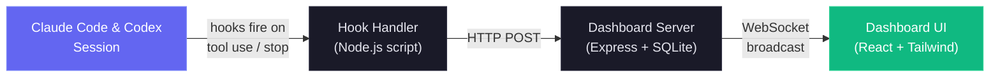

リアルタイムの監視ダッシュボードに加えて、ダッシュボード自体を検査および管理するためのツールのカタログを公開するローカル MCP サーバー実装（`mcp/`）も含まれており、ダッシュボードの操作を Claude Code や Codex のワークフローに直接統合することが容易になります。さらに、エージェント拡張レイヤーもあり、ダッシュボードとのインタラクション、分析、およびワークフローインテリジェンスのための Claude Code & Codex プラグイン、スキル、およびサブエージェントを提供します。

### 国際化 (i18n)

UI には、英語 (`en`)、中国語 (`zh`)、ベトナム語 (`vi`)、韓国語 (`ko`)、およびスペイン語 (`es`) を切り替えるためのロケール切り替え機能が組み込まれています。言語が追加されてもサイドバーが混雑しないように、カスタム言語ドロップダウンが採用されています。言語リソースはネームスペースごとにロードされ、ブラウザのストレージを通じて保存されるため、再読み込み後もユーザーの好みが安定して維持されます。

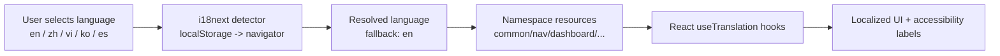

全体的なアーキテクチャや運用ガイドについては、[docs/I18N.md](./docs/I18N.md) を参照してください。

### ユーザーインターフェース

エージェントのアクティビティを探索するための、洗練されたダークテーマ、レスポンシブデザイン、および直感的なナビゲーションを備えています。

> [!NOTE]
> **このフォーク限定: ライトテーマ**。**設定 → 外観(Appearance)** から明るい背景のライトテーマに切り替え可能です(デフォルトはダークテーマのまま)。本家には無い、このフォーク独自の追加機能です。

<p align="center">
  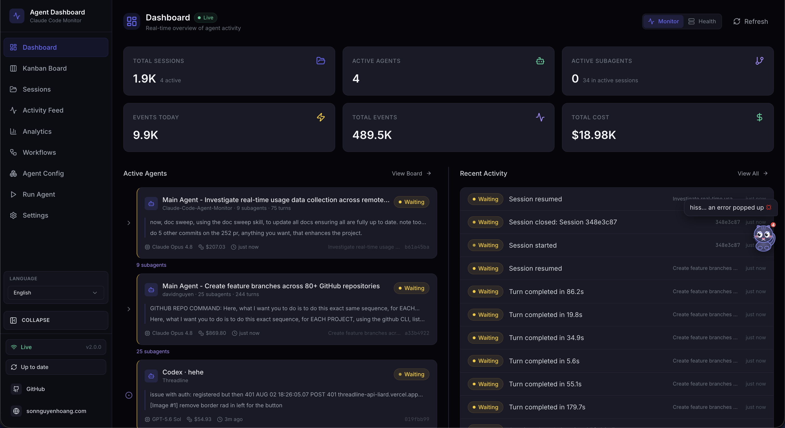
  <br>
  <em>📡 <strong>ダッシュボード · モニター</strong> — 概要統計、アクティブなエージェントカード、および最近のアクティビティフィード</em>
</p>

<p align="center">
  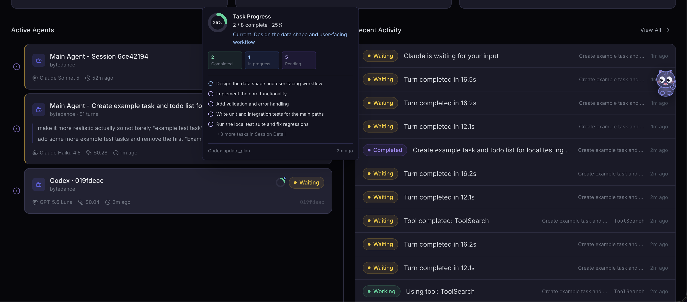
  <br>
  <em>📋 <strong>タスク進捗 · 概要</strong> — ダッシュボードのエージェントカードとセッションの行では、ステータスの横に同じコンパクトな完了ドーナツが表示されます。ホバーまたはフォーカスすると、現在の作業とタスクのステータスを所有者ごとにプレビュー表示します</em>
</p>

<p align="center">
  
  <br>
  <em>🩺 <strong>ダッシュボード · ヘルス</strong> — 総合ヘルススコアリング、ストレージエンジンのドーナツチャート、キャッシュヒット/エラー/成功ゲージ、ツール呼び出しの棒グラフ、サブエージェントの有効性、モデルごとのトークン分布、コンパクション統計など — すべて 5 秒ごとに自動更新されます</em>
</p>

<p align="center">
  
  <br>
  <em>📋 <strong>カンバンボード (エージェント)</strong> — 作業中 (Working) / 待機中 (Waiting) / 完了 (Completed) / エラー (Error) の 4 つの列に状態ごとにグループ化されたエージェント。黄色の 待機中 (Waiting) 列は、ユーザー入力（権限プロンプト、ターンの終了、または新規プロンプトでの待機）を待ってブロックされているセッションを表示します。待機中バッジにホバーすると、その<em>理由</em> (入力が必要 / ターン完了 / プロンプト待機 / 中断) が表示されます。各カードにはモデル、コスト、現在のツールが一目でわかるように表示されます。</em>
</p>

<p align="center">
  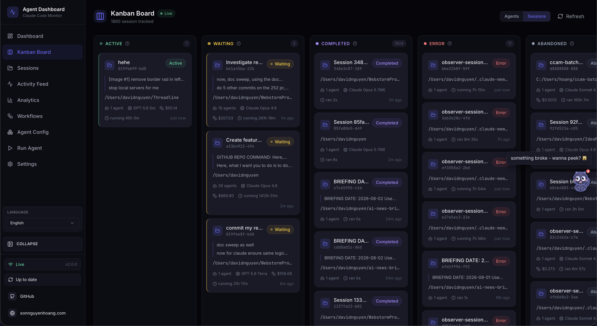
  <br>
  <em>🗂️ <strong>カンバンボード (セッション)</strong> — アクティブ (Active) / 待機中 (Waiting) / 完了 (Completed) / エラー (Error) / 中断 (Abandoned) の 5 つの列に状態ごとにグループ化されたセッション。同じページで切り替え可能です。列のヘッダーにホバーすると、ライフサイクルの移行を説明するツールチップが表示されます。</em>
</p>

<p align="center">
  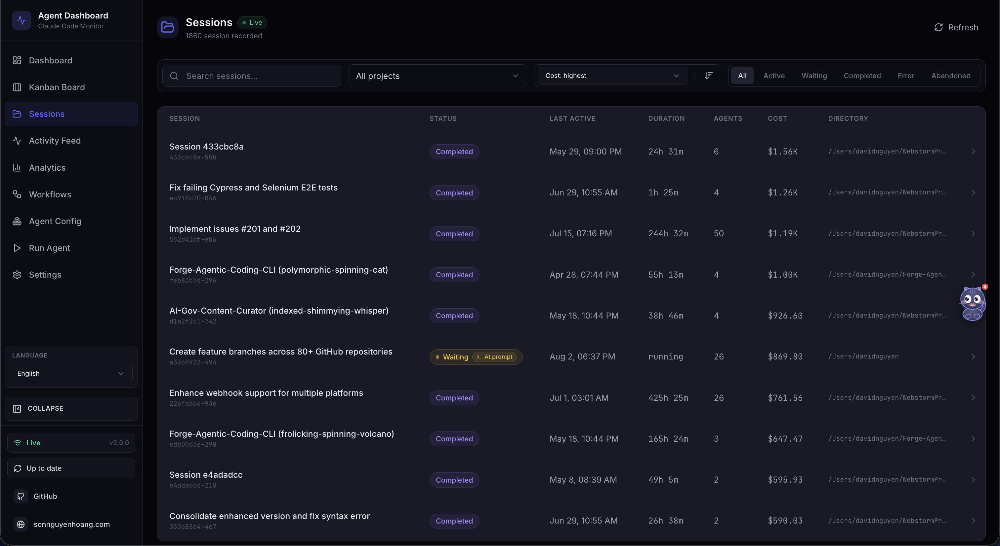
  <br>
  <em>📂 <strong>セッション</strong> — コスト、モデル、エージェント数、所要時間を含む、記録されたすべてのセッションの検索・フィルタリング可能なサーバーサイドページネーション対応テーブル。プロジェクトセレクタは検索可能な複数選択をサポートし、ソートにはカスタムメニューを使用します</em>
</p>

<p align="center">
  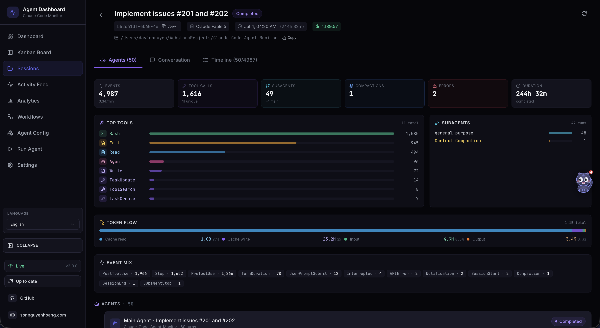
  <br>
  <em>🤖 <strong>セッション詳細 · エージェント</strong> — リアルタイムの概要タイル（イベント、ツール呼び出し、サブエージェント、コンパクション、エラー、所要時間）、使用頻度の高いツールの棒グラフ、サブエージェントタイプの分析、トークンフロー、およびエージェントの階層ツリー</em>
</p>

<p align="center">
  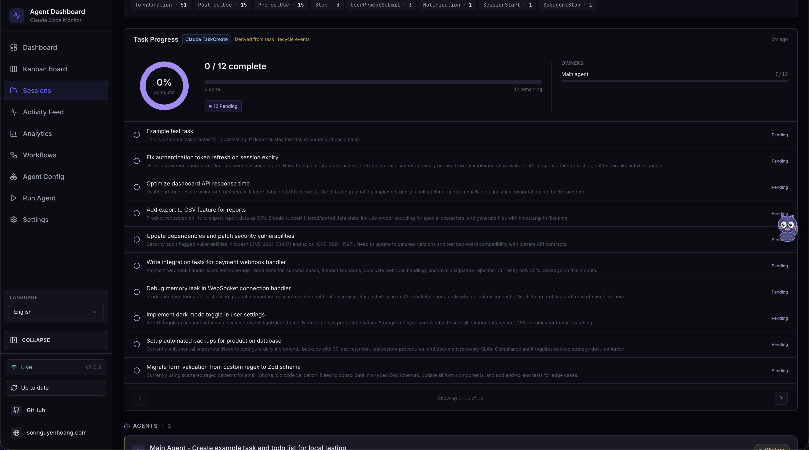
  <br>
  <em>✅ <strong>タスク進捗 · セッション詳細</strong> — 所有者を認識するフル機能のトラッカーは、分割された完了ドーナツ、アクティブな作業、完了バー、所有者分析、および 1 ページあたり 10 行のページネーションされたタスクリストを組み合わせたものです</em>
</p>

<p align="center">
  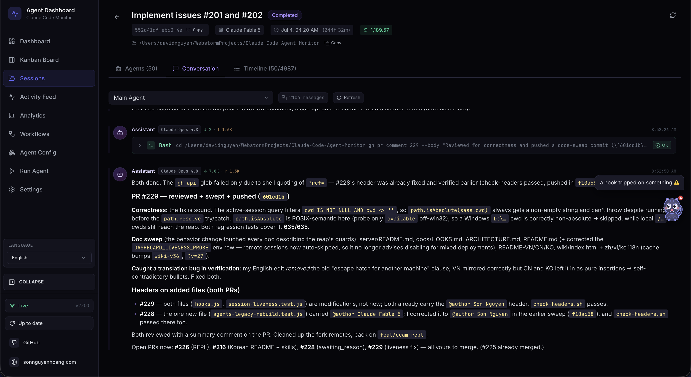
  <br>
  <em>💬 <strong>セッション詳細 · 会話</strong> — マウンダウンレンダリング、シンタックスハイライト付きコードブロック（行番号 + コピー機能）、ツールごとのスタイル付きツール呼び出し、キャプチャされた TUI 出力を伴うスラッシュコマンドピル、およびインラインのセッション名変更マーカーを備えたライブトランスクリプトビューア</em>
</p>

<p align="center">
  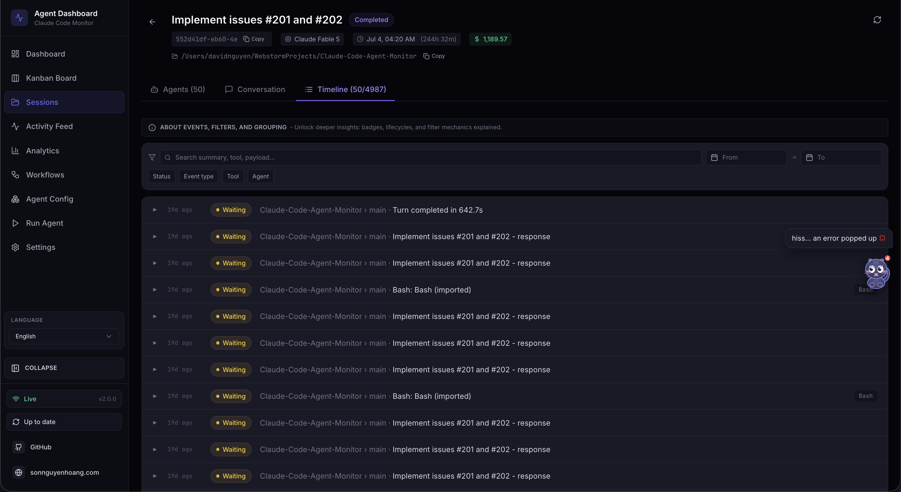
  <br>
  <em>🔬 <strong>セッション詳細 · タイムライン</strong> — 多次元フィルター、`tool_use_id` によるプレ/ポストグループ化、およびツールに対応したペイロードレンダラーを備えた時系列のイベントタイムライン</em>
</p>

<p align="center">
  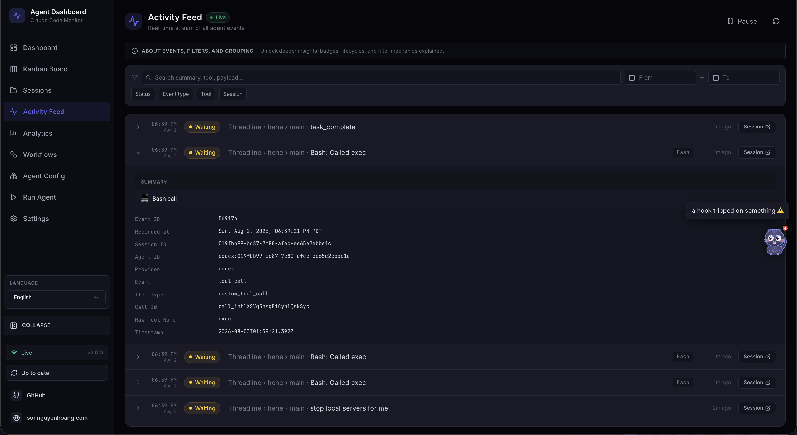
  <br>
  <em>📰 <strong>アクティビティフィード</strong> — 一時停止/再開機能、グループ化、多次元フィルター、および各行の "Session →" (セッションへジャンプ) ボタンを備えたリアルタイムのイベントログ</em>
</p>

<p align="center">
  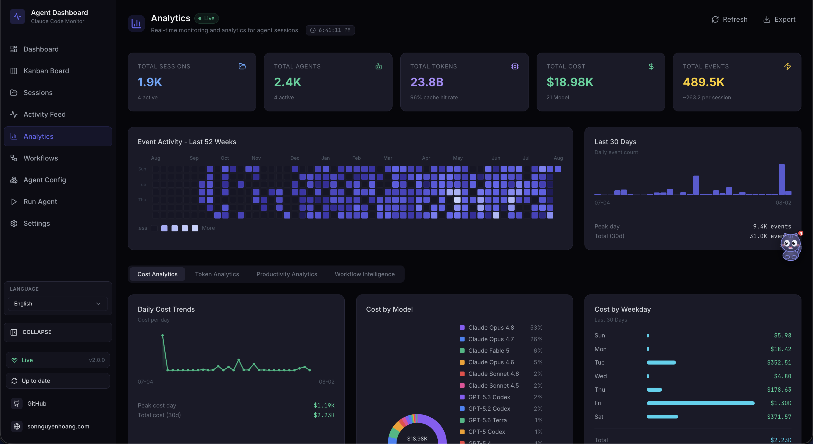
  <br>
  <em>📊 <strong>分析</strong> — モデル別のトークン使用量、ツール頻度、アクティビティヒートマップ、ライブ/オフラインインジケーターを備えたセッショントレンド。長いチャートの凡例はページネーションされ、短い凡例はそのまま表示されます</em>
</p>

<p align="center">
  
  <br>
  <em>🔀 <strong>ワークフロー</strong> — エージェントのオーケストレーション DAG、ツール実行のサンキーダイアグラム、コラボレーションネットワーク、制限付きデータ駆動の凡例、およびワークフローインテリジェンスの 11 のインタラクティブなセクション</em>
</p>

<p align="center">
  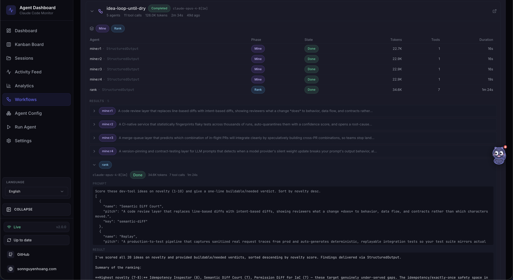
  <br>
  <em>🧬 <strong>ワークフロー実行 (ワークフローページ)</strong> — `Workflow` ツールによって生成された「動的ワークフロー」で、ディスク上の実行ジャーナルから再構成されます。ステータス、エージェント数、トークン、およびツール呼び出しが表示され、人間が読みやすい結果のプレビューとともにエージェントごとの詳細（フェーズ、ステータス、トークン、ツール、所要時間）を展開して表示できます</em>
</p>

<p align="center">
  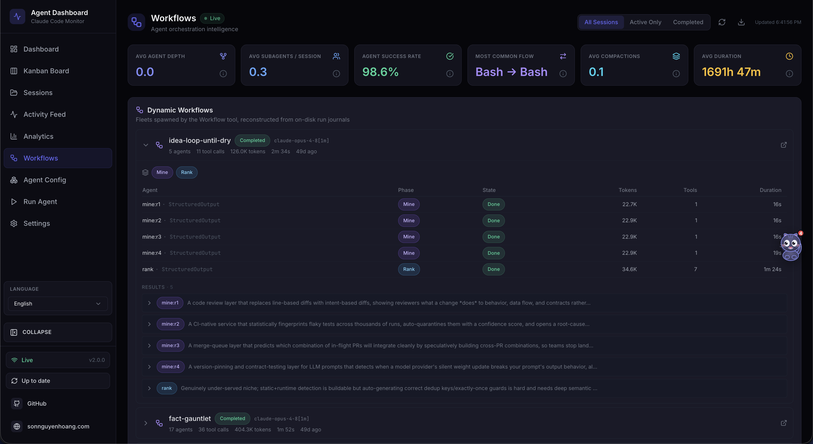
  <br>
  <em>🧬 <strong>ワークフロー実行 · 展開時</strong> — 展開された実行内容：クリック可能な色分けされたフェーズフィルター、エージェントごとのメトリクステーブル、およびクリックすると各エージェントの完全なプロンプトと結果が展開される結果アイテムの全リスト</em>
</p>

<p align="center">
  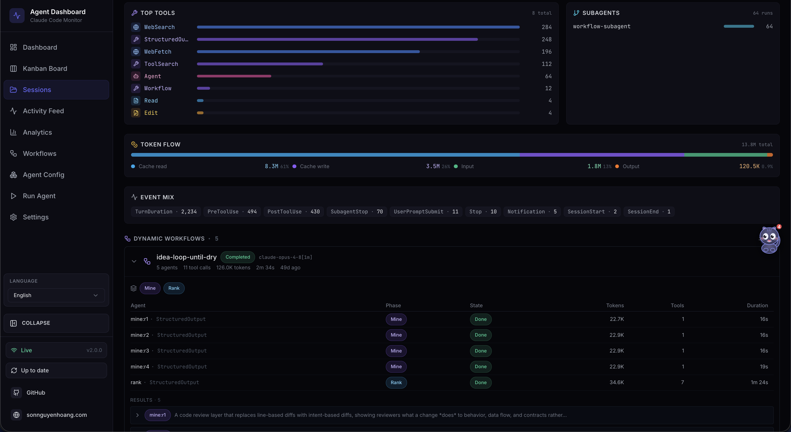
  <br>
  <em>🧬 <strong>ワークフロー実行 (セッション詳細)</strong> — 生成元のセッションにリンクされた同等のフリート。これにより、セッションの動的ワークフローサブエージェントと、それらが消費したトークンコストがインラインで表示されます</em>
</p>

<p align="center">
  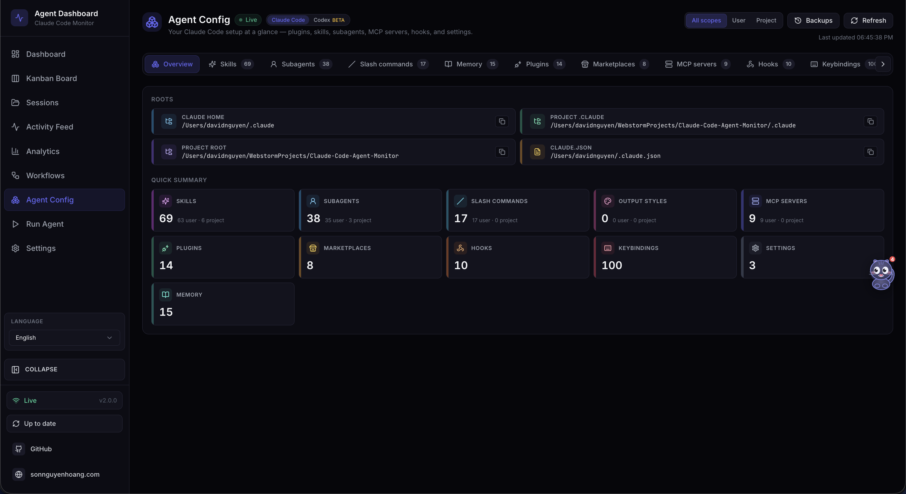
  <br>
  <em>🧰 <strong>エージェント設定</strong> — 完全な Claude Code エクスプローラーと、デフォルト設定、モデル、プロファイル、MCP、プロジェクト、スキル、ルール、フック、プラグイン、および指示（Instructions）を確認するためのライブ Codex ワークスペースを切り替えます。Codex のプレビューではシークレットが墨塗りされます。ユーザーが管理する設定、フック、ルール、スキル、および指示は、バックアップを取りながら安全に編集できます。</em>
</p>

<p align="center">
  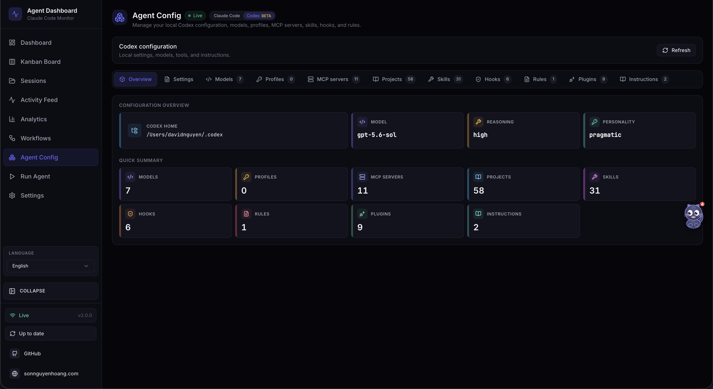
  <br>
  <em>🧰 <strong>Codex 設定エクスプローラー</strong> — Codex ワークスペースには、`config.toml`、アカウントモデル、プロファイル、MCP サーバー、プロジェクト、スキル、フック、ルール、プラグイン、および指示が集約されています。サポートされているユーザー管理ファイルはタイムスタンプ付きのバックアップを取った上で編集でき、`config.toml` は編集専用です。</em>
</p>

<p align="center">
  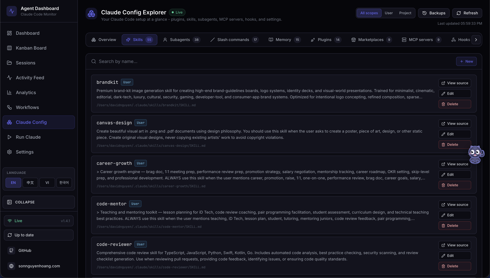
  <br>
  <em>🧩 <strong>Claude 設定エクスプローラー · スキル</strong> — スキルタブには、発見されたすべてのスキル（ユーザー、プロジェクト、プラグイン）が説明やソースとともに一覧表示され、全体から検索することができます。また、タイムスタンプによるバックアップを行いつつ、安全にスキルファイルを編集できます</em>
</p>

<p align="center">
  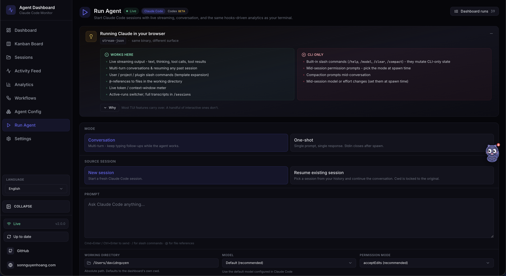
  <br>
  <em>▶️ <strong>エージェントの実行</strong> — ランチャーを開くたびに Claude Code または Codex を選択します。Claude は 会話 / ワンショット コントロールを維持します。Codex は、独自の承認およびサンドボックスコントロールを備えたネイティブのインタラクティブなアプリサーバースレッドを開始します。Codex モデルはサインインされた CLI カタログから動的に取得され、Claude は観測されたモデルとサポートされているエイリアスをリストアップします。</em>
</p>

<p align="center">
  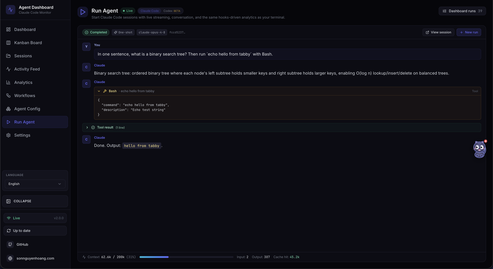
  <br>
  <em>💬 <strong>エージェントの実行 · ライブストリーム</strong> — Claude の stream-json および Codex の app-server イベントは両方とも、推論、コマンド、ファイル変更、ツールのアクティビティを含んだチャットとしてレンダリングされます。ダッシュボードの Runs では、エージェントをバックグラウンドで動作させたままにし、後で再接続することができます。</em>
</p>

<p align="center">
  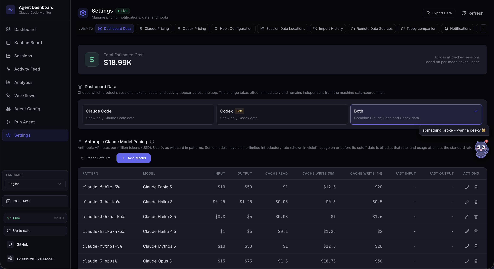
  <br>
  <em>⚙️ <strong>設定</strong> — モデルの価格設定ルール、フックのインストール状態、データ管理、通知の優先設定、およびシステム情報</em>
</p>

<p align="center">
  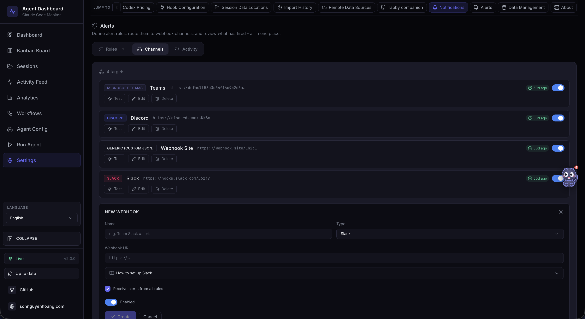
  <br>
  <em>🔔 <strong>設定 · アラート</strong> — ルールベースのアラートエンジンとアウトバウンド Webhook を一箇所で管理：アラート規則（イベントパターン / 非アクティブ / 停止中のエージェント / トークンしきい値）を各ルールごとのクールダウン付きで設定可能。発動したアラートのライブフィード、14 のファーストクラス Webhook プロバイダー（Slack、Discord、Teams、Google Chat、Mattermost、Rocket.Chat、Telegram、PagerDuty、Opsgenie、Splunk On-Call、Zapier、Make、n8n、Pipedream）、およびオプションの HMAC 署名を備えた汎用 JSON エンドポイントをサポート</em>
</p>

<p align="center">
  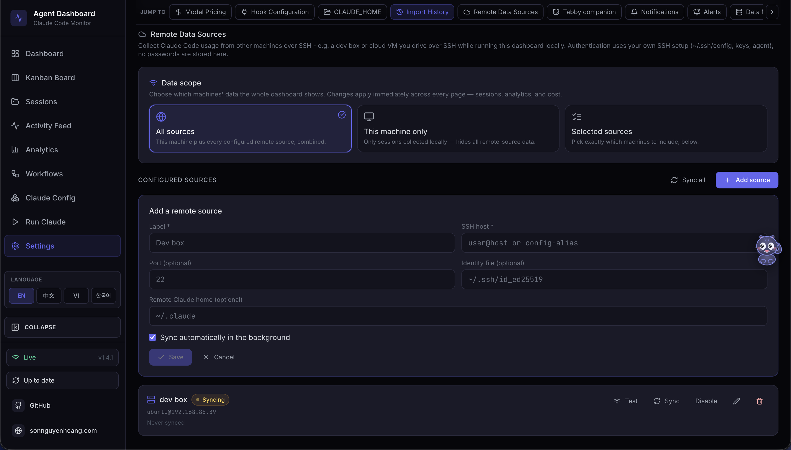
  <br>
  <em>🛰️ <strong>設定 · リモートデータソース</strong> — SSH 経由で他のマシンの Claude Code および Codex のアクティビティを取得します：オプションで独立した Remote Claude ホームパスと Remote Codex ホームパスを設定し、各プロバイダーをテストし、手動またはバックグラウンドのポーラーで同期できます。また、グローバルデータの範囲を「ローカル」、「すべてのソース」、または「特定のマシン」の間で切り替え、セッションごとのソースバッジを表示できます</em>
</p>

サイドバーを使用すると、ダッシュボード、カンバンボード、セッションリスト、アクティビティフィード、分析、ワークフロー、および設定へ素早くアクセスできます。各ページは、リアルタイムの更新と豊富な視覚化により、Claude Code エージェントのアクティビティについて深いインサイトを提供するように設計されています。

---

## 機能

ダッシュボードは、Claude Code のセッションとエージェントを監視・分析するための包括的な機能セットを提供します：

> **Cursor のセッションについても（参考情報）：** CCAM は `~/.claude` 配下に保存されるすべてのエージェントトランスクリプト（このマシンおよび同期されたリモート上のもの）を取り込みます。**Cursor** の使用状況も同様にカウントされます。これは、Cursor がエージェントセッションを Claude Code と同じパスに保存するためです。CCAM はどのアプリがファイルを書き込んだかを区別しません。

| Feature                            | Description                                                                                                                                                                                                                                                                  |
|------------------------------------|------------------------------------------------------------------------------------------------------------------------------------------------------------------------------------------------------------------------------------------------------------------------------|
| **Task Progress**                  | プロバイダーの監視可能な状態（現在の Claude `TaskCreate` / `TaskGet` / `TaskUpdate` / `TaskList` およびライフサイクルイベント、レガシーの `TodoWrite`、そして直接または統合実行ラップされた Codex の `update_plan`）から派生した所有者属性付きのタスク追跡。タスク状態を持つセッションは、セッションテーブルおよび各ダッシュボードのエージェントカードのステータスの横に、コンパクトなドーナツグラフとポータルレンダリングされたホバー/フォーカスプレビューを表示します。セッション詳細には、ステータスセグメント、アクティブな作業、所有者の内訳、10 件ずつページングされたタスク行を含むフルプログレスパネルが表示されます。進捗は最新の最上位の作業にスコープされます：トラッカーが発行されない新しい Claude の人間のターンや Codex タスクは古い状態をクリアし、そのターン/タスクが最終更新なしで終了した場合は未完了の状態が破棄されます。完全に完了した履歴は引き続き表示されます。 |
| **Dashboard**                      | `localStorage` に保持される2つのタブ：**Monitor** — 概要統計（6つの統計カード）、折りたたみ可能なサブエージェント階層を持つアクティブなエージェントカード、および `ResizeObserver` を介して利用可能なビューポートの高さを埋める動的アイテム数を持つ最近のアクティビティフィード。**Health** — 複合システムヘルススコアリング（重み付け：0.4 × 成功率 + 0.25 × キャッシュヒット率 + 0.25 × (100 - エラー率) + 0.1 × (100 - ヒープ % )）、レコード分布を示すストレージエンジンドーナツチャート、キャッシュパフォーマンス / エラー率 / 成功率のゲージ、ツール呼び出しの水平バーチャート（トップ8）、サブエージェントの有効性バー、モデルトークン分布、およびコンパクションの影響統計。すべてのヘルス指標は `/api/settings/info` および `/api/workflows` から 5 秒ごとに自動更新されます。すべてのチャートでビューポートの端を検出するカーソル追従型ツールチップを備えています。 |
| **Kanban Board**                   | ヘッダのトグルを持つ2つのビュー（`localStorage` に保持）：**Agents** — 4列（Working / Waiting / Completed / Error） — および **Sessions** — 5列（Active / Waiting / Completed / Error / Abandoned）。**Waiting** 列はエージェント上の永続化された `waiting` ステータスに直接マッピングされます。これは Claude Code がプロンプト入力待ち（新しいセッション、ターン間、またはパーミッション通知でブロックされた状態）の時に設定され、ユーザーが再開した瞬間（UserPromptSubmit / PreToolUse）に `working` に遷移します。各列のヘッダには、ライフサイクルの遷移を説明する `?` ツールチップが表示されます。カードはサーバーから永続化されたステータスによってフェッチされ（実質的にステータスごとに無制限）、1列あたり 10 枚のカードで「Show more（さらに表示）」アフォーダンスを使ってクライアントサイドでページネーションされます。WS サブスクリプションはアクティブなビュー（`agent_*` vs `session_*` フレーム）にスコープされるため、ビュー外の更新によって再フェッチがトリガーされることはありません。Waiting バッジはホバーツールチップとして行の `awaiting_reason`（待機理由）を公開します — **Needs input**（`notification`）、**Turn done**（`stop`）、**At prompt**（`session_start`）、**Interrupted**（`interrupted`）。タイトルがスペースを確保できるようにコンパクトカードではツールチップのみに保持され、より広い領域（セッションテーブル、セッション詳細ヘッダ）では理由がネストされたチップとしてインラインでも表示され、緊急の理由（パーミッションプロンプト、中断）はより熱いアンバー色で表示されます。 |
| **Sessions**                       | 記録されたすべてのセッションの、検索可能、フィルタリング可能で、**サーバーページネーション**されたテーブル。各ページクリックは `/api/sessions?status=&q=&limit=10&offset=…` にヒットするため、コスト計算は可視ページに対してのみ実行され、データベースに存在するセッション数には依存しません。最初のページでは、ダッシュボードやカンバンで表示されるのと同じローカルのインメモリ Codex 起動行も選択されます。これはすぐに表示されますが、永続的なセッション ID に置き換わるまではナビゲートできず、永続的な合計数やページネーションには影響しません。検索ボックス（`q=`）はサーバー上で `id` / `name` / `cwd` にまたがる大文字小文字を区別しない一致を 300 ms のデバウンスで実行し、応答にはページネータ UI 用の `total` カウントが含まれます。ステータスフィルター、検索、ページネーションは構成可能です。各セッションの人間が読める **name**（名前）はトランスクリプトから読み取られ、リアルタイムで同期されます — `/rename`、`claude -n`、またはピッカーの `Ctrl+R` からの明示的なタイトル（JSONL の `custom-title` 行）が常に優先され、それがない場合は自動生成された `ai-title` が埋められ、それもない場合はセッションの**最初の人間のプロンプト**（ツール結果 / スラッシュコマンドのノイズをスキップして切り詰められたもの）がプレースホルダー名とメインエージェントのプレースホルダー名/タスクを埋めます。これにより、タイトルが付けられなかったセッション（インポートされたものを含む）でも、何をしているかがわかります。ダッシュボードでは、カード、ダッシュボード、アクティビティフィード、および実行の再開ピッカーで、その名前（短い ID へのフォールバック付き）が表面化されます。 |
| **Session Detail**                 | アクティブなエージェントバナー（現在のツール + タスク）、6つのタイルカウンター（イベントと1分あたりのイベント率、ツール呼び出し、サブエージェント、コンパクション、エラー、刻む継続時間）、トップツール使用状況バー、サブエージェントタイプの内訳、スタックされたトークンフローストリップ、およびイベントタイプのピルクラウドを備えた、セッションごとのリアルタイム概要パネル — これらはすべてフックイベントでライブ更新されます。その下には：エージェント階層ツリー、多次元フィルター（ステータス、イベントタイプ、ツール、エージェント、テキスト検索、日付範囲）を備えた完全なイベントタイムライン、`tool_use_id` による Pre/Post グループ化、人間が読めるサマリーブロック、ツール対応の入力/応答レンダラー（Bash 用ターミナル、Edit 用の統合差分、Read/Write 用の行番号付きコード、Grep 用の照合リスト、MCP ツール用のキー/値カード）、およびトランスクリプトをレンダリングする Conversation タブがあります。これには、ターンの中途で入力されたメッセージ（Claude がまだ動作している間にキューに入れられたもの）が Claude が実際にそれらを受け取った場所に配置され、システムに起因するハーネス通知が含まれます。Markdown（見出し、リスト、引用、テーブル、タスクリスト）、行番号とクリップボードへのコピー機能を備えた構文ハイライトされたコードブロック（js/ts, python, json, bash, html, css, sql, yaml, diff）、ツールごとにスタイル設定されたツール呼び出し（Bash → ターミナル、Edit → 並べて表示（旧/新）、Write → ファイルラベル、Read → パスチップ、Grep → パターンカード）を備えています。セッションが人間によってブロックされている場合、ヘッダの下の黄色の **waiting-for-input バナー**には、`awaiting_reason`、その説明、およびセッションがどのくらい待機しているか（点滅するドット + 相対時間）が示されます。ヘッダの Waiting バッジには同じ理由がネストされたチップとして含まれます。 |
| **Activity Feed**                  | 一時停止/再開、多次元フィルター（Session Detail と同じツールバーに Session フィルターを追加）、サーバードリブンの「Load more（さらに読み込む）」ページネーション、読み込まれたページサイズを維持するデバウンスされたフィルター対応のライブ更新、グループ化トグル、project › session › subagent を示す起点プレフィックス、および行ごとの「Session →」ボタンを備えたリアルタイムストリーミングイベントログ。 |
| **Analytics**                      | トークン使用量、ツール頻度、アクティビティヒートマップ（中央揃え、日曜日始まりの曜日合わせ、曜日名のツールチップ）、セッショントレンド、ライブ/オフライン接続インジケーター。分析ペイロードが読み込まれる間、チャート領域（統計タイルだけでなく）にはチャートのレイアウトを反映した**点滅するスケルトンプレースホルダー**が表示されるため、ページが空/ゼロのチャートを瞬間的に表示することはありません。Analytics と Workflows の長い凡例はページネーションされます。1ページに収まる凡例は変更されません。 |
| **Live Updates**                   | WebSocket プッシュ -- ポーリングなしで、即座に UI が更新されます。 |
| **Auto-Discovery**                 | セッションとエージェントは、プロバイダーのシグナルから自動的に作成されます。Claude Code は `SessionStart` で即座に **Waiting** カードを作成します。Codex は、対話型の TUI プロセスが開始されるとすぐに、Codex が安定したセッション ID を割り当てる前も含めて、ローカルのインメモリ **Waiting** カードを最初に公開します。フック、ライブスレッドの行、またはロールアウトによって永続的なセッションが作成され、その一時的なカードが置き換えられます。ユーザーが Codex の再開ピッカーを開いて既存のスレッドを選択した場合、CCAM はその正確な Codex PID によってすでに開かれているロールアウトまたはライターロックを検出し、最初の新しいメッセージの前に永続的な再開セッションに切り替えます。ID付与前のカードは、SQLite、履歴、分析、価格設定、ワークフロー、アラート、または完了通知に書き込まれることはなく、プロセスが終了すると消滅します。 |
| **History Import**                 | プロバイダー対応の履歴インポートは、Claude Code トランスクリプトを `~/.claude/` から、Codex のロールアウト JSONL を `~/.codex/sessions` から取り込みます。各タブには独自のデフォルトパス、手順、フォルダスキャン、およびアップロードフローがあります。どちらもライブインジェストロジックを再利用し、トークン/コスト/ツールの計算を保持し、冪等性があります。外部の Codex ロールアウトはダッシュボードのストレージにスナップショットされるため、アーカイブまたはソースフォルダが削除された後もその会話は利用可能です。 |
| **Subagent Hierarchy**             | Dashboard および Session Detail 上の折りたたみ可能な親子エージェントツリー。サブエージェントを持つエージェントには展開/折りたたみのシェブロンが表示されます。リーフエージェントにはドットインジケーターが表示されます。サブエージェントがアクティブな場合は自動で展開されます。 |
| **Background Agents**              | バックグラウンド化されたサブエージェントを時期尚早に完了することなく正確に追跡します。 |
| **Subagent Tool Attribution**      | サブエージェント内部のツール呼び出し (Read, Bash, Edit, Grep, …) は、サブエージェントごとの JSONL ファイル内にのみ存在します — Claude Code はそれらに対するフックを発行しません。各 `SubagentStop` 時にダッシュボードは、各 `subagents/agent-*.jsonl` を解析し、`tool_use` ブロックを `tool_use_id` によって一致する `tool_result` とペアリングし、サブエージェント自身の `agent_id` の下に `PreToolUse` + `PostToolUse` イベントを発行する、投げっぱなしの `scanAndImportSubagents` パスを実行します。冪等性（`data LIKE '%"tool_use_id":"X"%'` による重複排除）があり、タイプ + 開始時間が 30 秒以内のライブフック作成されたサブエージェント行とマージされるため、並列の `<sid>-jsonl-*` 行が作成されることはありません。完全な履歴バックフィルのための `npm run setup` 起動時インポートでも同じパスが実行されます — ダッシュボードよりも前のセッションでも、完全なサブエージェントごとのツールタイムラインが取得されます。Activity Feed と Session Detail は、ネストされたサブエージェントのために親チェーンを `main › coder › explorer` としてレンダリングします。そのチェーンは `reconcileSubagentParents` によって権威的に再構築されます。サブエージェント行は最初メインエージェントの下にフラットに挿入され（単一のフックイベントまたは JSONL ファイルはスポーン者の ID を保持していません）、その後、各サブエージェントトランスクリプトの Task ツール結果（`spawnedChildren` としてキャプチャされた `toolUseResult.agentId`）からスポーン者が復元されるため、自身のサブエージェントをスポーンするサブエージェントはメインの下に1階層に折りたたまれるのではなく、**本当の**スポーン者の下にネストされます。これは冪等的かつ追加的であり — `parent_agent_id` のみを再指定し、行の挿入や削除は行いません — 同じ `SubagentStop` スキャン上で実行され、再親付けのみによってツリー構造が変更された場合でもダッシュボードが再フェッチするように `reparented` カウントを返します。 |
| **Cost Tracking**                  | 構成可能な価格ルールとセッションごとの内訳を備えたモデルごとのコスト見積もり。**期間限定の導入レート**（価格ルール上の `intro_*` + `intro_until`）をサポート：カットオフ日以前の使用量は導入レートで価格付けされ、それ以降は標準レートで価格付けされます。したがって、Claude Sonnet 5 のローンチ割引（2026-08-31まで）のようなプロモーションは、履歴的**および**将来の使用量に対して正しいまま保たれます — コストエンドポイントは、各日の使用量をその日付に有効なレートで価格付けします。**導入レートは設定で完全に編集可能**です — モデル価格設定エディターには、プロモーションのカットオフ日とカテゴリごとの導入価格（入力 / 出力 / キャッシュ読み取り / キャッシュ書き込み 5m & 1h）が表示されるため、将来のモデルのローンチプロモーションではコードの変更は不要で、編集のみで対応できます。**サブエージェントのカードには、各サブエージェントの自分自身のコストが表示されます**（そのサブエージェントのトランスクリプトのトークン使用量から派生し、現在のレートで価格付けされたもの）。セッションの合計ではありません — メインエージェントのカードがセッション全体を代表してセッションの合計を示し、サブエージェントのカードはそのサブエージェントが費やしたもののみを示すため、サブエージェントのカードがセッション全体のコストであるかのように誤解されることはなくなりました。コンパクション対応のトークン集計により、コンテキスト圧縮全体で合計が維持されます。トランスクリプトの読み取りは、効率的なトークン抽出のために増分バイトオフセットの更新でキャッシュされます。 |
| **Transcript Cache**               | JSONL トランスクリプトからのリアルタイム抽出：トークン、コンパクション、API エラー（`APIError` イベントとして保存される `isApiErrorMessage` エントリ）、ターンの期間（`TurnDuration` イベントとして保存）、思考ブロックの数、および使用量の追加情報（service_tier、speed、inference_geo）。ターンの期間は安定したトランスクリプトのアイデンティティを保持します。完全な解析はレガシーの重複行と膨れ上がったメタデータの合計を修復し、キャップ付きの末尾解析は追記のみにとどまります。エントリごとに拡張可能な配列は、`TRANSCRIPT_CACHE_MAX_ARRAY_LEN`（デフォルト `1000`、設定可能）で末尾がキャップされるため — 解析時と確定時の両方で — 何日も実行されるセッションであっても、単一のキャッシュエントリが際限なく拡張されることはありません。各エントリは `{mtimeMs, size, bytesRead, result}` のみを格納するため、トップレベルと `result` 内の両方に同じデータのシャドウコピーが存在することはありません。セッションメタデータはリアルタイムでこれらのフィールドによって強化されます。 |
| **Notifications**                  | 信頼性の高い配信のための完全な Web Push (VAPID) パイプライン。タブがバックグラウンドにある場合やブラウザが閉じられている場合でも到達します。macOS のオーディオサポートのために明示的に設定されています。サブスクリプション管理機能付きの、イベントごとに設定可能なトグル。 |
| **Alerts**                         | ルールベースのアラートエンジン — 全て **設定 → アラートと通知**（ルール / チャンネル / アクティビティ のタブ付きコントロールセンター、別ページなし）で設定されます。4つの条件タイプでアラートルールを定義します — **イベントパターン**（イベントタイプ / ツール名 / サマリーテキストの一致、オプションでタイムウィンドウ内にN回の一致するイベントが必要、例：「2分間に5回以上のエラー」）、**非アクティブ**（N分間イベントのないアクティブセッション）、**停止中のエージェント**（N分間アクティビティがなく `working`/`waiting` に座っているエージェント）、および **トークンしきい値**（制限を超えたセッショントータルトークン）。イベント駆動のルールは全てのフックインジェスト時にサーバーサイドで評価されます（インジェストトランザクション後 — アラートがフック配信を遅くしたり失敗させたりすることはありません）。時間ベースのルールは 60 秒のスイープで実行されます。発動したアラートはルールごと＋セッションごとの **クールダウン重複排除**（デフォルト 300 秒）付きで `alert_events` に保持され、`alert_triggered` WebSocket メッセージとしてブロードキャストされ、**アクティビティ**タブのライブフィードに、確認（acknowledge） / 全て確認、未確認のみのフィルター、アラートごとの「セッションを表示」リンクとともに表示されます。ルールは有効/無効の切り替えをサポートし、削除時にはその履歴をカスケードします。発動したアラートは、**チャンネル**タブで設定された **ユニバーサル Webhook ターゲット**にもファンアウトされます — **14のファーストクラスプロバイダー**と汎用エンドポイント：**Slack**、**Discord**、**Microsoft Teams**、**Google Chat**、**Mattermost**、**Rocket.Chat**（ネイティブチャットペイロード）；**Telegram**（Bot API）、**PagerDuty**（Events API v2）、**Opsgenie**（Alert API + GenieKey 認証）、**Splunk On-Call**（VictorOps REST）；および **Zapier**、**Make**、**n8n**、**Pipedream**、または任意の**汎用**エンドポイント（オプションの **HMAC-SHA256** 署名とカスタムヘッダーを備えたクリーンな JSON エンベロープ）。各プロバイダーはサーバーサイドのレジストリによって記述され、ペイロードフォーマッター、URL の解決方法（一部のものはクレデンシャルから導出します — 例：ボットトークンからの Telegram、リージョンからの Opsgenie — その他はデフォルト化）、および UI がレンダリングするクレデンシャルフィールドを宣言します。ターゲットはオプションのルールごとのスコープ指定、同期の「テスト送信」プローブ、および記録された配信ログをサポートします。配信はアラートパスから切り離され、リクエストタイムアウトと制限された再試行/バックオフで実行されるため、監視を遅らせたりブロックしたりすることはありません。ターゲット URL、シークレット、クレデンシャルフィールドはサーバーサイドに保存され、API によって返されることはありません（全てのレスポンスでマスク/編集されます）。 |
| **Update Notifier**                | サーバーは非ブロッキングな `git fetch` を定期的に実行し、ローカルのチェックアウトと `origin/master`/`origin/main`/`origin/HEAD` を比較します。アップストリームが先行している場合、UI は正確な `git pull && npm run setup` コマンドとワンクリックの **Copy（コピー）** ボタンを備えたモーダルを表示します。サイドバーにはライブバッジ付きの永続的な「Check for updates（更新の確認）」ボタンが追加されます。ダッシュボード自体がプルや再起動を行うことはありません — ユーザーがターミナルでコマンドを実行します — そのため、このメカニズムが開発セッション、pm2/systemd/Docker による監視を壊したり、孤児プロセスを残したりすることはありません。 |
| **Settings**                       | システム情報、フックの状態、モデルの価格設定管理、通知設定、データのエクスポート**と復元**（履歴のインポートパネルの **バックアップの復元** モードは、最大 25 MiB のエクスポート `.json` を1つ受け入れ、既存の行を上書きすることなく冪等に再インポートするため、複数のマシンの履歴を1つのダッシュボードに統合できます）、セッションのクリーンアップ。モデル価格設定セクションは、**Anthropic Claude Model Pricing** と **OpenAI GPT Model Pricing** を一致したヘッダレイアウトで分離し、プロバイダースコープの **デフォルトにリセット** および **モデルを追加** コントロール、そして初回一致ルールの検索、SQL スタイルの `%` ワイルドカード構文、手動での価格更新、API レートの注意点について説明する情報ポップオーバーを備えています。GPT ポップオーバーはまた、100万トークンあたりの USD 単位、272K の短/長の境界、Fast モードのレート、未公開のティアが見積もられずに未設定のままになる理由についても説明しています。**ダッシュボードデータ** コントロールは、Claude Code、Codex、またはその両方のセッション、エージェント、イベント、トークン、ワークフロー、分析、およびコストを直ちに再フェッチします。個別の Claude Code および Codex ホームの入力は完全に i18n 駆動であり、実行時に保存されます。Codex の保存は、ライブロールアウトの監視を再アクティブ化し、その新しいツリーをスキャンします。 |
| **Run Agent + Agent Config**       | `/run` は Claude Code / Codex の選択から始まり、ライブステータスの横にプロバイダートグルを保持します。Claude の実行では、ヘッドレスおよび stream-json 会話モードが保持されます。Codex の実行では、CLI のローカルな `app-server` プロトコルを使用して、真のインタラクティブスレッド、ネイティブの承認/サンドボックスポリシー、再開、停止、ライブ出力、および再アタッチを実現します。Codex モデルの選択肢はサインインされた CLI から直接取得されるため、モデルリリースはダッシュボードの更新を必要としません。Claude は、耐久性のあるエイリアスに加えてローカルで観察されたモデルを表示します（CLI にはモデルリストのコマンドがないため）。`/cc-config` は、確立された編集可能な Claude Code エクスプローラーと Codex ワークスペースを組み合わせ、設定のデフォルト、モデルキャッシュ、プロファイル、MCP、プロジェクト、スキル、ルール、フック、インストールされたプラグイン、および指示ファイルを管理します。通常のプレビューではシークレットが墨塗りされます。明示的なローカルエディターは、`config.toml`、`hooks.json`、ユーザールール、スキル、および指示のアトミックな保存と必須のタイムスタンプ付きバックアップをサポートしますが、構文を検証できないという警告が表示されます。Codex プロファイルのコマンドと管理対象のアーティファクトパスはワンクリックでコピーでき、プラグインカードはキャッシュフォルダーを表示するのではなく、Codex のインストール済みプラグインレジストリを使用します。どちらのエクスプローラーもプロバイダー固有のファイルシステムウォッチャーを通じて更新されます。 |
| **Codex Agent Config**             | Agent Config の Codex 側は、モデルがゼロであると誤って表示する可能性のある一般的なプレビュー制限なしでローカルアカウントのフルモデルカタログを読み取り、常にベース/プロファイルのオーバーライドを含みます。アプリ内で直接標準の Codex `<name>.config.toml` オーバーレイを作成できます。各カードは正確な `codex --profile <name>` コマンドをワンクリックでコピーし、保護されたエディターを開きます。プレビューパスは包含チェックの前に正規化されます。エディターは信頼できるルート以下のシンボリックリンクされたパスコンポーネントを拒否し、カノニカルな親の包含を検証し、`[redacted]` プレビューコンテンツを拒否します。プロファイル、フック、ルール、スキル、および指示は Claude スタイルの **ソースの表示 / パスのコピー / 編集 / 削除** アクションを共有します。すべての許可された削除は確認され、最初にバックアップされます（スキルはそのディレクトリ全体を保持します）。`config.toml` は永続的に編集専用です。 |
| **MCP Server (Local)**             | `mcp/` 内にある包括的なローカル MCP サーバー。3つのトランスポートモード (stdio, HTTP+SSE, 対話型 REPL) と 16 のドメインモジュールにわたる 97 の型付きツールを備えています。これらは可観測性、スコープされたセッション/エージェント/イベント、トランスクリプトと画像、Claude/GPT の価格設定、ワークフロー、アラート、Webhook、インポートとバックアップ復元、Claude/Codex 設定、Run Agent、リモートソース、フック/ホーム/アップデート、プッシュ、およびメンテナンスをカバーします。プロトコルと REPL モードは検証済みの1つのカタログを共有し、localhost 専用ターゲットと段階的なミューテーション/破壊的ゲートを備えています。直接的なループバック HTTP はベアラートークンを運ぶことができます。トークン化されたコンテナホストのエイリアスには HTTPS が必要です。リダイレクトは拒否され、アップロードはファイルあたり 50 MiB、コールあたり 100 MiB に、バイナリ応答は 10 MiB に、バックアップ復元は 25 MiB に制限されます。 |
| **Workflows**                      | 11のインタラクティブなセクションを持つ D3.js 駆動の視覚化ページ：エージェントオーケストレーション DAG、ツール実行のサンキーダイアグラム、コラボレーションネットワーク、サブエージェントの有効性（カードの `overflow:hidden` から逃れ、クリップされないようにビューポートにクランプされたポータルレンダリングされたツールチップを備えた曜日ごとのスパークライン）、検出されたワークフローパターン、モデルの委任フロー、エラー伝播マップ（レートバッジ付きの水平バー、エージェントタイプの内訳、API/セッションエラーカード）、同時並行性タイムライン、セッションの複雑さの散布図、コンパクションの影響分析（明確な「コンパクション数によるセッション」ヒストグラムとして再設計され、軸タイトル、統計タイル — 合計 / 影響を受けたセッション / 平均 / ピーク — 説明のヘルプライン、およびバーごとのホバーツールチップ付き）、およびセッションごとのドリルイン。各セクションの右揃えのサブタイトルは1行に制限（省略記号＋ホバータイトル）されるため、長い翻訳でもヘッダが折り返されることはありません。**全体にわたるリッチな i18n 対応ツールチップ：** すべてのチャートのセクションタイトルには `i` アイコンが付いており、構造化された「これが示すもの / 読み方 / なぜ重要か」というポップオーバーが開きます。ノード、エッジ、バー、バブルにホバーすると、決定的で値に依存する解釈（例：ソースのシェア / ターゲットのシェアのパーセンテージ、成功率のヘルスバケット、Opus / Sonnet / Haiku のファミリ説明、フロントロード / ミッドセッション / バックロードのようなタイミングパターン）を持つマルチセクションのツールチップが表示されます。6つの主要な統計カードそれぞれには、指標がどのように計算され、その現在の値が何を意味するのかを平易な言葉で説明するインフォポップオーバーが右下にあります。ツールチップは、再レンダリング後にカーソルから遅れたり残ったりしないように、コンテナレベルの `mouseleave` フォールバックを持つチャートごとの単一の参照を通じて DOM 操作されます。**Detected Workflow Patterns** の行をクリックすると、完全なステップシーケンス、統計グリッド、決定論的な説明（ループ検出、頻度バケット）、および実践的な提案を備えたインプレース詳細パネルが展開されます。ステータスフィルタータブ（Active Only / Completed / All）は 11 のセクションすべてをフィルタリングします。クロスフィルタリング、JSON エクスポート、および 3 秒のデバウンスを備えたリアルタイム WebSocket 自動更新機能。**Workflow Runs** パネルは「動的ワークフロー」— `Workflow` ツールとセルフペースの `/loop` によって生成されたサブエージェントのフリート — を表面化します。これらはフックを発行せず、ディスク上の実行ジャーナル (`workflows/wf_<runId>.json`) から再構築されます：各実行はそのフェーズとエージェントごとのトークン / ツール呼び出し / 継続時間の内訳を示し、ジャーナルが書き込まれる前にライブでの `running` 検出と、各セッション詳細ページでのリンクされたサブセクションを備えています。 |
| **Compaction Tracking**            | JSONL トランスクリプトから `/compact` イベントを検出し、コンパクションのエージェントとイベントを作成します。起動時にレガシーのコンパクションをバックフィルします。定期的なスキャナー（`DASHBOARD_STALE_MINUTES` から導出された頻度）は、フックが発行されない場合でもコンパクションを捕捉します。各アクティブセッションのトランスクリプトパスを `sessions.transcript_path`（最初にあるフックハンドラと `events` からの1回限りのバックフィルによって入力される）から直接読み取るため、イベントテーブル全体に対して `SELECT DISTINCT json_extract(events.data, '$.transcript_path')` を行う必要がなく、スイープは O(アクティブセッション) であり、成熟したデータベース上でも低コストです。トランスクリプトのキャッシュを共有するため、ファイルの重複読み取りは発生しません。合成のコンパクション行は `started_at` と `ended_at` の両方にトランスクリプトのタイムスタンプが刻印されるため、継続時間は正確に 0 になります（コンパクションは瞬時です）。起動時の修復マイグレーションは、`ended_at < started_at` となっている既存の行も修復します (issue #156)。 |
| **Subsessions/Resumed Sessions**   | 新しいイベントが到着すると自動的にセッションを再アクティブ化し、`/resume` や孤児になったセッションを正しく処理します。定期的なスイープ（`DASHBOARD_STALE_MINUTES` の ¼ ごと、60 秒〜5分にクランプ）は、イベントベースの検出をすり抜けた放棄されたセッションをマークします。 |
| **Pre-Existing Session Detection** | サーバー起動時にすでに実行中のセッションは（最近の JSONL ファイルの更新に基づいて）「アクティブ」としてインポートされます。停止イベントもインポートされた完了/放棄セッションを再アクティブ化するため、進行中のセッションからの最初のフックは常にダッシュボード上に表示されます。 |
| **Continuous Project Sync**        | `~/.claude/projects` の起動時自動インポートは1回限り（マーカーでゲートされている）であるため、初回起動**後**に作成されたプロジェクトフォルダー — そのセッションがフック経由で流れない場合（例：ホストのみのフックが無効化されている場合） — は、手動での再スキャンまで不可視のままになります。バックグラウンド同期 (`startSessionSync`) は、1つの mtime キャッシュと単一の統合スイープを共有する3つのトリガーを介してそのギャップを埋めます：起動時の**即時**スイープ、新しいセッションファイル/プロジェクトフォルダーが現れた瞬間に発火するデバウンスされた **`fs.watch`**（macOS/Windows では再帰的、Linux ではユーザーランドの再帰ウォッチャーの危険を回避するためにルート＋直下の子）、および**定期的なポーリング**（`DASHBOARD_SESSION_SYNC_MS`、デフォルト 30 秒）。各スイープは、mtime が進んだファイルのみを再解析し、`session_created`/`session_updated`（およびメインエージェント）をブロードキャストするため、UI がライブで更新されます。DB 内にすでに存在する変更のないセッションは再解析なしでスキップされるため、再起動コストは O(新規/変更されたファイル) に保たれます。 |
| **Remote Data Sources**            | SSH 経由でのライブ リモート / マルチマシンの Claude Code および Codex 収集。1つのソースは、**scp**、または Windows SSH ホスト上の WSL でホストされた CLI 用に `wsl.exe` + `tar` を介して `~/.claude/projects` および `~/.codex/sessions`（ネイティブな名前のタイトル用の Codex の軽量な `session_index.jsonl` を含む）を独立してミラーリングします。隔離された各ステージはそのプロバイダーの通常のインポーターを通過し、行に `sessions.source` のタグを付けます。いずれかのプロバイダーが利用可能な場合、ソースは正常であるため、Claude のみ、Codex のみ、混合のいずれのマシンでも機能します。15 秒の `DASHBOARD_REMOTE_SYNC_MS` ポーラーと即時の追加/再有効化によるプルは、プロバイダー対応の `remote_source.status`、`remote_data.updated`、およびセッションごとの更新をブロードキャストします。リモートのライフサイクルは、ミラーリングされた各トランスクリプトから調整されます。プロバイダーが利用できない、エラーになる、または `DASHBOARD_STALE_MINUTES` を超えて同期が停止した場合、そのプロバイダーの古いリモートセッションのみが通常のステータススイープのフォールバックの対象となります。健全な兄弟プロバイダーはミラー所有のままです。オプションで独立した **Remote Claude ホーム** と **Remote Codex ホーム** のパスを **設定 → リモートデータソース** で設定するか、`ccam remote-sources` を使用します。SSH 認証は完全にホスト側に保持されます（パスワード/シークレットは保存されません）。 |
| **Responsive Design**              | スタッキンググリッド、スクロール可能なテーブル、折りたたみ可能なサイドバーを備えたモバイルフレンドリーなレイアウト。 |
| **UI Localization**                | 英語 (`en`)、中国語 (`zh`)、ベトナム語 (`vi`)、韓国語 (`ko`)、スペイン語 (`es`) に翻訳された UI コピーとアクセシビリティラベルを備えた、組み込みのカスタムドロップダウン言語切り替え。カバレッジは Workflows ツールチップまでエンドツーエンドに及びます：統計カードの計算と値バケットの解釈、チャートごとの「何 / 読み方 / なぜ」ポップオーバー、すべてのグラフのホバーツールチップ（オーケストレーション、ツールフロー、パイプライン、モデル委任、並行性）、ワークフローパターンの詳細パネルの説明と提案、設定 → モデルの価格設定の情報ポップオーバー、CLAUDE_HOME パネル、および履歴インポートフロー全体が含まれます。 |
| **Seed Data**                      | デモおよび開発用の組み込みシードスクリプト。 |
| **Statusline**                     | モデル、コンテキスト使用量、git ブランチ、方向ごとのトークン、セッションコスト (USD) を表示する色分けされた CLI ステータスライン。 |
| **Model Name Formatting**          | UI 全体での人間が読めるモデル名：`claude-opus-4-7-20260101` や `claude-opus-4-7[1m]` のような生の識別子は「Claude Opus 4.7」や「Claude Opus 4.7 (1M)」として表示されます。自動バージョン ドット結合、日付/最新接尾辞の削除、プロバイダープレフィックスの削除、コンテキストウィンドウタグのフォーマットを用いて Claude、GPT、Gemini ファミリを処理します。設定ページは、価格ルール設定のために生の識別子を保持します。 |
| **Claude + Codex Plugin Marketplace** | 1つの 14 プラグイン ソースツリーから、正準な Claude マニフェスト、Codex `.codex-plugin/plugin.json` マニフェスト、両方のマーケットプレイスカタログ、66 のバンドルされたプラグインスキル、18 の Claude サブエージェント、34 の Claude コマンド、3 つの CLI ヘルパー、および OpenAI スキルメタデータを出荷します。`skills.sh` CLI は `npx skills add hoangsonww/Claude-Code-Agent-Monitor --list` で合計 75 のリポジトリスキルを発見します。`claude plugin marketplace add`、`codex plugin marketplace add`、または `npx skills add` でインストールします。 |
| **Run Claude**                     | チャットスタイルのストリーミング UI でダッシュボードから直接 `claude` サブプロセスを起動します。2つのモード：**Conversation（会話）**（複数ターン — stdin は開いたままで、フォローアップターンは stream-json エンベロープとしてパイプされます）および **One-shot（ワンショット）**（ヘッドレス、単一プロンプト → 単一応答）。Conversation モードはまた、`claude --resume <id>` 経由で**既存のセッションの再開**をサポートし、検索可能なピッカーで過去のセッション全体から選択できます。統合されたアクティブな実行 / 履歴モーダルには、設定不要の2つのジャンプボタンもあります：過去の会話行で **Resume（再開）** を押すと、直ちに `claude --resume <id>` が起動され、前のトランスクリプトをチャットにシードするため、完全なコンテキストがあるライブビューに着地します（プロンプトを再入力する必要はありません — フォローアップを送信するまで stdin で待機します）。過去の One-shot 行で **View（表示）** を押すと、キャプチャされたトランスクリプトが読み取り専用で実行ビューアにインライン読み込みされます（起動は行われません — 同じパネル、停止/フォローアップコントロールなし）。ヘッダのアクティブな実行スイッチャーを使用すると、実行をバックグラウンドに残したまま、別の実行を開始し、後で再アタッチできます。再アタッチは永続的です：クライアントは、起動元のインメモリーのエンベロープログ (`?envelopes=1`) をディスク上のセッションの JSONL トランスクリプトと照合し、ユーザー/アシスタントのメッセージ数が多い方を優先します。そのため、再開された実行から移動して戻ってきた場合でも、以前の完全な履歴が表示され続けます（起動元は起動後のターンのみを認識しますが、トランスクリプトファイルには以前＋現在の情報があります）。モデルドロップダウン（Opus 4.7 / 1M / Sonnet 4.6 / Haiku 4.5 / カスタム）、明示的な `bypassPermissions` の警告を備えたパーミッションモードピッカー、**思考の労力（thinking-effort）**フィールド（低 / 中 / 高 — `--effort` に連動）、ユーザーの**ホームディレクトリ**が事前入力された cwd オートコンプリート — これは、ダッシュボードリポジトリ自体の `.claude` プロジェクトコンテキスト（エージェント、スキル、ルール、`CLAUDE.md`、`.mcp.json`）を継承しない中立的な起動場所です。ホームの提案が利用できない場合はダッシュボードの cwd にフォールバックし、提案グループ（ホーム → ダッシュボード → 最近）の最初にホームがリストされます。`--include-partial-messages` によるリアルタイムの文字単位のストリーミングに加え、クライアントサイドの**タイプライター スムージング レイヤー**を備えており、各 `text_delta` / `thinking_delta` を `requestAnimationFrame` を通じて滴らせることで、短い返信（claude が全体を 1、2 チャンクにまとめる場合）でもタイプされているように見えます。統合コードは、ストリームの途中で claude の正準な `assistant` エンベロープが到着した場合でも `_streaming` フラグと累積された `content` 配列をそのまま維持するため、完了時に思考ブロックがドロップされることはありません。WebSocket のディスパッチは各エンベロープを `flushSync` でラップし、React の自動バッチ処理によってデルタのバーストが単一のレンダリングに折りたたまれるのを防ぎます。**TUI パリティ (Tier 1)**：stream-json モードとターミナル TUI の違いを説明する、スリムなピルに最小化される（消えることはない）折りたたみ可能な**制限事項バナー**。ユーザー / プロジェクト / プラグインコマンドを一覧表示し（送信前にクライアントサイドでテンプレート展開を介して実行）、`/clear`、`/model`、`/config` などの組み込み CLI コマンドを「CLI専用 — ここからは実行されません」バッジと共に表示する、階層的なスコアリング（完全一致 → 前方一致 → 単語境界 → 含む → サブシーケンス → 説明に含む）を備えた**スラッシュコマンド オートコンプリート付きのプロンプトエディター**。実行の cwd 実行の cwd 全体でデバウンスされたファジー検索（`node_modules`、`.git`、`dist`、`build` などをスキップ）を行う **`@`-ファイル参照**。入力 + 出力 + キャッシュ読み取りのトークンと実行コストを示す**ライブ コンテキストウィンドウ / トークンメーター**。これは、ライブストリーミング中は `stream_event` と `result.usage` のエンベロープから計算され、再開 / 表示 / 再アタッチのトランスクリプトからシードされる場合は最終的なアシスタントの `usage` ブロック（入力 / 出力 / キャッシュ読み取り / キャッシュ作成）から計算されるため、メーターは 0/200k のままになるのではなく、即座に入力されます。プログレスバーは、モデルのコンテキスト制限の 80% / 95% でインディゴ → アンバー → 赤に変わります。アクティブなモデル、労力、パーミッションモード、cwd、セッション ID、エンベロープ数、および経過時間を示す**ステータスヘッダ**。オートコンプリートのドロップダウンは、下の cwd ピッカーと衝突しないように上向きに開きます。タイトルの横にある ライブ / オフライン インジケーター。ルートの Same-origin ガードにより、ブラウザのドライブバイ起動を防止します。同時並行性はデフォルトで事実上無制限です（バグのあるクライアントによるフォークボムの暴発を防ぐための上限 10000。ターミナル TUI には制限がなく、我々にもありません）。実際の上限が必要な場合は `RUN_MAX_CONCURRENT` を設定してください。起動されたセッションは `claude` プロセスが行うのと同じフックを発火させるため、Sessions / Analytics / Kanban / Workflows に自動的に表示されます。そして、Sessions / SessionDetail には、現在そこから駆動されているセッションの Run ページにリンクバックする、緑色の **▶ Run** バッジ / バナーが表示されます。 |
| **Claude Config Explorer**         | `/cc-config` にある12個のタブを持つインスペクター。Claude Code が認識しているすべてのものについて：スキル、サブエージェント、スラッシュコマンド、出力スタイル、プラグイン（`plugin.json` からのプラグインごとの貢献数 + 作成者/ライセンス/ホームページ付き）、マーケットプレイス（各 `marketplace.json` から読み取られたプラグイン数付き）、MCP サーバー、フック（`~/.claude/hooks/` スクリプト一覧付き）、設定（`/config` が制御するオプション — モデル、冗長、テーマ、出力スタイル、労力、自動コンパクション、通知など — の**現在の構成**を一目で確認できる概要。ユーザー/プロジェクト/プロジェクトローカルスコープ全体で解決され、未設定のオプションはデフォルトとして表示され、さらにシークレットキーの墨塗りを備えたファイルごとの構造化されたキーバリュービュー + 生の JSON トグル）、メモリ（ユーザー + プロジェクトの `CLAUDE.md` ファイル**と**プロジェクトごとのファイルベースのメモリストア — `~/.claude/projects/<slug>/memory/` 下のすべての `*.md`、つまり1つの `MEMORY.md` インデックス＋記憶された事実ごとの1ファイル、しばしば100以上。インデックスファイルと事実ごとのファイルを分割する折りたたみ可能なセクションにプロジェクトごとにグループ化され、検索ボックスと、一致する事実ファイルへジャンプする（スクロールしてハイライトする）クリック可能な `MEMORY.md` インデックスリンクを備えています）、キーバインディング（`<kbd>` チップ付きでコンテキストごとにグループ化）、およびステータスライン（構成 + スクリプトコンテンツ）。読み取りパスと許可されたルートは `realpath` で正規化されるため、シンボリックリンクが信頼できる Claude のルートから逃れることはありません。リスクの低いテキストファイルのサーフェス（スキル / エージェント / コマンド / 出力スタイル / メモリ — プロジェクトごとの自動メモリファイルを含む）については、ページは、Claude Code がスキャンするディレクトリの外部にアトミックに書き込まれる、**必須のタイムスタンプ付きバックアップによる作成 / 編集 / 削除**、さらに自動ビルドされた `mv` 復元コマンドを備えた Backups モーダルをサポートしています。プラグイン、MCP、設定内のフック、および `settings.json` ファイルは、説明用バナー＋コピー可能な CLI コマンドを備えた読み取り専用の状態を保つため、ユーザーは自分で実行すべき正確なコマンドを知ることができます。**ライブ更新**：サーバー上で実行されている `cc-watcher` は、プラットフォームがサポートしている場所では再帰的に `~/.claude/` に加え、`~/.claude.json` で `fs.watch` を使用し、500 ms でデバウンスして、ダッシュボードの変更や外部ツール（CLI によるプラグインのインストール、手動での `settings.json` 編集、新しいスキルのドロップ）によって Claude Code の設定が変更されるたびに `cc_config_changed` WebSocket メッセージをブロードキャストします。ページは自動的にサブスクライブして再フェッチします。タイトルの横にある ライブ / オフライン のピルは WebSocket のステータスを示します。 |
| **Tabby**                          | すべてのページの右下隅に固定された、浮かぶ猫のコンパニオン。完全に既存の WebSocket `eventBus` 上に構築されています — **新しいバックエンドなし、API キーなし、新しい依存関係なし**。カーソルを追従する目とライブセッションストリームから派生した **8つの気分** (`idle`, `watching`, `happy`, `worried`, `stuck`, `thinking`, `sleeping`, `disconnected`) を持つ反応性の高い SVG マスコットで、それぞれ独自のグラフィックスアニメーション（しっぽを振る、耳を立てる、頭を揺らす、体を震わせる、キラキラ光る、zzz、アラート「!」）を備えています。注目すべきイベント（セッションの開始/終了、エラー、実行完了）に対して短くスロットル処理され統合された気の利いた言葉を投稿する**自動表面化の吹き出し（speech bubbles）**があり、ミュートすることも可能です。猫をクリックするか、**⌘B / Ctrl+B**（Esc で閉じる）を押すと、ライブステータスライン（`N live · M errored · connection state`）、クイックアクション（Run Claude / Activity / Sessions / errored sessions へのジャンプ、吹き出しのミュート、アラートのクリア）、および **Ask** ボックスを備えた**パネル**が開きます：単純なステータスの質問（「何が実行されているか」、「エラーはあるか」、「ステータス」）はキャッシュされたデータからローカルで応答され、その他の質問は **Run Claude** ページ（`/run?prompt=…` へのディープリンク）にハンドオフして実際の Claude Code セッションを生成します。アクセシビリティ対応（キーボード操作可能、`aria-live` 吹き出し、`prefers-reduced-motion` の尊重）、ソケットがダウンしている場合は穏やかな `disconnected` 状態への安全なダウングレードを行い、**設定**で切り替え可能です（en/zh/vi/ko/es でローカライズ済み）。実装は `client/src/components/Tabby/` にあります。 |
| **Progressive Web App (PWA)**      | ダッシュボード、ランディングページ、Wikiの3つの独立したPWAがあり、それぞれ独自のWeb App ManifestとService Workerを持っています。これらをホーム画面やDockにインストールすることで、スタンドアロンでChromeレスな体験を提供します。ダッシュボードのSWは、Viteのコンテンツハッシュされたバンドルを `/assets/` 配下でキャッシュファーストで提供し（ビルドごとにURLが不変であるため、キャッシュヒットは常に正しいです）、それ以外（ナビゲーション、SW自体、`manifest.json`、アイコン、ルートの `/`）はネットワークファーストでキャッシュにフォールバックします。本番環境のExpress静的ミドルウェアでの明示的な `Cache-Control` ヘッダ（`/assets/*` では `immutable`、`index.html`, `sw.js`, `manifest.json` では `no-cache, must-revalidate`）と組み合わせることで、ハードリフレッシュなしでビルド時にブラウザ内のバンドルが常に置き換えられます。クライアント側の `controllerchange` リスナーは、新しいSWがすでにコントロールされているページを引き継いだ時に正確に1回リロードします。VAPIDのプッシュ通知パイプラインは保持されます。ランディングページとWikiのSWは、初回アクセス時にそれぞれのシェルをプレキャッシュし画像を遅延キャッシュするため、1回の読み込みでオフラインアクセスが可能になります。すべてのマニフェストは、モダンブラウザ向けに `sizes="any"` を指定したSVGアイコン (`favicon.svg`) を使用し、iOSのスタンドアロンモード向けに `apple-mobile-web-app-capable` と `apple-touch-icon` メタタグを含みます。 |
| **Desktop App (macOS & Windows)**  | Electron 35 で構築されたオプションのネイティブデスクトップアプリで、`client/`、`server/`、`mcp/`、`vscode-extension/` と並んで `desktop/` ワークスペース内にあります。macOS の `.app` (`.dmg`) **と** Windows の `.exe` (NSIS インストーラー + インストール不要のポータブル) として出荷されます。既存の Express サーバーを**プロセス内**に組み込み（子プロセスや IPC ではなく `server/index.js` を `require()` します）、ビルドされた React クライアントを `BrowserWindow` でレンダリングします。ネイティブなタイトルバー、クリック時のドロップダウンがクリック時に SQLite から取得した**ライブステータススナップショット** (今日のセッション、エージェント、イベント) を表示するメニューバー/通知領域 (トレイ) アイコン、ネイティブのアプリケーションメニュー、ログイン時の自動起動（macOS は `SMAppService` による Login Items、Windows はユーザーごとの `HKCU\…\Run`）、**⌘Q / Ctrl+Q の確認ダイアログ** (2回目の押下でバイパス)、ウィンドウを閉じてもサーバーは実行を継続する機能、単一インスタンスロック、そして**ブラウザで開く**、**サーバーを再起動**、**ログを表示** のトレイアクションが追加されています。ポート 4820 を優先し (その後 4821〜4829、次にランダムな高ポートにフォールバック)、二重バインドするのではなく 4820 で既に実行されている正常なダッシュボードを採用し、**Web ダッシュボードと共存します** — `npm run dev` とデスクトップアプリの両方を一緒に実行でき、フックは両方にファンアウトします。最初の所有サーバーの起動時に、Claude Code フックを自動インストールし、バックグラウンドサービスを開始するため、インストールのみのユーザーでも手動での設定なしでイベントが流れるようになります。詳細は [`DESKTOP.md`](./DESKTOP.md) および [`desktop/README.md`](./desktop/README.md) を参照してください。 |
| **Self-hosted assets (no CDN)**    | すべてのフォントとスクリプトはローカルで提供されるため、ダッシュボードとドキュメントは**サードパーティの CDN リクエストをゼロ**にしています — これらは完全にオフラインでレンダリングされ、外部ホストに情報を漏らしません。React アプリは、[`@fontsource`](https://fontsource.org/) 経由で Inter と JetBrains Mono をバンドルしています（latin サブセット。Vite はビルド時にコンテンツハッシュされた WOFF2 を `dist/assets/` に出力し、Google Fonts への `<link>` はありません）。ランディングページと wiki は、リポジトリルートの `fonts/` ディレクトリからセルフホストされた `fonts/fonts.css` の `@font-face` シートを読み込みます。wiki の Mermaid は、jsDelivr ではなくローカルの `wiki/mermaid.min.js` (純正の最小化された `mermaid@10.9.6`) としてベンダリングされており、VS Code 拡張機能のエラーページはシステムのフォントスタックにフォールバックします。`fonts.googleapis.com`、`fonts.gstatic.com`、または `cdn.jsdelivr.net` の呼び出しはどこにも残っていません。 |
| **Session splash screen**          | アプリの読み込み時に表示される短いブランディングのスプラッシュ（ブラウザセッションごとに1回）：**時間に応じた挨拶**（おはよう / こんにちは / こんばんは / 遅くまでお疲れ様です）、太字のタグライン、2つのサブテキスト、および暗く雰囲気のある背景（放射状の光＋漂う星座＋グレイン）の上に描かれたアニメーション付きのノードグラフブランドマーク。完全にローカライズ済み（en/zh/vi/ko/es）。オーバーレイは**最初の描画から不透明**であるため、アプリが一瞬透けて見えることはなく、約 2.5 秒保持された後にフェードアウトします。任意の場所をクリックしてスキップでき、`prefers-reduced-motion` に準拠しています。CSS のみのアニメーションで、依存関係は追加されていません。 |

> **プロバイダーのスコープとホーム：** 設定により Claude Code / Codex / Both の選択はグローバルで一貫性を保ち、ダッシュボードを再起動することなくセッションデータのホームを変更できます。
>
> **ローカルの安全境界：** Run Agent は既存の絶対作業ディレクトリを受け入れ、使用前にそれを正規化するため、ホームと最近のプロジェクトの起動は引き続きサポートされます。ホストされた Webhook プロバイダーは HTTPS を要求します。汎用および n8n ターゲットは、ローカル/セルフホストされたレシーバーに HTTP を使用でき、配信はリダイレクトに従いません。

---

## クイックスタート

### 前提条件

- **Node.js** >= 22.22.0 (24 LTS 推奨)
- **npm** >= 9.0.0

### 1. インストール

> [!TIP]
> **Windows環境の方はこちら推奨**: 以下の手動セットアップの代わりに、クローン後に `pwsh scripts/start-ja.ps1` を実行するだけで「インストール・ビルド・サーバー起動・ブラウザオープン」までワンコマンドで完了します。開発中は `pwsh scripts/start-ja.ps1 -Dev` を使うとソース変更が即座に反映されます。詳細は [JA-SETUP.md](./JA-SETUP.md) を参照してください。手動セットアップは、Windows以外の環境か、内部の動きを確認したい場合向けです。

```bash
git clone https://github.com/ikup-mizuki/Claude-Code-Agent-Monitor.git
cd Claude-Code-Agent-Monitor
npm run setup
```

### 2. Claude Code フックの設定

```bash
npm run install-hooks
```

インストーラーはインタラクティブな複数選択画面を開きます：矢印キー、<kbd>Space</kbd>、および <kbd>Enter</kbd> を使用して、**Claude Code**、**Codex (beta)**、またはその両方を選択します (Claude Code はデフォルトで選択されています)。Claude Code のエントリは `~/.claude/settings.json` に保存され、Codex のエントリは `~/.codex/hooks.json` に保存されます。選択したダッシュボードのフックセットがすでに存在する場合、このダッシュボードのエントリのみを置き換える前に警告が表示されます（関連のないフックは保持されます）。同じ選択は後から **設定 (Settings) → フックの設定 (Hook Configuration) → フックのインストール (Install hooks)** で行うこともできます。

最初のダッシュボード表示時にデータソースを選択すると、アプリはその選択に対してのみフックの準備状況を確認します。Claude Code には Claude フックが必要であり、Codex には Codex フックが必要です。両方を選択した場合は両方のフックセットが必要です。必要なすべてのフックセットがすでにインストールされている場合、ダッシュボードは即座に開きます。そうでない場合、セットアップゲートは不足している選択されたプロバイダーのみをリストしてインストールし、関連のないフックを保持しつつ、ステータスチェックが失敗した場合は手動セットアップに安全にフォールバックします。

`~/.codex/sessions` にある Codex ロールアウトも継続的に検出されます。ダッシュボードは追記型の JSONL をインクリメンタルに読み取り、最新のロールアウトを優先し、不正な履歴ファイルを再試行用に分離します。これにより、フックの通知が欠落した場合でも、セッション、トークン、コスト、会話の行、および WebSocket の更新が最新の状態に保たれます。

Codex ロールアウトのライフサイクルレコードは、Claude Code と同じライブカードの状態を駆動します：`user_message` および `task_started` はメインエージェントを **作業中 (Working)** にマークし、`task_complete` はセッションをアクティブなまま **待機中 (Waiting)** と表示し、`turn_aborted` は中断理由とともに **待機中 (Waiting)** と表示します。新しいロールアウトレコードは、誤って完了状態になったセッションを自己修復します。サポートされているローカルホストでは、生存確認は各 Codex プロセスによって開かれたままになっている正確な `rollout-*.jsonl` と一致させられます。これにより、プロジェクトディレクトリを共有する古いロールアウトは、実体のないアクティブなエージェントとして表示されるのではなく、完了済みとしてインポートされます。Node ランチャーとそのネイティブな Codex 子プロセスは 1 つの論理プロセスにまとめられるため、1 つの TUI が 1 つのカードを生成します。

Codex `/rename` タイトルはネイティブなセッションインデックスから読み取られ、セッションとエージェントのカードをリアルタイムで更新します。その会話リプレイには、人間のターンと `exec` カスタムツールの呼び出しおよび出力が含まれ、トランスクリプトの先頭で古いメッセージを読み込むカーソルページネーションが備わっています。

Claude Code および Codex のカードには、プロバイダーネイティブなタイトルの下に、最新の明確な人間のプロンプトの履歴が 2 行のコンパクトな形式で表示されます。そのため、短い親しみやすい名前や簡潔なフォローアップによってアクティブなタスクが隠れることはありません。Claude は、ライブフック、インポート、およびウォッチドッグのスイープ中にローカルのトランスクリプトキャッシュからこのコンテキストを更新します。Codex はロールアウトレコードから更新し、古いインポートの場合は永続化された `user_message` イベントにフォールバックします。トランスクリプトは、Claude Code および Codex の永続化された PNG/JPEG/GIF/WebP 添付ファイルが存在する場合はそれをレンダリングしますが、重複する Codex 応答/イベントのコピーは人間の 1 ターンにまとめられます。

Codex `response_item` ツールの呼び出しは、専用のロールアウトカーソルを通じて一度だけインデックス化されます。そのため、そのワークフローツールフロー、セッションのドリルイン、モデル/トークンの合計、および `context_compacted` のカウントは、ライフサイクルやトークンカウンターを再実行することなく、記録された Codex データを反映します。Codex のみのダッシュボードスコープでは、Claude Code 専用の動的ワークフロージャーナルパネルは、空の Codex データとして表示されるのではなく、非表示になります。

### 3. 開始

```bash
# Development (hot reload on both server and client)
npm run dev

# Production (single process, built client)
npm run build && npm start
```

> [!TIP]
> **Makefile の代替手段** — システムに `make` がインストールされている場合は、すべてのコマンドを `make` 経由で利用することもできます。すべてのターゲットを確認するには `make help` を実行するか、`make dev`、`make build`、`make test` などのショートカットを使用してください。

### 4. 開く

| モード (Mode) | URL |
| ----------- | ----------------------- |
| Development | `http://localhost:5173` |
| Production  | `http://localhost:4820` |

### 5. オプション: ローカル MCP サーバーの実行

```bash
npm run mcp:start              # stdio (default — for MCP host integration)
npm run mcp:start:http         # HTTP + SSE server on port 8819
npm run mcp:start:repl         # interactive CLI with tab completion
ccam mcp stdio                 # stable launcher used by bundled plugins
```

`npm run setup` は、`ccam` をリンクする前に MCP パッケージをインストールしてビルドします。stdio モードの場合は、ホストでコマンド `ccam` と引数 `["mcp", "stdio"]` を構成してください。

HTTP モードの場合、リモート MCP クライアントを `http://127.0.0.1:8819/mcp` (Streamable HTTP) または `http://127.0.0.1:8819/sse` (レガシー SSE) に向けてください。

ホストの構成、トランスポートの詳細、安全フラグ、およびツールカタログの全容については、[mcp/README.md](./mcp/README.md) を参照してください。

### オプション: デモデータのシード

```bash
npm run seed
```

すぐに UI を探索できるように、8 つのサンプルセッション、23 のエージェント、および 106 のイベントを作成します。

### 代替手段: デスクトップアプリ (macOS & Windows)

ターミナルを開いたままにしたくない場合は、オプションの**ネイティブデスクトップアプリ**をインストールしてください。サーバーをプロセス内に埋め込み、メニューバー / 通知領域（トレイ）アイコンを追加し、ログイン時の自動起動（macOS のログイン項目 / Windows のスタートアップ）をサポートします。

最も早い方法は、[最新の GitHub リリース](https://github.com/hoangsonww/Claude-Code-Agent-Monitor/releases/latest) から**ビルド済みインストーラーをダウンロード**することです (CI は、`master` 上の `package.json` が更新されるたびに `vX.Y.Z` を自動公開します):

- **macOS** — `ClaudeCodeMonitor-<version>-arm64.dmg` (Apple Silicon) または `-x64.dmg` (Intel) を取得し、**Claude Code Monitor.app** を `/Applications` にドラッグします。
- **Windows** — `ClaudeCodeMonitor-Setup-<version>-x64.exe` (インストーラー) または `ClaudeCodeMonitor-<version>-x64-portable.exe` (インストール不要) を取得して実行します。

自分でビルドする場合:

```bash
npm run desktop:install        # install Electron + electron-builder into desktop/ (preflights native deps; prints setup help on failure)
npm run desktop:dmg:arm64      # macOS: fast single-arch DMG (Apple Silicon)
npm run desktop:win            # Windows: NSIS installer .exe (run on Windows)
```

ダウンロード、インストール、トレイ/メニューの機能、ビルドコマンド、署名など、デスクトップアプリの全容については、以下の [デスクトップアプリ (macOS & Windows)](#デスクトップアプリ-macos--windows) セクションに記載されています。ユーザーガイドである [`DESKTOP.md`](./DESKTOP.md) とアーキテクチャの [`desktop/README.md`](./desktop/README.md) も参照してください。

### 代替手段: Docker / Podman

OCI イメージと Compose ファイルは、Docker と Podman をサポートします。ランタイムは root ではなく、すべてのケーパビリティを削除し、PID 1 として Tini を使用し、Git/OpenSSH/SQLite を含み、`/app/data`、`/app/config`、および `/tmp` を除いて読み取り専用になります。

```bash
# Dashboard only
docker compose up -d --build
# or
podman compose up -d --build

# Complete stack: dashboard + authenticated MCP + Nginx + Prometheus + Grafana
umask 077
openssl rand -hex 32 > deployments/secrets/dashboard-token
openssl rand -hex 32 > deployments/secrets/hook-token
openssl rand -hex 32 > deployments/secrets/mcp-token
openssl rand -base64 32 > deployments/secrets/grafana-admin-password
npm run docker:full:up
```

デフォルトでは、すべてのホストポートはループバックにバインドされます：ダッシュボード `4820`、MCP `8819`、Nginx `8080`、Prometheus `9090`、および Grafana `3000`。Claude と Codex のホームは読み取り専用でマウントされます。名前付きボリュームは、SQLite とダッシュボード所有の構成を永続化します。Nginx は UI、認証された REST API、および WebSocket をプロキシしますが、フック、メトリクス、および MCP は明示的に有効にしない限りエッジでブロックされたままになります。オプションの `agent-runtime` Docker ターゲットは、コンテナネイティブなエージェント実行ワークフローのために固定された Claude Code および Codex CLI を追加します。

> [!IMPORTANT]
> コンテナの起動後に、ホストに Claude Code/Codex フックをインストールしてください。リモートクラウドフックの場合、`CCAM_DASHBOARD_URL=https://...` と個別の `CCAM_HOOK_TOKEN` を設定します；非ループバックのフック URL には HTTPS が必要です。[DEPLOYMENT.md](DEPLOYMENT.md) を参照してください。

---
## 動作の仕組み

ダッシュボードはネイティブフックシステムを介して Claude Code と統合され、エージェント活動のリアルタイム監視を提供します。アーキテクチャとデータフローの概要は以下の通りです：

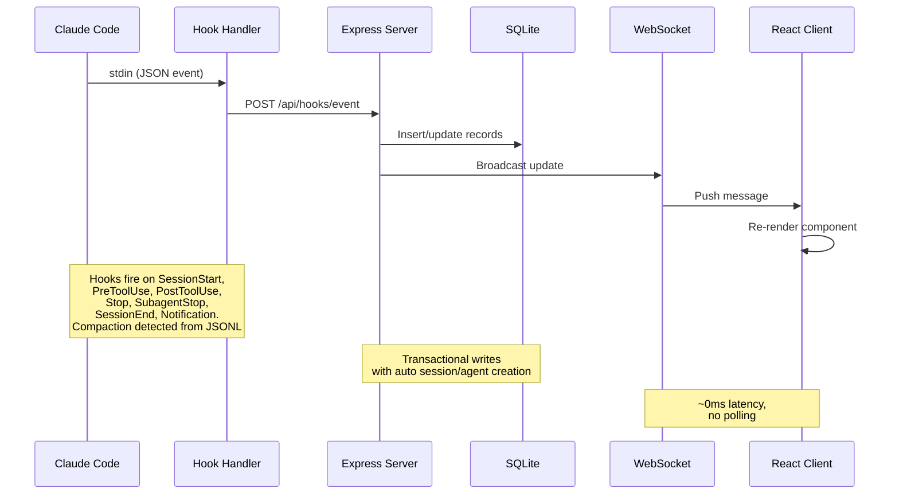

> [!IMPORTANT]
> サーバーアーキテクチャ、データベーススキーマ、API ルート、WebSocket デザイン、クライアントルーティング、フックハンドラのフロー、デプロイモード、およびセッションとエージェントの詳細なライフサイクル図については [ARCHITECTURE.md](./ARCHITECTURE.md) を参照してください。

### フックライフサイクル

1. **Claude Code** は、セッション開始、ツール使用、ターン終了、サブエージェント完了、およびセッション終了時にフックを発火します。
2. **Hook Handler** (`scripts/hook-handler.js`) は、標準入力から JSON イベントを読み取り、`~/.claude/.agent-dashboard.json`（または設定されている場合は `CLAUDE_DASHBOARD_PORT`）を介してアクティブなダッシュボードを解決し、同じペイロードを**一意の SQLite データディレクトリごとに 1 つのインジェストターゲット**に POST します（Docker と `npm run dev` が `~/.claude/agent-dashboard` を共有している場合は、最も低いポートが優先されるため、イベントが重複して取り込まれることはありません）。**異なる**データベースを持つサーバー（たとえば、`npm run dev` と並行して独自の Application Support ディレクトリを使用するデスクトップアプリなど）は、それぞれフックを受け取ります。Claude Code をブロックしないように、5秒のセーフティネットタイムアウトで静かに失敗し、ターゲットごとの Promise は拒否されないため、1つのデッドリスナーが他を停止させることはありません。
3. **サーバー (Server)** は、SQLite トランザクション内でイベントを処理します：
   - 初回接触時にセッションとメインエージェントを自動作成します。
   - `Agent` ツールの呼び出しを検出して、サブエージェントの作成を追跡します。
   - `SessionStart` 時にセッションとメインエージェントの `awaiting_input_since` をスタンプするため、プロンプトにいる新しい CLI は即座に **待機中 (Waiting)** 状態になります。
   - `UserPromptSubmit`（ユーザーが Enter を押したとき）で待機フラグをクリアし、メインエージェントを `working` に昇格させます — テキストのみのアシスタントターンは `PreToolUse` を発行しないため、これがターン開始の唯一の信頼できるシグナルとなります。
   - `PreToolUse` でエージェントを "working" に設定し（同時に待機フラグをクリア）、`PostToolUse` の間も動作状態を維持します。
   - `Stop`（Claude が応答を完了したとき）でメインエージェントは "waiting" になります — Claude がターンを終了し、ボールはユーザーに渡されました。バックグラウンドのサブエージェントは実行を続けます。セッションは `active` のままです。`stop_reason=error` を伴う Stop は、エージェントを `error`、セッションを `error` とマークします。
   - 権限の `Notification`（`permission`、`waiting for input`、`needs your approval` などのメッセージパターンに一致）では、エージェントを `waiting` に設定し、`awaiting_input_since` をスタンプします。
   - `SubagentStop` は、意図的に待機フラグをクリア**しません**（バックグラウンドのサブエージェントが完了しても、人間についての状態は何もわからないためです）。
   - `SubagentStop` によって個々のサブエージェントを完了としてマークします。`res.json()` が返された後、セッションの `subagents/agent-*.jsonl` ファイルを走査し、`tool_use_id` によって `tool_use` と `tool_result` ブロックをペアにし、各サブエージェント自身の `agent_id` の下で `PreToolUse` + `PostToolUse` イベントを発行する fire-and-forget 形式の `scanAndImportSubagents` パスを実行します — これにより、サブエージェント内部のツール呼び出しがダッシュボードから見えなくなるギャップを解消します。
   - `SessionEnd`（CLI プロセスの終了）で待機フラグを削除します。セッションが `error` の場合、エラー状態は保持されます。それ以外の場合は、すべてのエージェントとセッションを `completed` とマークします。
   - `SessionStart` 時に、`DASHBOARD_STALE_MINUTES`（デフォルト 180 = 3時間、環境変数でオーバーライド可能）の間アクティビティがない他のすべてのアクティブなセッションは自動的に "abandoned"（中断）とマークされ、そのエージェントも完了されます。これにより、セッション内での `/resume` や Ctrl+C、その他クリーンな `SessionEnd` なしに孤立したセッションが処理されます。
   - 新しい作業イベントが到着したときに（セッションが再開されたとき）、完了/エラー/中断されたセッションを再びアクティブにします。Stop および SubagentStop イベントも、完了/中断されたセッションを再度アクティブにします — これにより、サーバー起動前にインポートされた既存のセッション（最初のフックイベントが Stop である場合など）を適切に処理します。
   - **エラーリカバリ**: `UserPromptSubmit` と `PreToolUse` のみが、セッションを `error` から `active` に回復させることができます — これはユーザーがアクティブに再試行したことを示しています。
   - 会話のコンパクション（JSONL トランスクリプトの `isCompactSummary` エントリ）を検出し、`Compaction` エージェントとイベントを作成します。トークンの基準値はコンパクションをまたいで保持されるため、使用量が失われることはありません。トランスクリプトの読み取りは、増分バイトオフセット読み取りを備えた共有の統計ベースのキャッシュを使用します — 前回の読み取り以降に追加された新しいバイトのみがパースされるため、長いセッションでは約 50 倍の高速化が図られます。
   - JSONL トランスクリプトから API エラー（クォータ制限、レート制限、無効なリクエストなどの `isApiErrorMessage` エントリ）および生の `type: "error"` 応答を抽出し、`APIError` イベントとして保存します。ターン継続時間（`system` サブタイプの `turn_duration`）は `TurnDuration` イベントとして保存されます。ツールの結果エラー（`toolUseResult.is_error`）は `ToolError` イベントとして追跡されます。
   - **エラー検出ウォッチドッグ** — バックグラウンドタイマーが 15 秒ごとに実行され、最近のフックイベントがない（10秒以上経過した）アクティブなセッションをスキャンします。API エラー（認証の失敗、レート制限、クォータの枯渇）を探すためにトランスクリプトファイルを再読み込みし、イベントデータに `transcript_path` がないインポートされたセッションの場合はセッションの `cwd` からトランスクリプトパスを導出し、API エラーが見つかった場合はセッション/エージェントを `error` とマークします。これにより、API エラーが発生した後に Claude CLI がフックを発火しないケース（例えば、CLI がエラーを表示して待機する 401 認証の失敗など）をキャッチします。
   - **ユーザー割り込み (Esc) リカバリ** — `Esc` でターンをキャンセルしても**フックは発火しません**（Claude Code の仕様上の制限）。そのため、介入がないとメインエージェントは永遠に `working` でスタックしたままになります。同じ 15 秒のウォッチドッグが次の 2 つの方法でこれを回復します：(1) キャンセルによってトランスクリプトに `[Request interrupted by user]` マーカーが残された場合（出力が*あった後*の Esc）、トランスクリプトキャッシュは `pendingInterrupt` を介してそれをフラグ付けします — これはトランスクリプトの順序付け（最新の割り込み vs 最新の実際のターンアクティビティ、同じ時計）から純粋に導き出されるため、サブ秒のキャンセルでも機能します — そしてセッションは約 15 秒以内に **待機中 (Waiting)** に移行します。(2) *出力がされる前に* Esc が押された場合、Claude Code はマーカーを一切書き込まないため、アイドルタイムアウトのフォールバックが適用されます — メインエージェントが **実行中のツールを持たず**、かつ **フックイベントもトランスクリプトも** `DASHBOARD_WORKING_IDLE_SECONDS` (デフォルト `120`) **進行していない** 場合、ターンは死んだものとして扱われ、セッションは **待機中 (Waiting)** に移動します。どちらのパスも `Interrupted` イベントをログに記録し、通常の `Stop` が生成するのと同じ Waiting 状態にセッションを着地させます。ストリーミング出力（トランスクリプトがまだ成長中）や実行中のツール呼び出し（`current_tool` が設定されている）は除外されます。まれに誤って切り替わった場合も、次の実際のフックで自己修復します。
   - **死んだセッションの生存確認刈り取り** — Claude Code を終了する（Ctrl+C、ターミナルを閉じる）と `SessionEnd` フックが発火しますが、その瞬間にダッシュボードが実行されていないと、イベントは永遠に失われ、セッションは古いスイープ（デフォルトで3時間）まで **待機中 (Waiting)** に留まります。同じ 15 秒のウォッチドッグが **プロセス生存確認プローブ** でこのギャップを埋めます：実行中の `claude` CLI プロセスをリストアップし（macOS では `ps` + `lsof`、Linux では `/proc`）、`cwd` に生きている claude プロセスがない `active` なセッションを完了させます — 実際の `SessionEnd` が生成するのと同じ `completed` 状態に着地させ、タイムライン上に合成の `SessionEnd` イベントを記録します。ガード条件：ウォッチドッグのティック時に、セッションのトランスクリプトが少なくとも `DASHBOARD_LIVENESS_IDLE_SECONDS` (デフォルト `60`) 書き込まれていない必要があります（ディスク上にトランスクリプトが存在しない場合、最後のフック書き込みがフォールバック時計になります） — **起動時のパスはこのゲートを完全にスキップする**ため、起動の 1 秒前に終了したセッションでも直ちにクリアされます — そして、Windows、コンテナ内（ホストプロセスが見えない場合）、`ps`/`lsof` が失敗した場合、または `DASHBOARD_LIVENESS_PROBE=0` で明示的に無効にされている場合、プローブは「応答なし」を報告し（何も変更しません）。**混在** デプロイメントでは、`cwd` が POSIX の絶対パスでないセッションも自動的にスキップされます — 家庭内フック経由で他のマシンから転送されたセッションは、ローカルの `ps`/`lsof`/`/proc` スキャンが決して一致しないオリジン自身のパス（例：Windows の `D:\Git\ai-deck`）を報告するため、純粋なローカルセッションのためにプローブを無効にすることなく、リモートセッションは保護されます。**リモートデータソース (Remote Data Source)** セッション（`source` ≠ `local`）も常にスキップされます — それらの `cwd` は他のマシン上の正規の POSIX 絶対パスであるため、ローカルのプロセスプローブはそれらについて何も示しません。それらのライフサイクルは、上記のリモート同期の照合によって完全に所有されます。誤った完了は自己修復します：次のフックイベントがセッションを再びアクティブにします。15 秒のウォッチドッグのリズムに加えて、刈り取りは **起動時に即座に実行され**（前回の実行から DB に既にある死んだセッションを、レンダリングされる前にクリアします）、**約 5 秒後に再び実行されます**（起動同期がインポートしたばかりのセッションをカバーします）。これにより、ダッシュボードがダウンしている間に死んだセッションが Waiting として表示されることは決してありません。
   - 定期的なサーバースイープは、イベントベースの検出（例えば、フックを発火しない `/compact`、セッション作成の数秒以内の `/resume`）をすり抜けた中断されたセッションと新しいコンパクションをキャッチします。リズムは `DASHBOARD_STALE_MINUTES`（閾値の ¼、60 秒〜5 分にクランプ）から導出されます。スイープは、イベントテーブルをスキャンするのではなく、アクティブなセッション行から直接 `transcript_path` を読み取ります（小さなインデックスルックアップ）。この列は、フックハンドラが初めてトランスクリプトパスを見たときに設定され、`db.js` のマイグレーションによって既存のイベントから一回限りバックフィルされます。スイープが読み取る正確な行をカバーする部分インデックス `idx_sessions_active_tp` を備えています。スイープはフックハンドラとトランスクリプトキャッシュを共有し、重複した I/O を回避します。中断されたセッションのクリーンアップは、メモリを制限するためにトランスクリプトキャッシュエントリも追放します。**リモートデータソース (Remote Data Source)** セッション（`source` ≠ `local`）は、一致する Claude Code または Codex プロバイダーが正常である間のみミラー所有のままになります。そのプロバイダーが利用できない場合、エラーが発生した場合、または `syncing` 状態に取り残された場合、定期的および起動時のクリーンアップは通常の古い（stale）ルールを使用するため、古い Waiting カードが永遠に存続することはありません。
   - **継続的なプロジェクト同期** (`startSessionSync`) は、1 回限りのマーカー付き起動バックフィルを超えて `~/.claude/projects` を発見可能に保ちます：後から追加されたプロジェクトで、セッションが一度もフックを通過しないものは、手動での再スキャンが行われるまで非表示のままになります。即時の起動スイープ、デバウンスされた `fs.watch`（macOS/Windows では再帰的、Linux ではルートと直下の子）、および `DASHBOARD_SESSION_SYNC_MS` のポーリング（デフォルト 30秒；`0` でポーリング無効、ウォッチャーは継続）は 1 つの mtime キャッシュと、mtime が進んだファイルのみを再パースする統合スイープを共有します — そして、変更のないすでにインポートされたセッションは再パースせずにスキップされるため、再開コストは O(新規/変更ファイル) に保たれます。新しく発見された/成長した各セッションは、フックが発行するのと同じフレームである `session_created`/`session_updated` とそのメインエージェントをブロードキャストします。
4. **WebSocket** は変更をすべての接続されたクライアントにブロードキャストします。
5. **UI** は更新を受け取り、影響を受けるコンポーネントをポーリングなしでリアルタイムに再レンダリングします。

### エージェント状態遷移

永続化されるステータス: `working | waiting | completed | error`。
`awaiting_input_since` 列は補助的なものです — エージェントが待機を開始した日時を記録し、継続時間の表示に使用されますが、現在 `waiting` は実際の永続化ステータスになっています。

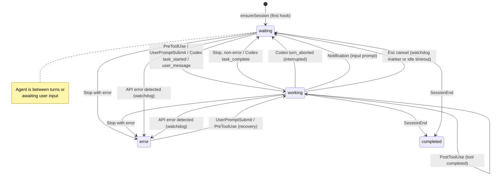

### セッション状態遷移

永続化されるステータス: `active | completed | error | abandoned`。
**待機中 (Waiting)** セッション状態は、UI のオーバーレイです（`status=active` に加えて `awaiting_input_since` が設定されている状態）。

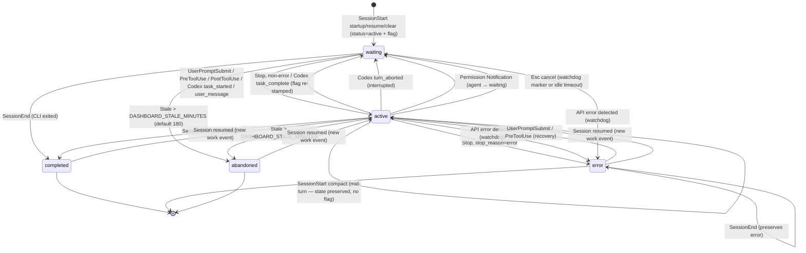

### コスト計算フロー

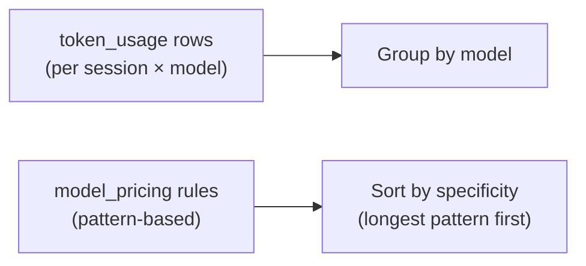
## 構成 (Configuration)

| 環境変数 (Environment Variable) | デフォルト (Default) | 説明 (Description) |
| ----------------------- | ------------- | --------------------------------------------- |
| `DASHBOARD_PORT`        | `4820`        | Express サーバーのポート |
| `CLAUDE_DASHBOARD_PORT` | `4820`        | フックハンドラがサーバーに到達するために使用するポート |
| `NODE_ENV`              | `development` | ビルドされたクライアントを提供するには `production` に設定します |
| `DASHBOARD_UPDATE_CHECK` | _(有効)_ | 定期的な git upstream チェックを無効にするには `0` / `false` / `off` に設定します |
| `DASHBOARD_UPDATE_CHECK_INTERVAL_MS` | `300000` (5 分) | 自動チェックの間隔；最小値 60,000 ミリ秒。ユーザーは更新モーダルやサイドバーの **Check now** (今すぐチェック) をクリックしてオンデマンドで実行することもできます |
| `DASHBOARD_STALE_MINUTES` | `180` (3 時間) | まだ `active` なセッション（ユーザー入力を待機中の **Waiting** も含む — "Waiting" は `active` な行に対する UI オーバーレイであり、保存された状態ではありません）が自動的に **abandoned (中断)** とマークされ、アクティブリストから除外されるまでの非アクティブな時間(分)。15 秒のウォッチドッグと定期的なメンテナンススイープ（この値の ¼ ごと、60秒〜5分の間にクランプされて実行される）によって強制されます。アイドルタイムアウトを短くしたい場合は値を下げてください（例: `60`） |
| `DASHBOARD_WORKING_IDLE_SECONDS` | `120` | トランスクリプトマーカーを残さない **出力前の** `Esc` でキャンセルされたターンを回復するための、動作中のアイドルタイムアウト。メインエージェントが `working` であり、実行中のツールがなく、フックイベントもトランスクリプトもこの期間進行していない場合、ウォッチドッグはセッションを **待機中 (Waiting)** に移行させます。静かに考える長いターンの際に時折誤って切り替わる（自己修復します）犠牲を払ってでも、素早い回復を望む場合はこの値を下げてください |
| `DASHBOARD_LIVENESS_PROBE` | `1` (オン) | ウォッチドッグの **死んだセッションの生存確認刈り取り**（CLI プロセスがすでに存在しない `active` なローカル Claude Code または Codex セッションを完了させる、`ps`/`lsof` ベースのプローブ — ダッシュボードがダウンしている間に失われた `SessionEnd` を回復します）を無効にするには `0` に設定します。**別のマシン**（家庭内フック）から転送されたセッションは、POSIX 以外の `cwd` を報告するため刈り取りによって自動的にスキップされます。そのため、ローカルと転送が混在するデプロイメントでこれをオフにする必要はもうありません；ローカルプロセスが何も証明しない完全なリモートセットアップの場合にのみ無効にしてください。Windows およびコンテナ内では自動的に無効になります |
| `DASHBOARD_LIVENESS_IDLE_SECONDS` | `60` | **ウォッチドッグティック** 生存確認刈り取りのためのアイドルゲート：セッションは、そのトランスクリプトが少なくともこの期間書き込まれていない場合にのみ完了とみなされます（ディスク上にトランスクリプトが存在しない場合、最後のフック書き込みがフォールバック時計となります）。これにより、ターン中や再開直後のセッションが一時的なプローブのミスによって誤って終了されることはありません。起動時のパスはこのゲートを無視します — 起動時はプローブ単独で決定するため、起動の数分前に終了したセッションは即座にクリアされます |
| `DASHBOARD_SESSION_SYNC_MS` | `30000` | 起動後に追加され、セッションがフックを通過しないプロジェクトを表面化させる、継続的な `~/.claude/projects` バックグラウンド同期のポーリング間隔 (ミリ秒)。`fs.watch` ウォッチャーはこれに関係なくほぼ即座に発火します；このポーリングはセーフティネットです（ウォッチャーはイベントを取りこぼしたり、ネットワークファイルシステムで発火しない場合があります）。ウォッチャーは実行したままポーリングを無効にするには `0` に設定します |
| `DASHBOARD_CODEX_HOME` | `CODEX_HOME` または `~/.codex` | オプションのローカル Codex 状態ディレクトリ。ロールアウトはその `sessions/` ツリーからのみ読み取られます。設定 (Settings) で新しい場所を保存すると、このダッシュボード専用のオーバーライドが永続化され、ライブ監視が再準備され、新しいツリーが即座にスキャンされます。 |
| `DASHBOARD_CODEX_SYNC_MS` | `4000` | 追記型の Codex ロールアウト用のセーフティネットポーリング間隔 (ミリ秒)。Codex フックはこれに関係なく同じインクリメンタルなインジェストを即座にトリガーします；ポーリングのみを無効にしつつ、可能であればファイルシステムウォッチャーを保持するには `0` に設定します。 |
| `DASHBOARD_REMOTE_SYNC_MS` | `15000` (15 秒) | **リモートデータソース (Remote Data Sources)** のバックグラウンド同期のポーリング間隔 (ミリ秒)。有効な各リモートの `~/.claude/projects` と `~/.codex/sessions`（および Codex の軽量な `session_index.jsonl` タイトルインデックス）を独立して SSH 経由で取得し、それぞれのローカルインポーターを通じて再インポートします。新規または有効化されたソースも即座に同期されます。ポーラーを無効にするには `0` に設定します（手動/オンデマンドの同期は機能し続けます） |
| `DASHBOARD_REMOTE_ACTIVE_WINDOW_MS` | `600000` (10 分) | **リモートデータソース** セッションのライブステータスの鮮度ウィンドウ。各同期で、対応するミラーリングされたトランスクリプトの **最新の JSONL イベント** がこのウィンドウ内にあるリモートの Claude Code または Codex セッションは、まだ実行中 (`active`) として扱われます；ミラーがこれよりも長く進まなくなると、セッションは `completed` に照合されます。リモートセッションはライブフックを受信しないため、プロバイダーを認識するミラー照合がローカルの生存確認に代わって機能します；失敗した、利用できない、または `syncing` にスタックしたプロバイダーのミラーは、通常の古い（stale）スイープにフォールバックします。リンクが遅い場合や、アイドル状態の長いターンの場合は、この値を上げてください |
| `DASHBOARD_REMOTE_SYNC_TIMEOUT_MS` | `600000` (10 分) | 中断されるまでの、単一のリモート同期（`scp` の取得 + インポート）のソースごとのタイムアウト (ミリ秒) |
| `DASHBOARD_REMOTE_TEST_TIMEOUT_MS` | `15000` (15 秒) | リモートソースが到達可能であることを検証する **テスト (Test)** SSH プローブ (`POST /api/remote-sources/:id/test`) のタイムアウト (ミリ秒) |
| `DASHBOARD_HOST`        | `127.0.0.1`   | サーバーがバインドするインターフェース。デフォルトはループバックです（ネットワークからは到達不可）。LAN 上に公開するには `0.0.0.0` に設定します（起動時に警告がログに記録されます） |
| `DASHBOARD_TOKEN`       | _(未設定)_     | 設定すると、すべての `/api/*` リクエストと WebSocket はこのトークンを提示する必要があります（`Authorization: Bearer <token>`、`x-dashboard-token` ヘッダー、または `?token=`）。デフォルトではオフです — ループバックへのバインドが信頼の境界となります |
| `DASHBOARD_TOKEN_FILE` | _(未設定)_ | Docker/Kubernetes シークレット用の、ファイルでバックアップされたダッシュボードトークン；直接の `DASHBOARD_TOKEN` の方が優先されます |
| `DASHBOARD_HOOK_TOKEN` / `DASHBOARD_HOOK_TOKEN_FILE` | _(未設定)_ | `/api/hooks/*` 用の独立したトークン；認証されたリモートフックインジェストに必要です |
| `DASHBOARD_ALLOWED_HOSTS` | _(ループバック)_ | HTTP + WebSocket のアップグレード時に許可される追加の `Host` 値のコンマ区切りリスト（DNS リバインディング対策）。ループバックを超えてバインドする場合は、ここに LAN のホスト名を追加してください |
| `DASHBOARD_ENV_PATH` | リポジトリの `.env` | 設定 (Settings) で Claude/Codex ホームのオーバーライドが永続化される際に使用される書き込み可能な dotenv パス；コンテナのデフォルトは `/app/config/.env` |
| `CCAM_DASHBOARD_URL` | _(localhost 自動検出)_ | オプションのリモートフック宛先。非ループバックの URL には HTTPS とフックトークンを使用する必要があります |
| `CCAM_HOOK_TOKEN` / `CCAM_HOOK_TOKEN_FILE` | _(未設定)_ | `x-ccam-hook-token` として送信されるフッククライアント認証情報 |

> [!IMPORTANT]
> **デフォルトで安全です。** サーバーは `127.0.0.1` にバインドされており、そのままではネットワークから到達することは**できません** ([GHSA-gr74-4xfh-6jw9](./.github/SECURITY.md))。LAN 上に公開するには、`DASHBOARD_HOST` (例: `0.0.0.0`) **と** `DASHBOARD_TOKEN`（これにより `/api/*` と WebSocket が保護されます）の**両方**を設定し、`DASHBOARD_ALLOWED_HOSTS` に LAN のホスト名をリストアップしてください。詳細については [`.env.example`](./.env.example) および [`.github/SECURITY.md`](./.github/SECURITY.md) を参照してください。

Git クローンの場合、サーバーは定期的に `origin` から `git fetch` を実行し、あなたのチェックアウトと `origin/master`、`origin/main`、または `origin/HEAD` を比較します。upstream より遅れている場合、サーバーのターミナルにメッセージが表示され、UI には実行すべき正確なコマンドが記載されたモーダルが表示されます。ダッシュボード自体が自動で pull したり再起動したりすることはありません — コマンドをコピーし、ターミナルで実行した後、起動した時と同じ方法でサーバーを再起動してください。

---

## `ccam` CLI

ダッシュボードの全機能は、依存関係のない **`ccam`** CLI (`bin/ccam.js`) を通じて、あらゆるターミナルから利用することもできます。これは `npm run setup`（`npm link` 経由）によって自動的にリンクされ、その後はどのディレクトリからでも `ccam <command>` が機能します。実行中のダッシュボードは `~/.claude/.agent-dashboard.json`（フックハンドラが使用するのと同じライブサーバーレジストリ）を通じて検出され、`CLAUDE_DASHBOARD_PORT` / `DASHBOARD_PORT` の環境変数のオーバーライドが可能で、フォールバックとして `http://127.0.0.1:4820` に接続します。

```bash
# サーバー (Server)
ccam status                       # ● running / ○ not running (実行中 / 非実行中) インジケーター
ccam start [--port N]             # サーバーをバックグラウンド (デタッチ) で開始
ccam stop                         # バックグラウンドのサーバーを安全に停止
ccam repl                         # インタラクティブシェル (別名: shell, i)

# 監視 (Monitoring)
ccam health                       # ダッシュボードは稼働しているか？
ccam stats                        # 合計、今日のイベント、ステータス分布
ccam kanban                       # ステータス列でグループ化されたセッションとエージェント
ccam tail [--session <id>]        # ターミナルでのライブイベントフィード (Ctrl+C で停止)

# データ (Data)
ccam sessions [--status s] [--q text] [--limit n]
ccam session <id>                 # 詳細: エージェントツリー、コスト、最近のイベント
ccam agents   [--status s] [--session id]
ccam events   [--session id] [--limit n]

# インサイト (Insights)
ccam analytics                    # トークンの合計、頻出ツール、エージェントタイプ
ccam workflows [--session id]     # ワークフローインテリジェンスの統計とパターン
ccam runs [--session id]          # 動的な Workflow-tool の実行
ccam cost [--session <id>]        # モデルごとの内訳を伴う推定総コスト
                                  # (--session で 1 つに絞り込み; ツールサーチャージを表示;
                                  #  使用量があるのに価格設定ルールがないモデルについて警告)

# アラートと Webhook (Alerts & webhooks)
ccam alerts [--unacked]           # 発動したアラートフィード
ccam alerts ack <id> | ack-all    # アラートを承認 (acknowledge) する
ccam rules                        # アラートルールの一覧
ccam webhooks                     # Webhook ターゲットの一覧
ccam webhooks test <id>           # 合成的なテストアラートを送信

# 価格設定 (Pricing)
ccam pricing                      # モデルの価格設定ルールの一覧 (fast-mode と intro 列を含む)
ccam pricing set <pattern> --input N --output N [--cache-read N --cache-write N]
                 [--cache-write-1h N] [--fast-input N --fast-output N]
                 [--intro-input N --intro-output N … --intro-until YYYY-MM-DD]
ccam pricing delete <pattern>
ccam pricing reset

# インポート (Import)
ccam import rescan                # ~/.claude/projects を再スキャン
ccam import path <dir>            # ディレクトリ内のすべての .jsonl をインポート

# 管理 (Administration)
ccam doctor                       # 接続性、フック、データベースの診断
ccam info                         # 生のシステム情報 JSON
ccam export [file.json]           # 完全な JSON データのエクスポート
ccam import-data <file.json>      # エクスポートの復元 (冪等、非破壊的)
ccam cleanup --hours N --days M   # 古いセッションの中断 / 過去のセッションのパージ
ccam reinstall-hooks              # Claude Code フックを再インストール
ccam update-check                 # チェックアウトは upstream より遅れているか？ (更新コマンドを表示)
ccam clear-data --yes             # すべてのデータを削除 (ALL) (--yes が必要)
ccam open                         # ブラウザでダッシュボードを開く
ccam version                      # CLI のバージョンを表示 (または --version / -v)
```

API ベースのコマンドにはサーバーの実行が必要です — サーバーが実行されていない場合、**読み取り専用のコマンドはフォールバックして `data/dashboard.db` を直接読み取ります**（明示的な `⚠ Offline mode` バナーが表示され、保存されているが死んでいる `active` なセッションは、サーバーのウォッチドッグが使用するのと同じプロセス生存確認プローブによって表示側で修正されます）。一方、サーバーなしでは正しく実行できないコマンド（ライブ `tail`、分析/コストの計算、データの変更）は、具体的な理由と開始コマンドを添えて `○ Dashboard server is NOT running` インジケーターを表示します；`ccam start` を実行すると本番サーバーがバックグラウンドで起動します。読み取りコマンドは常に安全です；唯一の破壊的なコマンド (`clear-data`) は、明示的な `--yes` がない限り実行を拒否します。出力はフルターミナル UI です — 右揃えの数値列、ステータスアイコン (`● active`, `○ waiting`, `✔ completed`, `✖ error`)、統計/分析/コスト用のインライン棒グラフ、および実際の `├─`/`└─` エージェントツリーを備えた罫線テーブル — であり、TTY では自動的に ANSI カラーが有効になり、パイプ処理時はオフになり、`--no-color` / `NO_COLOR` / `FORCE_COLOR` で制御可能です。ライブ監視セッションの場合、**`ccam repl`**（エイリアス `shell` / `i`）を使用すると、`ccam` プレフィックスなしでコマンドを入力できるインタラクティブなシェルが開きます — CCAM ウェルカムバナー、タブ補完、保存される矢印キー履歴、ライブサーバー状態プロンプト (`● host` (稼働中) / `○ offline` (オフライン))、グループ化された `help` / `help <cmd>` メニュー、そして任意のコマンドを自動更新する組み込みの `watch [secs] <cmd>` (例：`watch 5 kanban`) などを備えています；各行は独立した子プロセスとして実行されるため、オフラインによる拒否やブロック状態の `tail` によってもシェルがダウンすることはありません。`ccam` が PATH にない場合（例：`npm link` に昇格された権限が必要だった場合）、リポジトリのルートから一度 `npm link` を実行してください。フラグ、検出順序、REPL、安全モデル、スクリプティング/終了コード、トラブルシューティングに関する完全なリファレンスは、[docs/CLI.md](./docs/CLI.md) にあります。

## npm スクリプト

| コマンド | 説明 |
| ----------------------- | ---------------------------------------------------------- |
| `npm run setup`         | root/client/extension/MCP の依存関係をインストールし、MCP をビルドし、`ccam` をリンクします |
| `npm run update:pull-setup` | `git pull --ff-only` を実行後 `npm run setup` を実行します（手動アップグレード） |
| `npm run dev`           | サーバー (ウォッチモード) とクライアント (Vite HMR) を同時に起動します |
| `npm run dev:server`    | Express サーバーのみを `--watch` で起動します |
| `npm run dev:client`    | Vite 開発サーバーのみを起動します |
| `npm run build`         | React クライアントを `client/dist/` にビルドします |
| `npm start`             | 本番サーバーを起動します (ビルドされたクライアントを提供) |
| `npm test`              | フルスイートを実行します (サーバー `node --test` + クライアント Vitest) |
| `npm run test:server`   | バックエンドのテストを実行します (`node --test server/__tests__/`) |
| `npm run test:client`   | フロントエンドの Vitest テストを実行します。**すべての画面のレンダースナップショット** (`client/src/pages/__tests__/screens.snapshot.test.tsx`) を含みます。意図的な UI 変更の後は `cd client && npx vitest run -u` でベースラインを再生成してください |
| `npm run install-hooks` | `~/.claude/settings.json` に Claude Code フックを設定します |
| `npm run seed`          | データベースにサンプルデータを投入します |
| `npm run import-history`| `~/.claude/` からレガシーセッションをインポートします（起動時にも実行されます） |
| `npm run clear-data`    | すべてのセッション、エージェント、イベント、およびトークン使用量を削除します |
| `npm run mcp:install`   | ローカル MCP パッケージ (`mcp/`) の依存関係をインストールします |
| `npm run mcp:build`     | MCP サーバーの TypeScript を `mcp/build/` にビルドします |
| `npm run mcp:start`     | MCP サーバーを起動します (stdio トランスポート — MCP ホスト用) |
| `npm run mcp:start:http`| MCP サーバーを起動します (ポート 8819 の HTTP + SSE トランスポート) |
| `npm run mcp:start:repl`| MCP サーバーを起動します (タブ補完付きのインタラクティブ REPL) |
| `npm run mcp:dev`       | 開発モードで MCP サーバーを実行します (`tsx`, stdio) |
| `npm run mcp:dev:http`  | 開発モードで MCP サーバーを実行します (`tsx`, HTTP + SSE) |
| `npm run mcp:dev:repl`  | 開発モードで MCP サーバーを実行します (`tsx`, インタラクティブ REPL) |
| `npm run mcp:typecheck` | ビルド出力を生成せずに MCP ソースを型チェックします |
| `npm run extensions:sync` | スキル名/OpenAI メタデータ、Codex マニフェスト、および両方のマーケットプレイスを再生成します |
| `npm run extensions:validate` | 14 のデュアルフォーマットプラグインと 66 のバンドルされたスキルすべてを検証します |
| `npm run mcp:docker:build` | Docker で MCP コンテナイメージをビルドします (`agent-dashboard-mcp:local`) |
| `npm run mcp:podman:build` | Podman で MCP コンテナイメージをビルドします (`localhost/agent-dashboard-mcp:local`) |
| `npm run desktop:install` | Electron + electron-builder を `desktop/` ワークスペースにインストールします (Electron の ABI 用に `better-sqlite3` を再ビルドします)；ネイティブの `better-sqlite3` ビルドを事前確認し、失敗時には実行可能なセットアップのヘルプ（ツールチェーン不要の代替手段を含む）を表示します |
| `npm run desktop:dev`   | ローカルでのイテレーションのために Electron デスクトップアプリをビルドして起動します |
| `npm run desktop:build` | デスクトップの TypeScript ソースを `desktop/out/` にコンパイルします |
| `npm run desktop:test`  | デスクトップのスモークテストを実行します (Electron をスポーンし、`/api/health` をプローブします) |
| `npm run desktop:dmg`   | **両方**の macOS DMG (arm64 + x64) をビルドします — リリース向けですが、**遅い**です (各アーキテクチャをパッケージ化します) |
| `npm run desktop:dmg:arm64` | Apple-Silicon 専用の DMG をビルドします — **高速**、あなた自身の Mac 用に推奨 |
| `npm run desktop:dmg:x64` | Intel 専用の DMG をビルドします — **高速** |
| `npm run desktop:dmg:universal` | 1 つにマージされた**ユニバーサル** DMG (arm64 + x86_64) をビルドします — オプション、**最も遅い**、リリースで配布されるものではありません |
| `npm run desktop:win`   | Windows の **NSIS インストーラー** `.exe` (x64) をビルドします — Windows 上で実行します |
| `npm run desktop:win:portable` | Windows の **ポータブル** (インストール不要) `.exe` (x64) をビルドします — Windows 上で実行します |
| `npm run monitoring:install` | `monitoring/` 内で `npm install` を実行します — `postinstall` 経由で Prometheus + Grafana をダウンロードします |
| `npm run monitoring:setup` | `monitoring:install` のエイリアスです |
| `npm run monitoring:up` | Prometheus (:9090) と Grafana (:3000) をバックグラウンドで開始します (Docker なし) |
| `npm run monitoring:down` | npm で管理された監視スタックを停止します |
| `npm run monitoring:start` | 監視スタックをフォアグラウンドで開始します (Ctrl+C で両方を停止します) |
| `npm run monitoring:docker:up` | Docker Compose 経由で Prometheus + Grafana を開始します |
| `npm run monitoring:docker:down` | Docker の監視スタックを破棄します |
| `npm run monitoring:verify` | ダッシュボード、Prometheus、Grafana、およびスクレイプターゲットのヘルスチェックを行います |
| `npm run docker:up` | Docker 内でダッシュボードを起動します (`docker compose up -d --build`) |
| `npm run docker:down` | ダッシュボードコンテナを停止します |
| `npm run docker:full:up` | ダッシュボード + 認証付き MCP + rootless Nginx + Prometheus + Grafana |
| `npm run docker:full:down` | 完全な Docker スタックを破棄します |
| `npm run deploy:validate` | Docker、Compose、Nginx、Helm、Kustomize、Terraform、依存関係の監査、および「単一ライター」の不変条件を検証します |

---
## エージェント拡張 (Agent Extensions)

このリポジトリには、Claude Code と Codex の両方に対する包括的な拡張レイヤーが含まれています：

- Claude Code: `CLAUDE.md`, `.claude/rules/`, `.claude/skills/`
- Claude サブエージェント: `.claude/agents/`
- Codex: `AGENTS.md`, `.codex/rules/`, `.codex/agents/`, `.codex/skills/`
- 共有配布可能プラグイン: `plugins/`, `.claude-plugin/plugin.json` と `.codex-plugin/plugin.json` の両方を備える
- マーケットプレイス: Claude Code 用の `.claude-plugin/marketplace.json` および Codex 用の `.agents/plugins/marketplace.json`
- オープンエージェントスキル: すべてのプラグインスキルには正規のフロントマターと `agents/openai.yaml` が含まれます；`npx skills add hoangsonww/Claude-Code-Agent-Monitor --list` を実行すると 75 のリポジトリスキルが検出されます

### 拡張アーキテクチャ

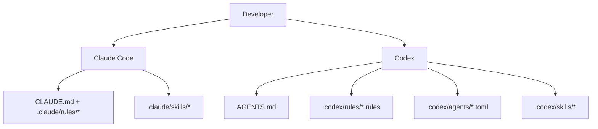

### Claude Code レイヤー

- 永続的コンテキスト:
  - [`CLAUDE.md`](./CLAUDE.md)
- パススコープ付きルール:
  - [`.claude/rules/backend-node.md`](./.claude/rules/backend-node.md)
  - [`.claude/rules/frontend-react.md`](./.claude/rules/frontend-react.md)
  - [`.claude/rules/mcp-typescript.md`](./.claude/rules/mcp-typescript.md)
  - [`.claude/rules/docs-markdown.md`](./.claude/rules/docs-markdown.md)
- スキル:
  - `repo-onboarding`
  - `ship-feature`
  - `version-release`
  - `mcp-operations`
  - `debug-live-issue`
- サブエージェント:
  - `backend-reviewer`
  - `frontend-reviewer`
  - `mcp-reviewer`

### Codex レイヤー

- 永続的コンテキスト:
  - [`AGENTS.md`](./AGENTS.md)
- 実行ポリシー:
  - [`.codex/rules/default.rules`](./.codex/rules/default.rules)
- カスタムサブエージェントテンプレート:
  - [`.codex/agents/`](./.codex/agents)
- スキル:
  - [`.codex/skills/`](./.codex/skills)
- セットアップ:
  - [`.codex/README.md`](./.codex/README.md)

---

## MCP 統合 (MCP Integration)

このプロジェクトには、16 のドメインモジュールにまたがる 97 のツールを備えた `mcp/` のローカル MCP サーバーが含まれています。スコープ付きデータ読み取り、トランスクリプト/画像、Claude と GPT の価格設定、ワークフロー、アラート/Webhook、インポートとバックアップの復元、Claude/Codex 設定、エージェントの実行、リモートソース、設定、プッシュ、保護されたメンテナンスなど、サポートされるすべてのアプリケーションアクションを公開します。3 つのトランスポートモードをサポートします。

### MCP トランスポートモード

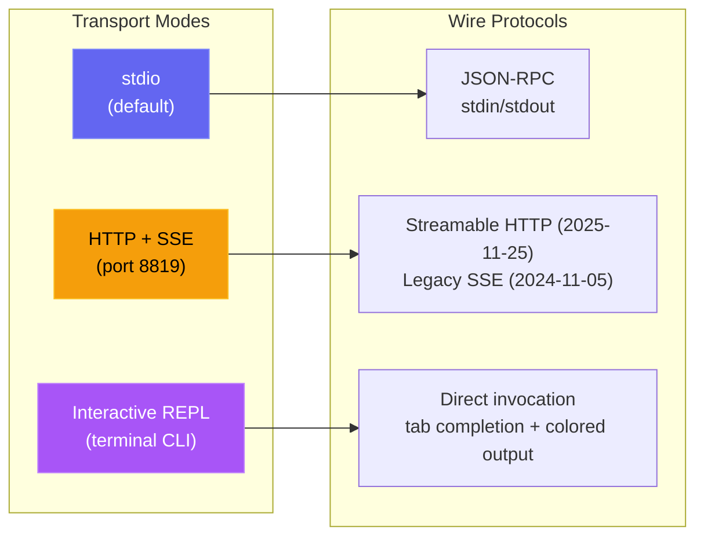

| モード (Mode) | コマンド (Command) | ユースケース (Use Case) |
| --- | --- | --- |
| **stdio** | `npm run mcp:start` | Claude Code、Claude Desktop、IDE の MCP ホスト |
| **HTTP** | `npm run mcp:start:http` | リモート MCP クライアント、Web 統合、マルチセッション |
| **REPL** | `npm run mcp:start:repl` | Ops デバッグ、手動ツール呼び出し、ローカル管理 |

<p align="center">
  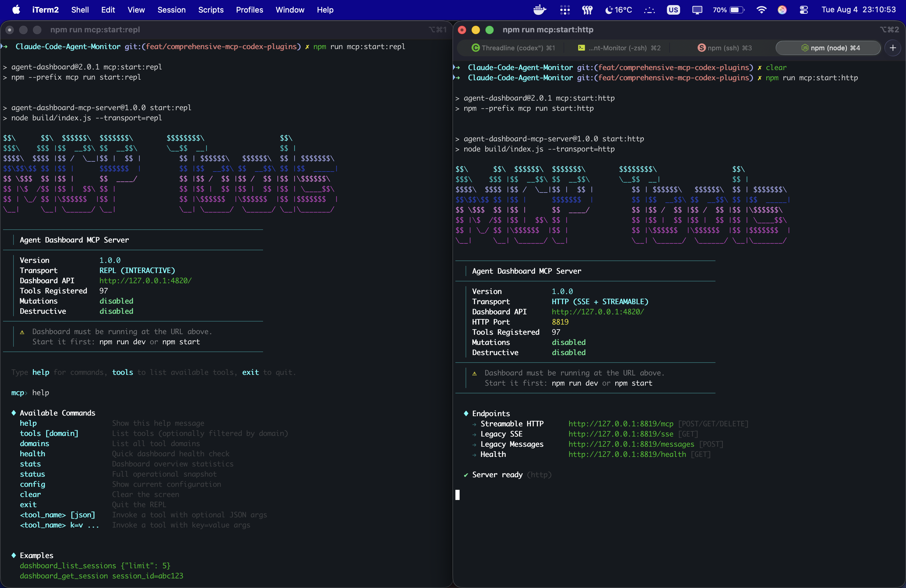
</p>

### MCP アーキテクチャ

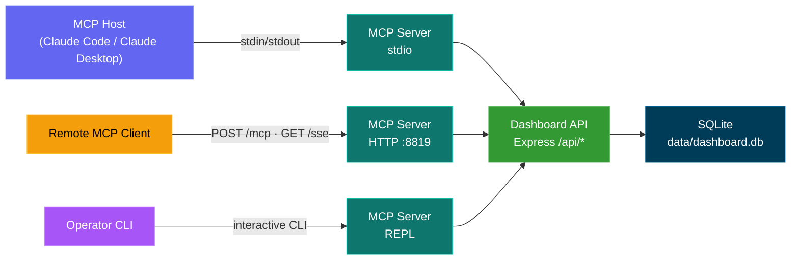

### MCP ツールサーフェス

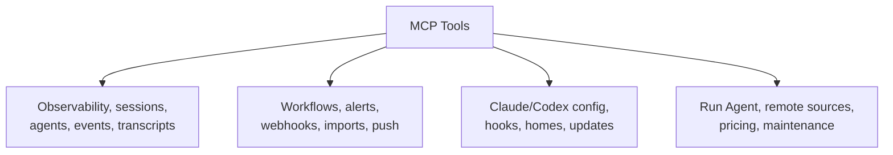

### MCP セキュリティモデル

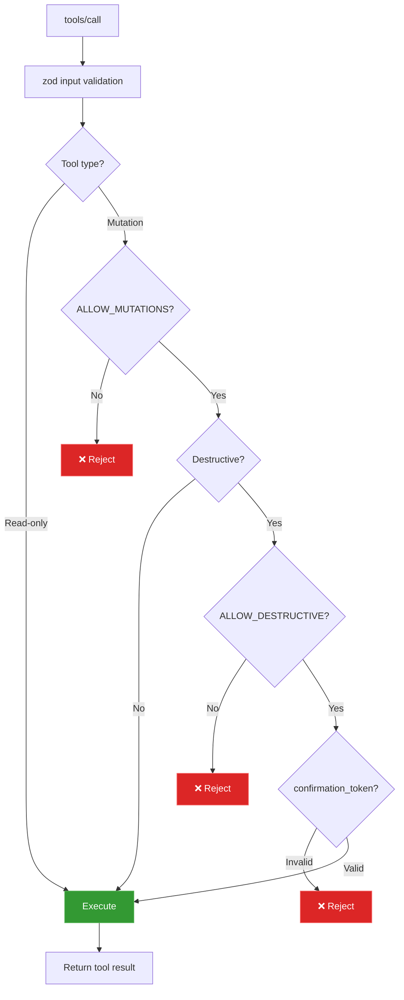

### MCP 運用モード

- 読み取り専用モード (デフォルト): `MCP_DASHBOARD_ALLOW_MUTATIONS=false`
- 管理者モード: `MCP_DASHBOARD_ALLOW_MUTATIONS=true`
- 認証されたダッシュボード: `MCP_DASHBOARD_API_TOKEN` / `_FILE` にダッシュボードトークンを設定
- 認証された HTTP/SSE トランスポート: `MCP_HTTP_AUTH_TOKEN` / `_FILE` を設定；クライアントは bearer 認証または `x-mcp-token` を送信します
- トランスポートガードレール: 直接のループバック HTTP はトークンを運ぶことができます；コンテナホストエイリアスは HTTPS を必要とします；リダイレクトは拒否されます
- ペイロードガードレール: アップロード履歴ファイルごとに 50 MiB、呼び出しごとに合計 100 MiB、バイナリ応答は 10 MiB、バックアップ復元は 25 MiB
- 破壊的モード: 以下がすべて必要です:
  - `MCP_DASHBOARD_ALLOW_MUTATIONS=true`
  - `MCP_DASHBOARD_ALLOW_DESTRUCTIVE=true`
  - ツール入力 `confirmation_token: "CLEAR_ALL_DATA"`

全容: [mcp/README.md](./mcp/README.md)

---

## API リファレンス (API Reference)

すべてのエンドポイントは JSON を返します。エラー応答は `{ error: { code, message } }` の形式に従います。

### OpenAPI / Swagger / ReDoc

HTTP API を探索するには 3 つの方法があり、すべて単一の OpenAPI 3.0.3 仕様によって駆動されます (デフォルトサーバーポート `4820`):

| メソッド | パス | 説明 |
| ------ | ------------------------------- | ------------------------------------------------------------------------------------------------- |
| `GET`  | `/api/openapi.json`             | 生の OpenAPI 3.0.3 JSON 仕様 |
| `GET`  | `/api/docs`                     | インタラクティブな **Swagger UI** — リクエスト実行を試すことができます |
| `GET`  | `/api/redoc`                    | **ReDoc** リファレンス — 同じ仕様のクリーンで読み取りに最適化された 3 ペインレンダリング |
| `GET`  | `/api/redoc/redoc.standalone.js`| セルフホスト型 ReDoc バンドル (CDN ではなく `redoc` 依存関係経由でローカルに提供されます — オフラインで動作します) |

OpenAPI ドキュメントは `server/openapi.js` (`createOpenApiSpec()`) から生成され、`server/openapi-extra/` 下の補足フラグメントと結合されます。Swagger UI と ReDoc はどちらもバックエンドから直接提供されます。ReDoc バンドルはローカルに提供されるため (`GET /api/redoc/redoc.standalone.js`)、プロジェクトの「外部アセットなし」ポリシーに従い、リファレンスは完全にオフライン / エアギャップ環境で機能します。

カバレッジは包括的です：すべてのバックエンドルート（82のパスエントリ）が以下のタグにわたって文書化されています — Health, Sessions, Agents, Events, Stats, Metrics, Analytics, Hooks, Pricing, Workflows, Settings, Updates, Alerts, Webhooks, Push, CcConfig (Claude Code 設定エクスプローラー), Run (ダッシュボードで生成された実行), そして Documentation — それぞれにパラメータ、リクエスト/レスポンススキーマ、フィールドレベルの説明、および現実的な例が含まれています。

リポジトリルートにコミットされた **`openapi.yaml`** は、ライブ仕様をミラーリングしています。これは `server/openapi.js` から生成され（手動で編集されることはありません）— API の変更後は以下を実行して再生成してください：

```bash
npm run openapi:yaml
```

### Prometheus メトリクス & Grafana

`GET /api/metrics` はダッシュボードのライブカウンターを公開します — ステータスごとのセッション/エージェント、イベントとトークンの合計、接続されたリアルタイムクライアント、構成されたリモートソース、プロセスの稼働時間/メモリ、およびビルドバージョン — これらは Prometheus テキストエクスポジション形式で出力されるため、CCAM を独自の監視スタックにスクレイピングできます。**4 つの自動プロビジョニングされたダッシュボード** (デフォルトホーム: **CCAM — Overview**) を備えたターンキーの Prometheus + Grafana スタックが [`monitoring/`](./monitoring/README.md) にあります。
**npm (Docker なし — macOS, Linux, または Windows):**

```bash
npm start                          # ポート 4820 でダッシュボード
npm run monitoring:install         # 1 回のみ: npm postinstall がバイナリを取得します
npm run monitoring:up              # ポート 3000 で Grafana、自動プロビジョニング済み；認証情報は monitoring/README.md を参照
```

**Docker / Podman** (ダッシュボードをコンテナで実行する場合、または Compose を好む場合):

```bash
# ダッシュボードのみ
npm run docker:up

# ダッシュボード + Prometheus + Grafana (1 つのコマンド)
npm run docker:full:up

# または混在: ネイティブ/Docker ダッシュボード + Docker 監視
DASHBOARD_ALLOWED_HOSTS=host.docker.internal npm start   # または同じ環境変数で docker:up
npm run monitoring:docker:up
npm run monitoring:verify
```

<p align="center">
  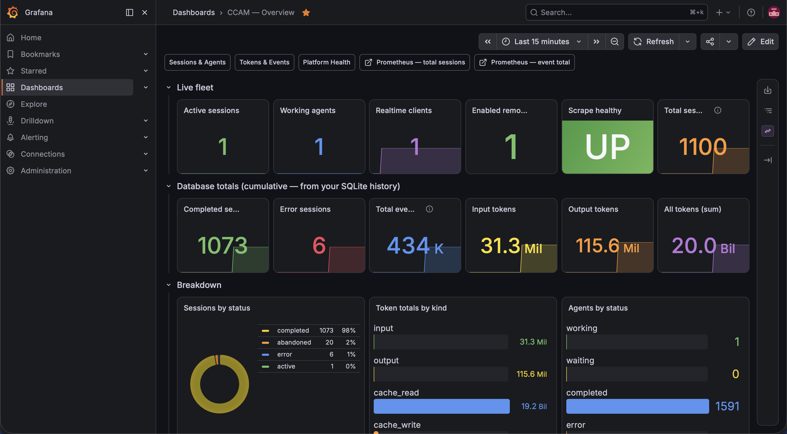
  <br>
  <em>📊 <strong>Grafana · CCAM — 概要 (Overview)</strong> — デフォルトのホームダッシュボード（4 つのボードが自動プロビジョニングされます）：フリートのスナップショット、データベースの合計、内訳チャート、およびレート — すべてライブの <code>/api/metrics</code> スクレイプからのものです</em>
</p>

<p align="center">
  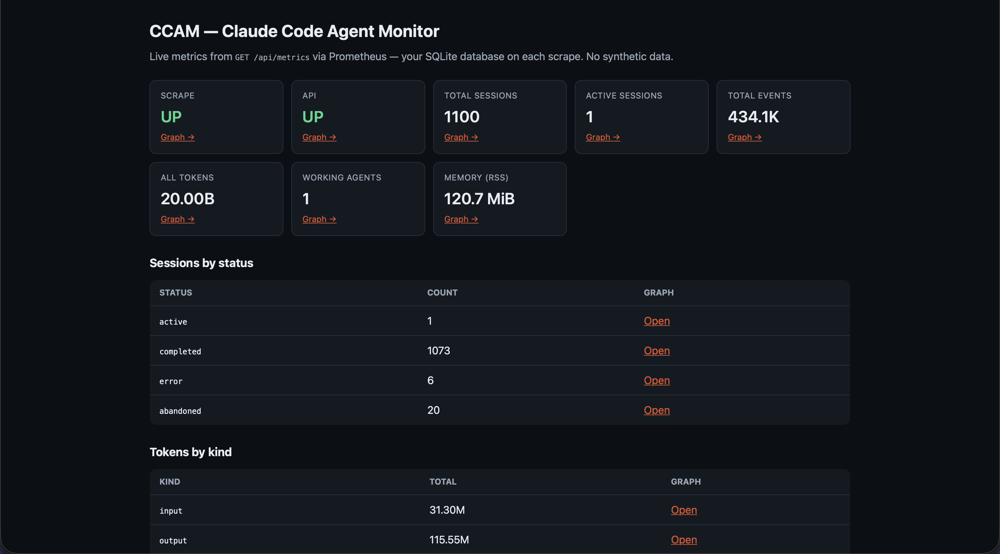
  <br>
  <em>🔥 <strong>Prometheus · CCAM コンソール</strong> — <code>/consoles/index.html</code> にある事前構築済みのランディングページで、スクレイプの正常性、セッションの合計、イベント、トークン、およびドリルダウンできる Graph リンクについて Prometheus に直接クエリを実行します</em>
</p>

<p align="center">
  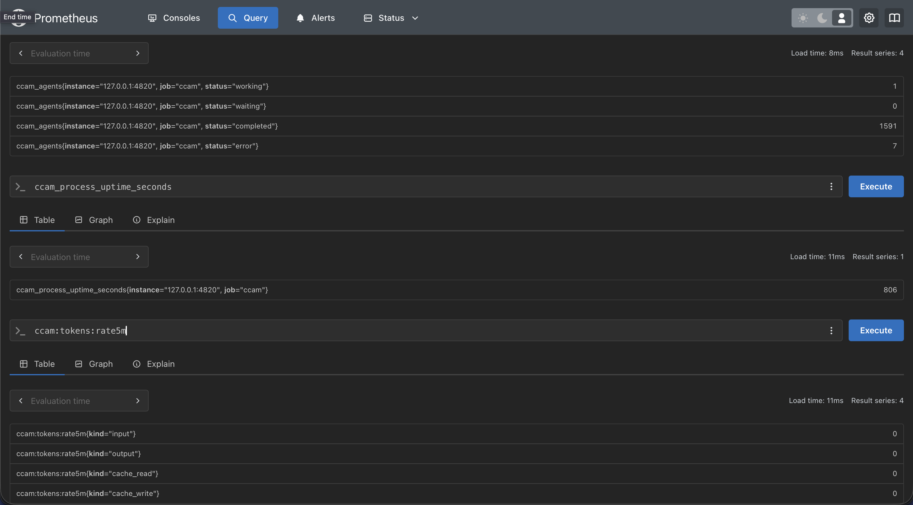
  <br>
  <em>📈 <strong>Prometheus · グラフ (Graph)</strong> — CCAM コンソールおよび <a href="./monitoring/README.md">monitoring/README.md</a> からのスターターリンクを使用して、スクレイプされた CCAM メトリクスに対して PromQL を実行します（例：<code>sum(ccam_sessions)</code>、<code>ccam_events_total</code>、<code>rate(ccam_tokens_total[5m])</code>）</em>
</p>

完全なメトリクスリストおよびスクレイプ/認証の詳細については、[docs/API.md → Metrics](./docs/API.md#metrics) を参照してください。

<p align="center">
  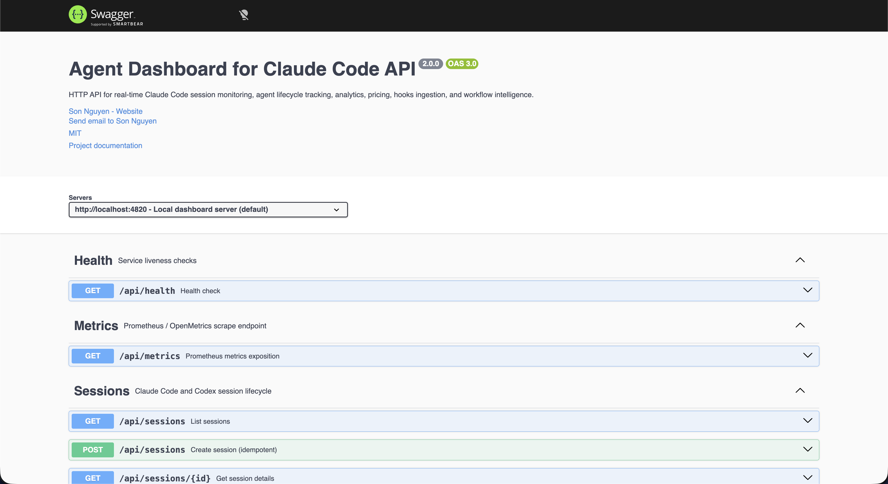
</p>

<p align="center">
  
</p>

### ヘルス (Health)

| メソッド (Method) | パス (Path)          | 説明 (Description)                           |
| ------ | ------------- | ------------------------------------- |
| `GET`  | `/api/health` | `{ status: "ok", timestamp }` を返します |

### セッション (Sessions)

| メソッド  | パス                            | クエリパラメータ                                                     | 説明                                                                                  |
| ------- | ------------------------------- | ---------------------------------------------------------------- | -------------------------------------------------------------------------------------------- |
| `GET`   | `/api/sessions`                 | `status`, `q`, `limit`, `offset`                                 | エージェント数とセッションごとのコストを含むセッションのリスト。`q` は `id` / `name` / `cwd` にわたって大文字小文字を区別しない検索を行います。`limit` のデフォルトは 50、最大 10000。応答にはページネーター用の `total` が含まれます。 |
| `GET`   | `/api/sessions/:id`             | --                                                               | エージェントとイベントを含むセッションの詳細                                                        |
| `GET`   | `/api/sessions/:id/stats`       | --                                                               | セッション詳細の概要パネルを駆動する集計カウント：イベント、タイプ別イベント、上位ツールの使用状況、エラー数、エージェントのタイプ/ステータス数、サブエージェントタイプの内訳、トークンの合計、時間範囲 |
| `GET`   | `/api/sessions/:id/transcripts` | --                                                               | セッションで利用可能な JSONL トランスクリプトのリスト（メイン + サブエージェント + コンパクション） |
| `GET`   | `/api/sessions/:id/transcript`  | `agent_id`, `limit`, `offset`, `after`, `before`                 | カーソルベースのページネーションを使用して、特定のトランスクリプトからメッセージをストリーミングします。アシスタントの `usage` には `input_tokens`、`output_tokens`、`cache_read_input_tokens`、`cache_creation_input_tokens` が含まれるため、再開 / 再接続時に実行ページのメーターを完全に復元できます |
| `POST`  | `/api/sessions`                 | --                                                               | セッションを作成します (`id` に対して冪等) |
| `PATCH` | `/api/sessions/:id`             | --                                                               | セッションのステータス/メタデータを更新します |

### エージェント (Agents)

| メソッド  | パス              | クエリパラメータ                              | 説明                   |
| ------- | ----------------- | ----------------------------------------- | ----------------------------- |
| `GET`   | `/api/agents`     | `status`, `session_id`, `limit`, `offset` | フィルター付きのエージェントリスト      |
| `GET`   | `/api/agents/:id` | --                                        | 単一エージェントの詳細           |
| `POST`  | `/api/agents`     | --                                        | エージェントを作成                  |
| `PATCH` | `/api/agents/:id` | --                                        | エージェントのステータス/タスク/ツールを更新 |

### イベント (Events)

| メソッド | パス          | クエリパラメータ                    | 説明                |
| ------ | ------------- | ------------------------------- | -------------------------- |
| `GET`  | `/api/events` | `session_id`, `limit`, `offset` | イベントリスト (最新のものから順に) |

### 統計 (Stats)

| メソッド | パス         | 説明                                            |
| ------ | ------------ | ------------------------------------------------------ |
| `GET`  | `/api/stats` | 集計カウント、ステータス分布、WS 接続数 |

### 分析 (Analytics)

| メソッド | パス             | 説明                                                |
| ------ | ---------------- | ---------------------------------------------------------- |
| `GET`  | `/api/analytics` | チャートとトレンドビューのためのトークン/ツール/セッションの集計   |

### リモートデータソース (Remote Data Sources)

| メソッド   | パス                            | クエリパラメータ | 説明                                                                                 |
| -------- | ------------------------------- | ------------ | ------------------------------------------------------------------------------------------- |
| `GET`    | `/api/remote-sources`           | --           | 構成されたリモートソースを、ステータス、最後のエラー、および最終同期のカウントとともに一覧表示します |
| `POST`   | `/api/remote-sources`           | --           | ソースを作成します。ボディ: `{ label, host, ssh_port?, identity_file?, remote_home?, remote_codex_home?, enabled? }` |
| `PATCH`  | `/api/remote-sources/:id`       | --           | ソースを更新します（ラベル、接続フィールド、有効/無効）                                       |
| `DELETE` | `/api/remote-sources/:id`       | `purge`      | ソースを削除します；`?purge=true` の場合は、そのソースのインポートされたセッションも削除されます                 |
| `POST`   | `/api/remote-sources/:id/test`  | --           | ソースへの SSH 接続性をプローブします                                                        |
| `POST`   | `/api/remote-sources/:id/sync`  | --           | 今すぐソースから取得し、再インポートします                                                      |

`GET /api/sessions`、`/api/events`、`/api/agents`、`/api/stats`、および `/api/analytics` は、結果を元の場所 (origin) でスコープするためのオプションの `sources` クエリパラメータ（コンマ区切りのソース ID；すべての場合は省略）を受け入れます。また、`GET /api/sessions/facets` はデータスコープセレクタ用の `sources` 配列を返します。

### フック (Hooks)

| メソッド | パス               | 説明                                  |
| ------ | ------------------ | -------------------------------------------- |
| `POST` | `/api/hooks/event` | Claude Code のフックイベントを受信して処理します |

**フックイベントのペイロード:**

```json
{
  "hook_type": "PreToolUse",
  "data": {
    "session_id": "abc-123",
    "tool_name": "Bash",
    "tool_input": { "command": "ls -la" }
  }
}
```

### 価格設定 (Pricing)

| メソッド   | パス                     | 説明                              |
| -------- | ------------------------ | ---------------------------------------- |
| `GET`    | `/api/pricing`           | すべての価格設定ルールを一覧表示します |
| `PUT`    | `/api/pricing`           | 価格設定ルールを作成または更新します |
| `DELETE` | `/api/pricing/:pattern`  | 価格設定ルールを削除します |
| `GET`    | `/api/pricing/cost`      | すべてのセッションの総コスト |
| `GET`    | `/api/pricing/cost/:id`  | 特定セッションのコストの内訳 |

### ワークフロー (Workflows)

| メソッド | パス                          | 説明                                             |
| ------ | ----------------------------- | ------------------------------------------------------- |
| `GET`  | `/api/workflows`              | プロバイダー/ソースでスコープされたワークフローデータ（オーケストレーション、記録されたツール、パターン、Codex コンパクション）。オプションの `?status=active\|completed`、`?sources=...`、および `?providers=claude\|codex` フィルターはすべての 11 のデータセクションに適用されます |
| `GET`  | `/api/workflows/session/:id`  | プロバイダー/ソースでスコープされたセッションごとのドリルイン（エージェントツリー、記録されたツールのタイムライン、イベント） |

### アラート (Alerts)

| メソッド   | パス                     | 説明                                                            |
| -------- | ------------------------ | ---------------------------------------------------------------------- |
| `GET`    | `/api/alerts`            | 発動したアラートフィード、最新順 (`?unacked=true`, `limit`, `offset`)    |
| `POST`   | `/api/alerts/:id/ack`    | 1 つのアラートを承認 (acknowledge) します |
| `POST`   | `/api/alerts/ack-all`    | 未承認のすべてのアラートを承認します |
| `GET`    | `/api/alerts/rules`      | アラートルールを一覧表示します |
| `POST`   | `/api/alerts/rules`      | ルールを作成します (`event_pattern` \| `inactivity` \| `status_duration` \| `token_threshold`) |
| `PATCH`  | `/api/alerts/rules/:id`  | 名前 / 設定 / 有効状態 / クールダウンを更新します (ルールの種類は不変です) |
| `DELETE` | `/api/alerts/rules/:id`  | ルールとその発動履歴を削除します |

### Webhook (Webhooks)

| メソッド   | パス                              | 説明                                                                          |
| -------- | --------------------------------- | ------------------------------------------------------------------------------------ |
| `GET`    | `/api/webhooks/providers`         | サポートされているプロバイダーとその設定フィールド (UI フォームを駆動します) |
| `GET`    | `/api/webhooks`                   | Webhook ターゲットの一覧表示 (URL はマスクされ、シークレットは墨塗りされます) |
| `POST`   | `/api/webhooks`                   | ターゲットを作成します (14 のファーストクラスプロバイダー + `generic`) |
| `PATCH`  | `/api/webhooks/:id`               | 名前 / URL / 有効状態 / シークレット / ヘッダー / ルールスコープを更新します (種類は不変です) |
| `DELETE` | `/api/webhooks/:id`               | ターゲットとその配信ログを削除します |
| `POST`   | `/api/webhooks/:id/test`          | 合成的なテストアラートを送信し、配信結果を報告します |
| `GET`    | `/api/webhooks/:id/deliveries`    | ターゲットの最近の配信ログ (`limit`, `offset`) |

ホストされたプロバイダーには HTTPS が必要です。`generic` と `n8n` はローカルまたはセルフホストされた受信者向けに HTTP を使用できます。配信はリダイレクトを拒否するため、認証情報、カスタムヘッダー、および HMAC 署名が 2 番目の URL に転送されることはありません。

### 設定 (Settings)

| メソッド | パス                           | 説明                                      |
| ------ | ------------------------------ | ------------------------------------------------ |
| `GET`  | `/api/settings/info`           | システム情報、DB 統計、フックのステータス |
| `POST` | `/api/settings/clear-data`     | すべてのセッション、エージェント、イベント、トークン使用量を削除します |
| `POST` | `/api/settings/reimport`       | `~/.claude/` からレガシーセッションを再インポートします |
| `POST` | `/api/settings/reinstall-hooks`| Claude Code フックを再インストールします |
| `POST` | `/api/settings/reset-pricing`  | Claude、Codex、または両方の価格設定テーブルをデフォルトにリセットします |
| `GET`  | `/api/settings/export`         | すべてのデータ（セッション、エージェント、イベント、token_usage、ワークフロー、dashboard_runs、alert_rules、model_pricing、gpt_model_pricing）を 1 つのバージョン管理された JSON ダウンロードとしてエクスポートします |
| `POST` | `/api/settings/import`         | `/export` から最大 25 MiB までの 1 つのバンドルを復元します (マルチパートの `file` または JSON `{ path }`)。冪等性 + 非破壊的 — 既存のセッションは全体がスキップされます |
| `POST` | `/api/settings/cleanup`        | 古いセッションを中断し、過去のデータをパージします |

### Claude 設定エクスプローラー (`/api/cc-config`)

すべての Claude Code 構成サーフェスの読み取り専用の検査に加えて、低リスクのテキストファイルアーティファクトに対する慎重に保護された変更 (mutation) を提供します。ファイルの読み取りは要求されたパスと許可されたルートを正規化するため、シンボリックリンクが信頼された Claude ディレクトリから抜け出すことはできません。すべての書き込みパスは、変更前に `<root>/cc-config-backups/<type>/` の下にタイムスタンプ付きのバックアップを作成します。

| メソッド   | パス                                | 説明 |
| -------- | ----------------------------------- | ----------- |
| `GET`    | `/api/cc-config/overview`           | ルート (claude ホーム, プロジェクトの .claude, プロジェクトルート, ~/.claude.json) + すべてのサーフェスのカウント |
| `GET`    | `/api/cc-config/skills`             | `<scope>/.claude/skills/<name>/SKILL.md` の下のスキル (パースされたフロントマター付き)；`?scope=user\|project\|all` |
| `GET`    | `/api/cc-config/agents`             | サブエージェント `<scope>/.claude/agents/*.md` |
| `GET`    | `/api/cc-config/commands`           | スラッシュコマンド `<scope>/.claude/commands/*.md` |
| `GET`    | `/api/cc-config/output-styles`      | 出力スタイル `<scope>/.claude/output-styles/*.md` |
| `GET`    | `/api/cc-config/plugins`            | `~/.claude/plugins/installed_plugins.json` からインストールされたプラグインと、設定からの `enabledPlugins` を結合したもの。各エントリには `contributes`（プラグインのインストールディレクトリ内のスキル/エージェント/コマンド/フック/出力スタイルの数）と `plugin.json` メタデータが含まれます |
| `GET`    | `/api/cc-config/marketplaces`       | `known_marketplaces.json` からの登録済みマーケットプレイスに、各マーケットプレイス自身の `marketplace.json`（プラグイン数、所有者、説明）を付加したもの |
| `GET`    | `/api/cc-config/mcp`                | `~/.claude.json` (トップレベル + プロジェクトごと) と `settings.json` からの MCP サーバー |
| `GET`    | `/api/cc-config/hooks`              | ユーザー / プロジェクト / プロジェクトローカルの `settings.json` ファイル全体で集約されたフック |
| `GET`    | `/api/cc-config/hook-scripts`       | `~/.claude/hooks/` 内のファイル (`hooks.<event>.command` で参照されるヘルパースクリプト) |
| `GET`    | `/api/cc-config/keybindings`        | コンテキストでグループ化されたキー/アクションのペアにパースされた `~/.claude/keybindings.json` |
| `PUT`    | `/api/cc-config/keybindings`        | `{ groups: [{ context, bindings: [{ key, action }] }] }` から `keybindings.json` を上書きします。最初にバックアップを取り、トップレベルのメタデータ (`$schema`/`$docs`) を保持し、重複するコンテキスト/キーを拒否します。（`settings.json` とは異なり、CLI はセッションの途中でこれを書き換えないため）編集しても安全です |
| `GET`    | `/api/cc-config/statusline`         | `settings.json.statusLine` の設定 + 存在する場合は実際の `statusline.py` / `statusline-command.sh` コンテンツ |
| `GET`    | `/api/cc-config/settings`           | ユーザー / プロジェクト / プロジェクトローカルの設定 JSON。シークレットと思われるキー（`/token\|secret\|password\|api[_-]?key\|auth/i` に一致するもの）は `"<redacted>"` に置き換えられます |
| `GET`    | `/api/cc-config/memory`             | ユーザーおよびプロジェクトスコープの `CLAUDE.md` ファイル、さらにプロジェクトごとのファイルベースのメモリ：`~/.claude/projects/<slug>/memory/` 下のすべての `*.md` に対する `scope:"auto-memory"` アイテム（それぞれ `project`, `name`, `isIndex`, およびパースされた `frontmatter` を持ちます）。`{ scope: "auto-memory", type: "auto-memory", project, name }` と共に `PUT`/`DELETE /api/cc-config/file` を介して変更します（バックアップは `<memory-dir>/.cc-config-backups/auto-memory/` に配置されます） |
| `GET`    | `/api/cc-config/file?path=…`        | 単一ファイルの本文 (CLAUDE_HOME / プロジェクト .claude / プロジェクト CLAUDE.md にパス制限されます) |
| `GET`    | `/api/cc-config/backups`            | すべてのタイムスタンプ付きバックアップのリスト (オプションで `?scope=&type=` フィルター可能) |
| `PUT`    | `/api/cc-config/file`               | テキストファイルアーティファクトを作成または上書きします。本文: `{ scope, type, name?, content }`。ファイルが存在する場合は自動的にバックアップします。一時ファイル + リネームによるアトミック操作。256 KB のコンテンツ制限、厳格な `name` 正規表現 |
| `DELETE` | `/api/cc-config/file`               | テキストファイルアーティファクトをバックアップしてから削除します。スキルディレクトリは（バンドルされたアセットを保持するために）再帰的に削除される前に全体がバックアップされます |

### エージェントの実行 (`/api/run`)

ダッシュボードから `claude` サブプロセスをスポーンおよび監視するための HTTP サーフェス。すべてのルートで Same-Origin ガードが働きます — ブラウザのリクエストは localhost オリジンから来る必要があります。Origin がない (CLI/curl) リクエストは通過します。提供される `cwd` は存在する絶対ディレクトリでなければならず、`realpath` で正規化されます。ユーザーのホームディレクトリや最近の任意のプロジェクトから Run Agent を起動できるように、意図的にこのリポジトリの外部のディレクトリを指定することも可能です。

| メソッド   | パス                              | 説明 |
| -------- | --------------------------------- | ----------- |
| `GET`    | `/api/run`                        | インメモリのすべての実行ハンドル（稼働中 + 最近完了したもの）を一覧表示します；`maxConcurrent` と `activeCount` も返します |
| `GET`    | `/api/run/binary`                 | `claude` が `PATH` 上にあるか、またどこに存在するかをプローブします — 実行前に UI が明確なエラーを表示するために使用されます |
| `GET`    | `/api/run/cwds`                   | 推奨される作業ディレクトリ：ダッシュボードサーバーの cwd、`$HOME`、およびセッションテーブルからの最近の cwd |
| `GET`    | `/api/run/files?cwd=…&q=…`        | Run ページの `@`-file オートコンプリート用の、`cwd` 内のあいまい (Fuzzy) ファイル検索。`node_modules`、`.git`、`dist`、`build`、`.next`、`.cache`、`coverage` などをスキップします。Cwd は必須であり、存在する必要があります。結果は制限され、ベースネームの一致度でランク付けされます |
| `POST`   | `/api/run`                        | 新しい実行をスポーンします。ボディ: `{ prompt, mode: "headless"\|"conversation", cwd?, model?, permissionMode?, resumeSessionId?, effort? }`。Headless は `-p` 経由でプロンプトを argv に入れ、標準入力を閉じます。Conversation は stream-json エンベロープとしてプロンプトを標準入力にパイプし、フォローアップのために標準入力を開いたままにします。`resumeSessionId` (conversation モードのみ) は `--resume <id>` を追加します；これが設定されている場合、`prompt` は空でもかまいません — スポーナーは最初の標準入力への書き込みをスキップし、`claude` はユーザーが `POST /api/run/:id/message` を介してフォローアップを送信するまで、再開された会話上で待機します。`effort` (`low` / `medium` / `high`) は `--effort` にマッピングされます。スポーナーは常に `--output-format stream-json --verbose --include-partial-messages` を渡すため、UI は文字ごとの差分 (delta) をレンダリングできます。同時実行数は実質的に無制限です (デフォルトの上限は 10000 — `RUN_MAX_CONCURRENT` でオーバーライド可能) |
| `GET`    | `/api/run/:id`                    | 現在のハンドルの状態。`?envelopes=1` はインメモリのエンベロープログを含めるため、再アタッチ時に UI が履歴をリプレイできます |
| `POST`   | `/api/run/:id/message`            | 実行中の会話にフォローアップターンを送信します (conversation モードのみ)。ボディ: `{ text }` |
| `DELETE` | `/api/run/:id`                    | 実行を停止します。SIGTERM を送信し、5秒後に SIGKILL にエスカレーションします |

出力は、既存のダッシュボード WebSocket 上を 3 つのメッセージタイプとしてストリームされます：`run_stream`（パースされた stream-json エンベロープ、`--include-partial-messages` からの `stream_event` デルタを含む）、`run_status`（ステータス遷移）、`run_input_ack`（標準入力の書き込み確認）。設定エクスプローラー（Config Explorer）ページは 4 つ目のメッセージ — `cc_config_changed` — を購読します。これは、`server/lib/cc-watcher.js` ( `~/.claude/` の `fs.watch` 経由) および `routes/cc-config.js` が、成功したすべての PUT/DELETE の後に、ペイロード `{ source: "dashboard"|"fs", action?, scope?, type?, name?, paths? }` とともにブロードキャストするものです。セッションリストとセッション詳細ページは、`/api/run` をポーリング（および `run_status` をリッスン）して、現在実行中の Run によって駆動されているセッションに対し、`/run` に戻るためのクリック可能な **▶ Run** インジケーターのバッジを付けます。

### 履歴のインポート (Import History)

**設定 (Settings) → 履歴のインポート (Import History)** のプロバイダータブから、既存の **Claude Code** または **Codex** の履歴をインポートします。Claude Code は `~/.claude/projects` 用の共有 JSONL パーサーを使用し、Codex は `~/.codex/sessions` に対するリアルタイム監視と同じ追記型ロールアウトインジェスターを使用します。これには、トークンスナップショット、response-item のツール呼び出し、ライフサイクル状態、および `session_index.jsonl` が含まれる場合はネイティブの `/rename` タイトルが含まれます。再インポートは冪等性があります：Claude はコンパクションのベースラインを保持し、Codex はバイトカーソルを保持するため、どちらのプロバイダーも使用量やコストを二重にカウントすることはありません。フォルダーやブラウザからアップロードされた Codex の履歴は、一時ファイルがクリーンアップされる前にダッシュボード所有のストレージにコピーされるため、後で会話ビューを引き続き利用できます。

4 番目のモード — **バックアップの復元 (Restore backup)** — は、生の Claude トランスクリプトではなく、完全なダッシュボードの `.json` エクスポート (**データのエクスポート** ボタン、`ccam export`、または `GET /api/settings/export` によって生成されたもの) をインポートします。これはエクスポートのラウンドトリップ版にあたります：すべてのテーブル（sessions, agents, events, token_usage, workflows, dashboard_runs, alert_rules, model_pricing, gpt_model_pricing）を復元し、冪等でかつ非破壊的です — すでに存在するセッションは全体がスキップされるため、何も複製したり上書きしたりすることなく、**複数のマシン**を安全に 1 つのダッシュボードに統合することができます。これは `server/lib/data-transfer.js` と `POST /api/settings/import` (または `ccam import-data <file>`) によってサポートされています。

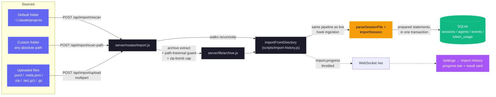

**ルート (Routes)**

| メソッド | パス                    | 説明                                                              |
| ------ | ----------------------- | ------------------------------------------------------------------------ |
| `GET`  | `/api/import/guide`     | プロバイダーを考慮した OS パス、アーカイブコマンド、拡張子、および指示 (`?provider=claude\|codex`) |
| `POST` | `/api/import/rescan`    | 選択されたデフォルトを再スキャンします: `~/.claude/projects` または `~/.codex/sessions` (`{ provider }`) |
| `POST` | `/api/import/scan-path` | `{ path, provider }` を使用して絶対パスのディレクトリをスキャンします；再帰的に走査します |
| `POST` | `/api/import/upload`    | `.jsonl`, `.meta.json`, `.zip`, `.tar(.gz)`, `.gz` の `provider` 付きマルチパートアップロード |

**サポートされている入力:** 単一の JSONL (`.jsonl`) セッショントランスクリプト、それに付随する `.meta.json` サイドカー、および任意のネストされたディレクトリレイアウトを含むアーカイブ（`.zip`, `.tar`, `.tar.gz`/`.tgz`, 単なる `.gz`）。2 つの正規の Claude Code レイアウトが自動的に認識されます：`<project>/<sessionId>/subagents/agent-*.jsonl` (デフォルト) および `<project>/subagents/<sessionId>/agent-*.jsonl` (代替)。Codex の場合、インポーターは再帰的な `rollout-*.jsonl` セッションファイル (`session_meta` を持つ単一の JSONL ファイルを含む) およびオプションの
`session_index.jsonl` (ネイティブなセッション名の場合)。

**精度の保証 (Accuracy guarantees).** セッションは UUID によって重複排除されるため、インポーターを再実行しても常に安全です。コンパクションの `baseline_input` / `baseline_output` / `baseline_cache_read` / `baseline_cache_write` 列は、トランスクリプトがコンパクト化される前のトークン数を保持するため、コンパクション後の JSONL を再取り込みしても履歴のコストが消去されることはありません。イベントレベルの重複排除は、イベントタイプごとのハイウォーターマーク（セッションの `MAX(created_at) GROUP BY event_type`）を使用します。すべての再インポート時に、`ts > cutoff[type]` を持つ JSONL エントリのみが挿入されるため、トランスクリプトが複数日にまたがって成長するような長時間のセッションでも、以前の作業を重複させることなく Stop / PostToolUse / TurnDuration / ToolError イベントを受信し続けます。`sessions.ended_at` は、JSONL の最後のアクティビティが保存された値を超えた場合に前方にロールされ、メッセージ数のメタデータはすべてのパスで更新されます。

**巨大なトランスクリプトの安全性 (Huge-transcript safety).** 共有トランスクリプトキャッシュ (`server/lib/transcript-cache.js`) は JSONL ファイルを 4 MiB のチャンクで読み取り、一度に 1 行だけをデコードします。これにより、V8 の最大 JS 文字列長（64 ビット Node 20 で約 512 MiB）を超えるトランスクリプトでも、プロセスを `FATAL ERROR: v8::ToLocalChecked Empty MaybeLocal` でアボートすることなくパースできます。フックの取り込み、定期的なコンパクションのスイープ、および履歴インポーターでも同じチャンク化されたパスが使用され、ファイル全体を 1 つの JS 文字列として実体化することはありません。エントリごとの拡張可能な配列 (`turnDurations`, `errors`, `compaction.entries`, `usageExtras.*`) は `TRANSCRIPT_CACHE_MAX_ARRAY_LEN` (デフォルト `1000`) でテールキャップされ、`2 × cap` ウォーターマークでのパース中にトリミングが適用されます。これにより、複数日にわたるセッションの完全なファイルの新規パースが、最終化の前に無制限の一時的メモリを構築することはなくなります。

**安全性 (Safety).** アーカイブ抽出は、すべてのエントリに対してパストラバーサル（絶対パスと `..` セグメントは拒否されます）を検証します。構成可能な抽出上限 (`CCAM_IMPORT_MAX_EXTRACT_BYTES`、デフォルト 4 GB) により、zip/tar/gzip ボムを防ぎます。アップロードサイズはファイルごと (`CCAM_IMPORT_MAX_BYTES`、デフォルト 1 GB) およびリクエストごと (`CCAM_IMPORT_MAX_FILES`、デフォルト 2000) に制限されています。すべてのステージングディレクトリはリクエストごとのものであり、`finally` 内で再利用 (reclaim) されます。これは、multer がすべてのファイルを最初に拒否した場合も含まれます。

**進捗 (Progress).** インポートのアクティビティは、既存の WebSocket を介して `import.progress` メッセージ（`phase`: `start` / `scan` / `extract` / `parse` / `complete` / `error`）としてブロードキャストされ、大規模なインポート時にチャンネルのフラッディングを避けるためにスロットリングされます。

**UI.** ステップバイステップの手順、ライブの進捗、およびインポートされた / 拡張された / スキップされた / エラー数のカウントを示すインポート後のサマリーを備えた、ガイド付きのドラッグアンドドロップエクスペリエンスについては、**設定 (Settings) → 履歴のインポート (Import History)** パネルを使用してください。

<p align="center">
  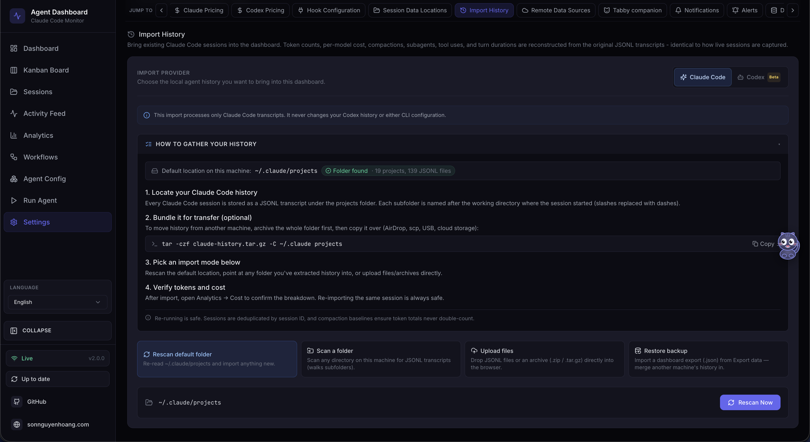
</p>

### WebSocket

`ws://localhost:4820/ws` に接続して、リアルタイムのプッシュメッセージを受信します:

```json
{
  "type": "agent_updated",
  "data": { "id": "...", "status": "working", "current_tool": "Edit" },
  "timestamp": "2026-03-05T15:43:01.800Z"
}
```

**メッセージの種類:** `session_created`, `session_updated`, `agent_created`, `agent_updated`, `new_event`, `alert_triggered`, `alert_updated`, `remote_source.status` (データ `{ id, status: "idle"|"syncing"|"ok"|"error"|"deleted", error?, last_sync_at? }`)

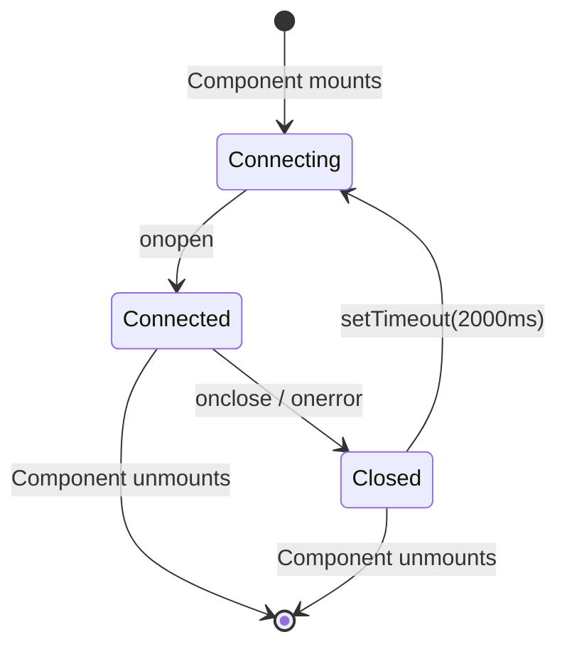

---

## フックイベント (Hook Events)

ダッシュボードは、以下の Claude Code フックタイプを処理します:

| フックの種類 | トリガー | ダッシュボードのアクション |
| ------------------- | ------------------------------ | -------------------------------------------------------------------------------------------- |
| `SessionStart`      | Claude Code セッション開始 | セッションとメインエージェントを作成します。`awaiting_input_since`（`awaiting_reason=session_start` 付き）をスタンプするため、新しいセッションは **待機中 (Waiting)** となります。例外として `compact` ソースの SessionStart（ターン中間の自動コンパクション）はフラグをそのままにするため、作業中のセッションは **アクティブ (Active)** のまま維持されます。再開されたセッションを再度アクティブ化します。`DASHBOARD_STALE_MINUTES`（デフォルト 180）の間アクティビティがない孤立したセッションを放棄します。 |
| `UserPromptSubmit`  | ユーザーがプロンプトでエンターを押した時 | 待機フラグをクリアし、メインエージェントを `working` に昇格します — テキストのみのアシスタントターンは `PreToolUse` を発行しないため、これがターン開始の唯一のシグナルです |
| `PreToolUse`        | エージェントがツールの使用を開始した時 | 待機フラグをクリアし、エージェントを `working` に設定し、`current_tool` を設定します。ツールが `Agent` の場合、サブエージェントレコードを作成します |
| `PostToolUse`       | ツールの実行が完了した時 | 待機フラグをクリアします（Notification がツール使用の途中でスタンプした権限プロンプトの承認を処理します）。`current_tool` をクリアします。エージェントは `working` のまま維持されます |
| `Stop`              | Claude が応答を終了した時 | エラーがない場合: メインエージェントは `waiting` になります — Claude はターンを終え、ボールはユーザーに渡されます。`stop_reason=error`: エージェントとセッションを `error` とマークします。バックグラウンドのサブエージェントは実行を継続します |
| `SubagentStop`      | バックグラウンドエージェントが終了した時 | 説明、タイプ、またはタスクによってサブエージェントを一致させ、完了させます。意図的に待機フラグをクリア**しません** — サブエージェントの終了は人間についての情報を何も伝えないからです。**非同期 (fire-and-forget) の JSONL スキャンをトリガーし** (`scanAndImportSubagents`)、サブエージェント自身の `agent_id` の下でツールごとの `PreToolUse` + `PostToolUse` イベントを発行するため、タイムラインにはスポーンマーカーだけでなく、サブエージェントが実行したすべてのツールが表示されます |
| `Notification`      | エージェントの通知 | イベントを記録します。権限/入力プロンプトメッセージはエージェントを `waiting` に設定し、`awaiting_input_since` (パターンのマッチによる `awaiting_reason=notification`: `permission`, `waiting for input`, `needs your approval`, …) をスタンプします。コンパクション通知は `Compaction` イベントとしてタグ付けされます。有効な場合、ブラウザ通知をトリガーします |
| `SessionEnd`        | Claude Code CLI プロセスが終了した時 | 待機フラグを落とします。セッションがすでに `error` 状態の場合はエラー状態が維持され、それ以外の場合はすべてのエージェントとセッションが `completed` (完了) としてマークされます |
| `Compaction`   | JSONL で `/compact` が検出された時 | コンパクションサブエージェント (タイプ `compaction`) と Compaction イベントを作成します。トランスクリプト JSONL の `isCompactSummary` エントリから検出されます。アクティブなセッションの定期的なスキャナーによっても検出されます |
| `APIError`     | JSONL トランスクリプトの API エラー | `isApiErrorMessage` エントリ (quota, rate limit, invalid_request) および生の `type: "error"` 応答から抽出されます。**現在、セッションとエージェントはただちに `error` とマークされます** — 以前はステータスを変更せずにイベントとして記録されていました。エラーの詳細を含むイベントとして保存されます |
| `TurnDuration` | JSONL トランスクリプトのターンのタイミング | `durationMs` を持つ `system` サブタイプの `turn_duration` メッセージから抽出されます。ターンレベルのタイミング分析のためのイベントとして保存されます |
| `ToolError`    | JSONL でのツール結果のエラー | `toolUseResult.is_error` エントリから抽出されます。エラー伝播分析のためにツールレベルの失敗を追跡します |
| `Interrupted`  | ユーザーによってキャンセルされたターン (Esc) | ウォッチドッグによって合成されます — `Esc` はフックを発生させないため、スタックした `working` セッションはトランスクリプトの `[Request interrupted by user]` マーカーから検出されるか、あるいはいかなる出力より前に Esc が押された場合は、アイドルワークタイムアウト (`DASHBOARD_WORKING_IDLE_SECONDS`) によって検出されます。セッションは **待機中 (Waiting)** に移行します (通常の `Stop` と同じ) |

---

## ブラウザ通知 (Browser Notifications)

ダッシュボードは、ダッシュボードのタブにフォーカスがない場合やブラウザがバックグラウンドにある場合でも、Web Push (VAPID) を使用した永続的なブラウザ通知をサポートし、リアルタイムのアラートを提供します。

### 仕組み (How It Works)

1. 設定 (Settings) ページでマスタートグルを使用して通知を**有効 (Enable)** にします。
2. プロンプトが表示されたらブラウザの権限を**付与 (Grant)** します — これにより Service Worker が登録され、プッシュサブスクリプションが作成されます。
3. どのイベントで通知をトリガーするかを**設定 (Configure)** します:

| イベント (Event) | デフォルト | 説明 (Description) |
| ---------------------------- | ------- | --------------------------------------------------------------- |
| 新しいセッション開始 | オン | 新しい Claude Code セッションが作成されたときに発行されます |
| Claude の応答完了 | オフ | Claude が応答ターンを終了したときの `Stop` イベントで発行されます |
| セッションの終了 | オフ | CLI プロセスが終了したときの `SessionEnd` で発行されます |
| セッションエラー | オン | セッションがエラーで終了したときに発行されます |
| サブエージェントのスポーン | オフ | バックグラウンドのサブエージェントが作成されたときに発行されます |

さらに、Claude Code からの `Notification` フックイベントは、イベントごとのトグルに関係なく（マスタートグルが有効である限り）ブラウザ通知をトリガーします。

### 通知アーキテクチャ (Notifications Architecture)

- **VAPID パイプライン:** 安全なメッセージ配信のためにサーバー上で `web-push` を使用します。VAPID キーは自動生成され、`data/vapid-keys.json` に保存されます。
- **Service Worker:** 専用のワーカー (`client/public/sw.js`) が受信した `push` イベントを処理し、macOS で確実に音声が再生されるように `silent: false` を指定して通知を表示します。
- **サブスクリプション:** ブラウザ固有のエンドポイントは SQLite の `push_subscriptions` テーブルに保存されます。
- **永続性:** Service Worker がバックグラウンドで動作するため、ブラウザが閉じられていても通知が届きます。
- **テスト通知:** 設定 (Settings) にあるボタンを使用すると、VAPID パイプラインとオーディオの再生を確認できます。

### PWA とオフラインサポート (PWA & Offline Support)

このプロジェクトは、**ダッシュボード**、**ランディングページ**、**Wiki** 用に 3 つの独立したプログレッシブ Web アプリ (PWA) を提供しています。それぞれに独自の `manifest.json` と Service Worker があるため、ブラウザはそれらを個別のインストール可能なアプリケーションとして扱います。

| サーフェス | マニフェスト | Service Worker | キャッシュ戦略 |
| --- | --- | --- | --- |
| ダッシュボード (`client/`) | `client/public/manifest.json` | `client/public/sw.js` | `/assets/*` 配下の Vite のコンテンツハッシュ化されたバンドルは、キャッシュファーストで提供されます (URL はビルドごとに不変です)。それ以外 (ナビゲーション、SW 自身、`manifest.json`、アイコン、ルート `/`) はキャッシュをフォールバックとしたネットワークファーストなので、ハードリフレッシュなしでもリビルド後は常に最新の UI が表示されます。API (`/api/*`)、WebSocket (`/ws`)、および Vite HMR リクエストはキャッシュされません。プッシュ通知ハンドラーはキャッシュロジックと一緒に保持されます。Express の静的ミドルウェア (`server/index.js`) は、`/assets/*` に対して `Cache-Control: public, max-age=31536000, immutable` を送信し、`index.html`、`sw.js`、`manifest.json` に対して `Cache-Control: no-cache, must-revalidate` を送信することでこれを強化します。`client/src/main.tsx` は `controllerchange` をリッスンし、すでに制御されているページで新しい SW がアクティブ化すると、一度だけリロードを実行します (初回のインストールでは実行されません)。 |
| ランディングページ (ルート) | `manifest.json` | `sw.js` | HTML シェル、ファビコン、OG 画像をプリキャッシュします。スクリーンショットの PNG は初回表示時に遅延キャッシュ (キャッシュファースト) され、重い初期プリキャッシュを避けます。ナビゲーションはオフラインフォールバック付きのネットワークファーストです。 |
| Wiki (`wiki/`) | `wiki/manifest.json` | `wiki/sw.js` | `index.html`、`style.css`、`script.js`、マニフェスト、およびファビコンをプリキャッシュします。1 回のアクセス後は完全にオフライン対応となります。HTML はネットワークファースト、CSS/JS はキャッシュファーストです。 |

**キャッシュのライフサイクル:** 3 つの SW はすべてインストール時に `skipWaiting()` を呼び出し、アクティブ化時に古いキャッシュを削除します（`dashboard-v2`、`landing-v1`、`wiki-v1` のようなバージョン文字列をキーとします）。バージョン定数をインクリメントするとクリーンなリフレッシュが強制されます。

**iOS サポート:** すべての 3 つの HTML ファイルには、Safari でのスタンドアロン・ホーム画面モードのために `<meta name="apple-mobile-web-app-capable" content="yes">` と `<meta name="apple-mobile-web-app-status-bar-style" content="black-translucent">` が含まれています。

**アイコン:** マニフェストは `sizes="any"` および `type="image/svg+xml"` を指定した `favicon.svg` を参照します — これは Chrome 107 以降、Firefox 110 以降、Edge 107 以降でサポートされています。Apple のタッチアイコンも SVG ファビコンを使用します。

---

## アップデート通知 (Update Notifier)

ダッシュボードは自身の git チェックアウトを監視し、正規のデフォルトブランチのコミットが HEAD より進んでいる場合にモーダルを表示します。**ブランチおよびフォーク対応:** `upstream` リモート（フォークの標準的な規約）がある場合、`origin` よりも優先されます。選択されたリモートの `master`/`main`/`HEAD` が比較参照 (ref) になります。`manual_command` は状況に適応します — ローカルブランチが正規の参照を追跡している場合のみ `git pull --ff-only` となり、それ以外の場合はコマンドが嘘をつかないように `git fetch`（フォークの場合はファストフォワードマージ）になります。ユーザーはターミナルで実行するための正確なコマンドを受け取ります — サーバーは自身を自らプルしたり再起動したり**しません**。これにより、このメカニズムは開発セッション、pm2/systemd/launchd/Docker スーパービジョン、リモートデプロイメント全体でポータブルなまま維持されます。

<p align="center">
  
</p>

### 仕組み (How It Works)

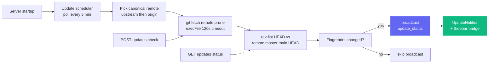

単一のチェックは安価であり（正規のリモートに対して `git fetch <remote> --prune` を実行 — 設定されていれば `upstream`、そうでなければ `origin`）、`execFile`（シェルなし）と 120 秒のタイムアウトでラップされています。オフラインのネットワーク、git 以外のインストール、設定されたリモートがない、解決できないアップストリーム参照などの失敗は、例外を投げるのではなく、すべて**ソフトなペイロード**（例: `fetch_error: "..."`）を返します。そのため、リモートが不安定であってもダッシュボードがブロックされることはありません。

### UI サーフェス

| サーフェス | 動作 |
| --- | --- |
| **モーダル** (`client/src/components/UpdateNotifier.tsx`) | `update_available === true` であり、ユーザーがこの特定の `remote_sha` をまだ閉じて (dismiss) いない場合に表示されます。遅延しているコミット数、追跡されている参照、オプションの `situation_note`（機能ブランチ/フォークにいる場合に、なぜコマンドが異なるかを説明するメモ）、コピー・ペースト可能なコマンド、および 3 つのボタン（**コマンドをコピー**, **今すぐ確認する**, **閉じる**）を表示します。ESC とバックドロップのクリックで閉じます。`localStorage` で `remote_sha` をキーにしているため、新しいアップストリームコミットがある場合はモーダルが自動的に再び開きます。 |
| **サイドバーボタン** (`client/src/components/Sidebar.tsx`) | フッターにある常に表示される「アップデートを確認」ボタン。遅れている場合はエメラルドの枠 + 緑色のバッジドット、前回の確認がフェッチエラーになった場合はアンバー色になります。クリックすると以前の「閉じた」状態がクリアされ、`POST /api/updates/check` が発火します。 |
| **サーバーターミナル** | スケジューラーが「最新 (up to date)」から「遅延 (behind)」に遷移すると、コマンドを含むフレーム付きのブロックを標準出力にプリントするため、ヘッドレスで実行しているユーザーにも表示されます。 |

### API サーフェス

| エンドポイント | 目的 |
| --- | --- |
| `GET /api/updates/status` | 読み取り専用チェック: 正規のリモートに対して `git fetch` を実行し、HEAD をそのデフォルトブランチと比較し、ペイロードを返します。 |
| `POST /api/updates/check` | 同じチェックですが、WebSocket 上で `update_status` をブロードキャストするため、接続されているすべてのクライアントが一度に更新されます。 |

どちらのエンドポイントも同じペイロード構造を返します:

```json
{
  "git_repo": true,
  "update_available": true,
  "repo_root": "/Users/you/Claude-Code-Agent-Monitor",
  "remote_ref": "upstream/master",
  "canonical_remote": "upstream",
  "current_branch": "master",
  "tracking_upstream": "origin/master",
  "tracks_canonical": false,
  "situation": "fork_or_diverged_tracking",
  "local_sha": "abc1234...",
  "remote_sha": "def5678...",
  "commits_behind": 3,
  "manual_command": "cd \"/...\" && git fetch upstream && git merge --ff-only upstream/master && npm run setup",
  "situation_note": "You're on 'master' tracking 'origin/master'. This command fast-forwards your branch from upstream/master (the canonical default).",
  "message": "3 commit(s) on upstream/master not in your checkout."
}
```

`situation` は以下のいずれかになります: `tracking_canonical`（デフォルトブランチの通常のクローン — `git pull --ff-only` が機能します）、`fork_or_diverged_tracking`（ローカルブランチ名は正規のものと一致するが別のリモートを追跡している — `git fetch <remote> && git merge --ff-only <ref>`）、`feature_branch`（デフォルトブランチから外れている — フェッチのみで統合はユーザーに任されます）、または `detached_head`。

### 意図的に**ここにはない**もの

`POST /api/updates/apply` や自己再起動ヘルパーは、意図的に存在しません。プロセス内からのプロセスの自己更新は、外部のスーパーバイザーなしには信頼できません — `npm run dev` (concurrently)、`npm start`、`pm2`、`systemd`、`launchd`、および Docker はそれぞれ異なる再起動ロジックを必要とします。また、死にかけているサーバーでの `git pull` / `npm install` の失敗にはクリーンなロールバックパスがありません。検出のみに限定することで、すべてのスーパーバイザー、すべての OS、すべてのブランチの状態で動作の予測可能性が保たれつつ、「いつプルすればいいか」という情報のギャップは埋められます。実際の更新はユーザー自身のシェルでの操作に委ねられます。

### 構成 (Configuration)

| 環境変数 | デフォルト | メモ |
| --- | --- | --- |
| `DASHBOARD_UPDATE_CHECK` | 有効 | `0` / `false` / `off` に設定すると、スケジューラーが完全に無効になります。 |
| `DASHBOARD_UPDATE_CHECK_INTERVAL_MS` | `300000` (5分) | 自動チェック間のインターバル。下限は 60 000 ms です — それ以下の値は切り上げられます。 |

---

## Tabby — フローティングキャットコンパニオン (Tabby — Floating Cat Companion)

**Tabby (タビー)** は、ダッシュボードのすべてのページの右下隅にピン留めされた、かわいいフローティングの猫のコンパニオンです。常に存在し、ライブセッションのストリームを、一目でわかる反応的なマスコット（会話も可能）に変換します。

<p align="center">
  
</p>

### リアクティブマスコット (Reactive mascot)

Tabby はライブセッションのストリームから派生した **8つの気分** を持つ、カーソルを追跡する SVG キャットであり、それぞれに独自のアニメーションがあります:

| 気分 (Mood) | いつ | アニメーション |
| --- | --- | --- |
| `idle` | 特筆すべきことが何も起こっていないとき | しっぽを休めて振る |
| `watching` | セッションがアクティブなとき | 耳を立てて、目がカーソルを追う |
| `happy` | セッションや実行が正常に終了したとき | 頭を上下に振る + キラキラ |
| `worried` | 何かおかしいとき | 微妙に震える |
| `stuck` | セッションがブロックされていると思われるとき | 警告 "!" |
| `thinking` | エージェントが作業中のとき | 頭をゆっくり上下に振る |
| `sleeping` | しばらく静かなとき | `zzz` |
| `disconnected` | WebSocket がダウンしているとき | 穏やかで静止したポーズ |

### 吹き出し (Speech bubbles)

Tabby は注目すべきイベント（セッションの開始/終了、エラー、実行完了）で短い皮肉を自動的に表示します。吹き出しは**スロットリングされ、まとめられる (coalesced)** ため、イベントのバーストが画面をスパムすることはありません。スクリーンリーダー用に `aria-live` を使用し、パネルから**ミュート**することもできます。

### パネル (Panel)

猫をクリックするか、**⌘B / Ctrl+B**（Esc で閉じる）を押してパネルを開きます。以下が表示されます:

- ライブの**ステータスライン** — `N ライブ · M エラー · 接続状態`。
- **クイックアクション** — Run Claude、アクティビティ、セッション、またはエラーセッションへのジャンプ。吹き出しのミュート。アラートのクリア。
- **Ask** ボックス（下記参照）。

### Ask ボックス → Run Claude ハンドオフ

**Ask** ボックスは、「何が動いているか」、「エラーはあるか」、「ステータスは」といった単純なステータスの質問には、キャッシュされたデータからローカルで応答します。それ以外の質問は、実際の Claude Code セッションをスポーンするために、既存の **Run Claude** ページに引き継がれます（`/run?prompt=…` にディープリンクします）。Tabby 自身が LLM を呼び出すことは決してありません。簡単なステータスの検索以外のすべてのことについて、Run Claude ページを再利用するだけです。

### アクセシビリティと安全な劣化 (Accessibility & safe degradation)

Tabby はキーボードで操作でき、吹き出しには `aria-live` を使用し、`prefers-reduced-motion`（モーション軽減の推奨）を尊重します。WebSocket がダウンした場合、エラーを起こすのではなく、穏やかな `disconnected` 状態に安全に劣化します。Tabby は **設定 (Settings)** (英語、中国語、ベトナム語、韓国語、スペイン語にローカライズされています) でオン/オフを切り替えることができ、実装は `client/src/components/Tabby/` にあります。

---

## 接続ステータスモーダル (Connection Status Modal)

サイドバーのフッターにある **Live** / **Disconnected** のピルをクリックすると、ダッシュボードの WebSocket トランスポートに関する詳細を示す小さなパネルが開きます。アクティブな `ws://` エンドポイント、現在のソケットの起動時間、受信した合計イベント数、横棒グラフでの上位のイベントタイプ、60 秒の処理量を示すスパークライン、および最近のアクティビティリストとしての直近の 8 つのイベントが表示されます。累積統計（合計、タイプの内訳、最近のリスト）は、`sidebar-connection-stats` という名前で `localStorage` を経由してリロードをまたいで保持されます。ローリングしているスパークラインと「connected since」のタイマーは、意図的にエフェメラル (短命) なものになっています。フッターの **リセット (Reset)** ボタンを押すと、オンデマンドですべての項目がクリアされます。

<p align="center">
  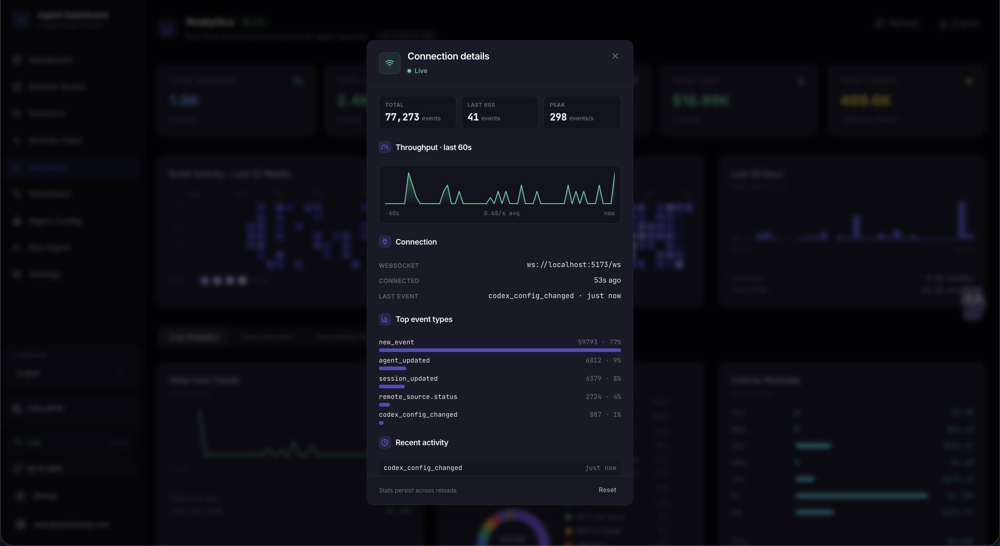
</p>

---

## VS Code 拡張機能 (VS Code Extension)

**Claude Code Agent Monitor** は、ファーストクラスの VS Code 拡張機能として利用でき、エディタを離れることなく AI エージェントを監視することができます。

<p align="center">
  
</p>

### 🚀 主な機能 (Key Features)
- **ライブサイドバー**: リアルタイムのエージェントヘルス（作業中、待機中、完了など）を表示する専用のアクティビティバービュー。
- **使用状況分析**: サイドバー内で総トークン数、ライブの USD コスト、およびイベント数を直接追跡します。
- **ステータスバー統合**: ボトムバーにある、アクティブなセッションとエージェントを表示する一目でわかるパルスモニター。
- **ディープナビゲーション**: 特定のダッシュボードビュー（かんばん、分析、設定）または最近のセッションへのワンクリックアクセス。
- **統合タブ**: ネイティブの VS Code Webview タブとしてフル監視ダッシュボードを開きます。

### 📦 インストールとセットアップ (Installation & Setup)
1. [vscode-extension](./vscode-extension) ディレクトリを開きます。
2. Marketplace から拡張機能をインストールするか、`vsce package` を使用して自分でパッケージ化します。
3. ローカルのダッシュボードサーバーが実行中であることを確認します (`npm run dev`)。
4. 開始するには、VS Code アクティビティバーの **レーダーアイコン** をクリックします。

開発者向けの詳細な構成については、[.vscode](./.vscode) および [vscode-extension](./vscode-extension) ディレクトリを参照してください。

> [!TIP]
> VS Code Marketplace の拡張機能: [Claude Code Agent Monitor](https://marketplace.visualstudio.com/items?itemName=hoangsonw.claude-code-agent-monitor)

---

## デスクトップアプリ (macOS & Windows)

ダッシュボードは、一度インストールすればそのまま使えるオプションの **ネイティブデスクトップアプリケーション** としても提供されています — macOS 用の `.app`（`.dmg` として配布）と Windows 用の `.exe`（NSIS インストーラーおよびインストール不要のポータブルビルド）。これは `client/`、`server/`、`mcp/`、および `vscode-extension/` の兄弟にあたる `desktop/` ワークスペースに存在し、**Electron 35** で構築されています。

<p align="center">
  
  <br>
  <em>🍎🪟 <strong>デスクトップアプリ (Desktop App)</strong> — メニューバー / 通知領域（トレイ）アイコン、ログイン時の自動起動、および単一インスタンスロックを備えたネイティブシェル。実際の OS ウィンドウ内に同じダッシュボードが表示されます（画像は macOS のもの）。</em>
</p>

<p align="center">
  
  <br>
  <em>🪟 ネイティブ Windows アプリと同じダッシュボード — 通知領域（トレイ）アイコン、ネイティブのウィンドウメニュー、およびログイン時の自動起動。</em>
</p>

ブラウザの `localhost:4820` で表示されるすべてのものがこのウィンドウ内にあり、その上にネイティブ OS のライフサイクルが存在します：トレイアイコン、ネイティブアプリケーションメニュー、自動起動の統合、およびサーバーをクリーンにシャットダウンする単一の終了 (quit) ボタンです。

### 仕組み (How it works)

ターミナルからダッシュボードを実行する場合とは異なり、デスクトップアプリは `npm start` も、開いているシェルも、サーバーの 2 つ目のコピーも必要としません。Electron の **メインプロセス** は Express サーバーを **インプロセス** でホストします — これは **子プロセスも IPC も使用せず** に、同じ Node ランタイム内で `server/index.js` を直接 `require()` します — そして、Chromium の `BrowserWindow` をビルド済みの React クライアントに向けます。

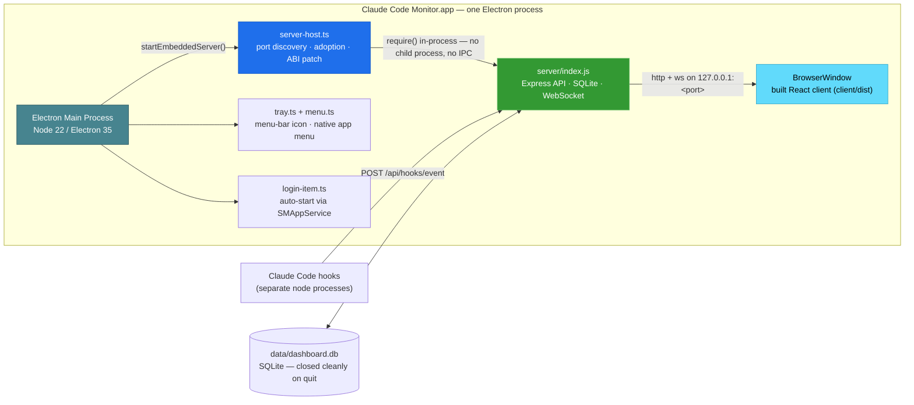

起動時にアプリは以下を行います:

1. 空いているポートを選択します — 優先的に **4820**、フォールバックとして **4821–4829**、それらがすべて使用中の場合はランダムなハイポートを選択します。
2. 正常なダッシュボードサーバーがすでに `4820` で `/api/health` に応答している場合（例えば、ターミナルで `npm start` を実行した場合）、二重にバインドする代わりに **そのサーバーを採用 (adopt)** します — ポートの衝突や SQLite の競合は発生しません。採用されたサーバーは、アプリを終了した後も実行を継続します。
3. そうでない場合は、埋め込みサーバーを起動し、**最初に所有したサーバーの起動時**に、Claude Code フックを自動インストールし、バックグラウンドサービス（アップデートスケジューラー、`cc-watcher`、孤立した実行の調整）を開始します。したがって、DMG のみのユーザーは、**手動でのセットアップなし**（チェックアウトも `npm run install-hooks` も不要）でイベントを流すことができます。
4. **(macOS)** **ログインシェルの `PATH`** を復元するため、**Run Claude** 機能が `claude` CLI を見つけてスポーンできるようにします — Finder/Dock から起動されたアプリは通常 launchd の最小限の `PATH` しか継承しないため、`~/.local/bin`、`/opt/homebrew/bin`、バージョンマネージャーの bin 内の CLI などを見逃してしまいます。（Windows では、プロセスはすでにユーザーの `PATH` を継承しています。）
5. ダッシュボードウィンドウを開きます — ただし、アプリがログイン時に起動された場合（macOS ではログインアイテム、Windows ではタグ付けされた `HKCU\…\Run` エントリ経由）を除き、その場合はトレイのみで待機します。
6. 終了時に、埋め込みサーバーを正常にシャットダウンし、**SQLite をクリーンに閉じます**（WAL チェックポイント）。

### 機能 (Features)

- **トレイアイコン** — 常時表示のステータスサーフェス (macOS のメニューバー / Windows の通知領域)。左クリックでダッシュボードウィンドウを切り替えます。右クリックでコンテキストメニューが開き、**ダッシュボードを開く (Open Dashboard)**、**ブラウザで開く (Open in Browser)**、**サーバーの再起動 (Restart Server)**、**ログを表示 (Show Logs)**、**ログイン時に開く (Open at Login)** (トグル)、および **終了 (Quit)** が可能です。macOS では色付きのテンプレートグリフが使用され、Windows では色付きの `icon.ico` が使用されます（黒のテンプレートは暗いタスクバーで消えてしまうため）。
- **ウィンドウとタスクバーのアイコン** — `BrowserWindow` はカラーのアプリロゴ（Windows では `icon.ico`、その他のプラットフォームでは `icon.png`）に関連付けられているため、タイトルバー / タスクバーには本物の Claude Code Monitor アイコンが表示されます — パッケージ化されていない `npm run desktop:dev` の実行でも、一般的な Electron アイコンは表示されなくなりました。
- **ネイティブアプリケーションメニュー** — `About` / `File` / `Edit` / `View` / `Window` / `Help` などの標準メニューと `⌘` / `Ctrl` ショートカット。**File → Open Dashboard** アイテム (`⌘1`) は **macOS のみ**です：macOS はウィンドウが非表示になった後もグローバルメニューバーを保持するため、ウィンドウを再び開くことができます — Windows/Linux ではメニューはウィンドウにアタッチされており、非表示の間は起動できないため、代わりにトレイの **Open Dashboard** から再表示します（最小化されている場合や他のウィンドウの背後にある場合でも、確実にウィンドウを最前面に表示します）。
- **ログイン時の自動起動** — トレイまたはアプリメニューから **Open at Login** を切り替えます。macOS では最新の `SMAppService` API を介して登録されるため、エントリは **システム設定 → 一般 → ログイン項目** に表示されます。Windows ではユーザーごとの `HKCU\Software\Microsoft\Windows\CurrentVersion\Run` エントリに書き込まれ、**タスクマネージャー → スタートアップ** で確認できます。
- **ウィンドウを閉じると非表示になり、サーバーは実行を継続する** — ウィンドウを閉じると非表示になるだけです。サーバーとトレイは起動したままです。トレイをクリックするとウィンドウが戻ります。
- **単一インスタンスロック** — 二重起動すると、既存のウィンドウにフォーカスが当たるだけです。2 つ目のサーバーは起動せず、ポートの衝突も発生しません。（すべてのプラットフォームに適用されます。）
- **データは再インストールや更新後も残る** — SQLite データベースと VAPID キーは、**アプリバンドル / インストールディレクトリの外部**の、ユーザーごとのアプリデータディレクトリに存在します — macOS では `~/Library/Application Support/Claude Code Monitor/data/`、Windows では `%APPDATA%\Claude Code Monitor\data\` です。パッケージ化されたバンドルは読み取り専用であるため、その内部にデータベースを書き込むと履歴インポートやイベントの永続性が損なわれます。これをアプリデータディレクトリに保持することでこの問題が解決し、アプリを交換またはアップグレードした際にも、インポートした履歴がそのまま維持されます。（Windows の NSIS アンインストーラーは、デフォルトでこのデータを保持します。）
- **PATH 上の `claude` CLI** — macOS では、アプリは起動時にログインシェルの `PATH` を回復するため、Finder/Dock から起動されたアプリが通常 launchd の最小限の `PATH` しか継承しないにもかかわらず、**Run Claude** 機能が動作します。（Windows では継承されたユーザー `PATH` にすでに含まれています。）
- **ログ** — メインプロセスは `~/Library/Logs/Claude Code Monitor/desktop.log` (macOS) または `%APPDATA%\Claude Code Monitor\logs\desktop.log` (Windows) にログを書き込みます；トレイメニューの **Show Logs** からアクセスできます。

### 取得方法 (Get it)

**オプション A — ビルド済みのインストーラーをダウンロードする（推奨）:** **[Releases → latest](https://github.com/hoangsonww/Claude-Code-Agent-Monitor/releases/latest)** から取得できます（公開されており、GitHub へのサインインは不要）。CI は `master` 上の `package.json` のバージョンがインクリメントされるたびに新しい `vX.Y.Z` リリースを自動公開するため、このリンクは常に現在のビルドを提供します:

| プラットフォーム | アセット | メモ |
| --- | --- | --- |
| macOS (Apple Silicon) | `ClaudeCodeMonitor-<ver>-arm64.dmg` | `/Applications` にドラッグ |
| macOS (Intel) | `ClaudeCodeMonitor-<ver>-x64.dmg` | `/Applications` にドラッグ |
| Windows (インストーラー) | `ClaudeCodeMonitor-Setup-<ver>-x64.exe` | ユーザーごとのインストール、管理者権限不要 |
| Windows (ポータブル) | `ClaudeCodeMonitor-<ver>-x64-portable.exe` | インストールせずに実行 |

コミットごとの最新ビルドは、CI アーティファクトとしても存在します（サインインが必要、14 日間保持されます）: `🍎 macOS Desktop (DMG)` ジョブからの `ClaudeCodeMonitor-dmg` および `🪟 Windows Desktop (EXE)` ジョブからの `ClaudeCodeMonitor-win` — 次のリリースタグの前に `master` をテストするのに便利です。

**オプション B — 自分でビルドする:** リポジトリのルートから実行します:

```bash
npm run setup                # ルート + クライアントの依存関係をインストールし、クライアントをビルドし、フックをインストールします
npm run build                # React クライアントをビルドします (client/dist)
npm run desktop:install      # Electron + electron-builder を desktop/ にインストールします (ネイティブ依存関係の事前確認を行い、失敗時にはセットアップのヘルプを表示します)
npm run desktop:dmg:arm64    # macOS:   高速な単一アーキテクチャの DMG → desktop/release/ClaudeCodeMonitor-<ver>-arm64.dmg
npm run desktop:win          # Windows: NSIS インストーラー → desktop/release/ClaudeCodeMonitor-Setup-<ver>-x64.exe
```

> [!NOTE]
> **DMG は macOS でビルドされ、Windows `.exe` は Windows でビルドされます** — electron-builder はホスト OS 向けにパッケージ化します。macOS の `npm run desktop:dmg` ビルドは、アプリを**2回**（各アーキテクチャごとに1回ずつ）パッケージ化し、アーキテクチャごとの **両方** の DMG (`arm64` + `x64`) を出力します — これがリリースビルドであり、それらを 1 つのユニバーサルバイナリに統合することはしません。自分用の Mac では、単一アーキテクチャの `desktop:dmg:arm64` または `desktop:dmg:x64` を使用してください。Windows では、`npm run desktop:install` によってビルド済みの Electron 用バイナリとして `better-sqlite3` が取得されるため、一般的なケースでは Visual Studio C++ ツールチェーンは不要です。ビルドが失敗した場合（ビルド済みのバイナリがない、または C++ ツールチェーンがない場合）、`desktop:install` は壊れたインストールを残すのではなく、OS ごとの正確な修正方法とツールチェーンなしの代替案を出力し、はっきりと失敗を報告します。

### インストール方法 (Install it)

**macOS:**

1. `.dmg` をダブルクリックしてマウントします。
2. **Claude Code Monitor.app** を `/Applications` フォルダーにドラッグします。
3. DMG はデフォルトで**アドホック署名 (ad-hoc signed)** されているため、macOS の Gatekeeper が初回起動時に警告を表示します（*"Apple could not verify…"*）。隔離属性 (quarantine attribute) をクリアします:

   ```bash
   xattr -cr "/Applications/Claude Code Monitor.app"
   ```

   または、**システム設定 → プライバシーとセキュリティ**を開き、**このまま開く (Open Anyway)** をクリックします。

4. アプリを起動します。トレイアイコンが表示され、ダッシュボードウィンドウが開きます。

**Windows:**

1. `ClaudeCodeMonitor-Setup-<ver>-x64.exe` を実行します。これは `%LOCALAPPDATA%\Programs\Claude Code Monitor` の下に**ユーザーごと (per-user)** にインストールされ（管理者権限は不要）、インストールディレクトリを選択できます。または、インストールせずに起動するには `*-portable.exe` を実行します。
2. インストーラーはデフォルトで**未署名**であるため、初回起動時に Windows の **SmartScreen** が *"Windows protected your PC"* と表示する場合があります — **詳細情報 (More info) → 実行 (Run anyway)** をクリックします。
3. スタートメニュー / デスクトップのショートカットから起動します。通知領域（トレイ）アイコンが表示され、ダッシュボードウィンドウが開きます。

<p align="center">
  
  <br>
  <em>Windows インストーラー · ステップ 1 — <strong>インストールオプションの選択</strong>（ユーザーごとの "Only for me" vs 全ユーザー）。</em>
</p>

<p align="center">
  
  <br>
  <em>Windows インストーラー · ステップ 2 — <strong>インストール場所の選択</strong>（デフォルトはユーザーごとの <code>%LOCALAPPDATA%\Programs</code>）。</em>
</p>

<p align="center">
  
  <br>
  <em>Windows インストーラー · ステップ 3 — <strong>セットアップの完了</strong>（終了してアプリを起動）。</em>
</p>

### ビルドコマンド (Build commands)

すべてのコマンドは**リポジトリのルート**から実行します:

| コマンド | 行うこと |
| --------------------------- | ---------------------------------------------------------------------------- |
| `npm run desktop:install`   | Electron と electron-builder を `desktop/` にインストールします。Electron の ABI に合わせて `better-sqlite3` をリビルドします。ネイティブの `better-sqlite3` ビルドを事前確認し、失敗時には実行可能なセットアップのヘルプ（ツールチェーンなしの代替案を含む）を出力します |
| `npm run desktop:build`     | デスクトップの TypeScript ソースを `desktop/out/` にコンパイルします |
| `npm run desktop:dev`       | ローカルイテレーション用に Electron アプリをビルドして起動します |
| `npm run desktop:test`      | スモークテストを実行します（Electron をスポーンし、`/api/health` をプローブし、シャットダウンします） |
| `npm run desktop:dmg`       | **macOS:** **両方**の DMG (arm64 + x64) をビルドします — リリース用としては正しいですが、**遅い**です (各アーキテクチャをパッケージ化します) |
| `npm run desktop:dmg:arm64` | **macOS:** Apple Silicon 専用の DMG をビルドします — **高速** (約1分)、自分用の Mac にお勧めです |
| `npm run desktop:dmg:x64`   | **macOS:** Intel 専用の DMG をビルドします — **高速** (約1分) |
| `npm run desktop:dmg:universal` | **macOS:** マージされた 1 つの **ユニバーサル** DMG (arm64 + x86_64) をビルドします — オプションであり、**最も遅く**、リリースで提供されるものではありません |
| `npm run desktop:win`       | **Windows:** NSIS インストーラー `.exe` (x64) をビルドします |
| `npm run desktop:win:portable` | **Windows:** インストール不要のポータブル `.exe` (x64) をビルドします |

得られる macOS DMG は **約 80 MB**（インストールされるとディスク上で ≈ 250 MB）で、Windows インストーラーも同程度です — 標準的な Electron バンドルのオーバーヘッドです。

### 署名と公証 (Signing & notarization)

macOS DMG はデフォルトで**アドホック署名**されているため、有料の Apple Developer アカウントを持っていなくても誰でも動作する `.app` をビルドできます — `package` スクリプトは `CSC_IDENTITY_AUTO_DISCOVERY=false` を設定するため、コントリビューターのキーチェーンにすでにあるコード署名証明書が自動で選択されることはありません。実際の **Developer ID 署名** は `CSC_LINK`（base64 エンコードされた `.p12`）と `CSC_KEY_PASSWORD` を介してオプトインします。**Apple 公証**は `APPLE_ID`、`APPLE_TEAM_ID`、および `APPLE_APP_SPECIFIC_PASSWORD` を介してオプトインします。**Windows** ビルドはデフォルトで**未署名**です（初回起動時に SmartScreen が警告を出す場合があります — *詳細情報 → 実行*）。Authenticode 署名は、明示的な証明書が `CSC_LINK` + `CSC_KEY_PASSWORD` 経由で提供された場合にのみアクティブになります。これらが提供されると、CI はそれらをすべて自動的に取得します — コードの変更は不要です。

### 実装ノート (Implementation notes)

- **`better-sqlite3`** は依存関係ツリーの中で唯一のネイティブモジュールであり、ネイティブモジュールはそれが実行される正確な Node ABI に対してコンパイルされる必要があります。`desktop/` ワークスペースは Electron の ABI 向けにリビルドされた **独自のコピー** の `better-sqlite3` を提供し、プロセスローカルの `require` リダイレクトを使用して `server/db.js` をそれに向けます。リポジトリのルートのコピーはシステム Node 向けにビルドされたまま維持されます（したがって `npm run test:server` は機能し続けます）。
- **DMG をビルドすると、ターゲットアーキテクチャ用に `better-sqlite3` がリビルドされます**。これにより、デスクトップのコピーが別の CPU アーキテクチャ用にビルドされたままになり、`npm run desktop:dev` / `npm run desktop:test` が `ERR_DLOPEN_FAILED` で失敗する可能性があります。デスクトップの `prebuild` ステップは、次のビルド時にローカルマシン向けにネイティブモジュールを**自動修復**するようになったため、アーキテクチャ固有の DMG ビルド後も dev およびスモークテストのフローは引き続き機能します。`prebuild` ステップはまた、`better-sqlite3` のネイティブバイナリが完全に欠落している場合、**セットアップヘルプを表示して即座に失敗し**、ランタイムのクラッシュをコピー＆ペースト可能なビルド時エラーに変換します。
- **`desktop/` 外の唯一の変更点**は、動作を保持したまま行われた `server/index.js` のリファクタリングです。リスン後のブートストラップ（アップデートスケジューラー、`cc-watcher`、孤立した実行の調整）がエクスポートされた `startBackgroundServices()` に抽出されたため、埋め込みサーバーは `node server/index.js` が実行するものとまったく同じものを実行します。スタンドアロンの `node server/index.js` パスは機能的に変更されていません。`client/`、`scripts/`、`mcp/`、および `vscode-extension/` は手を加えられていません。
- パスでフィルタリングされた 2 つのデスクトップ CI ジョブがアプリをビルド、スモークテスト、パッケージ化します。`macos-latest` 上の **`🍎 macOS Desktop (DMG)`** (2 つの単一アーキテクチャ DMG である `ClaudeCodeMonitor-dmg` アーティファクトをアップロード) と、`windows-latest` 上の **`🪟 Windows Desktop (EXE)`** (NSIS インストーラー + ポータブルである `ClaudeCodeMonitor-win` アーティファクトをアップロード) です。`master` へのバージョンアップのプッシュ時には、`release` ジョブが公開された `vX.Y.Z` GitHub リリースに macOS の DMG と Windows `.exe` の**両方**を添付します。Windows のアイコン (`desktop/assets/icon.ico`) はリポジトリにコミットされています (`icon.png` から `npm run build:win-icon` で再生成できます。PowerShell + .NET を使用し、追加のツールは不要です)。

完全なユーザーガイド (ダウンロード、インストール、Gatekeeper / SmartScreen、トレイメニュー、自動起動) については [`DESKTOP.md`](./DESKTOP.md) を参照してください。コントリビューター / アーキテクチャのリファレンス (プロセスモデル、ブートライフサイクル、ポート検出、ビルドパイプライン — Mermaid ダイアグラム付き) については [`desktop/README.md`](./desktop/README.md) を参照してください。

---

## データストレージ (Data Storage)

- **エンジン:** `better-sqlite3` を経由した SQLite 3（オプション）または Node.js 組み込みの `node:sqlite`
- **場所:** `data/dashboard.db`
- **ジャーナルモード:** WAL (書き込み中の並行読み取り)
- **リセット:** すべてのデータを消去するには `data/dashboard.db` を削除します

### エンティティリレーションシップ (ER) 図

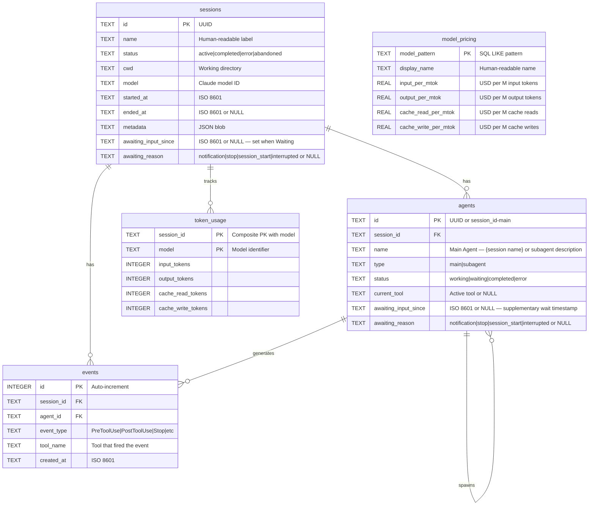

---

## プラグインマーケットプレイス (Plugin Marketplace)

CCAM は、1 つの共有ソースツリーから **14 のプラグイン** を提供します。Claude Code は `.claude-plugin/marketplace.json` を読み取ります。Codex は `.agents/plugins/marketplace.json` に加えて、各プラグインの `.codex-plugin/plugin.json` を読み取ります。バンドルには、**66 のプラグインスキル、18 の Claude サブエージェント、34 の Claude コマンド、3 つの CLI ヘルパー、3 つのフック構成、および 2 つの MCP 対応プラグイン** が含まれています。

```bash
# Claude Code
claude plugin marketplace add hoangsonww/Claude-Code-Agent-Monitor
claude plugin install ccam-platform@claude-code-agent-monitor-plugins

# Codex
codex plugin marketplace add hoangsonww/Claude-Code-Agent-Monitor
codex plugin add ccam-platform@claude-code-agent-monitor-plugins

# オープンエージェントスキル / skills.sh 互換の CLI
npx skills add hoangsonww/Claude-Code-Agent-Monitor --list

# 現在のプロジェクトに Claude Code と Codex の 1 つのスキルをインストール
npx skills add hoangsonww/Claude-Code-Agent-Monitor \
  --skill mcp-server \
  --agent claude-code \
  --agent codex \
  --yes

# プロジェクトスコープのスキルの確認、更新、および削除
npx skills list --json
npx skills update --project --yes
npx skills remove mcp-server --yes

# --global を追加してユーザースコープにインストールし、そのスコープを明示的に管理します
npx skills add hoangsonww/Claude-Code-Agent-Monitor \
  --skill mcp-server \
  --agent claude-code \
  --agent codex \
  --global \
  --yes
npx skills list --global --json
npx skills update --global --yes
npx skills remove --global mcp-server --yes
```

`skills` CLI は、66 のプラグインスキルとリポジトリメンテナンススキルを含む、**合計 75 のリポジトリスキル**を検出します。プロジェクトのインストールでは、`.agents/skills/` に加えてエージェント固有のリンクが使用されます。グローバルな Claude Code スキルはデフォルトで `~/.claude/skills/` になりますが、設定されている場合は `$CLAUDE_CONFIG_DIR/skills/` になります。グローバルな Codex スキルはデフォルトで `~/.codex/skills/` になりますが、設定されている場合は `$CODEX_HOME/skills/` になります。マルチエージェントのインストールは、共有ストアを介してファイルを重複排除し、それらの宛先をリンクする場合があります。すべてのプラグインスキルには、正規の `name`/`description` フロントマターと `agents/openai.yaml` メタデータが含まれています。インストールするために `vercel-labs/skills` へのアップストリームの PR は不要です。パブリックな GitHub リポジトリがソースであり、skills.sh の可視性はパブリケーションと実際のインストールテレメトリに従います。

新しいフォーカスパックは、既存の分析、生産性、品質、セッション、ワークフロー、設定、およびダッシュボードプラグインを補完します:

- `ccam-runner`: 監視された Claude Code/Codex の起動、フォローアップ、停止、再開、および実行履歴
- `ccam-integrations`: アラートルール、Webhook、プッシュ通知、および SSH リモートコレクション
- `ccam-platform`: Claude/Codex 設定エクスプローラー、プロバイダーを認識するインポート、バックアップの復元、フックのセットアップ、更新、および MCP 操作
- `ccam-reports`: ステークホルダー向けのエグゼクティブ、コスト、信頼性、およびワークフローレポート
以下のコマンドでディストリビューションメタデータを検証および再生成します:

```bash
npm run extensions:sync
npm run extensions:validate
```

完全なカタログ、インストールコマンド、skills.sh の動作、パブリック送信の境界、およびクリーンインストールチェックについては、[docs/PLUGINS.md](docs/PLUGINS.md) を参照してください。

---

## Statusline

Claude Code 用のスタンドアロン CLI ステータスラインユーティリティです。モデル名、ユーザー、作業ディレクトリ、git ブランチ、コンテキストウィンドウの使用状況バー、方向ごとのトークン数、セッションコストを、ANSI エスケープシーケンスで色分けして表示します。

```
nguyens6@host ~/agent-dashboard/client | Sonnet 4.6 | main | ████████░░ 79% | 3↑ 2↓ 156586c | $0.4231
```

| セグメント     | 色                | 例                                                        |
| ----------- | -------------------- | -------------------------------------------------------------- |
| モデル       | シアン (Cyan)                 | `Sonnet 4.6`                                                   |
| ユーザー        | 緑 (Green)                | `nguyens6`                                                     |
| CWD         | 黄 (Yellow)               | `~/agent-dashboard`                                            |
| Git ブランチ  | マゼンタ (Magenta)              | `main`                                                         |
| コンテキストバー | 緑 / 黄 / 赤 | `████████░░ 79%`                                               |
| トークン      | 緑 / シアン / ディム (Dim)   | `3↑ 2↓ 156586c` (緑 `↑` は入力、シアン `↓` は出力、ディム `c` はキャッシュ)    |
| コスト (USD)  | 緑 / 黄 / 赤 | `$0.4231` (セッション合計 — API およびサブスクリプションプランで表示)|

コストの色分けのしきい値: $5 未満は緑、$5–$20 は黄、$20 以上は赤。

インストール手順については [`statusline/README.md`](statusline/README.md) を参照してください。

<p align="center">
  
</p>

---

## サーバーアーキテクチャ (Server Architecture)

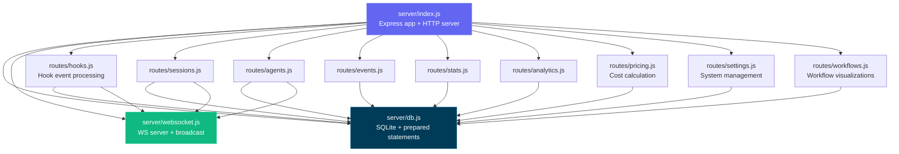

---

## クライアントルーティング (Client Routing)

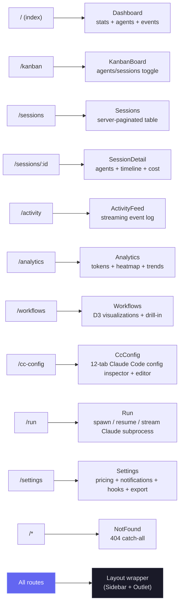

---

## フックハンドラーフロー (Hook Handler Flow)

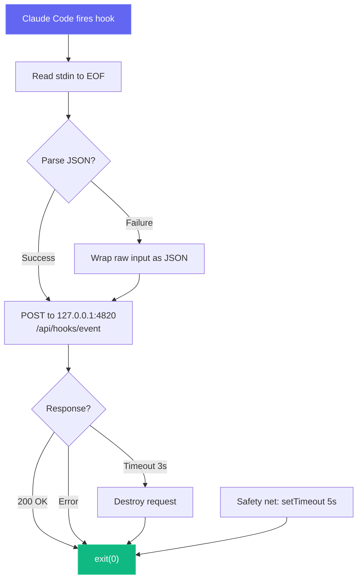

---

## デプロイメントモード (Deployment Modes)

開発モードと本番環境デプロイメントモードの両方を、異なるプロセスアーキテクチャでサポートしています:

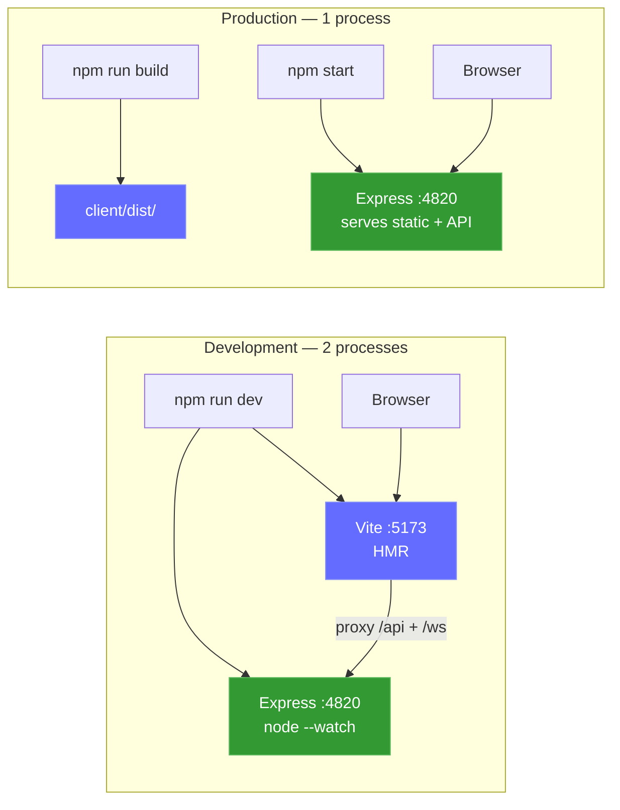

オプションのローカル MCP サイドカー (stdio, HTTP+SSE, および REPL トランスポートをサポート):

```mermaid
graph LR
    subgraph "MCP Transport Options"
        M_STDIO["MCP Server (stdio)<br/>npm run mcp:start"]
        M_HTTP["MCP Server (HTTP)<br/>npm run mcp:start:http<br/>:8819"]
        M_REPL["MCP Server (REPL)<br/>npm run mcp:start:repl"]
    end

    H["MCP Host"] -->|"stdin/stdout"| M_STDIO
    RC["Remote Client"] -->|"POST /mcp · GET /sse"| M_HTTP
    OP["Operator"] -->|"interactive CLI"| M_REPL

    M_STDIO --> D["Dashboard Server<br/>:4820"]
    M_HTTP --> D
    M_REPL --> D

    style M_STDIO fill:#0f766e,stroke:#14b8a6,color:#fff
    style M_HTTP fill:#0f766e,stroke:#14b8a6,color:#fff
    style M_REPL fill:#0f766e,stroke:#14b8a6,color:#fff
```

オプションの **デスクトップアプリ (macOS & Windows)** — Express サーバーをインプロセスでホストする単一の Electron プロセス (ターミナルも子プロセスも不要):

```mermaid
flowchart LR
    subgraph desktop["Desktop App (macOS & Windows) — 1 Electron process"]
        E_MAIN["Electron Main Process<br/>(Node 22 / Electron 35)"]
        E_HOST["server-host.ts<br/>require() server/index.js"]
        E_SRV["Embedded Express :4820<br/>API · SQLite · WebSocket"]
        E_WIN["BrowserWindow<br/>built React client"]
        E_TRAY["Menu-bar (tray) icon<br/>+ native app menu"]
        E_MAIN --> E_HOST
        E_HOST -->|"in-process require()"| E_SRV
        E_MAIN --> E_TRAY
        E_SRV -->|"http + ws on 127.0.0.1"| E_WIN
    end

    E_HOOKS["Claude Code hooks"] -->|"POST /api/hooks/event"| E_SRV

    style E_MAIN fill:#47848F,stroke:#2f5a62,color:#fff
    style E_SRV fill:#339933,stroke:#5cb85c,color:#fff
    style E_WIN fill:#61DAFB,stroke:#3aa9c9,color:#000
```

### クラウドデプロイメント (Cloud Deployment)

`deployments/` スタックは、EKS、GKE、AKS、OKE、および自己管理クラスターを含む、準拠する任意の Kubernetes サービスを対象としています。CCAM は SQLite を使用するため、サポートされているすべてのマニフェストは、Recreate ロールアウトにより**永続ボリュームごとに 1 つのアクティブなダッシュボードライター**を強制します。HPA、アクティブ-アクティブレプリカ、ブルーグリーン、およびカナリアデプロイメントは、SQLite が永続化バックエンドである間は意図的にサポートされません。

```mermaid
flowchart LR
  CI["CI: test · validate · scan · attest · sign"] --> HELM["Helm / Kustomize / Terraform"]
  HELM --> APP["CCAM dashboard<br/>exactly 1 replica"]
  APP --> PVC[("Retained ReadWriteOnce PVC")]
  EDGE["Ingress or Gateway API<br/>TLS + WebSocket"] --> APP
  PROM["Prometheus Operator"] -->|"Bearer /api/metrics"| APP
  MCP["Authenticated MCP sidecar"] --> APP
```

- **Helm:** スキーマによって強制された 1 つのライター、ダイジェストサポート、保持された PVC、Ingress または Gateway API、External-Secret 互換のトークンマウント、NetworkPolicy、オプションの MCP と ServiceMonitor。
- **Kustomize:** 制限付き PSS ベースに加えて、dev/staging/production オーバーレイ、オプションの MCP、監視、Gateway API、および CSI スナップショットコンポーネント。
- **Terraform:** 検証済みの Helm チャートを既存の Kubernetes クラスターにデプロイします。クラウドのネットワーキング、クラスター ID、CSI、TLS、およびシークレットの同期は、引き続きプロバイダーが所有します。
- **オペレーション:** SHA-256 を使用した一貫性のある SQLite オンラインバックアップ、ゼロスケールによる検証済みのリストア、バックアップ優先のデプロイ/ロールバック/ティアダウン、および認証されたヘルスチェック。
- **CI サプライチェーン:** アプリおよび MCP イメージはスキャンされ、SBOM および SLSA の来歴とともに amd64/arm64 向けに公開され、Cosign を使用してキーレス署名されます。

```bash
npm run deploy:validate
REGISTRY="ghcr.io/$(gh repo view --json owner -q .owner.login)"
IMAGE_TAG="$(git rev-parse --short HEAD)"

helm upgrade --install agent-monitor deployments/helm/agent-monitor \
  --namespace agent-monitor-production --create-namespace \
  --values deployments/helm/agent-monitor/values-production.yaml \
  --set image.registry= \
  --set image.repository=${REGISTRY}/claude-code-agent-monitor \
  --set image.tag=${IMAGE_TAG} \
  --atomic --wait --timeout 10m
```

> [!NOTE]
> 完全な本番環境のセットアップ、シークレット、Docker/Podman スタック、Gateway API、Terraform、バックアップ、リストア、およびロールバックについては、[DEPLOYMENT.md](DEPLOYMENT.md) および [deployments/README.md](deployments/README.md) に文書化されています。

---

## プロジェクト構造 (Project Structure)

```
agent-dashboard/
|-- CLAUDE.md                   # Claude Code プロジェクトのメモリと作業に関する合意
|-- AGENTS.md                   # Codex プロジェクトの指示
|-- package.json                # ルートスクリプト (ダッシュボード + MCP ヘルパー) + サーバーの依存関係
|-- .claude/
|   +-- rules/                  # パススコープの Claude ルール
|   +-- skills/                 # Claude の再利用可能なプロジェクトスキル
|   +-- agents/                 # Claude カスタムサブエージェント
|-- .claude-plugin/
|   +-- marketplace.json        # Claude Code マーケットプレイス マニフェスト (14 プラグイン)
|-- .agents/plugins/
|   +-- marketplace.json        # Codex マーケットプレイス マニフェスト (同じ 14 プラグイン)
|-- plugins/
|   |-- ccam-analytics/         # 分析: セッションレポート、コスト内訳、使用状況の傾向、生産性スコア
|   |   |-- .claude-plugin/plugin.json
|   |   |-- skills/ (4)         # session-report, cost-breakdown, usage-trends, productivity-score
|   |   |-- agents/             # analytics-advisor (Sonnet モデル)
|   |   |-- hooks/hooks.json    # Stop + SubagentStop イベントロギング
|   |   +-- bin/ccam-stats      # ターミナルダッシュボード CLI
|   |-- ccam-productivity/      # 生産性: スタンドアップ、レポート、スプリント、ワークフローオプティマイザー
|   |-- ccam-devtools/          # DevTools: デバッグ、診断、エクスポート、ヘルスチェック
|   |   +-- bin/                # ccam-doctor + ccam-export CLI
|   |-- ccam-insights/          # インサイト: パターン、異常、最適化、比較
|   |-- ccam-cost-guard/        # コストガードレール: 予算、支出予測、コストアラート、モデルの節約
|   |-- ccam-sessions/          # セッションフォレンジック: 検索、タイムライン、トランスクリプトの再生、cwd ロールアップ、クリーンアップ
|   |-- ccam-workflows/         # ワークフローオーケストレーション: DAG マップ、委任監査、同時実行、フリートの実行
|   |-- ccam-quality/           # 信頼性 & SLO: エラースキャン、API エラーレポート、フック障害の監査、SLO チェック
|   |-- ccam-config/            # 設定 & メモリのガバナンス: 設定監査、メモリレビュー、スキル/MCP/フックのインベントリ
|   +-- ccam-dashboard/         # ダッシュボードコネクター: ステータス、クイックスタッツ、MCP 統合
|       +-- .mcp.json           # MCP サーバー設定
|-- server/
|   |-- index.js                 # Express アプリ、HTTP サーバー、静的ファイル提供
|   |-- db.js                    # SQLite スキーマ、マイグレーション、プリペアドステートメント
|   |-- websocket.js             # ハートビート付きの WebSocket サーバー
|   +-- routes/
|       |-- hooks.js             # フックイベント処理 (トランザクション)
|       |-- sessions.js          # セッション CRUD
|       |-- agents.js            # エージェント CRUD
|       |-- events.js            # イベントリスティング
|       |-- stats.js             # 集計統計
|       |-- analytics.js         # トークン、ツール、およびトレンド分析
|       |-- workflows.js         # ワークフローの集計データとセッションごとのドリルイン
|       |-- pricing.js           # モデルの価格設定 CRUD とコスト計算
|       +-- settings.js          # システム情報、データ管理、エクスポート、クリーンアップ
|   +-- lib/
|       +-- transcript-cache.js  # V8 の最大文字列長 (~512 MiB) を超えるファイルでも Node をアボートさせることなくパースするための、チャンク同期バイトストリームリーダー (4 MiB チャンク、行ごとの UTF-8 デコード) を備えた JSONL トランスクリプトキャッシュ。トークン、コンパクション、API エラー、ターンの期間、思考ブロック、および使用量の追加情報 (service_tier, speed, inference_geo) を抽出します
|   +-- compat-sqlite.js         # node:sqlite 互換性ラッパー (better-sqlite3 のフォールバック)
|-- client/
|   |-- package.json             # クライアントの依存関係
|   |-- index.html               # HTML エントリーポイント
|   |-- vite.config.ts           # Vite + プロキシ設定
|   |-- tailwind.config.js       # カスタムダークテーマ
|   |-- tsconfig.json            # Strict TypeScript
|   +-- src/
|       |-- main.tsx             # React エントリー
|       |-- App.tsx              # ルーター + WebSocket プロバイダー
|       |-- index.css            # Tailwind + カスタムユーティリティ
|       |-- lib/
|       |   |-- types.ts         # 共有 TypeScript インターフェース
|       |   |-- api.ts           # 型付きの fetch クライアント
|       |   |-- format.ts        # 日付/時刻のフォーマットユーティリティ
|       |   +-- eventBus.ts      # WebSocket 配信用の Pub/sub
|       |-- hooks/
|       |   |-- useWebSocket.ts      # 自動再接続 WebSocket フック
|       |   +-- useNotifications.ts  # WebSocket イベントからのブラウザ通知トリガー
|       |-- components/
|       |   |-- Layout.tsx       # サイドバーとアウトレットを含むシェル
|       |   |-- Sidebar.tsx      # ナビゲーション + 接続インジケーター
|       |   |-- AgentCard.tsx    # ステータス付きのエージェント情報カード
|       |   |-- StatCard.tsx     # メトリクスカード
|       |   |-- StatusBadge.tsx  # 色分けされたステータスピル
|       |   |-- EmptyState.tsx   # 空のリストのプレースホルダー
|       |   +-- workflows/       # D3.js ワークフロー可視化コンポーネント
|       |       |-- OrchestrationDAG.tsx            # エージェント生成パターンの水平 DAG
|       |       |-- ToolExecutionFlow.tsx           # ツール間遷移の d3-sankey ダイアグラム
|       |       |-- AgentCollaborationNetwork.tsx   # 力学モデルによるエージェントパイプライングラフ
|       |       |-- SubagentEffectiveness.tsx       # SVG サクセスリング付きのスコアカードグリッド
|       |       |-- WorkflowPatterns.tsx            # 自動検出されたオーケストレーションシーケンス
|       |       |-- ModelDelegationFlow.tsx         # エージェント階層を通じたモデルのルーティング
|       |       |-- ErrorPropagationMap.tsx         # 階層の深さによるエラークラスタリング
|       |       |-- ConcurrencyTimeline.tsx         # スイムレーンによる並列エージェント実行
|       |       |-- SessionComplexityScatter.tsx    # D3 バブルチャート (期間 vs エージェント数 vs トークン数)
|       |       |-- CompactionImpact.tsx            # トークン圧縮イベントとリカバリ
|       |       |-- WorkflowStats.tsx               # ワークフローの集計統計
|       |       +-- SessionDrillIn.tsx              # セッションごとのエージェントツリー、ツールタイムライン、イベント
|       +-- pages/
|           |-- Dashboard.tsx      # 概要ページ
|           |-- KanbanBoard.tsx    # エージェント/セッションのトグル、ステータスカラム
|           |-- Sessions.tsx       # サーバー側でページネーションされたセッションテーブル
|           |-- SessionDetail.tsx  # 単一セッションのディープダイブ
|           |-- ActivityFeed.tsx   # リアルタイムのイベントストリーム
|           |-- Analytics.tsx      # トークン使用量、ヒートマップ、トレンド
|           |-- Workflows.tsx      # D3.js ワークフローの可視化とセッションのドリルイン
|           |-- Settings.tsx       # モデル価格、通知、フック、エクスポート、クリーンアップ
|           +-- NotFound.tsx       # 404 キャッチオールページ
|-- scripts/
|   |-- hook-handler.js          # 軽量な stdin-to-HTTP フォワーダー
|   |-- install-hooks.js         # ~/.claude/settings.json を自動設定
|   |-- import-history.js        # ~/.claude/ からセッションをインポート。高度な JSONL 抽出（API エラー、ターン期間、エントリポイント、パーミッションモード、思考ブロック、使用量の追加情報、ツールエラー、サブエージェントの JSONL ファイル）を伴う。再インポートは完全にインクリメンタル：イベントタイプごとの高水準点（セッションごとの `MAX(created_at) GROUP BY event_type`）が事前に計算され、`ts > cutoff[type]` を満たす JSONL エントリのみが挿入されます。これにより、トランスクリプトが複数日にまたがって増大する長期実行セッションでも、再実行のたびに Stop / PostToolUse / TurnDuration / ToolError イベントを引き続き受信します。また、JSONL が保存された値を過ぎて進行した場合は `sessions.ended_at` をロールフォワードし、実行ごとにメッセージ数のメタデータを更新します
|   +-- seed.js                  # サンプルデータジェネレーター
|-- mcp/
|   |-- package.json             # MCP パッケージスクリプト + 依存関係
|   |-- README.md                # MCP のセットアップ、ホスト設定、ツールカタログ、安全モデル
|   |-- src/
|   |   |-- index.ts             # MCP ランタイムエントリポイント (トランスポートルーター)
|   |   |-- server.ts            # MCP サーバーアセンブリ
|   |   |-- clients/             # リトライ/バックオフ付きダッシュボード API クライアント
|   |   |-- config/              # 環境/CLI 設定のパース
|   |   |-- core/                # ロガー、ツールレジストリ、結果ヘルパー
|   |   |-- policy/              # ミューテーション/破壊的ガード
|   |   |-- tools/               # 97 個のツールを登録する 16 個のドメインモジュール
|   |   |-- transports/          # HTTP+SSE サーバー、REPL、ツールコレクター
|   |   |-- ui/                  # ANSI バナー、カラー、フォーマッター、テーブル
|   |   +-- types/               # 共有 MCP 型定義
|   +-- build/                   # ビルドされた MCP ランタイム出力
|-- desktop/
|   |-- package.json             # Electron + electron-builder の依存関係とスクリプト
|   |-- electron-builder.yml     # DMG パッケージング設定。署名/公証のフック
|   |-- tsconfig.json            # Strict TypeScript (src/ -> out/)
|   |-- README.md                # デスクトップアプリアーキテクチャのリファレンス (コントリビューター向けドキュメント)
|   |-- assets/                  # icon.svg + 生成された icon.icns + トレイ用 PNG
|   |-- src/
|   |   |-- main.ts              # Electron メインプロセスのエントリ — ライフサイクル、配線
|   |   |-- server-host.ts       # インプロセスでの Express ブート、ポート検出、採用、DB クローズ
|   |   |-- window.ts            # BrowserWindow + 永続化されたウィンドウのジオメトリ
|   |   |-- tray.ts              # メニューバー (トレイ) アイコン + コンテキストメニュー
|   |   |-- menu.ts              # ネイティブアプリケーションメニュー (File ▸ Open Dashboard は macOS のみ)
|   |   |-- login-item.ts        # macOS のログイン項目 (Login Items) 自動起動トグル (SMAppService)
|   |   |-- logger.ts            # ファイルロガー -> ~/Library/Logs/Claude Code Monitor/desktop.log
|   |   |-- constants.ts         # アプリ名、ポート、タイムアウト、ウィンドウサイズ
|   |   +-- preload.ts           # 意図的に空 (レンダラー特権をゼロにするため)
|   |-- scripts/
|   |   |-- install.js           # desktop:install 用のネイティブ依存関係の事前確認。失敗時にはセットアップのヘルプを表示し、非ゼロで終了
|   |   |-- preflight.js         # 共有の better-sqlite3 バイナリチェック + 実行可能な OS ごとのセットアップヘルプ (ツールチェーンなしの代替案を含む)
|   |   |-- prebuild.js          # tsc の前にルート + クライアントがビルドされていることを確認。ネイティブバイナリがない場合はセットアップヘルプを表示して即座に失敗
|   |   |-- build-icons.sh       # qlmanage/sips/iconutil による SVG -> PNG/ICNS 変換
|   |   +-- notarize.js          # electron-builder の afterSign フック (オプトインの公証)
|   +-- tests/
|       +-- smoke.test.mjs       # Electron のスポーン + /api/health のプローブ
|-- deployments/
|   |-- README.md                # 本番デプロイメントリファレンス
|   |-- nginx/                   # ルートレスの Nginx エッジおよびオプトインのフック/MCP ポリシー
|   |-- secrets/                 # 無視される Compose トークン/パスワードファイル
|   |-- terraform/               # 既存の Kubernetes クラスターへの Helm デプロイメント
|   |-- kubernetes/              # 1 つのライターを持つ Kustomize ベース + 環境のオーバーレイ
|   |   |-- base/                # 制限付き PSS、Recreate デプロイメント、PVC、Service、Ingress
|   |   |-- overlays/            # Dev、staging、production ネームスペースとリソース
|   |   +-- components/          # MCP、ServiceMonitor、Gateway API、VolumeSnapshot
|   |-- helm/agent-monitor/      # スキーマによって強制された Helm チャートと環境変数値
|   +-- scripts/                 # 検証、デプロイ、バックアップ、リストア、ロールバック、ヘルス、ティアダウン
|-- .codex/
|   |-- config.toml              # Codex ランタイム設定
|   |-- README.md                # エージェントとスキル向けの Codex セットアップガイド
|   |-- rules/                   # Codex 実行ポリシーのルール
|   |-- agents/                  # Codex カスタムエージェントテンプレート
|   +-- skills/                  # Codex プロジェクトスキル
|-- statusline/
|   |-- README.md                # Statusline インストールおよび使用ガイド
|   |-- statusline.py            # ステータスラインを描画する Python スクリプト
|   +-- statusline-command.sh    # Claude Code の statusLine 設定用のシェルラッパー
+-- data/
    +-- dashboard.db             # SQLite データベース (gitignored)
```

---

## トラブルシューティング (Troubleshooting)

| 問題                           | 解決策                                                                                                                                                         |
| --------------------------------- | ---------------------------------------------------------------------------------------------------------------------------------------------------------------- |
| `better-sqlite3` のインストールに失敗する | これは致命的ではありません — サーバーは自動的に Node.js 組み込みの `node:sqlite` にフォールバックします (Node 22+)。古い Node バージョンの場合は、Python 3 と C++ ビルドツールをインストールしてから、`npm rebuild better-sqlite3` を実行してください |
| フックが発火しない                  | `npm run install-hooks` を実行し、Claude Code を再起動します。フックが `~/.claude/settings.json` に存在することを確認してください                                                             |
| ダッシュボードにデータが表示されない           | Claude Code セッションを開始する前に、サーバーが実行中である (`npm run dev`) ことを確認してください。`http://localhost:4820/api/health` をチェックしてください                                     |
| WebSocket が切断される            | クライアントは 2 秒ごとに自動再接続します。ポート 4820 がファイアウォールによってブロックされていないことを確認してください                                                                    |
| 再起動後にデータが古いままになる          | データベースは再起動を超えて永続化されます。新しいデモデータを作成するには `npm run seed` を実行するか、データをリセットするには `data/dashboard.db` を削除してください                                            |
| MCP ツールが接続に失敗する         | ダッシュボード API が `MCP_DASHBOARD_BASE_URL` 上で起動していることを確認し、MCP を再ビルド/起動してください (`npm run mcp:build`、`npm run mcp:start`)                                         |

---

## 貢献 (Contributing)

コントリビューションを歓迎します。完全なガイドについては [`.github/CONTRIBUTING.md`](.github/CONTRIBUTING.md) を参照してください。

すべてのコントリビューターは、[Contributor License Agreement](https://github.com/hoangsonww/Claude-Code-Agent-Monitor/blob/master/CLA.md) (CLA) に署名する必要があります。これは、プルリクエストごとに `🖋️ CLA Assistant` GitHub Action によって自動的に強制されます。最初に PR を開いたときに、ボットが `I have read the CLA Document and I hereby sign the CLA` とコメントして署名するように求めてきます。あなたが署名するまで、PR の **CLA Assistant** ステータスチェックは赤のままになり、一度署名すれば、今後のすべてのコントリビューションに適用されます。

---

## ライセンス (License)

MIT. 詳細については [LICENSE](LICENSE) を参照してください。
