> 本ページは本家 [hoangsonww/Claude-Code-Agent-Monitor](https://github.com/hoangsonww/Claude-Code-Agent-Monitor) v2.3.0 時点(2026-10-12)の詳細ドキュメント [README-EN.md](./README-EN.md) を和訳したものです。概要ページは [README.md](./README.md)(英語原文: [README-TOP-EN.md](./README-TOP-EN.md))、日本語版のセットアップは [JA-SETUP.md](./JA-SETUP.md) を参照してください。

# Claude Code、Cursor & Codex 用エージェントダッシュボード

### Claude Code、Cursor & Codex エージェント活動のためのリアルタイム監視プラットフォーム 🚀

Claude Code、Cursor、Codex のエージェントセッション、ツール使用状況、会話履歴、コスト、サブエージェントのオーケストレーションをリアルタイムで追跡および視覚化するためのプロフェッショナルなダッシュボードです。Node.js、Express、React、SQLite を使用して構築されており、ネイティブフックと、プロバイダーごとに対応したローカルのトランスクリプト検出を組み合わせています。


> [!WARNING]
> **本リポジトリについて**: これは [hoangsonww/Claude-Code-Agent-Monitor](https://github.com/hoangsonww/Claude-Code-Agent-Monitor) を有志が個人的にフォークした**非公式**の日本語訳版です。Anthropic公式のツールではありません。
> - 翻訳はAI(Gemini)による機械翻訳ベースです。誤訳・不自然な表現が残っている可能性があります
> - 本家アップデートの追従は不定期です(メンテナは気が向いたときに追従します)
> - Issueでの報告は歓迎しますが、対応をお約束するものではありません。訳文の修正PRは歓迎します
> - 動作確認は **Windows + Claude Code** の組み合わせでのみ行っています。macOS/Linuxや他環境では未検証です

> [!TIP]
> 参照: [README-EN.md](./README-EN.md) (English/本家オリジナル)、[README-CN.md](./README-CN.md) (中文版本)、[README-VN.md](./README-VN.md) (Phiên bản tiếng Việt)、[README-KO.md](./README-KO.md) (한국어 버전)、および [README-ES.md](./README-ES.md) (versión en español) には、地域固有のヒントやベストプラクティスが記載されたローカライズ版のドキュメントがあります。

> [!NOTE]
> タスク指向のサポートが必要ですか？ [GitHub Wiki](https://github.com/hoangsonww/Claude-Code-Agent-Monitor/wiki) は、日常的な使用、チーム運用、トラブルシューティング、CLI/MCPの自動化、およびデプロイ手順のための実践的なハンドブックです。[ローカライズされた静的 Wiki](https://hoangsonww.github.io/Claude-Code-Agent-Monitor/wiki/) では、英語、ベトナム語、中国語、韓国語、スペイン語で製品およびアーキテクチャのツアーを引き続き提供しています。正確な技術仕様については [`docs/`](./docs/README.md) に記載されています。

---

## 目次

- [概要](#概要)
- [国際化 (i18n)](#国際化-i18n)
- [機能](#機能)
- [クイックスタート](#クイックスタート)
- [動作の仕組み](#動作の仕組み)
- [構成](#構成-configuration)
- [npm スクリプト](#npm-スクリプト)
- [プラグインマーケットプレイス](#プラグインマーケットプレイス-plugin-marketplace)
- [エージェント拡張](#エージェント拡張-agent-extensions)
- [MCP 統合](#mcp-統合-mcp-integration)
- [API リファレンス](#api-リファレンス-api-reference)
- [フックイベント](#フックイベント-hook-events)
- [ブラウザ通知](#ブラウザ通知-browser-notifications)
- [アップデート通知](#アップデート通知-update-notifier)
- [Tabby — フローティングキャットコンパニオン](#tabby--フローティングキャットコンパニオン-tabby--floating-cat-companion)
- [サウンドキュー](#サウンドキュー-sound-cues)
- [接続ステータスモーダル](#接続ステータスモーダル-connection-status-modal)
- [VS Code 拡張機能](#vs-code-拡張機能-vs-code-extension)
- [デスクトップアプリ (macOS & Windows)](#デスクトップアプリ-macos--windows)
- [データストレージ](#データストレージ-data-storage)
- [Statusline](#statusline)
- [サーバーアーキテクチャ](#サーバーアーキテクチャ-server-architecture)
- [クライアントルーティング](#クライアントルーティング-client-routing)
- [フックハンドラーフロー](#フックハンドラーフロー-hook-handler-flow)
- [デプロイメントモード](#デプロイメントモード-deployment-modes)
- [プロジェクト構造](#プロジェクト構造-project-structure)
- [トラブルシューティング](#トラブルシューティング-troubleshooting)
- [貢献](#貢献-contributing)
- [ライセンス](#ライセンス-license)

---

## 概要

洗練されたダークテーマのウェブインターフェースを通じて、セッションの追跡、エージェントのリアルタイム監視、ツール使用状況の視覚化、会話のリプレイ、およびサブエージェントのオーケストレーションの観察を行います。Claude Code と Codex はネイティブフックを使用し、Cursor は互換性のあるライブイベントとネイティブの `~/.cursor` トランスクリプト検出によって、追加設定なしで利用できます。

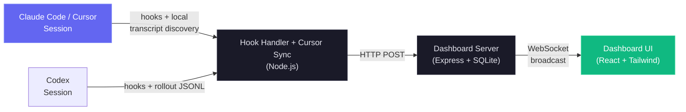

リアルタイムの監視ダッシュボードに加えて、ダッシュボード自体を検査および管理するためのツールのカタログを公開するローカル MCP サーバー実装（`mcp/`）も含まれており、ダッシュボードの操作を Claude Code や Codex のワークフローに直接統合することが容易になります。さらに、エージェント拡張レイヤーもあり、ダッシュボードとのインタラクション、分析、およびワークフローインテリジェンスのための Claude Code & Codex プラグイン、スキル、およびサブエージェントを提供します。

### 国際化 (i18n)

UI には、英語 (`en`)、中国語 (`zh`)、ベトナム語 (`vi`)、韓国語 (`ko`)、およびスペイン語 (`es`) を切り替えるためのロケール切り替え機能が組み込まれています。言語が追加されてもサイドバーが混雑しないように、カスタム言語ドロップダウンが採用されています。言語リソースはネームスペースごとにロードされ、ブラウザのストレージを通じて保存されるため、再読み込み後もユーザーの好みが安定して維持されます。

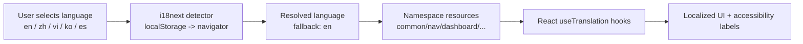

全体的なアーキテクチャや運用ガイドについては、[docs/I18N.md](./docs/I18N.md) を参照してください。

### ユーザーインターフェース

レスポンシブなダークインターフェースがワークフロー全体をカバーします。すべてのプレビューはモバイル対応のサムネイルを使用し、鮮明な原寸画像へのリンクになっています。

> [!NOTE]
> **このフォーク限定: ライトテーマ**。**設定 → 外観(Appearance)** から明るい背景のライトテーマに切り替え可能です(デフォルトはダークテーマのまま)。本家には無い、このフォーク独自の追加機能です。

<p align="center">
  <a href="images/dashboard.png"></a>
  <br>
  <em>📡 <strong>ダッシュボード</strong> · フリート全体の合計、アクティブなエージェント、最近のアクティビティ、ライブのヘルスシグナル</em>
</p>

<p align="center">
  <a href="images/tasks-overview.png"></a>
  <br>
  <em>📋 <strong>タスク進捗</strong> · コンパクトな完了表示と、所有者を認識した作業プレビュー</em>
</p>

<p align="center">
  <a href="images/dashboard-health.png">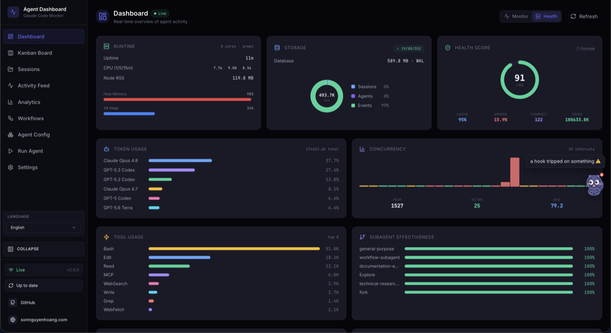</a>
  <br>
  <em>🩺 <strong>システムヘルス</strong> · ストレージ、キャッシュ、エラー、ツール、モデル、サブエージェント、コンパクション</em>
</p>

<p align="center">
  <a href="images/board.png">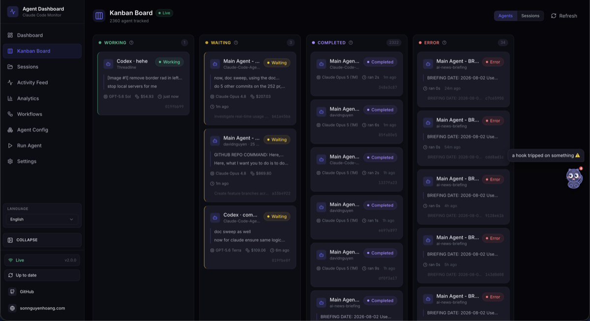</a>
  <br>
  <em>📋 <strong>カンバンボード · エージェント</strong> · 作業中、待機中、完了、失敗したエージェントを、明確な待機理由とともに表示</em>
</p>

<p align="center">
  <a href="images/board-sessions.png"></a>
  <br>
  <em>🗂️ <strong>カンバンボード · セッション</strong> · アクティブ、待機中、完了、エラー、中断のセッション</em>
</p>

<p align="center">
  <a href="images/sessions.png"></a>
  <br>
  <em>📂 <strong>セッション</strong> · コストとアクティビティを含む、検索・フィルタリング可能なサーバーサイドページネーション対応の履歴</em>
</p>

<p align="center">
  <a href="images/session-agents.png"></a>
  <br>
  <em>🤖 <strong>セッションエージェント</strong> · ライブ合計、ツール使用状況、トークンフロー、エージェント階層</em>
</p>

<p align="center">
  <a href="images/tasks-details.png">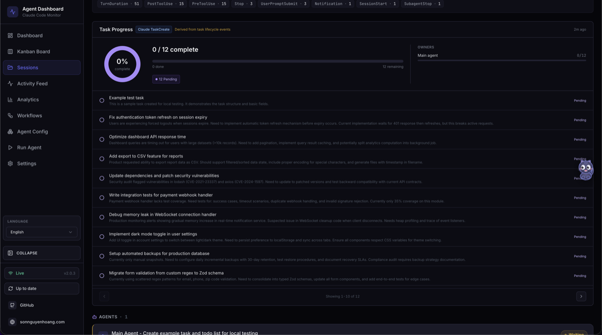</a>
  <br>
  <em>✅ <strong>タスク詳細</strong> · 完了セグメント、アクティブな作業、所有者、ページネーション付きタスク</em>
</p>

<p align="center">
  <a href="images/session-conversation.png"></a>
  <br>
  <em>💬 <strong>会話</strong> · レンダリングされたトランスクリプト、コード、ツール呼び出し、コマンド出力、セッションマーカー</em>
</p>

<p align="center">
  <a href="images/session-timeline.png">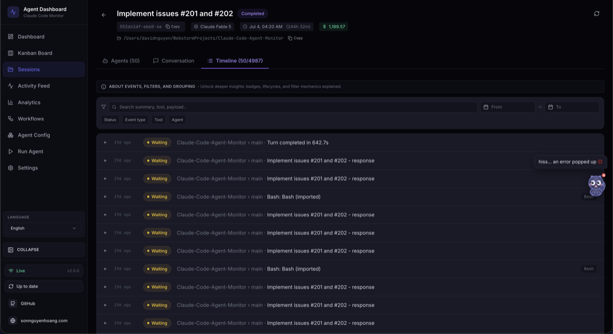</a>
  <br>
  <em>🔬 <strong>タイムライン</strong> · 時系列のイベント、多次元フィルター、ペアになったツールアクティビティ</em>
</p>

<p align="center">
  <a href="images/feed.png"></a>
  <br>
  <em>📰 <strong>アクティビティフィード</strong> · 一時停止可能なライブイベント、グループ化、フィルター、セッションへのジャンプ</em>
</p>

<p align="center">
  <a href="images/analytics.png">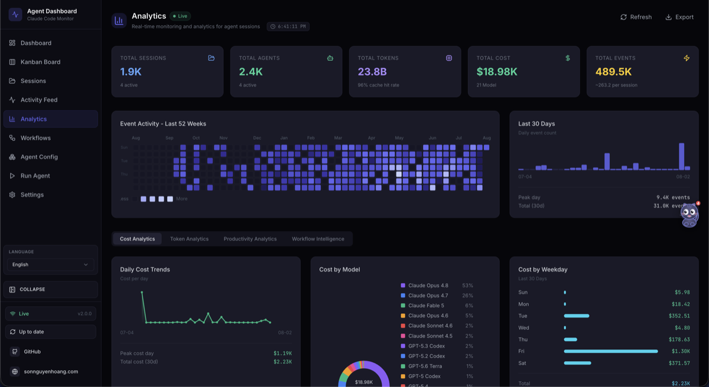</a>
  <br>
  <em>📊 <strong>分析</strong> · モデル別トークン、ツール頻度、アクティビティヒートマップ、セッショントレンド</em>
</p>

<p align="center">
  <a href="images/workflows.png">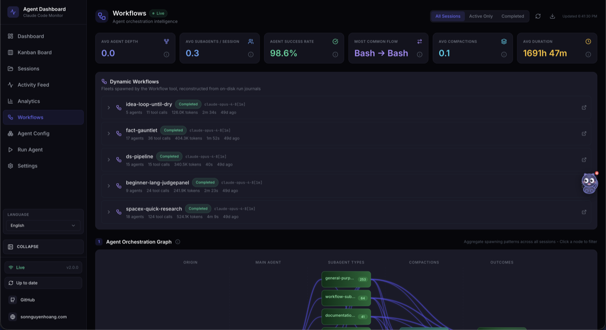</a>
  <br>
  <em>🔀 <strong>ワークフロー</strong> · オーケストレーショングラフ、ツールフロー、コラボレーション、委任、パターン</em>
</p>

<p align="center">
  <a href="images/dynamicworkflows-workflows.png"></a>
  <br>
  <em>🧬 <strong>ワークフロー実行</strong> · ジャーナルに基づくステータス、エージェント、トークン、ツール、所要時間</em>
</p>

<p align="center">
  <a href="images/dynamicworkflows-workflows2.png"></a>
  <br>
  <em>🧬 <strong>展開された実行</strong> · フェーズフィルター、エージェントごとのメトリクス、プロンプト、完全な結果</em>
</p>

<p align="center">
  <a href="images/dynamicworkflows-session.png"></a>
  <br>
  <em>🧬 <strong>セッションのワークフロー</strong> · リンクされた動的実行と、統合されたトークンコスト</em>
</p>

<p align="center">
  <a href="images/config.png"></a>
  <br>
  <em>🧰 <strong>エージェント設定</strong> · サポートされている Claude Code と Codex の設定を確認し、安全に編集</em>
</p>

<p align="center">
  <a href="images/config-codex.png">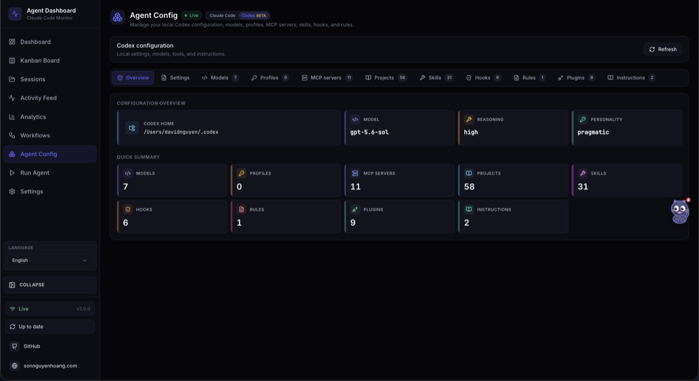</a>
  <br>
  <em>🧰 <strong>Codex 設定</strong> · モデル、プロファイル、MCP、プロジェクト、スキル、フック、ルール、プラグイン、指示</em>
</p>

<p align="center">
  <a href="images/config-skills.png"></a>
  <br>
  <em>🧩 <strong>スキル</strong> · 検索可能なユーザー、プロジェクト、プラグインのスキルと、バックアップ付き編集</em>
</p>

<p align="center">
  <a href="images/run.png"></a>
  <br>
  <em>▶️ <strong>エージェントの実行</strong> · プロバイダー固有のコントロールで Claude Code または Codex を起動</em>
</p>

<p align="center">
  <a href="images/run-results.png"></a>
  <br>
  <em>💬 <strong>ライブ実行</strong> · ストリーミングチャット、推論、コマンド、ファイル変更、ツール、再接続</em>
</p>

<p align="center">
  <a href="images/settings.png"></a>
  <br>
  <em>⚙️ <strong>設定</strong> · 価格設定、フック、通知、データ、リモートソース、システムステータス</em>
</p>

<p align="center">
  <a href="images/alerts.png">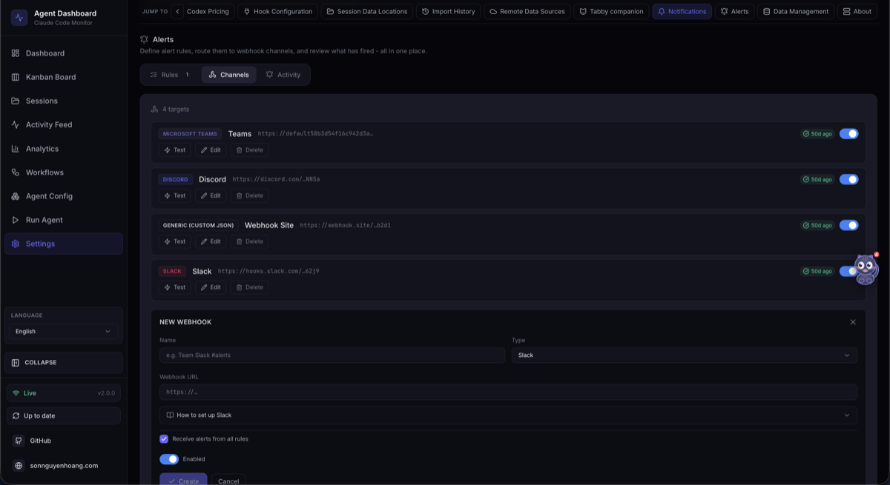</a>
  <br>
  <em>🔔 <strong>アラート</strong> · ルール、クールダウン、アクティビティ、組み込みまたは署名付き汎用 Webhook</em>
</p>

<p align="center">
  <a href="images/remote.png">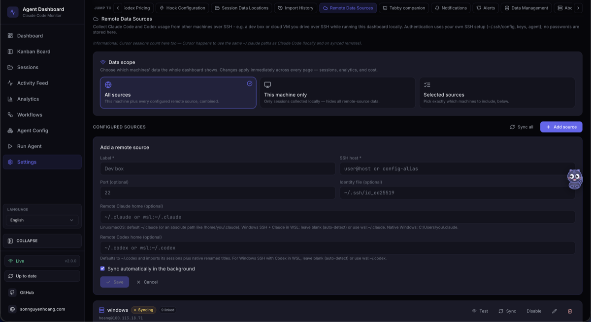</a>
  <br>
  <em>🛰️ <strong>リモートデータソース</strong> · プロバイダーを認識した SSH 同期と、ソース単位のモニタリング</em>
</p>

<p align="center">
  <a href="images/palette.png">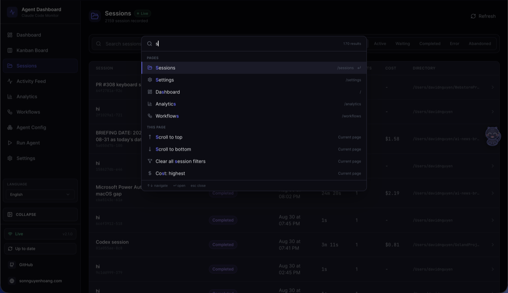</a>
  <br>
  <em>⌘ <strong>コマンドパレット</strong> · ページ、セッション、プロジェクト、フィルター、アクションを呼び出せる単一のキーボードランチャー</em>
</p>

サイドバーには、ダッシュボード、カンバンボード、セッション、アクティビティフィード、分析、ワークフロー、エージェント設定、エージェントの実行、設定へのリンクがあります。以下のセクションでは、これらのビューの背後にある完全な動作について説明します。

---

## 機能

ダッシュボードは、ローカルエージェントのライフサイクル全体をカバーします。詳細な運用上の仕様は、リンク先のセクションと `docs/` の参照ドキュメントに記載されています。

| Feature | Summary |
| --- | --- |
| **Task Progress** | Claude のタスクツール、レガシーの `TodoWrite`、Codex の `update_plan` から、所有者を認識した進捗を表示します。コンパクトなプレビューはカードや行に表示され、セッション詳細ではステータスセグメント、アクティブな作業、所有者、10 行ずつのページングが加わります。新しい最上位の作業が始まると古い未完了状態はクリアされ、完了済みの履歴は残ります。 |
| **Dashboard** | 永続化された **Monitor** タブと **Health** タブで、フリート全体の合計、アクティブな階層、最近のアクティビティ、成功率・キャッシュ・エラー・ヒープを重み付けしたヘルス、ストレージ、ツール、モデル、サブエージェントの有効性、コンパクション指標をまとめて表示します。Health は `/api/settings/info` と `/api/workflows` から 5 秒ごとに更新されます。 |
| **Kanban Board** | エージェントの列は作業中 (Working)、待機中 (Waiting)、完了 (Completed)、エラー (Error) をカバーし、セッションの列にはさらにアクティブ (Active) と中断 (Abandoned) が加わります。カードは 10 件ずつページングされ、アクティブな WebSocket ビューのみを購読し、完全なタイトルを保持し、権限入力、ターン完了、プロンプトのアイドル、中断といった待機理由を説明します。 |
| **Sessions** | 検索・フィルタリング可能なサーバーサイドページネーション対応の履歴で、コストは表示中のページ分のみ計算し、一時的なインメモリの Codex 起動行も表示します。検索は `id`、`name`、`cwd` を対象とし、300 ms のデバウンスがあります。名前は、明示的なタイトル、AI タイトル、最初の意味のあるユーザープロンプトの順に解決されます。 |
| **Session Detail** | ライブ統計、アクティブな作業、ツール使用状況、サブエージェント、トークン、階層、フィルター付きイベントタイムライン、`tool_use_id` によるグループ化、およびツール専用のレンダラーを提供します。会話ビューでは、キューに入ったターン、システム通知、Markdown、ハイライト付きコード、スタイル付きツールをレンダリングし、待機バナーには理由と経過時間が表示されます。 |
| **Activity Feed** | 一時停止可能なリアルタイムイベントで、共有フィルター、サーバーサイドページネーション、グループ化、プロジェクト/セッション/サブエージェントの出所、セッションへのリンク、一貫した Claude/Codex のステータスバッジを備えています。 |
| **Analytics** | モデル別トークン、ツール頻度、日曜日始まりに揃えたアクティビティヒートマップ、セッショントレンド、接続状態、レイアウトに合わせたローディングスケルトン、ページネーション付きの長い凡例を提供します。 |
| **Command Palette** | `Cmd/Ctrl+K` で、最近のコマンド、すべてのルート、サーバー側のライブセッション、ページアクション、プロジェクトディレクトリ、サブビュー、フィルター、設定 (Settings)、Agent Config、環境設定、スコープ、言語を検索できます。サブシーケンスによるランキング、`>`/`@`/`#` スコープ、完全なキーボード操作、翻訳済みラベル、検索失敗時の静かな処理、破壊的アクションにはナビゲーションのみを行う処理をサポートします。 |
| **One Shortcut** | `Cmd/Ctrl+K` は、入力フィールド内を含め、ダッシュボード全体で唯一のグローバルなキーの組み合わせです。複数キーによるナビゲーションを廃止して隠しモードをなくしました。Tabby は `Cmd/Ctrl+B` を維持します。 |
| **Live Updates** | WebSocket プッシュにより、ポーリングなしでインターフェースが更新されます。 |
| **Auto-Discovery** | プロバイダーのシグナルからセッションとエージェントが自動的に作成されます。Claude は `SessionStart` で表示され、Codex は永続的な ID が付く前に一時的なローカルの Waiting カードを表示し、再開された完了済みスレッドを安全に引き継ぎ、ID 確定前のカードを永続的な合計、分析、アラート、通知に書き込むことはありません。 |
| **History Import** | `~/.claude/` の Claude トランスクリプトと `~/.codex/sessions` の Codex ロールアウトは、プロバイダー固有のスキャンおよびアップロードフロー、共有のライブ取り込み集計、冪等な書き込みを使用します。外部の Codex ロールアウトはスナップショットされるため、ソースが削除されても会話は残ります。 |
| **Subagent Hierarchy** | Dashboard と Session Detail の折りたたみ可能な親子ツリーは、子がアクティブな間は自動的に展開されます。 |
| **Background Agents** | バックグラウンドのサブエージェントは、早期に完了扱いになることなく追跡され続けます。 |
| **Subagent Tool Attribution** | `SubagentStop` と起動時スキャンで、サブエージェントごとの JSONL ツールをインポートし、`tool_use_id` で結果をペアにして重複排除し、30 秒以内に一致するライブ行をマージして、生成された子 ID から真のネストされた親を再構築します。親の付け替えは追加的に行われ、行が挿入されなくても UI の更新をトリガーします。 |
| **Cost Tracking** | 設定可能なモデルごと・セッションごとの価格設定は、期間限定の導入レート、編集可能なプロモーションカテゴリ、各サブエージェント自身のコスト、コンパクションに対して安全な合計をサポートします。トランスクリプトの読み取りには、キャッシュされた増分バイトオフセットを使用します。 |
| **Transcript Cache** | 増分 JSONL パースにより、トークン、コンパクション、API エラー、ターン所要時間、思考 (thinking)、使用量メタデータを抽出します。完全パースはレガシーの重複を修復し、末尾パースは追記のみを維持します。配列は `TRANSCRIPT_CACHE_MAX_ARRAY_LEN`（デフォルト `1000`）で上限が設けられ、エントリにはファイルのメタデータとパース結果のみが保存されます。 |
| **Transcript Snapshot Retention** | 永続的な Claude、Codex、Cursor のスナップショットは、最も完全な会話を保持します。ソースが失われた Claude と Cursor のコピーは、往復検証の後に gzip 圧縮されます。パージはスナップショットを削除します。任意の経過期間/サイズの上限により、設定 (Settings) のドライランプレビューの後で、唯一の古いコピーを削除することもできます。 |
| **Notifications** | VAPID Web Push により、バックグラウンドやブラウザを閉じた状態でも設定済みのイベントを配信し、macOS の音声サポートとサブスクリプション管理を備えています。 |
| **Alerts** | 設定 (Settings) には、イベントパターン、非アクティブ、停止中のエージェント、トークンのアラート向けに、Rules・Channels・Activity が用意されています。イベントルールは取り込み後に実行され、時間ベースのルールは 60 秒ごとに巡回します。永続化されたアラートは、ルール/セッションごとのクールダウン（デフォルト 300 秒）、WebSocket 配信、確認応答 (acknowledgement) を備え、14 の名前付きプロバイダーまたは署名付き汎用 JSON へスコープ付きの Webhook ファンアウトを行います。シークレットはマスクされ、タイムアウトと上限付きのリトライがあります。 |
| **Update Notifier** | ブロックしないスケジュール済みの `git fetch` でチェックアウトを正規のリモートと比較し、正確な更新コマンドをモーダル、サイドバー、ターミナルに表示します。CCAM が自ら pull や再起動を行うことはありません。 |
| **Settings** | システムとフックのステータス、プロバイダーごとの価格設定、通知、クリーンアップ、プロバイダーホーム、即時のデータ更新、および最大 25 MiB のエクスポート JSON の冪等な復元を提供します。価格設定は、プロバイダーごとのデフォルト、ワイルドカードルール、公表レートのガイダンス、272K の GPT 境界、Cursor ネイティブとサードパーティの別々のカタログをサポートします。 |
| **Run Agent + Agent Config** | `/run` は、プロバイダー固有のモデル、承認、サンドボックス、再開、停止、ストリーム、再接続を備えて、Claude Code またはネイティブの Codex app-server スレッドを起動します。`/cc-config` は編集可能な Claude と Codex のエクスプローラーを組み合わせたもので、サポートされるユーザーファイルにはガード付きのアトミック保存とタイムスタンプ付きバックアップ、シークレットを伏せたプレビュー、正確なプロファイルコマンド、プロバイダー固有のウォッチャーを使用します。 |
| **Codex Agent Config** | アカウントの完全なモデルカタログとベース/プロファイルのオーバーライドを表示し、標準の `<name>.config.toml` オーバーレイを作成し、正規パスによる包含チェックとシンボリックリンクのチェックで編集を保護します。プロファイル、フック、ルール、スキル、指示では、ソース/パス/編集/削除のアクションがサポートされ、削除はバックアップを先に取ってから行います。`config.toml` は編集専用です。 |
| **MCP Server (Local)** | stdio、HTTP+SSE、REPL の 3 つのトランスポートで、16 モジュールにわたる 103 の型付きツールを公開します。検証済みの単一カタログにより、localhost または HTTPS ターゲット、ベアラートークンのルール、リダイレクトの拒否、変更ゲート、ファイルごと 50 MiB・呼び出しごと 100 MiB のアップロード、10 MiB のバイナリレスポンス、25 MiB の復元を強制します。 |
| **Workflows** | 11 の D3 セクションが、オーケストレーション、ツールフロー、コラボレーション、有効性、パターン、委任、エラー、並行性、複雑さ、コンパクション、セッションへのドリルインをカバーします。ローカライズされた説明ツールチップ、クロスフィルタリング、JSON エクスポート、3 秒デバウンスのライブ更新、ジャーナルから再構築された動的実行により、エージェントごとのフェーズ、トークン、ツール、所要時間、プロンプト、結果の詳細が保持されます。 |
| **Compaction Tracking** | トランスクリプトのスキャンにより、所要時間ゼロのコンパクションエージェント/イベントを作成し、レガシーの負の所要時間を修復し、古いセッションをバックフィルし、キャッシュされた `sessions.transcript_path` の値を使ってアクティブなセッションのみを定期的に検査します。 |
| **Subsessions/Resumed Sessions** | 新しいイベントにより、再開されたセッションや孤立したセッションが再アクティブ化されます。`DASHBOARD_STALE_MINUTES` の 4 分の 1 ごと（60 秒から 5 分の範囲に制限）の巡回で、中断されたセッションを検出します。 |
| **Pre-Existing Session Detection** | 起動時のインポートで最近更新されたトランスクリプトをアクティブとしてマークし、その後の Stop イベントで、インポートされた完了済みまたは中断されたセッションを更新前に再アクティブ化します。 |
| **Continuous Project Sync** | 起動直後の即時スイープ、デバウンスされたファイルシステムウォッチャー、`DASHBOARD_SESSION_SYNC_MS`（デフォルト 30 秒）のポーリングが、mtime キャッシュと統合されたスキャンを共有します。新規または更新されたファイルのみを再パースし、Linux で安全なウォッチャー範囲とライブのセッションブロードキャストを備えています。 |
| **Remote Data Sources** | SSH ソースは、`scp` または WSL の `tar` を通じて Claude と Codex のホームを独立してミラーリングし、`sessions.source` にタグを付け、ライフサイクルを調整し、どちらかのプロバイダーが動作していれば正常な状態を保ちます。ポーリングのデフォルトは 15 秒で、古いデータへのフォールバックは失敗したプロバイダーにのみ影響します。認証情報はホストの SSH にとどまります。 |
| **Remote Push Ingestion** | `POST /api/hooks/ingest-batch` は NAT の背後にあるマシンをサポートします。`REMOTE_PUSH_TOKEN` が設定されるまで無効のままで、クエリ文字列のトークンとローカルが所有するセッションを拒否し、バッチを 1000 件に制限し、`(session_id, event_type, uuid)` で重複排除し、項目ごとの部分エラーを返し、コミット後にのみブロードキャストします。 |
| **Responsive Design** | モバイルレイアウトでは、グリッドを縦に積み、幅の広いテーブルをスクロールさせ、ナビゲーションを折りたたみます。 |
| **UI Localization** | 英語、中国語、ベトナム語、韓国語、スペイン語が、UI の文言、アクセシビリティラベル、ワークフローの説明とツールチップ、モデル価格設定のガイダンス、プロバイダーホーム、Import History をカバーします。 |
| **Seed Data** | 組み込みのスクリプトが、現実的なデモ用・開発用データを提供します。 |
| **Statusline** | カラーの CLI ストリップに、モデル、コンテキスト、Git ブランチ、方向別のトークン、USD でのセッションコストが表示されます。 |
| **Model Name Formatting** | Claude、GPT、Gemini の識別子は、プロバイダー/日付/latest の接尾辞を取り除き、数値バージョンを連結し、コンテキストタグを整形して、読みやすい名前になります。設定 (Settings) では生の価格パターンが保持されます。 |
| **Claude + Codex Plugin Marketplace** | 1 つの 14 プラグインのツリーに、両方のマニフェスト形式とカタログ、66 のプラグインスキル、18 の Claude サブエージェント、34 の Claude コマンド、3 つの CLI ヘルパー、OpenAI メタデータが含まれます。`npx skills add hoangsonww/Claude-Code-Agent-Monitor --list` で 77 のリポジトリスキルが検出されます。 |
| **Run Claude** | Conversation モードと One-shot モードは、履歴の再開/表示、同時実行のバックグラウンド実行、トランスクリプトを考慮した再接続、モデル/effort/権限/cwd の制御、部分メッセージのスムージング、思考 (thinking) の保持、スラッシュコマンド、`@` ファイル、コンテキストとコストのメーター、ライブステータスをサポートします。同一オリジン保護により不正な自動起動をブロックし、同時実行数はデフォルトで 10000 の安全上限があり、`RUN_MAX_CONCURRENT` で下げることができます。 |
| **Claude Config Explorer** | 12 のタブで、スキル、エージェント、コマンド、スタイル、プラグイン、マーケットプレイス、MCP、フック、設定、メモリ、キーバインド、ステータスラインを確認できます。正規パスによりシンボリックリンクの脱出をブロックし、サポートされるテキストサーフェスでは、ツリー外のタイムスタンプ付きバックアップを伴うアトミックな作成/編集/削除を行います。機密性の高い設定は、正確な CLI ガイダンスとともに読み取り専用のままです。500 ms の `cc-watcher` が外部での変更をブロードキャストします。 |
| **Tabby** | 依存関係のない WebSocket マスコットで、アクティビティから導出される 8 つのムード、スロットリングされた吹き出し、クイックアクション、ローカルのステータス回答、より広い質問向けの Run Claude への引き継ぎを備えています。キーボードでの操作が可能で、モーションの低減設定に対応し、切断時も安全で、設定可能かつローカライズされています。 |
| **Sound Cues** | 依存関係のない 7 つの Web Audio キューが、セッション、エラー、サブエージェント、通知、接続、クリックをカバーします。クールダウン、グローバルなバースト予算、ローパスフィルタ、自動再生の安全性、永続化された音量、キューごとの設定により、邪魔にならないようになっています。 |
| **Progressive Web App (PWA)** | ダッシュボード、ランディングページ、Wiki はそれぞれ独立したマニフェストと Service Worker を持ちます。不変の Vite アセットはキャッシュファースト、ナビゲーションと可変のシェルファイルはネットワークファーストです。プッシュは維持され、ランディングページと Wiki はシェルをプレキャッシュしてスクリーンショットを遅延キャッシュし、SVG と Apple のメタデータがインストールをサポートします。 |
| **Desktop App (macOS & Windows)** | Electron 35 が、同じインプロセスの Express サーバーと React クライアントをもとに、macOS の DMG と Windows のインストーラー/ポータブル EXE をパッケージ化します。ネイティブメニュー、トレイのステータス/アクション、ログイン時の起動、終了確認、ネイティブ通知、単一インスタンスロック、安全なポートのフォールバック/引き継ぎ、クリーンな SQLite のシャットダウン、初回起動時のフック/バックグラウンド設定が加わります。 |
| **Self-hosted assets (no CDN)** | フォント、スクリプト、Wiki の Mermaid、拡張機能のフォールバックはすべてローカルです。アプリ、ランディングページ、Wiki は、Google Fonts、jsDelivr、その他のサードパーティのアセットリクエストなしでオフラインで動作します。 |
| **Session splash screen** | ローカライズされた、ブラウザセッションごとに 1 回のあいさつとノードグラフのアニメーションが、最初の描画から不透明な状態で表示され、約 2.5 秒続き、クリックでスキップでき、モーションの低減設定を尊重します。 |

> **プロバイダーのスコープとホーム：** 設定 (Settings) では、Claude 互換 (Claude Code + Cursor) / Codex / Both の選択がグローバルに一貫して保たれます。Claude Code と Codex のホームはダッシュボードを再起動せずに編集でき、Cursor は `~/.cursor` または `DASHBOARD_CURSOR_HOME` から自動的に検出されます。
>
> **ローカルの安全境界：** Run Agent は既存の絶対作業ディレクトリを受け入れ、使用前にそれを正規化するため、ホームと最近のプロジェクトの起動は引き続きサポートされます。ホストされた Webhook プロバイダーは HTTPS を要求します。汎用および n8n ターゲットは、ローカル/セルフホストされたレシーバーに HTTP を使用でき、配信はリダイレクトに従いません。

---

## クイックスタート

### 前提条件

- **Node.js** >= 22.22.0 (24 LTS 推奨)
- **npm** >= 9.0.0

### 1. インストール

> [!TIP]
> **Windows環境の方はこちら推奨**: 以下の手動セットアップの代わりに、クローン後に `pwsh scripts/start-ja.ps1` を実行するだけで「インストール・ビルド・サーバー起動・ブラウザオープン」までワンコマンドで完了します。開発中は `pwsh scripts/start-ja.ps1 -Dev` を使うとソース変更が即座に反映されます。詳細は [JA-SETUP.md](./JA-SETUP.md) を参照してください。手動セットアップは、Windows以外の環境か、内部の動きを確認したい場合向けです。

```bash
git clone https://github.com/ikup-mizuki/Claude-Code-Agent-Monitor.git
cd Claude-Code-Agent-Monitor
npm run setup
```

### 2. Claude Code フックの設定

```bash
npm run install-hooks
```

矢印キー、Space、Enter で、**Claude Code**、**Codex (beta)**、またはその両方を選択します。Claude のフックは `~/.claude/settings.json` に、Codex のフックは `~/.codex/hooks.json` に保存されます。再インストールすると CCAM のエントリのみが置き換えられ、関連のないフックは保持されます。同じ操作は **設定 (Settings) → フックの設定 (Hook Configuration)** でも利用できます。

初回起動時、CCAM は現在のデータスコープで選択されているプロバイダーのみを確認し、不足しているフックがあればインストールを提案します。準備状況のチェックが失敗した場合は、ダッシュボードをブロックせず、手動セットアップにフォールバックします。

セットアップ後もプロバイダーの検出は続きます：

- **Claude Code と Cursor：** Claude のフックがライブイベントを供給します。Cursor にフックは不要で、Claude Code を選択すると `~/.cursor/chats` と `~/.cursor/projects/*/agent-transcripts` も監視し、Cursor のクリーンアップ前に会話のスナップショットを取り、`DASHBOARD_CURSOR_HOME` を尊重します。
- **Codex：** フックと、`~/.codex/sessions` のロールアウトのインクリメンタルな監視により、ライフサイクル、プロンプト、タイトル、ツール、トークン、コスト、コンパクション、会話、WebSocket の状態が最新に保たれます。不正なファイルは分離して再試行され、ロールアウトとプロセスの正確な照合により実体のないアクティブカードが防止され、ネイティブの `/rename` タイトルとカーソルページネーション付きの会話履歴もライブに保たれます。
- **両方：** カードは最新の 2 つの明確な人間のプロンプトを保持し、永続化された画像添付ファイルをレンダリングし、重複した Codex の応答を排除します。Codex のみのスコープでは、Claude 専用の Dynamic Workflow ジャーナルは非表示になります。

### 3. 開始

```bash
# Development (hot reload on both server and client)
npm run dev

# Production (single process, built client)
npm run build && npm start
```

> [!TIP]
> **Makefile の代替手段** — システムに `make` がインストールされている場合は、すべてのコマンドを `make` 経由で利用することもできます。すべてのターゲットを確認するには `make help` を実行するか、`make dev`、`make build`、`make test` などのショートカットを使用してください。

### 4. 開く

| モード (Mode) | URL |
| ----------- | ----------------------- |
| Development | `http://localhost:5173` |
| Production  | `http://localhost:4820` |

### 5. オプション: ローカル MCP サーバーの実行

```bash
npm run mcp:start              # stdio (default — for MCP host integration)
npm run mcp:start:http         # HTTP + SSE server on port 8819
npm run mcp:start:repl         # interactive CLI with tab completion
ccam mcp stdio                 # stable launcher used by bundled plugins
```

`npm run setup` は、`ccam` をリンクする前に MCP パッケージをインストールしてビルドします。stdio モードの場合は、ホストでコマンド `ccam` と引数 `["mcp", "stdio"]` を構成してください。

HTTP モードの場合、リモート MCP クライアントを `http://127.0.0.1:8819/mcp` (Streamable HTTP) または `http://127.0.0.1:8819/sse` (レガシー SSE) に向けてください。

ホストの構成、トランスポートの詳細、安全フラグ、およびツールカタログの全容については、[mcp/README.md](./mcp/README.md) を参照してください。

### オプション: デモデータのシード

```bash
npm run seed
```

すぐに UI を探索できるように、8 つのサンプルセッション、23 のエージェント、および 106 のイベントを作成します。

### 代替手段: デスクトップアプリ (macOS & Windows)

ターミナルを開いたままにしたくない場合は、オプションの**ネイティブデスクトップアプリ**をインストールしてください。サーバーをプロセス内に埋め込み、メニューバー / 通知領域（トレイ）アイコンを追加し、ログイン時の自動起動（macOS のログイン項目 / Windows のスタートアップ）をサポートします。

最も早い方法は、[最新の GitHub リリース](https://github.com/hoangsonww/Claude-Code-Agent-Monitor/releases/latest) から**ビルド済みインストーラーをダウンロード**することです (CI は、`master` 上の `package.json` が更新されるたびに `vX.Y.Z` を自動公開します):

- **macOS** — `ClaudeCodeMonitor-<version>-arm64.dmg` (Apple Silicon) または `-x64.dmg` (Intel) を取得し、**Claude Code Monitor.app** を `/Applications` にドラッグします。
- **Windows** — `ClaudeCodeMonitor-Setup-<version>-x64.exe` (インストーラー) または `ClaudeCodeMonitor-<version>-x64-portable.exe` (インストール不要) を取得して実行します。

自分でビルドする場合:

```bash
npm run desktop:install        # install Electron + electron-builder into desktop/ (preflights native deps; prints setup help on failure)
npm run desktop:dmg:arm64      # macOS: fast single-arch DMG (Apple Silicon)
npm run desktop:win            # Windows: NSIS installer .exe (run on Windows)
```

ダウンロード、インストール、トレイ/メニューの機能、ビルドコマンド、署名など、デスクトップアプリの全容については、以下の [デスクトップアプリ (macOS & Windows)](#デスクトップアプリ-macos--windows) セクションに記載されています。ユーザーガイドである [`DESKTOP.md`](./DESKTOP.md) とアーキテクチャの [`desktop/README.md`](./desktop/README.md) も参照してください。

### 代替手段: Docker / Podman

OCI イメージと Compose ファイルは、Docker と Podman をサポートします。ランタイムは root ではなく、すべてのケーパビリティを削除し、PID 1 として Tini を使用し、Git/OpenSSH/SQLite を含み、`/app/data`、`/app/config`、および `/tmp` を除いて読み取り専用になります。

```bash
# Dashboard only
docker compose up -d --build
# or
podman compose up -d --build

# Complete stack: dashboard + authenticated MCP + Nginx + Prometheus + Grafana
umask 077
openssl rand -hex 32 > deployments/secrets/dashboard-token
openssl rand -hex 32 > deployments/secrets/hook-token
openssl rand -hex 32 > deployments/secrets/mcp-token
openssl rand -base64 32 > deployments/secrets/grafana-admin-password
npm run docker:full:up
```

デフォルトでは、すべてのホストポートはループバックにバインドされます：ダッシュボード `4820`、MCP `8819`、Nginx `8080`、Prometheus `9090`、および Grafana `3000`。Claude と Codex のホームは読み取り専用でマウントされます。名前付きボリュームは、SQLite とダッシュボード所有の構成を永続化します。Nginx は UI、認証された REST API、および WebSocket をプロキシしますが、フック、メトリクス、および MCP は明示的に有効にしない限りエッジでブロックされたままになります。オプションの `agent-runtime` Docker ターゲットは、コンテナネイティブなエージェント実行ワークフローのために固定された Claude Code および Codex CLI を追加します。

> [!IMPORTANT]
> コンテナの起動後に、ホストに Claude Code/Codex フックをインストールしてください。リモートクラウドフックの場合、`CCAM_DASHBOARD_URL=https://...` と個別の `CCAM_HOOK_TOKEN` を設定します；非ループバックのフック URL には HTTPS が必要です。[DEPLOYMENT.md](DEPLOYMENT.md) を参照してください。

---

## 動作の仕組み

ダッシュボードはネイティブフックシステムを介して Claude Code と統合され、エージェント活動のリアルタイム監視を提供します。アーキテクチャとデータフローの概要は以下の通りです：

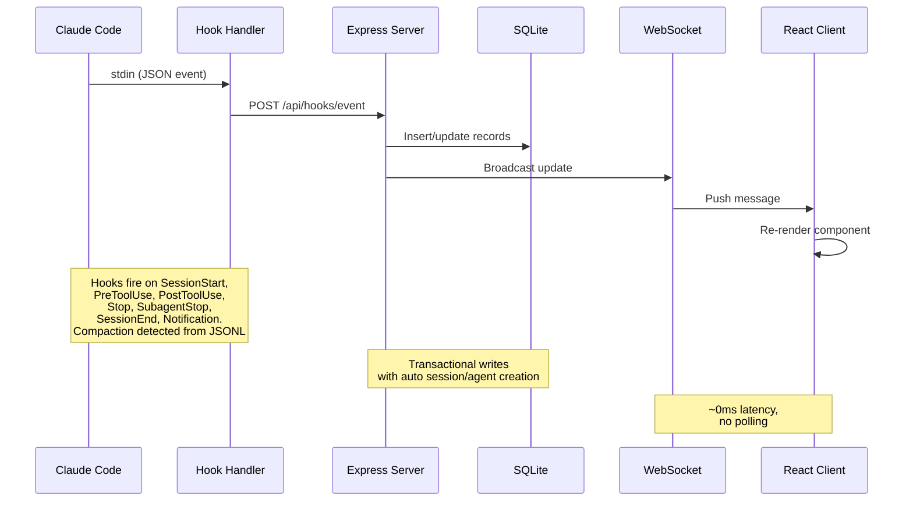

> [!IMPORTANT]
> サーバーアーキテクチャ、データベーススキーマ、API ルート、WebSocket デザイン、クライアントルーティング、フックハンドラのフロー、デプロイモード、およびセッションとエージェントの詳細なライフサイクル図については [ARCHITECTURE.md](./ARCHITECTURE.md) を参照してください。

### フックライフサイクル

1. **Claude Code** は、セッション、プロンプト、ツール、通知、サブエージェント、ターン、終了のフックを発行します。
2. **`scripts/hook-handler.js`** は、標準入力から各イベントを読み取り、`~/.claude/.agent-dashboard.json` または `CLAUDE_DASHBOARD_PORT` を通じてアクティブなダッシュボードを検出します。一意の SQLite データディレクトリごとに 1 回だけ送信し、重複するリスナーには最も低いポートを選択しつつ、別々のデータベースを持つダッシュボードにもフィードします。配信はフェイルセーフで、各ターゲットは分離されており、ハンドラは 5 秒以内に終了します。
3. **サーバー (Server)** は、イベントと関連する状態を 1 つの SQLite トランザクションでコミットします：
   - 初回接触時にセッションとメインエージェントを作成します。`SessionStart` は **待機中 (Waiting)** で始まり、`UserPromptSubmit` または `PreToolUse` で **作業中 (Working)** に移行し、`PostToolUse` で作業中を維持します。
   - `Stop` はバックグラウンドのエージェントが継続している間、メインエージェントを **待機中 (Waiting)** に戻します。`stop_reason=error` はエージェントとセッションを **エラー (Error)** とマークします。権限に関する通知も入力待ちになります。エラーから回復するのは、新しいプロンプトまたはツールの開始のみです。
   - `SubagentStop` は、人間の待機状態を変更することなく、その子を完了させます。その後、切り離されたスキャンが JSONL ツールをインポートし、`tool_use_id` で使用と結果をペアにして重複排除し、真のネストされた親を再構築します。
   - `SessionEnd` は待機をクリアし、エラーを保持する必要がない限りセッションを完了させます。新しい作業は、インポートされたセッションや再開されたセッションを含め、完了、エラー、中断されたセッションを再アクティブ化します。
   - `SessionStart` と定期メンテナンスは、`DASHBOARD_STALE_MINUTES`（デフォルト 180）を超えて非アクティブなセッションを中断 (abandoned) にします。スイープはこの値の 4 分の 1 ごとに実行され、60 秒から 5 分の範囲に制限されます。
   - 共有のインクリメンタルなトランスクリプトパースにより、未変更のバイトを再読み込みすることなく、コンパクション、API エラーとツールエラー、ターン所要時間、トークン、メタデータを記録します。アクティブなセッションのスイープはインデックス付きの `sessions.transcript_path` の値を使用し、中断されたキャッシュエントリを追放します。
   - 15 秒のウォッチドッグは、フックが 10 秒間ない場合にトランスクリプトの API エラーを検出します。また、トランスクリプトのマーカーから、またはマーカーがない場合は `DASHBOARD_WORKING_IDLE_SECONDS`（デフォルト 120）の経過後に、ツールが実行中でなくフックもトランスクリプトも進行していない場合に限って、Esc による中断から回復します。
   - 同じウォッチドッグは、`DASHBOARD_LIVENESS_IDLE_SECONDS`（デフォルト 60）の経過後に、プロセス生存確認プローブを通じて死んだローカルセッションを完了させます。起動時のプローブは即座に実行され、約 5 秒後にもう一度、このアイドルゲートなしで実行されます。プローブは、Windows、コンテナ、POSIX ではない転送されたパス、リモートソースのセッション、ツールの失敗、`DASHBOARD_LIVENESS_PROBE=0` をスキップします。誤った完了は、後の実際のフックで自己修復します。
   - 継続的なプロジェクト同期は、即時スイープ、デバウンスされた `fs.watch`、`DASHBOARD_SESSION_SYNC_MS` のポーリング（デフォルト 30 秒）を組み合わせます。1 つの mtime キャッシュにより、新規または成長したトランスクリプトのみを再パースし、フックと同じセッションフレームをブロードキャストします。
4. **WebSocket** は、コミットされた変更を公開します。
5. **UI** は、ポーリングなしで影響を受けるビューを更新します。

### エージェント状態遷移

永続化されるステータス: `working | waiting | completed | error`。
`awaiting_input_since` 列は補助的なものです — エージェントが待機を開始した日時を記録し、継続時間の表示に使用されますが、現在 `waiting` は実際の永続化ステータスになっています。

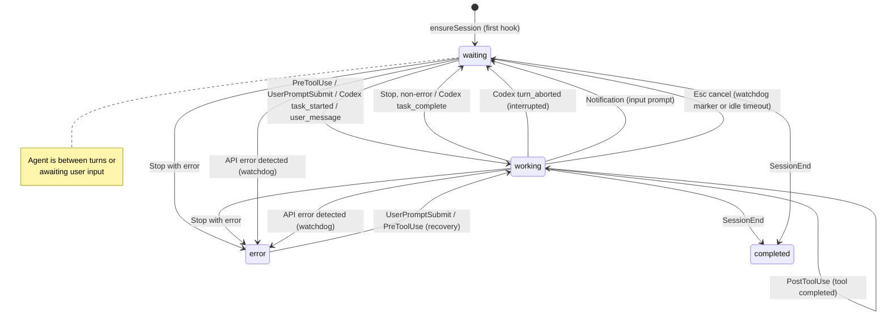

### セッション状態遷移

永続化されるステータス: `active | completed | error | abandoned`。
**待機中 (Waiting)** セッション状態は、UI のオーバーレイです（`status=active` に加えて `awaiting_input_since` が設定されている状態）。

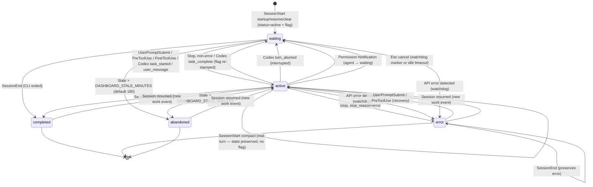

### コスト計算フロー

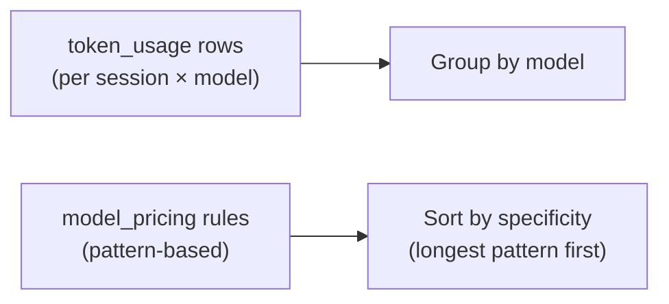

## 構成 (Configuration)

| 環境変数 (Environment variable) | デフォルト (Default) | 用途 (Purpose) |
| --- | --- | --- |
| `DASHBOARD_PORT` | `4820` | Express サーバーのポート。 |
| `CLAUDE_DASHBOARD_PORT` | `4820` | フックハンドラが使用するポート。 |
| `NODE_ENV` | `development` | ビルドされたクライアントを提供するには `production` を使用します。 |
| `DASHBOARD_UPDATE_CHECK` | 有効 | 定期的な upstream チェックを無効にするには `0`、`false`、または `off` に設定します。 |
| `DASHBOARD_UPDATE_CHECK_INTERVAL_MS` | `300000` | 更新チェックの間隔。最小値は 60,000 ミリ秒。手動の **Check now** (今すぐチェック) も引き続き利用できます。 |
| `DASHBOARD_STALE_MINUTES` | `180` | active または Waiting のセッションが abandoned (中断) になるまでの非アクティブ時間。ウォッチドッグがこれを強制し、メンテナンスはこの値の 4 分の 1 ごとに実行されます（60 秒〜5 分の範囲にクランプ）。 |
| `DASHBOARD_WORKING_IDLE_SECONDS` | `120` | ツール、フック、トランスクリプトのいずれの動きも進まない場合に、マーカーを残さない Esc キャンセルから回復します。値を下げると反応は速くなりますが、静かに考える長いターンを一時的に誤分類することがあります（新しいアクティビティがあれば自己修復します）。Cursor も同じルールを使用します。 |
| `DASHBOARD_LIVENESS_PROBE` | `1` | 死んだローカルの Claude/Codex セッションをプロセスベースで完了させる処理を無効にするには `0` に設定します。Windows、コンテナ、転送された非 POSIX パス、リモートソースでは自動的にスキップされます。 |
| `DASHBOARD_LIVENESS_IDLE_SECONDS` | `60` | ウォッチドッグの生存確認におけるトランスクリプトまたは最後のフックのアイドルゲート。起動時のプローブはこのゲートを無視するため、すでに死んでいるセッションは即座にクリアされます。 |
| `DASHBOARD_SESSION_SYNC_MS` | `30000` | 新規または変更された `~/.claude/projects` ファイルのセーフティポーリング。`fs.watch` は引き続き即時に反応します。`0` はポーリングのみを無効にします。 |
| `DASHBOARD_CURSOR_HOME` | `~/.cursor` | チャット、トランスクリプト、バックフィル、永続スナップショット用の Cursor 状態ルート。 |
| `DASHBOARD_CURSOR_SYNC_MS` | `5000` | フィンガープリント方式の Cursor セーフティポーリング。`0` でポーリングを無効にしてもウォッチャーは有効なままです。 |
| `DASHBOARD_CODEX_HOME` | `CODEX_HOME` または `~/.codex` | Codex 状態ルート。設定 (Settings) でオーバーライドが永続化され、監視が再準備され、即座にスキャンされます。 |
| `DASHBOARD_CODEX_SYNC_MS` | `4000` | Codex ロールアウトのセーフティポーリング。`0` に設定してもフックとウォッチャーは有効なままです。 |
| `DASHBOARD_CODEX_MAX_ATTEMPTS` | `5` | 変更のない読み取り不能な 1 つのロールアウトに対する試行回数（最初の試行を含む）。サイズまたは mtime が変わると予算がリセットされ、使い切るとログを 1 回出力します。 |
| `DASHBOARD_CODEX_HOOK_IDLE_SECONDS` | `60` | `codex exec --ephemeral` などフックのみの Codex セッションで、終了報告済みの `stop` が `SessionEnd` を受け取らない場合に、そのセッションを完了させます。無音だけでは対象になりません。 |
| `DASHBOARD_TASK_SUMMARY_TTL_MS` | `2000` | タスクサマリーと `todo_snapshot` の古いデータ提供ウィンドウ。追記はインクリメンタルに解析され、32 MiB を超えて増大した場合は新しい末尾から再開します。`0` は追記のたびに解析します。 |
| `DASHBOARD_SNAPSHOT_COMPRESS` | `1` | 元データが消えた、24 時間アイドルの Claude/Cursor スナップショットに対する検証付き gzip 変換を停止するには、`0`、`false`、または `off` に設定します。読み取り不能なソースツリーと Codex スナップショットはスキップされます。 |
| `DASHBOARD_SNAPSHOT_MAX_AGE_DAYS` | 未設定 | この期間より古い完了済みセッションに対する、6 時間ごとのオプションの保持パス。削除されたセッションはトゥームストーン化され、再開されたセッションは保護されます。スナップショットが唯一のコピーである可能性があるため、`ccam snapshots prune --days N` でプレビューしてください。 |
| `DASHBOARD_SNAPSHOT_MAX_BYTES` | 未設定 | バイト数または `5GB` のような単位で指定する、スナップショット合計サイズのオプションの上限。古い完了済みセッションから順に削除され、active または直近 24 時間のセッションは保護されます。 |
| `DASHBOARD_REMOTE_SYNC_MS` | `15000` | Claude プロジェクト、Codex ロールアウト、Codex タイトルインデックスに対する SSH リモートソースのポーリング。新規または再有効化されたソースは即座に同期されます。`0` にしても手動同期は利用できます。 |
| `DASHBOARD_REMOTE_ACTIVE_WINDOW_MS` | `600000` | ミラーされたリモートトランスクリプトを、最新のイベントがこの鮮度以内である間は active として扱い、その後 completed に照合します。失敗したプロバイダーは通常の stale 処理にフォールバックします。 |
| `DASHBOARD_REMOTE_SYNC_TIMEOUT_MS` | `600000` | SSH 取得とインポートに対するソースごとのタイムアウト。 |
| `DASHBOARD_REMOTE_TEST_TIMEOUT_MS` | `15000` | リモートソースの SSH テストのタイムアウト。 |
| `DASHBOARD_HOST` | `127.0.0.1` | バインドするインターフェース。`0.0.0.0` にするとサービスが公開され、警告がログに記録されます。 |
| `DASHBOARD_TOKEN` | 未設定 | Bearer ヘッダー、`x-dashboard-token`、または `?token=` で `/api/*` と WebSocket を保護します。ループバックがデフォルトの信頼の境界です。 |
| `DASHBOARD_TOKEN_FILE` | 未設定 | Docker/Kubernetes シークレット用の、ファイルでバックアップされたダッシュボードトークン；`DASHBOARD_TOKEN` が優先されます。 |
| `DASHBOARD_HOOK_TOKEN` / `DASHBOARD_HOOK_TOKEN_FILE` | 未設定 | ループバックを超える場合の `/api/hooks/event` および `/api/hooks/codex` に対する独立した保護。 |
| `REMOTE_PUSH_TOKEN` / `REMOTE_PUSH_TOKEN_FILE` | 未設定 | 公開される `POST /api/hooks/ingest-batch` 用の別個のゲート。このルートはデフォルトで無効で、ローカルのフックトークンを引き継ぐことはありません。 |
| `DASHBOARD_ALLOWED_HOSTS` | ループバック | DNS リバインディング対策のための、HTTP および WebSocket の `Host` 値の追加分（コンマ区切り）。 |
| `DASHBOARD_ENV_PATH` | リポジトリの `.env` | プロバイダーホームのオーバーライドを永続化するために使用される書き込み可能な dotenv ファイル；コンテナのデフォルトは `/app/config/.env` です。 |
| `CCAM_DASHBOARD_URL` | localhost 自動検出 | リモートフックの宛先。非ループバックの URL には HTTPS とフックトークンが必要です。 |
| `CCAM_HOOK_TOKEN` / `CCAM_HOOK_TOKEN_FILE` | 未設定 | `x-ccam-hook-token` として送信されるフッククライアント認証情報。 |

> [!IMPORTANT]
> サーバーはデフォルトでループバック専用です。LAN アクセスには `DASHBOARD_HOST`、`DASHBOARD_TOKEN`、および一致する `DASHBOARD_ALLOWED_HOSTS` の値が必要です。[`.env.example`](./.env.example) と[セキュリティポリシー](./.github/SECURITY.md)を参照してください。

Git クローンは定期的に正規のリモートを fetch し、そのデフォルトブランチと現在のチェックアウトを比較します。遅れている場合は、ターミナルと UI に実行すべき手動更新コマンドが表示されます。CCAM が自動で pull したり再起動したりすることはありません。

---

## `ccam` CLI

**`ccam`** CLI (`bin/ccam.js` → `cli/`) は、継承されるオプション、バリデーション、サジェスト、自動生成ヘルプ、シェル補完を備えた Commander.js のコマンドツリーを通じて、あらゆるターミナルからダッシュボードを操作できるようにします。`npm run setup` によって自動的にリンクされます。サーバーの解決は、`--server` / `CCAM_URL`、設定されたポート、ライブサーバーレジストリ、そして `http://127.0.0.1:4820` の順に確認します。

```bash
# サーバー (Server)
ccam status | health                  # ● running / ○ not running (実行中 / 非実行中); バージョン + タイムスタンプ
ccam start [--port N] | stop | restart  # バックグラウンドの本番サーバー
ccam logs [-n N] [-f]                 # data/ccam-server.log を tail
ccam open [page] [--session id]       # ダッシュボード、ページ、またはセッションを開く
ccam repl                             # インタラクティブシェル (別名: shell, i)

# 監視 (Monitoring)
ccam overview [--watch]               # 1 画面のライブスナップショット (別名: top)
ccam stats | kanban                   # 合計 + ステータス分布 / ステータスレーン
ccam tail [--session id] [--type T] [--tool N]   # ライブイベントフィード
ccam stream [--type new_event,…]      # 生のリアルタイム WebSocket フィード
ccam watch -n 5 <command …>           # 任意のコマンドを一定間隔で再実行

# データ (Data)
ccam sessions [--status s] [--q text] [--cwd dir] [--sort price] [--limit n]
ccam sessions get|stats|cost|agents|events|transcripts <id>
ccam sessions transcript <id>         # 会話を読みやすいチャットログとして表示
ccam sessions rename <id> <name…> | update <id> | create | facets
ccam agents [list|get|update|create]  # エージェント; ccam session <id> = sessions get
ccam events [--type T] [--tool N] [--q text] [--from iso] | events facets

# インサイト (Insights)
ccam analytics                        # トークン、コスト、頻出ツール、日次スパークライン
ccam workflows [session <id>]         # ワークフローインテリジェンス + パターン
ccam runs [list|get <run-id>]         # Workflow-tool の実行
ccam run list|history|start|follow|send|stop …   # ダッシュボードから起動されたエージェント
ccam cost [--session id] [--daily]    # モデルごとのコスト、サーチャージ、価格未設定のモデル

# アラートと Webhook (Alerts & webhooks)
ccam alerts [--unacked] | ack <id> | ack-all
ccam alert-rules list|types|create|update|enable|disable|delete
ccam webhooks list|get|providers|deliveries|create|update|enable|disable|delete|test

# 価格設定 (Pricing)
ccam pricing [list] | set <pattern> --input N --output N [--fast-* …] [--intro-* …] | delete | reset
ccam pricing gpt|cursor [list|set|delete]   # OpenAI/Codex と Cursor のレートカード

# インポートとリモートソース (Import & remote sources)
ccam import guide|rescan|path <dir>|upload <files…>|reimport
ccam import-data <file.json>          # エクスポートの復元 (冪等)
ccam remote-sources list|get|add|update|enable|disable|test|sync|rm

# 管理 (Administration)
ccam doctor | info | export [file|-] | cleanup --hours N --days M
ccam snapshots [status|compress] | snapshots prune --days N   # トランスクリプトのスナップショット; prune は --apply --confirm PRUNE_SNAPSHOTS を付けない限りドライラン
ccam hooks [status|install] | reinstall-hooks | config claude|codex …
ccam updates [status|check] | update-check | metrics [--grep re]
ccam home [set claude|codex <path>] | push key|send|subscribe|unsubscribe
ccam api [METHOD] /api/path [--data JSON]   # 任意のエンドポイント; 書き込みには --yes が必要
ccam mcp [stdio|http|repl] | clear-data --yes

# CLI
ccam help [command…] | commands [--json] | completion bash|zsh|fish | version
```

グループはデフォルトで一覧を表示します（`ccam alerts` は `ccam alerts list` と同じ）。すべてのコマンドが `--help` をサポートしており、`ccam commands` はツリーを表示し、`ccam commands --json` はそのマシン可読なスキーマを出力します。

- **出力:** TTY ではテーブル、ステータスアイコン、チャート、スパークライン、エージェントツリー、トランスクリプトビュー、カラーのヘルプが表示されます。パイプではプレーンテキストになります。`--json` または `CCAM_OUTPUT=json` で安定した JSON を返し、`tail`、`stream`、`run follow` では NDJSON になります。エラーは stderr に `{"error":{"code":"…","message":"…"}}` の形式で出力され、終了コードは `0` または `1` です。
- **書き込み:** インタラクティブな `y/N` 確認または `--yes` を使用します。非インタラクティブな書き込みには `--yes` が必要で、`clear-data` は常にリテラルのフラグを必要とします。
- **オフラインモード:** 読み取り専用のコマンドは `data/dashboard.db` にフォールバックし、`⚠ Offline mode` バナーを表示し、死んでいる active なセッションを生存確認ビューによって補正します。サーバー専用のコマンドは、ダッシュボードが利用できない理由を説明します。
- **REPL と補完:** `ccam repl` は、ツリー駆動の補完、永続的な履歴、ライブプロンプト、組み込みの `help`、`json`、`watch` を追加し、各行は子プロセスとして分離されます。zsh の補完は `source <(ccam completion zsh)` で有効にします。

`ccam` が `PATH` にない場合は、リポジトリのルートから一度 `npm link` を実行してください。完全な仕様は [docs/CLI.md](./docs/CLI.md) を参照してください。

## npm スクリプト

| コマンド | 説明 |
| ----------------------- | ---------------------------------------------------------- |
| `npm run setup`         | root/client/extension/MCP の依存関係をインストールし、MCP をビルドし、`ccam` をリンクします |
| `npm run update:pull-setup` | `git pull --ff-only` を実行後 `npm run setup` を実行します（手動アップグレード） |
| `npm run dev`           | サーバー (ウォッチモード) とクライアント (Vite HMR) を同時に起動します |
| `npm run dev:server`    | デバウンスされたグレースフルリスタート方式のソースウォッチャー付きで Express を起動します |
| `npm run dev:client`    | Vite 開発サーバーのみを起動します |
| `npm run build`         | React クライアントを `client/dist/` にビルドします |
| `npm start`             | 本番サーバーを起動します (ビルドされたクライアントを提供) |
| `npm test`              | フルスイートを実行します (サーバー `node --test` + クライアント Vitest) |
| `npm run verify`        | ローカルのゲート全体を 1 つのコマンドで実行します: 著作者ヘッダーの監査、Prettier チェック、クライアントの型チェック、バックエンドテスト、フロントエンドテスト |
| `npm run check:headers` | 対象となるすべてのソースファイルが著作者ヘッダーを持っていることを監査します |
| `npm run typecheck:client` | クライアントを型チェックします (`tsc -b`) — 本番ビルドが Vite の前に実行するのと同じチェックです |
| `npm run test:server`   | バックエンドのテストを実行します (`node --test server/__tests__/`) |
| `npm run test:client`   | フロントエンドの Vitest テストを実行します。**すべての画面のレンダースナップショット** (`client/src/pages/__tests__/screens.snapshot.test.tsx`) を含みます。意図的な UI 変更の後は `cd client && npx vitest run -u` でベースラインを再生成してください |
| `npm run install-hooks` | `~/.claude/settings.json` に Claude Code フックを設定します |
| `npm run seed`          | データベースにサンプルデータを投入します |
| `npm run import-history`| `~/.claude/` からレガシーセッションをインポートします（起動時にも実行されます） |
| `npm run reconcile-tokens`| インポートされたセッションのトークン合計を更新します（合計が下がることはありません） |
| `npm run repair-tokens` | ディスク上にトランスクリプトがある（`~/.claude/projects/` 配下、またはセッションに保存された `transcript_path` 経由で見つかる）すべての **Claude** セッションについて、**ワークフロー以外**のトークン合計を再計算し、コンパクションのベースラインをゼロにします；ワークフローと Codex の行は保持されます。v2.0.9 より前のレコード単位の使用量合計、または同一モデルのフラットなサブエージェント使用量の取りこぼしの影響を受けたデータベースに対する、1 回限りの修復です。先にダッシュボードを停止してください |
| `DASHBOARD_TOKEN_REPAIR` | デフォルトで有効 (`1`)。レコード単位の過大計上、または同一モデルのフラットなサブエージェントの取りこぼしの影響を受けた過去のトークン合計を、1 回限り自動で修復します。ライブでの修正ではすべての完了済みセッションを再訪することはできず、`replaceTokenUsage` は古い最高水位を下げられません。データベースごとに 1 回だけ実行され（マーカーでゲート、起動パスから遅延実行、別のダッシュボードがデータディレクトリを共有している間はスキップ）、先に古い行を `token_usage_pre_repair_v2` にスナップショットします。スキップして `npm run repair-tokens` で手動修復するには `0` に設定します |
| `npm run clear-data`    | すべてのセッション、エージェント、イベント、およびトークン使用量を削除します |
| `npm run mcp:install`   | ローカル MCP パッケージ (`mcp/`) の依存関係をインストールします |
| `npm run mcp:build`     | MCP サーバーの TypeScript を `mcp/build/` にビルドします |
| `npm run mcp:start`     | MCP サーバーを起動します (stdio トランスポート — MCP ホスト用) |
| `npm run mcp:start:http`| MCP サーバーを起動します (ポート 8819 の HTTP + SSE トランスポート) |
| `npm run mcp:start:repl`| MCP サーバーを起動します (タブ補完付きのインタラクティブ REPL) |
| `npm run mcp:dev`       | 開発モードで MCP サーバーを実行します (`tsx`, stdio) |
| `npm run mcp:dev:http`  | 開発モードで MCP サーバーを実行します (`tsx`, HTTP + SSE) |
| `npm run mcp:dev:repl`  | 開発モードで MCP サーバーを実行します (`tsx`, インタラクティブ REPL) |
| `npm run mcp:typecheck` | ビルド出力を生成せずに MCP ソースを型チェックします |
| `npm run extensions:sync` | スキル名/OpenAI メタデータ、Codex マニフェスト、および両方のマーケットプレイスを再生成します |
| `npm run extensions:validate` | 14 のデュアルフォーマットプラグインと 66 のバンドルされたスキルすべてを検証します |
| `npm run mcp:docker:build` | Docker で MCP コンテナイメージをビルドします (`agent-dashboard-mcp:local`) |
| `npm run mcp:podman:build` | Podman で MCP コンテナイメージをビルドします (`localhost/agent-dashboard-mcp:local`) |
| `npm run desktop:install` | Electron + electron-builder を `desktop/` ワークスペースにインストールします (Electron の ABI 用に `better-sqlite3` を再ビルドします)；ネイティブの `better-sqlite3` ビルドを事前確認し、失敗時には実行可能なセットアップのヘルプ（ツールチェーン不要の代替手段を含む）を表示します |
| `npm run desktop:dev`   | ローカルでのイテレーションのために Electron デスクトップアプリをビルドして起動します |
| `npm run desktop:build` | デスクトップの TypeScript ソースを `desktop/out/` にコンパイルします |
| `npm run desktop:test`  | デスクトップのスモークテストを実行します (Electron をスポーンし、`/api/health` をプローブします) |
| `npm run desktop:dmg`   | **両方**の macOS DMG (arm64 + x64) をビルドします — リリース向けですが、**遅い**です (各アーキテクチャをパッケージ化します) |
| `npm run desktop:dmg:arm64` | Apple-Silicon 専用の DMG をビルドします — **高速**、あなた自身の Mac 用に推奨 |
| `npm run desktop:dmg:x64` | Intel 専用の DMG をビルドします — **高速** |
| `npm run desktop:dmg:universal` | 1 つにマージされた**ユニバーサル** DMG (arm64 + x86_64) をビルドします — オプション、**最も遅い**、リリースで配布されるものではありません |
| `npm run desktop:win`   | Windows の **NSIS インストーラー** `.exe` (x64) をビルドします — Windows 上で実行します |
| `npm run desktop:win:portable` | Windows の **ポータブル** (インストール不要) `.exe` (x64) をビルドします — Windows 上で実行します |
| `npm run monitoring:install` | `monitoring/` 内で `npm install` を実行します — `postinstall` 経由で Prometheus + Grafana をダウンロードします |
| `npm run monitoring:setup` | `monitoring:install` のエイリアスです |
| `npm run monitoring:up` | Prometheus (:9090) と Grafana (:3000) をバックグラウンドで開始します (Docker なし) |
| `npm run monitoring:down` | npm で管理された監視スタックを停止します |
| `npm run monitoring:start` | 監視スタックをフォアグラウンドで開始します (Ctrl+C で両方を停止します) |
| `npm run monitoring:docker:up` | Docker Compose 経由で Prometheus + Grafana を開始します |
| `npm run monitoring:docker:down` | Docker の監視スタックを破棄します |
| `npm run monitoring:verify` | ダッシュボード、Prometheus、Grafana、およびスクレイプターゲットのヘルスチェックを行います |
| `npm run docker:up` | Docker 内でダッシュボードを起動します (`docker compose up -d --build`) |
| `npm run docker:down` | ダッシュボードコンテナを停止します |
| `npm run docker:full:up` | ダッシュボード + 認証付き MCP + rootless Nginx + Prometheus + Grafana |
| `npm run docker:full:down` | 完全な Docker スタックを破棄します |
| `npm run deploy:validate` | Docker、Compose、Nginx、Helm、Kustomize、Terraform、依存関係の監査、および「単一ライター」の不変条件をレビューします。指摘事項は助言扱い（終了コード 0）で、`CCAM_DEPLOY_VALIDATE_STRICT=1` を設定すると厳格なゲートになります |

---

## エージェント拡張 (Agent Extensions)

このリポジトリには、Claude Code と Codex の両方に対する包括的な拡張レイヤーが含まれています：

- Claude Code: `CLAUDE.md`, `.claude/rules/`, `.claude/skills/`
- Claude サブエージェント: `.claude/agents/`
- Codex: `AGENTS.md`, `.codex/rules/`, `.codex/agents/`, `.codex/skills/`
- 共有配布可能プラグイン: `plugins/`, `.claude-plugin/plugin.json` と `.codex-plugin/plugin.json` の両方を備える
- マーケットプレイス: Claude Code 用の `.claude-plugin/marketplace.json` および Codex 用の `.agents/plugins/marketplace.json`
- オープンエージェントスキル: すべてのプラグインスキルには正規のフロントマターと `agents/openai.yaml` が含まれます；`npx skills add hoangsonww/Claude-Code-Agent-Monitor --list` を実行すると 77 のリポジトリスキルが検出されます

### 拡張アーキテクチャ

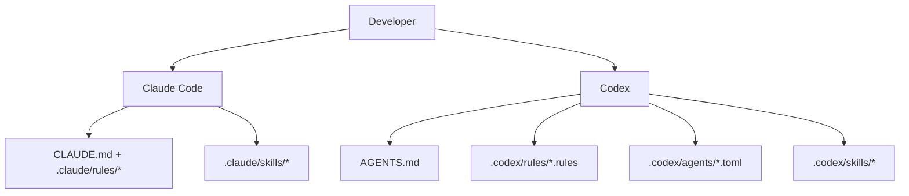

### Claude Code レイヤー

- 永続的コンテキスト:
  - [`CLAUDE.md`](./CLAUDE.md)
- パススコープ付きルール:
  - [`.claude/rules/backend-node.md`](./.claude/rules/backend-node.md)
  - [`.claude/rules/frontend-react.md`](./.claude/rules/frontend-react.md)
  - [`.claude/rules/mcp-typescript.md`](./.claude/rules/mcp-typescript.md)
  - [`.claude/rules/docs-markdown.md`](./.claude/rules/docs-markdown.md)
  - [`.claude/rules/file-headers.md`](./.claude/rules/file-headers.md)
  - [`.claude/rules/wiki-i18n.md`](./.claude/rules/wiki-i18n.md)
  - [`.claude/rules/i18n-parity.md`](./.claude/rules/i18n-parity.md)
- スキル:
  - `repo-onboarding`
  - `ship-feature`
  - `version-release`
  - `mcp-operations`
  - `debug-live-issue`
  - `update-project-docs`
  - `file-headers`
  - `push-to-forked-pr`
  - `i18n-parity`
- サブエージェント:
  - `backend-reviewer`
  - `frontend-reviewer`
  - `mcp-reviewer`

### Codex レイヤー

- 永続的コンテキスト:
  - [`AGENTS.md`](./AGENTS.md)
- 実行ポリシー:
  - [`.codex/rules/default.rules`](./.codex/rules/default.rules)
- カスタムサブエージェントテンプレート:
  - [`.codex/agents/`](./.codex/agents)
- スキル:
  - [`.codex/skills/`](./.codex/skills)
- セットアップ:
  - [`.codex/README.md`](./.codex/README.md)

---

## MCP 統合 (MCP Integration)

このプロジェクトには、16 のドメインモジュールにまたがる 103 のツールを備えた `mcp/` のローカル MCP サーバーが含まれています。スコープ付きデータ読み取り、トランスクリプト/画像、Claude、Cursor、GPT の価格設定、ワークフロー、アラート/Webhook、インポートとバックアップの復元、Claude/Codex 設定、エージェントの実行、リモートソース、設定、プッシュ、保護されたメンテナンスなど、サポートされるすべてのアプリケーションアクションを公開します。3 つのトランスポートモードをサポートします。

### MCP トランスポートモード

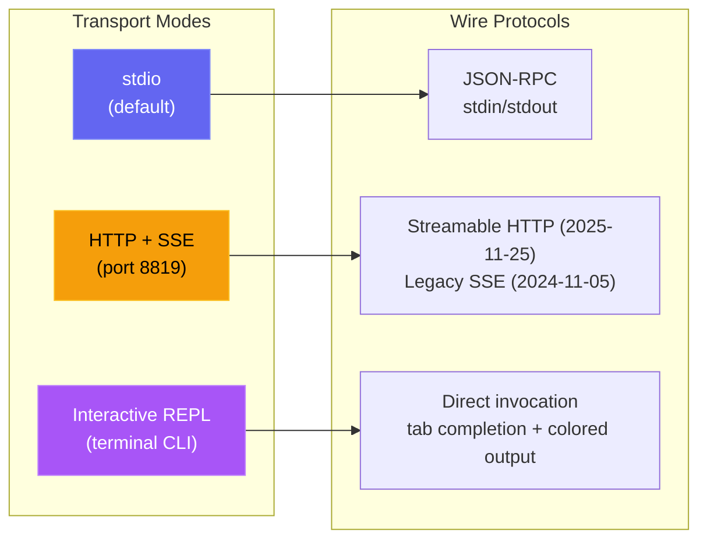

| モード (Mode) | コマンド (Command) | ユースケース (Use Case) |
| --- | --- | --- |
| **stdio** | `npm run mcp:start` | Claude Code、Claude Desktop、IDE の MCP ホスト |
| **HTTP** | `npm run mcp:start:http` | リモート MCP クライアント、Web 統合、マルチセッション |
| **REPL** | `npm run mcp:start:repl` | Ops デバッグ、手動ツール呼び出し、ローカル管理 |

<p align="center">
  <a href="images/mcp.png">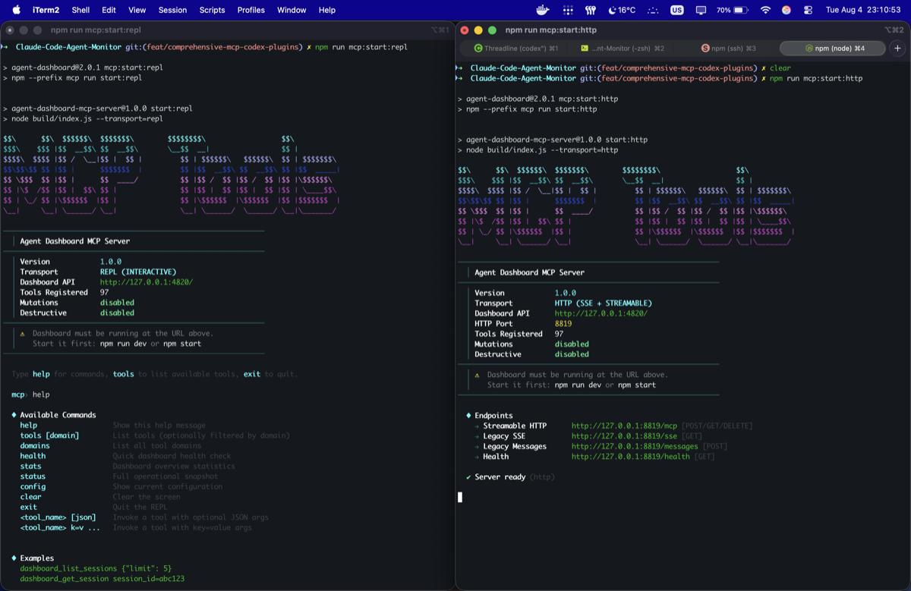</a>
</p>

### MCP アーキテクチャ

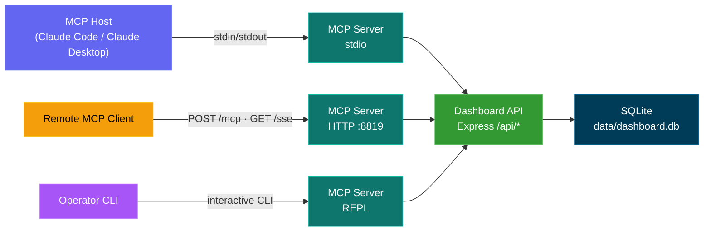

### MCP ツールサーフェス

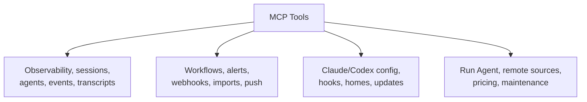

### MCP セキュリティモデル

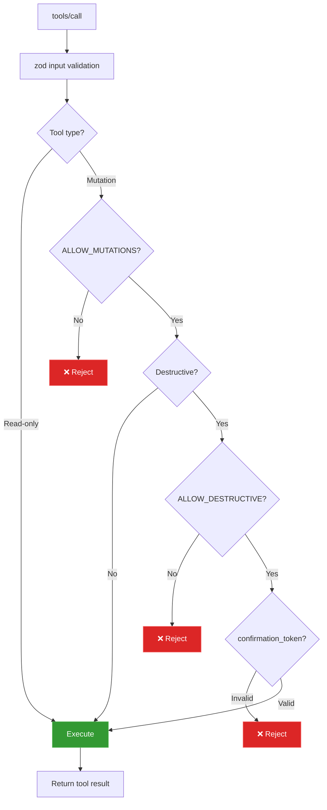

### MCP 運用モード

- 読み取り専用モード (デフォルト): `MCP_DASHBOARD_ALLOW_MUTATIONS=false`
- 管理者モード: `MCP_DASHBOARD_ALLOW_MUTATIONS=true`
- 認証されたダッシュボード: `MCP_DASHBOARD_API_TOKEN` / `_FILE` にダッシュボードトークンを設定
- 認証された HTTP/SSE トランスポート: `MCP_HTTP_AUTH_TOKEN` / `_FILE` を設定；クライアントは bearer 認証または `x-mcp-token` を送信します
- トランスポートガードレール: 直接のループバック HTTP はトークンを運ぶことができます；コンテナホストエイリアスは HTTPS を必要とします；リダイレクトは拒否されます
- ペイロードガードレール: アップロード履歴ファイルごとに 50 MiB、呼び出しごとに合計 100 MiB、バイナリ応答は 10 MiB、バックアップ復元は 25 MiB
- 破壊的モード: 以下がすべて必要です:
  - `MCP_DASHBOARD_ALLOW_MUTATIONS=true`
  - `MCP_DASHBOARD_ALLOW_DESTRUCTIVE=true`
  - ツール入力 `confirmation_token: "CLEAR_ALL_DATA"`

全容: [mcp/README.md](./mcp/README.md)

---

## API リファレンス (API Reference)

すべてのエンドポイントは JSON を返します。エラー応答は `{ error: { code, message } }` の形式に従います。

### OpenAPI / Swagger / ReDoc

HTTP API を探索するには 3 つの方法があり、すべて単一の OpenAPI 3.0.3 仕様によって駆動されます (デフォルトサーバーポート `4820`):

| メソッド | パス | 説明 |
| ------ | ------------------------------- | ------------------------------------------------------------------------------------------------- |
| `GET`  | `/api/openapi.json`             | 生の OpenAPI 3.0.3 JSON 仕様 |
| `GET`  | `/api/docs`                     | インタラクティブな **Swagger UI** — リクエスト実行を試すことができます |
| `GET`  | `/api/redoc`                    | **ReDoc** リファレンス — 同じ仕様のクリーンで読み取りに最適化された 3 ペインレンダリング |
| `GET`  | `/api/redoc/redoc.standalone.js`| セルフホスト型 ReDoc バンドル (CDN ではなく `redoc` 依存関係経由でローカルに提供されます — オフラインで動作します) |

OpenAPI ドキュメントは `server/openapi.js` (`createOpenApiSpec()`) から生成され、`server/openapi-extra/` 下の補足フラグメントと結合されます。Swagger UI と ReDoc はどちらもバックエンドから直接提供されます。ReDoc バンドルはローカルに提供されるため (`GET /api/redoc/redoc.standalone.js`)、プロジェクトの「外部アセットなし」ポリシーに従い、リファレンスは完全にオフライン / エアギャップ環境で機能します。

カバレッジは包括的です：すべてのバックエンドルート（82のパスエントリ）が以下のタグにわたって文書化されています — Health, Sessions, Agents, Events, Stats, Metrics, Analytics, Hooks, Pricing, Workflows, Settings, Updates, Alerts, Webhooks, Push, CcConfig (Claude Code 設定エクスプローラー), Run (ダッシュボードで生成された実行), そして Documentation — それぞれにパラメータ、リクエスト/レスポンススキーマ、フィールドレベルの説明、および現実的な例が含まれています。

リポジトリルートにコミットされた **`openapi.yaml`** は、ライブ仕様をミラーリングしています。これは `server/openapi.js` から生成され（手動で編集されることはありません）— API の変更後は以下を実行して再生成してください：

```bash
npm run openapi:yaml
```

<p align="center">
  <a href="images/swagger.png"></a>
</p>

<p align="center">
  <a href="images/redoc.png">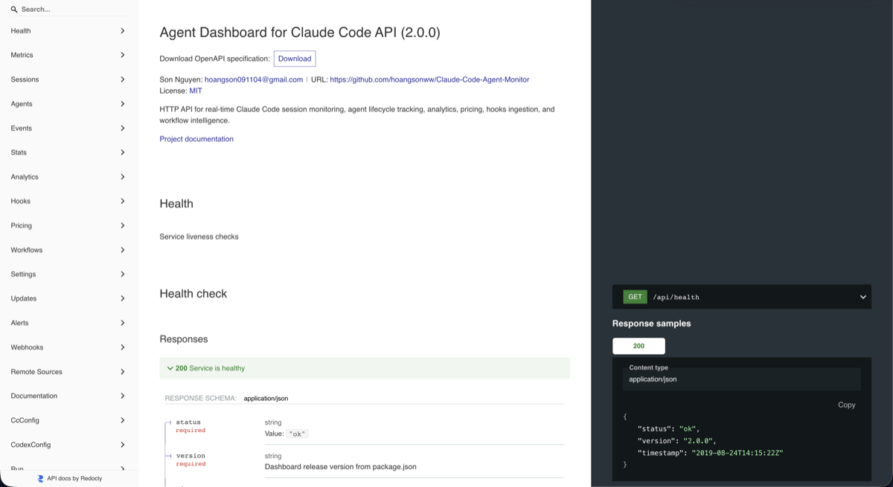</a>
</p>

### ヘルス (Health)

| メソッド (Method) | パス (Path)          | 説明 (Description)                           |
| ------ | ------------- | ------------------------------------- |
| `GET`  | `/api/health` | `{ status: "ok", timestamp }` を返します |

### セッション (Sessions)

| メソッド  | パス                            | クエリパラメータ                                                     | 説明                                                                                  |
| ------- | ------------------------------- | ---------------------------------------------------------------- | -------------------------------------------------------------------------------------------- |
| `GET`   | `/api/sessions`                 | `status`, `q`, `limit`, `offset`                                 | エージェント数とセッションごとのコストを含むセッションのリスト。`q` は `id` / `name` / `cwd` にわたって大文字小文字を区別しない検索を行います。`limit` のデフォルトは 50、最大 10000。応答にはページネーター用の `total` が含まれます。 |
| `GET`   | `/api/sessions/:id`             | --                                                               | エージェントとイベントを含むセッションの詳細                                                        |
| `GET`   | `/api/sessions/:id/stats`       | --                                                               | セッション詳細の概要パネルを駆動する集計カウント：イベント、タイプ別イベント、上位ツールの使用状況、エラー数、エージェントのタイプ/ステータス数、サブエージェントタイプの内訳、トークンの合計、時間範囲 |
| `GET`   | `/api/sessions/:id/transcripts` | --                                                               | セッションで利用可能な JSONL トランスクリプトのリスト（メイン + サブエージェント + コンパクション） |
| `GET`   | `/api/sessions/:id/transcript`  | `agent_id`, `limit`, `offset`, `after`, `before`                 | カーソルベースのページネーションを使用して、特定のトランスクリプトからメッセージをストリーミングします。アシスタントの `usage` には `input_tokens`、`output_tokens`、`cache_read_input_tokens`、`cache_creation_input_tokens` が含まれるため、再開 / 再接続時に実行ページのメーターを完全に復元できます |
| `POST`  | `/api/sessions`                 | --                                                               | セッションを作成します (`id` に対して冪等) |
| `PATCH` | `/api/sessions/:id`             | --                                                               | セッションのステータス/メタデータを更新します |

### エージェント (Agents)

| メソッド  | パス              | クエリパラメータ                              | 説明                   |
| ------- | ----------------- | ----------------------------------------- | ----------------------------- |
| `GET`   | `/api/agents`     | `status`, `session_id`, `limit`, `offset` | フィルター付きのエージェントリスト      |
| `GET`   | `/api/agents/:id` | --                                        | 単一エージェントの詳細           |
| `POST`  | `/api/agents`     | --                                        | エージェントを作成                  |
| `PATCH` | `/api/agents/:id` | --                                        | エージェントのステータス/タスク/ツールを更新 |

### イベント (Events)

| メソッド | パス          | クエリパラメータ                    | 説明                |
| ------ | ------------- | ------------------------------- | -------------------------- |
| `GET`  | `/api/events` | `session_id`, `limit`, `offset` | イベントリスト (最新のものから順に) |

### 統計 (Stats)

| メソッド | パス         | 説明                                            |
| ------ | ------------ | ------------------------------------------------------ |
| `GET`  | `/api/stats` | 集計カウント、ステータス分布、WS 接続数 |

### 分析 (Analytics)

| メソッド | パス             | 説明                                                |
| ------ | ---------------- | ---------------------------------------------------------- |
| `GET`  | `/api/analytics` | チャートとトレンドビューのためのトークン/ツール/セッションの集計   |

### リモートデータソース (Remote Data Sources)

| メソッド   | パス                            | クエリパラメータ | 説明                                                                                 |
| -------- | ------------------------------- | ------------ | ------------------------------------------------------------------------------------------- |
| `GET`    | `/api/remote-sources`           | --           | 構成されたリモートソースを、ステータス、最後のエラー、および最終同期のカウントとともに一覧表示します |
| `POST`   | `/api/remote-sources`           | --           | ソースを作成します。ボディ: `{ label, host, ssh_port?, identity_file?, remote_home?, remote_codex_home?, enabled? }` |
| `PATCH`  | `/api/remote-sources/:id`       | --           | ソースを更新します（ラベル、接続フィールド、有効/無効）                                       |
| `DELETE` | `/api/remote-sources/:id`       | `purge`      | ソースを削除します；`?purge=true` の場合は、そのソースのインポートされたセッションも削除されます                 |
| `POST`   | `/api/remote-sources/:id/test`  | --           | ソースへの SSH 接続性をプローブします                                                        |
| `POST`   | `/api/remote-sources/:id/sync`  | --           | 今すぐソースから取得し、再インポートします                                                      |

`GET /api/sessions`、`/api/events`、`/api/agents`、`/api/stats`、および `/api/analytics` は、結果を元の場所 (origin) でスコープするためのオプションの `sources` クエリパラメータ（コンマ区切りのソース ID；すべての場合は省略）を受け入れます。また、`GET /api/sessions/facets` はデータスコープセレクタ用の `sources` 配列を返します。

### フック (Hooks)

| メソッド | パス               | 説明                                  |
| ------ | ------------------ | -------------------------------------------- |
| `POST` | `/api/hooks/event` | Claude Code のフックイベントを受信して処理します |
| `POST` | `/api/hooks/ingest-batch` | ローミング / NAT 配下のマシンからセッションデータのバッチをプッシュします（デフォルトでは無効。下記の `REMOTE_PUSH_TOKEN` と、ペイロード形式の詳細は `server/README.md` を参照） |

**フックイベントのペイロード:**

```json
{
  "hook_type": "PreToolUse",
  "data": {
    "session_id": "abc-123",
    "tool_name": "Bash",
    "tool_input": { "command": "ls -la" }
  }
}
```

### 価格設定 (Pricing)

| メソッド   | パス                     | 説明                              |
| -------- | ------------------------ | ---------------------------------------- |
| `GET`    | `/api/pricing`           | すべての価格設定ルールを一覧表示します |
| `PUT`    | `/api/pricing`           | 価格設定ルールを作成または更新します |
| `DELETE` | `/api/pricing/:pattern`  | 価格設定ルールを削除します |
| `GET`    | `/api/pricing/cost`      | すべてのセッションの総コスト |
| `GET`    | `/api/pricing/cost/:id`  | 特定セッションのコストの内訳 |

### ワークフロー (Workflows)

| メソッド | パス                          | 説明                                             |
| ------ | ----------------------------- | ------------------------------------------------------- |
| `GET`  | `/api/workflows`              | プロバイダー/ソースでスコープされたワークフローデータ（オーケストレーション、記録されたツール、パターン、Codex コンパクション）。オプションの `?status=active\|completed`、`?sources=...`、および `?providers=claude\|codex` フィルターはすべての 11 のデータセクションに適用されます |
| `GET`  | `/api/workflows/session/:id`  | プロバイダー/ソースでスコープされたセッションごとのドリルイン（エージェントツリー、記録されたツールのタイムライン、イベント） |

### アラート (Alerts)

| メソッド   | パス                     | 説明                                                            |
| -------- | ------------------------ | ---------------------------------------------------------------------- |
| `GET`    | `/api/alerts`            | 発動したアラートフィード、最新順 (`?unacked=true`, `limit`, `offset`)    |
| `POST`   | `/api/alerts/:id/ack`    | 1 つのアラートを承認 (acknowledge) します |
| `POST`   | `/api/alerts/ack-all`    | 未承認のすべてのアラートを承認します |
| `GET`    | `/api/alerts/rules`      | アラートルールを一覧表示します |
| `POST`   | `/api/alerts/rules`      | ルールを作成します (`event_pattern` \| `inactivity` \| `status_duration` \| `token_threshold`) |
| `PATCH`  | `/api/alerts/rules/:id`  | 名前 / 設定 / 有効状態 / クールダウンを更新します (ルールの種類は不変です) |
| `DELETE` | `/api/alerts/rules/:id`  | ルールとその発動履歴を削除します |

### Webhook (Webhooks)

| メソッド   | パス                              | 説明                                                                          |
| -------- | --------------------------------- | ------------------------------------------------------------------------------------ |
| `GET`    | `/api/webhooks/providers`         | サポートされているプロバイダーとその設定フィールド (UI フォームを駆動します) |
| `GET`    | `/api/webhooks`                   | Webhook ターゲットの一覧表示 (URL はマスクされ、シークレットは墨塗りされます) |
| `POST`   | `/api/webhooks`                   | ターゲットを作成します (14 のファーストクラスプロバイダー + `generic`) |
| `PATCH`  | `/api/webhooks/:id`               | 名前 / URL / 有効状態 / シークレット / ヘッダー / ルールスコープを更新します (種類は不変です) |
| `DELETE` | `/api/webhooks/:id`               | ターゲットとその配信ログを削除します |
| `POST`   | `/api/webhooks/:id/test`          | 合成的なテストアラートを送信し、配信結果を報告します |
| `GET`    | `/api/webhooks/:id/deliveries`    | ターゲットの最近の配信ログ (`limit`, `offset`) |

ホストされたプロバイダーには HTTPS が必要です。`generic` と `n8n` はローカルまたはセルフホストされた受信者向けに HTTP を使用できます。配信はリダイレクトを拒否するため、認証情報、カスタムヘッダー、および HMAC 署名が 2 番目の URL に転送されることはありません。

### 設定 (Settings)

| メソッド | パス                           | 説明                                      |
| ------ | ------------------------------ | ------------------------------------------------ |
| `GET`  | `/api/settings/info`           | システム情報、DB 統計、フックのステータス |
| `POST` | `/api/settings/clear-data`     | すべてのセッション、エージェント、イベント、トークン使用量を削除します |
| `POST` | `/api/settings/reimport`       | `~/.claude/` からレガシーセッションを再インポートします |
| `POST` | `/api/settings/reinstall-hooks`| Claude Code フックを再インストールします |
| `POST` | `/api/settings/reset-pricing`  | Claude、Codex、または両方の価格設定テーブルをデフォルトにリセットします |
| `GET`  | `/api/settings/export`         | すべてのデータ（セッション、エージェント、イベント、token_usage、ワークフロー、dashboard_runs、alert_rules、model_pricing、cursor_model_pricing、gpt_model_pricing）を 1 つのバージョン管理された JSON ダウンロードとしてエクスポートします |
| `POST` | `/api/settings/import`         | `/export` から最大 25 MiB までの 1 つのバンドルを復元します (マルチパートの `file` または JSON `{ path }`)。冪等性 + 非破壊的 — 既存のセッションは全体がスキップされます |
| `POST` | `/api/settings/cleanup`        | 古いセッションを中断し、過去のデータ（およびパージされたセッションのスナップショット）をパージします |
| `GET`  | `/api/settings/snapshots`      | プロバイダーごとのトランスクリプトスナップショットのストレージ + 保持ポリシー |
| `POST` | `/api/settings/snapshots/compress` | 元のトランスクリプトが失われたスナップショットを可逆圧縮します |
| `POST` | `/api/settings/snapshots/prune` | スナップショットの削除を計画（ドライラン、デフォルト）または適用します。適用には `confirm: "PRUNE_SNAPSHOTS"` が必要です |

### Claude 設定エクスプローラー (`/api/cc-config`)

すべての Claude Code 構成サーフェスの読み取り専用の検査に加えて、低リスクのテキストファイルアーティファクトに対する慎重に保護された変更 (mutation) を提供します。ファイルの読み取りは要求されたパスと許可されたルートを正規化するため、シンボリックリンクが信頼された Claude ディレクトリから抜け出すことはできません。すべての書き込みパスは、変更前に `<root>/cc-config-backups/<type>/` の下にタイムスタンプ付きのバックアップを作成します。

| メソッド   | パス                                | 説明 |
| -------- | ----------------------------------- | ----------- |
| `GET`    | `/api/cc-config/overview`           | ルート (claude ホーム, プロジェクトの .claude, プロジェクトルート, ~/.claude.json) + すべてのサーフェスのカウント |
| `GET`    | `/api/cc-config/skills`             | `<scope>/.claude/skills/<name>/SKILL.md` の下のスキル (パースされたフロントマター付き)；`?scope=user\|project\|all` |
| `GET`    | `/api/cc-config/agents`             | サブエージェント `<scope>/.claude/agents/*.md` |
| `GET`    | `/api/cc-config/commands`           | スラッシュコマンド `<scope>/.claude/commands/*.md` |
| `GET`    | `/api/cc-config/output-styles`      | 出力スタイル `<scope>/.claude/output-styles/*.md` |
| `GET`    | `/api/cc-config/plugins`            | `~/.claude/plugins/installed_plugins.json` からインストールされたプラグインと、設定からの `enabledPlugins` を結合したもの。各エントリには `contributes`（プラグインのインストールディレクトリ内のスキル/エージェント/コマンド/フック/出力スタイルの数）と `plugin.json` メタデータが含まれます |
| `GET`    | `/api/cc-config/marketplaces`       | `known_marketplaces.json` からの登録済みマーケットプレイスに、各マーケットプレイス自身の `marketplace.json`（プラグイン数、所有者、説明）を付加したもの |
| `GET`    | `/api/cc-config/mcp`                | `~/.claude.json` (トップレベル + プロジェクトごと) と `settings.json` からの MCP サーバー |
| `GET`    | `/api/cc-config/hooks`              | ユーザー / プロジェクト / プロジェクトローカルの `settings.json` ファイル全体で集約されたフック |
| `GET`    | `/api/cc-config/hook-scripts`       | `~/.claude/hooks/` 内のファイル (`hooks.<event>.command` で参照されるヘルパースクリプト) |
| `GET`    | `/api/cc-config/keybindings`        | コンテキストでグループ化されたキー/アクションのペアにパースされた `~/.claude/keybindings.json` |
| `PUT`    | `/api/cc-config/keybindings`        | `{ groups: [{ context, bindings: [{ key, action }] }] }` から `keybindings.json` を上書きします。最初にバックアップを取り、トップレベルのメタデータ (`$schema`/`$docs`) を保持し、重複するコンテキスト/キーを拒否します。（`settings.json` とは異なり、CLI はセッションの途中でこれを書き換えないため）編集しても安全です |
| `GET`    | `/api/cc-config/statusline`         | `settings.json.statusLine` の設定 + 存在する場合は実際の `statusline.py` / `statusline-command.sh` コンテンツ |
| `GET`    | `/api/cc-config/settings`           | ユーザー / プロジェクト / プロジェクトローカルの設定 JSON。シークレットと思われるキー（`/token\|secret\|password\|api[_-]?key\|auth/i` に一致するもの）は `"<redacted>"` に置き換えられます |
| `GET`    | `/api/cc-config/memory`             | ユーザーおよびプロジェクトスコープの `CLAUDE.md` ファイル、さらにプロジェクトごとのファイルベースのメモリ：`~/.claude/projects/<slug>/memory/` 下のすべての `*.md` に対する `scope:"auto-memory"` アイテム（それぞれ `project`, `name`, `isIndex`, およびパースされた `frontmatter` を持ちます）。`{ scope: "auto-memory", type: "auto-memory", project, name }` と共に `PUT`/`DELETE /api/cc-config/file` を介して変更します（バックアップは `<memory-dir>/.cc-config-backups/auto-memory/` に配置されます） |
| `GET`    | `/api/cc-config/file?path=…`        | 単一ファイルの本文 (CLAUDE_HOME / プロジェクト .claude / プロジェクト CLAUDE.md にパス制限されます) |
| `GET`    | `/api/cc-config/backups`            | すべてのタイムスタンプ付きバックアップのリスト (オプションで `?scope=&type=` フィルター可能) |
| `PUT`    | `/api/cc-config/file`               | テキストファイルアーティファクトを作成または上書きします。本文: `{ scope, type, name?, content }`。ファイルが存在する場合は自動的にバックアップします。一時ファイル + リネームによるアトミック操作。256 KB のコンテンツ制限、厳格な `name` 正規表現 |
| `DELETE` | `/api/cc-config/file`               | テキストファイルアーティファクトをバックアップしてから削除します。スキルディレクトリは（バンドルされたアセットを保持するために）再帰的に削除される前に全体がバックアップされます |

### Prometheus メトリクス & Grafana

`GET /api/metrics` は、セッションとエージェントのステータス、イベント、トークン、リアルタイムクライアント、リモートソース、プロセスの稼働時間とメモリ、およびビルドバージョンの Prometheus テキストメトリクスを公開します。[`monitoring/`](./monitoring/README.md) は Prometheus と、自動プロビジョニングされる 4 つの Grafana ダッシュボードを提供し、**CCAM · Overview** がデフォルトです。

```bash
# ネイティブのダッシュボードと監視
npm start
npm run monitoring:install       # 1 回のみのバイナリセットアップ
npm run monitoring:up            # ポート 3000 で Grafana

# コンテナ
npm run docker:up                 # ダッシュボードのみ
npm run docker:full:up            # ダッシュボード + Prometheus + Grafana

# ネイティブ / コンテナの混在セットアップ
DASHBOARD_ALLOWED_HOSTS=host.docker.internal npm start
npm run monitoring:docker:up
npm run monitoring:verify
```

<p align="center">
  <a href="images/grafana.png">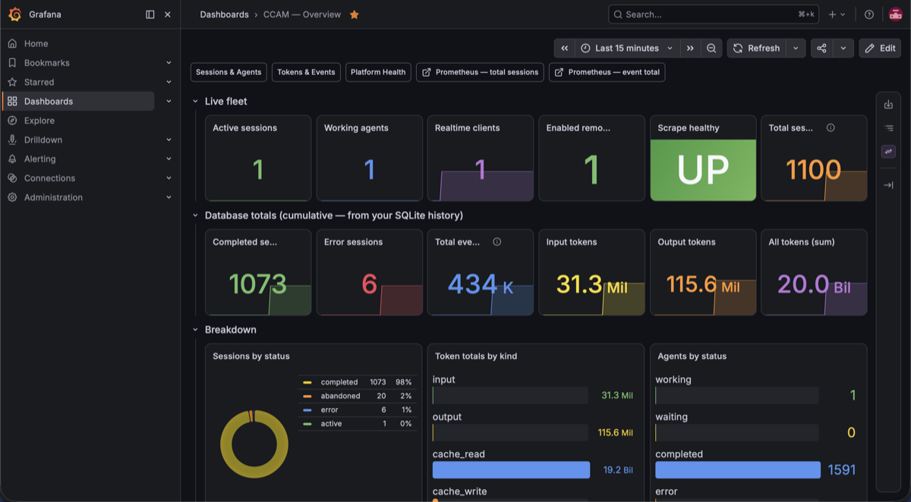</a>
  <br>
  <em>📊 <strong>Grafana · CCAM Overview</strong> · ライブの <code>/api/metrics</code> スクレイプによる、フリートの状態、データベースの合計、内訳、およびレート</em>
</p>

<p align="center">
  <a href="images/prometheus-console.png">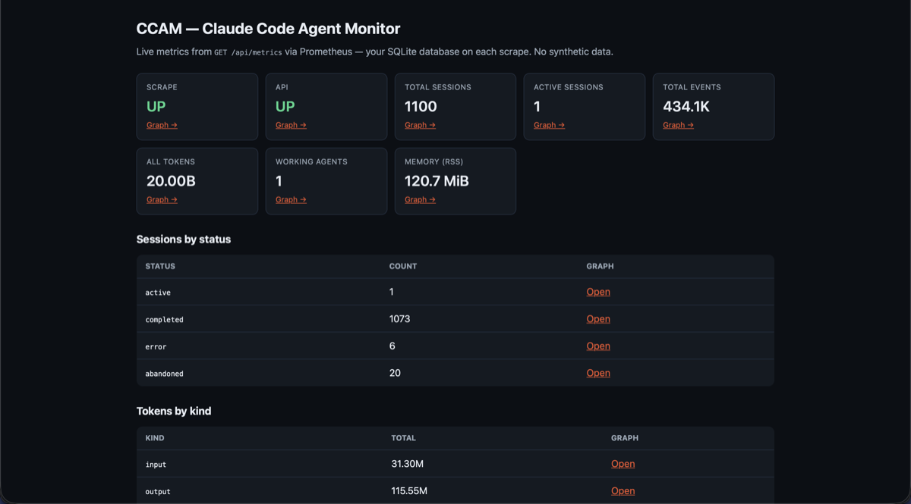</a>
  <br>
  <em>🔥 <strong>Prometheus · CCAM コンソール</strong> · スクレイプの正常性、セッション、イベント、トークン、および Graph へのドリルダウンリンク</em>
</p>

<p align="center">
  <a href="images/prometheus-query.png">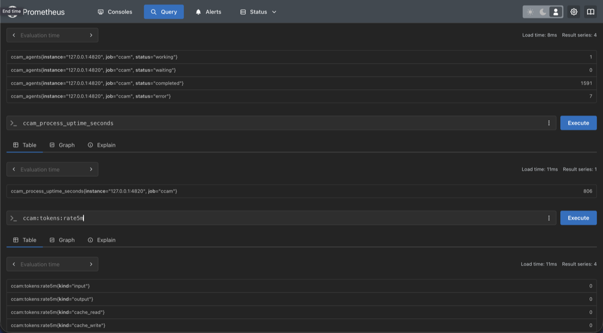</a>
  <br>
  <em>📈 <strong>Prometheus · Graph</strong> · コンソールからのスターターリンクを使用して、スクレイプされた CCAM メトリクスに対して PromQL を実行します</em>
</p>

メトリクス名、認証、およびスクレイプ設定については、[docs/API.md → Metrics](./docs/API.md#metrics) を参照してください。

### エージェントの実行 (`/api/run`)

ダッシュボードから `claude` サブプロセスをスポーンおよび監視するための HTTP サーフェス。すべてのルートで Same-Origin ガードが働きます — ブラウザのリクエストは localhost オリジンから来る必要があります。Origin がない (CLI/curl) リクエストは通過します。提供される `cwd` は存在する絶対ディレクトリでなければならず、`realpath` で正規化されます。ユーザーのホームディレクトリや最近の任意のプロジェクトから Run Agent を起動できるように、意図的にこのリポジトリの外部のディレクトリを指定することも可能です。

| メソッド   | パス                              | 説明 |
| -------- | --------------------------------- | ----------- |
| `GET`    | `/api/run`                        | インメモリのすべての実行ハンドル（稼働中 + 最近完了したもの）を一覧表示します；`maxConcurrent` と `activeCount` も返します |
| `GET`    | `/api/run/binary`                 | `claude` が `PATH` 上にあるか、またどこに存在するかをプローブします — 実行前に UI が明確なエラーを表示するために使用されます |
| `GET`    | `/api/run/cwds`                   | 推奨される作業ディレクトリ：ダッシュボードサーバーの cwd、`$HOME`、およびセッションテーブルからの最近の cwd |
| `GET`    | `/api/run/files?cwd=…&q=…`        | Run ページの `@`-file オートコンプリート用の、`cwd` 内のあいまい (Fuzzy) ファイル検索。`node_modules`、`.git`、`dist`、`build`、`.next`、`.cache`、`coverage` などをスキップします。Cwd は必須であり、存在する必要があります。結果は制限され、ベースネームの一致度でランク付けされます |
| `POST`   | `/api/run`                        | 新しい実行をスポーンします。ボディ: `{ prompt, mode: "headless"\|"conversation", cwd?, model?, permissionMode?, resumeSessionId?, effort? }`。Headless は `-p` 経由でプロンプトを argv に入れ、標準入力を閉じます。Conversation は stream-json エンベロープとしてプロンプトを標準入力にパイプし、フォローアップのために標準入力を開いたままにします。`resumeSessionId` (conversation モードのみ) は `--resume <id>` を追加します；これが設定されている場合、`prompt` は空でもかまいません — スポーナーは最初の標準入力への書き込みをスキップし、`claude` はユーザーが `POST /api/run/:id/message` を介してフォローアップを送信するまで、再開された会話上で待機します。`effort` (`low` / `medium` / `high`) は `--effort` にマッピングされます。スポーナーは常に `--output-format stream-json --verbose --include-partial-messages` を渡すため、UI は文字ごとの差分 (delta) をレンダリングできます。同時実行数は実質的に無制限です (デフォルトの上限は 10000 — `RUN_MAX_CONCURRENT` でオーバーライド可能) |
| `GET`    | `/api/run/:id`                    | 現在のハンドルの状態。`?envelopes=1` はインメモリのエンベロープログを含めるため、再アタッチ時に UI が履歴をリプレイできます |
| `POST`   | `/api/run/:id/message`            | 実行中の会話にフォローアップターンを送信します (conversation モードのみ)。ボディ: `{ text }` |
| `DELETE` | `/api/run/:id`                    | 実行を停止します。SIGTERM を送信し、5秒後に SIGKILL にエスカレーションします |

出力は、既存のダッシュボード WebSocket 上を 3 つのメッセージタイプとしてストリームされます：`run_stream`（パースされた stream-json エンベロープ、`--include-partial-messages` からの `stream_event` デルタを含む）、`run_status`（ステータス遷移）、`run_input_ack`（標準入力の書き込み確認）。設定エクスプローラー（Config Explorer）ページは 4 つ目のメッセージ — `cc_config_changed` — を購読します。これは、`server/lib/cc-watcher.js` ( `~/.claude/` の `fs.watch` 経由) および `routes/cc-config.js` が、成功したすべての PUT/DELETE の後に、ペイロード `{ source: "dashboard"|"fs", action?, scope?, type?, name?, paths? }` とともにブロードキャストするものです。セッションリストとセッション詳細ページは、`/api/run` をポーリング（および `run_status` をリッスン）して、現在実行中の Run によって駆動されているセッションに対し、`/run` に戻るためのクリック可能な **▶ Run** インジケーターのバッジを付けます。

### 履歴のインポート (Import History)

**設定 (Settings) → 履歴のインポート (Import History)** では、プロバイダー固有のフォルダースキャンまたはアップロードにより、`~/.claude/projects` の Claude Code トランスクリプトと `~/.codex/sessions` の Codex ロールアウトをインポートします。どちらもライブ取り込みを再利用し、トークン、コスト、ツール、コンパクションのベースライン、ライフサイクル、およびネイティブの Codex タイトルを保持し、冪等性を維持します。アップロードされた Codex の履歴はダッシュボードのストレージにコピーされるため、元ファイルがクリーンアップされても会話は残ります。

**バックアップの復元 (Restore backup)** は、UI、`ccam export`、または `GET /api/settings/export` からエクスポートされたダッシュボードの `.json` を受け付けます。`POST /api/settings/import` と `ccam import-data <file>` は、既存のセッションを上書きすることなくすべてのテーブルを復元するため、複数マシンの安全な統合が可能です。

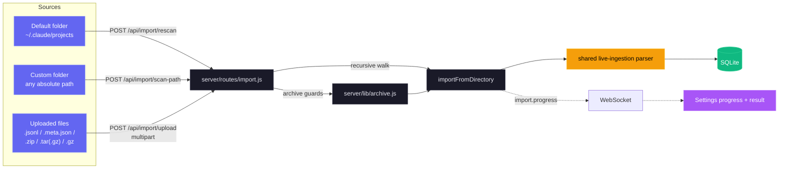

| メソッド | パス | 目的 |
| --- | --- | --- |
| `GET` | `/api/import/guide` | `?provider=claude\|codex` による、プロバイダーを考慮したパス、アーカイブコマンド、拡張子、および指示。 |
| `POST` | `/api/import/rescan` | `{ provider }` から選択されたデフォルトのルートを再スキャンします。 |
| `POST` | `/api/import/scan-path` | 絶対パスの `{ path, provider }` を再帰的にスキャンします。 |
| `POST` | `/api/import/upload` | `provider` を指定して、サポートされているファイルまたはアーカイブをアップロードします。 |

- **入力:** ネストされたレイアウトの単一の `.jsonl`、`.meta.json`、`.zip`、`.tar`、`.tar.gz`/`.tgz`、および `.gz` ファイル。Claude は 2 つの正規のサブエージェントレイアウトの両方をサポートします。Codex は、再帰的な `rollout-*.jsonl`、または `session_meta` を持つ JSONL と、オプションの `session_index.jsonl` のタイトルを認識します。
- **精度:** UUID とイベントのハイウォーターマークによる重複排除により、二重カウントを防ぎます。コンパクションのベースラインが以前のトークンを保持し、その後のアクティビティは `ended_at` を進め、メッセージのメタデータを更新します。
- **大きなファイル:** 共有の 4 MiB チャンク単位・1 行ずつのパースにより、V8 の約 512 MiB の文字列長制限を超えるトランスクリプトも処理できます。拡張可能な配列は `TRANSCRIPT_CACHE_MAX_ARRAY_LEN`（デフォルト `1000`）で上限が設定され、パース中は上限の 2 倍でトリミングされます。
- **安全性:** 抽出時に絶対パスと `..` を含むパスは拒否されます。デフォルトでは、抽出データは 4 GB、各アップロードは 1 GB、リクエストは 2000 ファイルまでに制限され、リクエストごとのステージングは常に再利用 (reclaim) されます。
- **進捗:** スロットリングされた `import.progress` WebSocket のフェーズは `start`、`scan`、`extract`、`parse`、`complete`、`error` をカバーします。UI はドラッグアンドドロップのガイダンスと、インポート済み / 拡張済み / スキップ / エラーの合計を提供します。

### WebSocket

`ws://localhost:4820/ws` に接続して、リアルタイムのプッシュメッセージを受信します:

```json
{
  "type": "agent_updated",
  "data": { "id": "...", "status": "working", "current_tool": "Edit" },
  "timestamp": "2026-03-05T15:43:01.800Z"
}
```

**メッセージの種類:** `session_created`, `session_updated`, `agent_created`, `agent_updated`, `new_event`, `alert_triggered`, `alert_updated`, `remote_source.status` (データ `{ id, status: "idle"|"syncing"|"ok"|"error"|"deleted", error?, last_sync_at? }`)

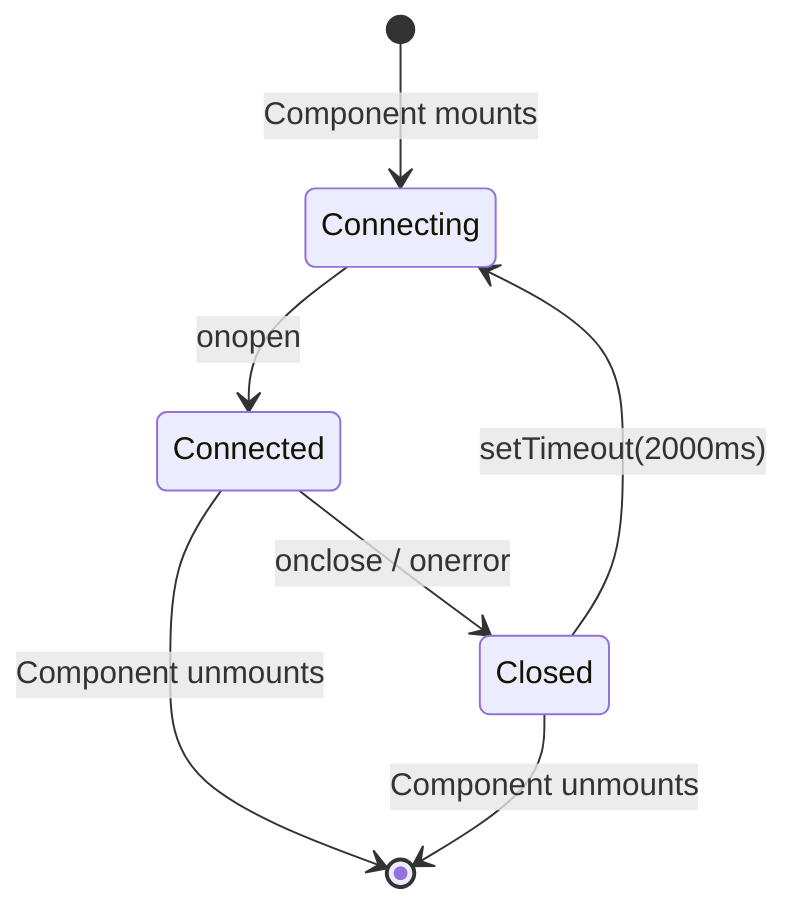

---

## フックイベント (Hook Events)

ダッシュボードは、以下の Claude Code フックタイプを処理します:

| フックの種類 | トリガー | ダッシュボードのアクション |
| ------------------- | ------------------------------ | -------------------------------------------------------------------------------------------- |
| `SessionStart`      | Claude Code セッション開始 | セッションとメインエージェントを作成します。`awaiting_input_since`（`awaiting_reason=session_start` 付き）をスタンプするため、新しいセッションは **待機中 (Waiting)** となります。例外として `compact` ソースの SessionStart（ターン中間の自動コンパクション）はフラグをそのままにするため、作業中のセッションは **アクティブ (Active)** のまま維持されます。再開されたセッションを再度アクティブ化します。`DASHBOARD_STALE_MINUTES`（デフォルト 180）の間アクティビティがない孤立したセッションを放棄します。 |
| `UserPromptSubmit`  | ユーザーがプロンプトでエンターを押した時 | 待機フラグをクリアし、メインエージェントを `working` に昇格します — テキストのみのアシスタントターンは `PreToolUse` を発行しないため、これがターン開始の唯一のシグナルです |
| `PreToolUse`        | エージェントがツールの使用を開始した時 | 待機フラグをクリアし、エージェントを `working` に設定し、`current_tool` を設定します。ツールが `Agent` の場合、サブエージェントレコードを作成します |
| `PostToolUse`       | ツールの実行が完了した時 | 待機フラグをクリアします（Notification がツール使用の途中でスタンプした権限プロンプトの承認を処理します）。`current_tool` をクリアします。エージェントは `working` のまま維持されます |
| `Stop`              | Claude が応答を終了した時 | エラーがない場合: メインエージェントは `waiting` になります — Claude はターンを終え、ボールはユーザーに渡されます。`stop_reason=error`: エージェントとセッションを `error` とマークします。バックグラウンドのサブエージェントは実行を継続します |
| `SubagentStop`      | バックグラウンドエージェントが終了した時 | 説明、タイプ、またはタスクによってサブエージェントを一致させ、完了させます。意図的に待機フラグをクリア**しません** — サブエージェントの終了は人間についての情報を何も伝えないからです。**非同期 (fire-and-forget) の JSONL スキャンをトリガーし** (`scanAndImportSubagents`)、サブエージェント自身の `agent_id` の下でツールごとの `PreToolUse` + `PostToolUse` イベントを発行するため、タイムラインにはスポーンマーカーだけでなく、サブエージェントが実行したすべてのツールが表示されます |
| `Notification`      | エージェントの通知 | イベントを記録します。権限/入力プロンプトメッセージはエージェントを `waiting` に設定し、`awaiting_input_since` (パターンのマッチによる `awaiting_reason=notification`: `permission`, `waiting for input`, `needs your approval`, …) をスタンプします。コンパクション通知は `Compaction` イベントとしてタグ付けされます。有効な場合、ブラウザ通知をトリガーします |
| `SessionEnd`        | Claude Code CLI プロセスが終了した時 | 待機フラグを落とします。セッションがすでに `error` 状態の場合はエラー状態が維持され、それ以外の場合はすべてのエージェントとセッションが `completed` (完了) としてマークされます |
| `Compaction`   | JSONL で `/compact` が検出された時 | コンパクションサブエージェント (タイプ `compaction`) と Compaction イベントを作成します。トランスクリプト JSONL の `isCompactSummary` エントリから検出されます。アクティブなセッションの定期的なスキャナーによっても検出されます |
| `APIError`     | JSONL トランスクリプトの API エラー | `isApiErrorMessage` エントリ (quota, rate limit, invalid_request) および生の `type: "error"` 応答から抽出されます。**現在、セッションとエージェントはただちに `error` とマークされます** — 以前はステータスを変更せずにイベントとして記録されていました。エラーの詳細を含むイベントとして保存されます |
| `TurnDuration` | JSONL トランスクリプトのターンのタイミング | `durationMs` を持つ `system` サブタイプの `turn_duration` メッセージから抽出されます。ターンレベルのタイミング分析のためのイベントとして保存されます |
| `ToolError`    | JSONL でのツール結果のエラー | `toolUseResult.is_error` エントリから抽出されます。エラー伝播分析のためにツールレベルの失敗を追跡します |
| `RemoteToolEvent` | リモートマシンからプッシュされたツール呼び出し | ローミング/NAT 配下のマシンがプッシュする `tool_events[]` の各項目に対して `POST /api/hooks/ingest-batch` によって書き込まれます。コミット済みの行およびバッチ内に対して `(session_id, event_type, uuid)` で重複排除されるため、バッチを再送しても安全です |
| `RemoteTurn`   | リモートマシンからプッシュされたターン時間 | `turns[]` の各項目に対して `POST /api/hooks/ingest-batch` によって書き込まれ、そのターンの `duration_ms` を保持します。`RemoteToolEvent` と同じ `(session_id, event_type, uuid)` による重複排除が行われます |
| `Interrupted`  | ユーザーによってキャンセルされたターン (Esc) | ウォッチドッグによって合成されます — `Esc` はフックを発生させないため、スタックした `working` セッションはトランスクリプトの `[Request interrupted by user]` マーカーから検出されるか、あるいはいかなる出力より前に Esc が押された場合は、アイドルワークタイムアウト (`DASHBOARD_WORKING_IDLE_SECONDS`) によって検出されます。セッションは **待機中 (Waiting)** に移行します (通常の `Stop` と同じ) |

---

## ブラウザ通知 (Browser Notifications)

ダッシュボードは、ダッシュボードのタブにフォーカスがない場合やブラウザがバックグラウンドにある場合でも、Web Push (VAPID) を使用した永続的なブラウザ通知をサポートし、リアルタイムのアラートを提供します。

### 仕組み (How It Works)

1. 設定 (Settings) ページでマスタートグルを使用して通知を**有効 (Enable)** にします。
2. プロンプトが表示されたらブラウザの権限を**付与 (Grant)** します — これにより Service Worker が登録され、プッシュサブスクリプションが作成されます。
3. どのイベントで通知をトリガーするかを**設定 (Configure)** します:

| イベント (Event) | デフォルト | 説明 (Description) |
| ---------------------------- | ------- | --------------------------------------------------------------- |
| 新しいセッション開始 | オン | 新しい Claude Code セッションが作成されたときに発行されます |
| Claude の応答完了 | オフ | Claude が応答ターンを終了したときの `Stop` イベントで発行されます |
| セッションの終了 | オフ | CLI プロセスが終了したときの `SessionEnd` で発行されます |
| セッションエラー | オン | セッションがエラーで終了したときに発行されます |
| サブエージェントのスポーン | オフ | バックグラウンドのサブエージェントが作成されたときに発行されます |

さらに、Claude Code からの `Notification` フックイベントは、イベントごとのトグルに関係なく（マスタートグルが有効である限り）ブラウザ通知をトリガーします。

### 通知アーキテクチャ (Notifications Architecture)

- **VAPID パイプライン:** 安全なメッセージ配信のためにサーバー上で `web-push` を使用します。VAPID キーは自動生成され、`data/vapid-keys.json` に保存されます。
- **Service Worker:** 専用のワーカー (`client/public/sw.js`) が受信した `push` イベントを処理し、macOS で確実に音声が再生されるように `silent: false` を指定して通知を表示します。
- **サブスクリプション:** ブラウザ固有のエンドポイントは SQLite の `push_subscriptions` テーブルに保存されます。
- **永続性:** Service Worker がバックグラウンドで動作するため、ブラウザが閉じられていても通知が届きます。
- **テスト通知:** 設定 (Settings) にあるボタンを使用すると、VAPID パイプラインとオーディオの再生を確認できます。

### PWA とオフラインサポート (PWA & Offline Support)

ダッシュボード、ランディングページ、Wiki は、独立したマニフェストと Service Worker を備えた、それぞれ別個のインストール可能な PWA です。

| サーフェス | マニフェスト | Service Worker | キャッシュ戦略 |
| --- | --- | --- | --- |
| ダッシュボード (`client/`) | `client/public/manifest.json` | `client/public/sw.js` | 不変の `/assets/*` はキャッシュファーストです。ナビゲーション、ワーカー、マニフェスト、アイコン、`/` はフォールバック付きのネットワークファーストです。`/api/*`、`/ws`、Vite HMR は決してキャッシュされず、プッシュハンドラーは引き続き有効です。Express はアセットに対して 1 年間の immutable ヘッダーを、シェルファイルに対して再検証ヘッダーを送信します。`controllerchange` はアップグレード時に一度だけリロードし、初回インストール時には行いません。 |
| ランディングページ (ルート) | `manifest.json` | `sw.js` | シェル、ファビコン、OG 画像をプリキャッシュします。スクリーンショットは初回表示時にキャッシュされ、ナビゲーションはオフラインフォールバック付きのネットワークファーストです。 |
| Wiki (`wiki/`) | `wiki/manifest.json` | `wiki/sw.js` | HTML、CSS、JS、マニフェスト、ファビコンをプリキャッシュします。HTML はネットワークファーストのままで、CSS と JS はキャッシュファーストです。1 回のアクセス後はオフラインで利用できます。 |

すべてのワーカーは `skipWaiting()` を呼び出し、アクティブ化時にバージョン付きの古いキャッシュを削除し、キャッシュバージョンが変わるとクリーンにリフレッシュします。各 HTML ファイルには iOS スタンドアロン用のメタデータが含まれ、マニフェストと Apple のタッチアイコンは `sizes="any"` を指定した `favicon.svg` を使用します。

---

## アップデート通知 (Update Notifier)

ダッシュボードは自身の git チェックアウトを監視し、正規のデフォルトブランチのコミットが HEAD より進んでいる場合にモーダルを表示します。**ブランチおよびフォーク対応:** `upstream` リモート（フォークの標準的な規約）がある場合、`origin` よりも優先されます。選択されたリモートの `master`/`main`/`HEAD` が比較参照 (ref) になります。`manual_command` は状況に適応します — ローカルブランチが正規の参照を追跡している場合のみ `git pull --ff-only` となり、それ以外の場合はコマンドが嘘をつかないように `git fetch`（フォークの場合はファストフォワードマージ）になります。ユーザーはターミナルで実行するための正確なコマンドを受け取ります — サーバーは自身を自らプルしたり再起動したり**しません**。これにより、このメカニズムは開発セッション、pm2/systemd/launchd/Docker スーパービジョン、リモートデプロイメント全体でポータブルなまま維持されます。

<p align="center">
  <a href="images/update.png">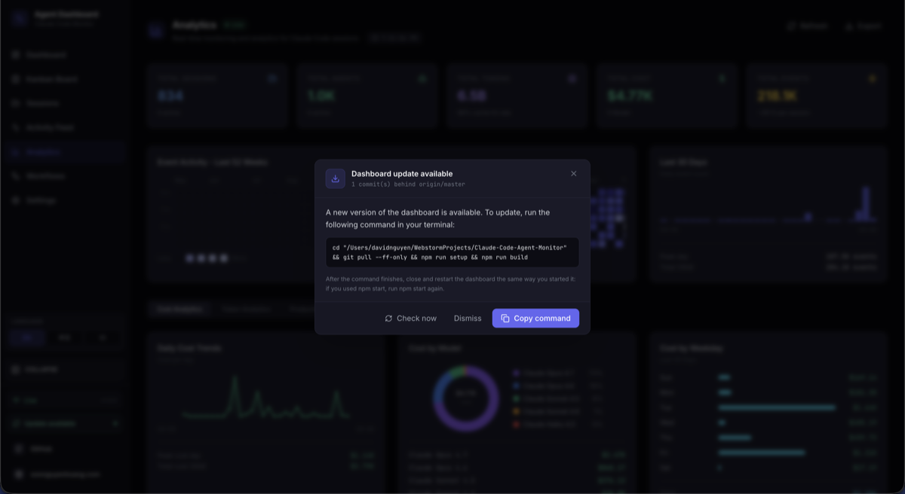</a>
</p>

### 仕組み (How It Works)

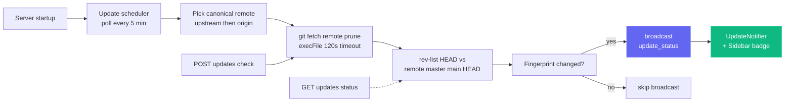

単一のチェックは安価であり（正規のリモートに対して `git fetch <remote> --prune` を実行 — 設定されていれば `upstream`、そうでなければ `origin`）、`execFile`（シェルなし）と 120 秒のタイムアウトでラップされています。オフラインのネットワーク、git 以外のインストール、設定されたリモートがない、解決できないアップストリーム参照などの失敗は、例外を投げるのではなく、すべて**ソフトなペイロード**（例: `fetch_error: "..."`）を返します。そのため、リモートが不安定であってもダッシュボードがブロックされることはありません。

### UI サーフェス

| サーフェス | 動作 |
| --- | --- |
| **モーダル** (`client/src/components/UpdateNotifier.tsx`) | 新しく利用可能な `remote_sha` に対して開きます。遅れているコミット数、追跡されている参照、オプションのブランチ/フォークに関するメモ、正確なコマンド、そして **コマンドをコピー**、**今すぐ確認する**、**閉じる** を表示します。Escape またはバックドロップのクリックで閉じます。閉じた状態は `localStorage` にキー付けされるため、より新しい SHA があれば再び開きます。 |
| **サイドバーボタン** (`client/src/components/Sidebar.tsx`) | 常に表示されます。緑は遅れていること、アンバーはフェッチの失敗を意味します。クリックすると「閉じた」状態がクリアされ、`POST /api/updates/check` が呼び出されます。 |
| **サーバーターミナル** | ステータスが最新から遅延に変わったときに、コマンドを含むフレーム付きのブロックをプリントします。ヘッドレスのユーザーにも表示されます。 |

### API サーフェス

| エンドポイント | 目的 |
| --- | --- |
| `GET /api/updates/status` | 読み取り専用チェック: 正規のリモートに対して `git fetch` を実行し、HEAD をそのデフォルトブランチと比較し、ペイロードを返します。 |
| `POST /api/updates/check` | 同じチェックですが、WebSocket 上で `update_status` をブロードキャストするため、接続されているすべてのクライアントが一度に更新されます。 |

どちらのエンドポイントも同じペイロード構造を返します:

```json
{
  "git_repo": true,
  "update_available": true,
  "repo_root": "/Users/you/Claude-Code-Agent-Monitor",
  "remote_ref": "upstream/master",
  "canonical_remote": "upstream",
  "current_branch": "master",
  "tracking_upstream": "origin/master",
  "tracks_canonical": false,
  "situation": "fork_or_diverged_tracking",
  "local_sha": "abc1234...",
  "remote_sha": "def5678...",
  "commits_behind": 3,
  "manual_command": "cd \"/...\" && git fetch upstream && git merge --ff-only upstream/master && npm run setup",
  "situation_note": "You're on 'master' tracking 'origin/master'. This command fast-forwards your branch from upstream/master (the canonical default).",
  "message": "3 commit(s) on upstream/master not in your checkout."
}
```

`situation` は以下のいずれかになります: `tracking_canonical`（デフォルトブランチの通常のクローン — `git pull --ff-only` が機能します）、`fork_or_diverged_tracking`（ローカルブランチ名は正規のものと一致するが別のリモートを追跡している — `git fetch <remote> && git merge --ff-only <ref>`）、`feature_branch`（デフォルトブランチから外れている — フェッチのみで統合はユーザーに任されます）、または `detached_head`。

### 意図的に**ここにはない**もの

`POST /api/updates/apply` や自己再起動ヘルパーは、意図的に存在しません。プロセス内からのプロセスの自己更新は、外部のスーパーバイザーなしには信頼できません — `npm run dev` (concurrently)、`npm start`、`pm2`、`systemd`、`launchd`、および Docker はそれぞれ異なる再起動ロジックを必要とします。また、死にかけているサーバーでの `git pull` / `npm install` の失敗にはクリーンなロールバックパスがありません。検出のみに限定することで、すべてのスーパーバイザー、すべての OS、すべてのブランチの状態で動作の予測可能性が保たれつつ、「いつプルすればいいか」という情報のギャップは埋められます。実際の更新はユーザー自身のシェルでの操作に委ねられます。

### 構成 (Configuration)

| 環境変数 | デフォルト | メモ |
| --- | --- | --- |
| `DASHBOARD_UPDATE_CHECK` | 有効 | `0` / `false` / `off` に設定すると、スケジューラーが完全に無効になります。 |
| `DASHBOARD_UPDATE_CHECK_INTERVAL_MS` | `300000` (5分) | 自動チェック間のインターバル。下限は 60 000 ms です — それ以下の値は切り上げられます。 |

---

## Tabby — フローティングキャットコンパニオン (Tabby — Floating Cat Companion)

**Tabby (タビー)** は、ダッシュボードのすべてのページの右下隅にピン留めされた、かわいいフローティングの猫のコンパニオンです。常に存在し、ライブセッションのストリームを、一目でわかる反応的なマスコット（会話も可能）に変換します。

<p align="center">
  <a href="images/tabby.png"></a>
</p>

### リアクティブマスコット (Reactive mascot)

Tabby はライブセッションのストリームから派生した **8つの気分** を持つ、カーソルを追跡する SVG キャットであり、それぞれに独自のアニメーションがあります:

| 気分 (Mood) | いつ | アニメーション |
| --- | --- | --- |
| `idle` | 特筆すべきことが何も起こっていないとき | しっぽを休めて振る |
| `watching` | セッションがアクティブなとき | 耳を立てて、目がカーソルを追う |
| `happy` | セッションや実行が正常に終了したとき | 頭を上下に振る + キラキラ |
| `worried` | 何かおかしいとき | 微妙に震える |
| `stuck` | セッションがブロックされていると思われるとき | 警告 "!" |
| `thinking` | エージェントが作業中のとき | 頭をゆっくり上下に振る |
| `sleeping` | しばらく静かなとき | `zzz` |
| `disconnected` | WebSocket がダウンしているとき | 穏やかで静止したポーズ |

### 吹き出し (Speech bubbles)

Tabby は注目すべきイベント（セッションの開始/終了、エラー、実行完了）で短い皮肉を自動的に表示します。吹き出しは**スロットリングされ、まとめられる (coalesced)** ため、イベントのバーストが画面をスパムすることはありません。スクリーンリーダー用に `aria-live` を使用し、パネルから**ミュート**することもできます。

### パネル (Panel)

猫をクリックするか、**⌘B / Ctrl+B**（Esc で閉じる）を押してパネルを開きます。以下が表示されます:

- ライブの**ステータスライン** — `N ライブ · M エラー · 接続状態`。
- **クイックアクション** — Run Claude、アクティビティ、セッション、またはエラーセッションへのジャンプ。吹き出しのミュート。アラートのクリア。
- **Ask** ボックス（下記参照）。

### Ask ボックス → Run Claude ハンドオフ

**Ask** ボックスは、「何が動いているか」、「エラーはあるか」、「ステータスは」といった単純なステータスの質問には、キャッシュされたデータからローカルで応答します。それ以外の質問は、実際の Claude Code セッションをスポーンするために、既存の **Run Claude** ページに引き継がれます（`/run?prompt=…` にディープリンクします）。Tabby 自身が LLM を呼び出すことは決してありません。簡単なステータスの検索以外のすべてのことについて、Run Claude ページを再利用するだけです。

### アクセシビリティと安全な劣化 (Accessibility & safe degradation)

Tabby はキーボードで操作でき、吹き出しには `aria-live` を使用し、`prefers-reduced-motion`（モーション軽減の推奨）を尊重します。WebSocket がダウンした場合、エラーを起こすのではなく、穏やかな `disconnected` 状態に安全に劣化します。Tabby は **設定 (Settings)** (英語、中国語、ベトナム語、韓国語、スペイン語にローカライズされています) でオン/オフを切り替えることができ、実装は `client/src/components/Tabby/` にあります。

---

## サウンドキュー (Sound Cues)

ダッシュボードは、ライブセッションのアクティビティに対して**控えめな音声フィードバック**を提供するため、セカンドモニターに表示したままにしておいても、実行が完了したときや失敗したときに音で気づくことができます。サウンドは**デフォルトでオン**であり、ワンクリックで完全にオフにできます。

### 依存関係ゼロの合成 (Zero-dependency synthesis)

リポジトリ内には `.mp3` や `.wav` のアセットは一切なく、`package.json` にオーディオライブラリもありません。すべてのキューは再生時に **Web Audio API** で生成されます。短いオシレーター（サイン波またはトライアングル波）のリストを、それぞれが独自の指数ゲインエンベロープを持つ形で、マスターゲインノードとローパスフィルターを通してミックスするため、結果は作業を切り裂くのではなく、作業の背後に収まります。エンジン全体は `client/src/lib/sound.ts` の 1 ファイルです。

### キュー (The cues)

| キュー (Cue) | 発火するタイミング | 音の印象 |
| --- | --- | --- |
| `sessionStart` | 新しいセッションが現れたとき | 上昇する完全五度 (C5 → G5) |
| `sessionComplete` | セッションが応答を終えた (`Stop`) とき、または閉じた (`SessionEnd`) とき | 解決する長調のアルペジオ (E5 → G5 → C6) |
| `sessionError` | セッションが `error` 状態に入ったとき | トライアングル波による柔らかく下降する短三度 — 気づけるが、不安をあおらない |
| `subagentSpawn` | サブエージェントがスポーンしたとき | 短い単発のプラック音 |
| `notification` | Claude Code が `Notification` イベントを発行したとき | 小さなベルのように鳴る、デチューンされた 2 音 |
| `connected` / `disconnected` | ダッシュボードの WebSocket が復帰または切断したとき | 2 音の上昇 / 下降 |
| `click` | ボタン、リンク、タブ、スイッチを押したとき | ほとんど聞こえないティック音 |

キューは C メジャーの音のセットに収められているため、重なった余韻が不協和に聞こえることはなく、すべてのエンベロープは突然途切れるのではなく指数的に減衰するため、急停止によるクリック音も避けられます。

### 邪魔にならないために (Staying out of your way)

3 つのガードが、音声がノイズになるのを防ぎます:

- **キューごとのクールダウン** — 同じキューは約 350 ms 以内（インタラクションのティックは 45 ms）には繰り返されません。
- **グローバルなバースト予算** — 任意の 1.2 秒のウィンドウ内で開始されるキューは最大 4 つまでなので、履歴のインポートや切断後の再接続で大量の WebSocket メッセージが大量のビープ音になることはありません。
- **自動再生ポリシー** — ブラウザのルールに従い、ページに対する最初のポインター、キー、またはタッチ操作があるまで何も再生されません。それ以前のキューはキューイングされず、静かに破棄されます。

ブラウザが Web Audio にまったく対応していない場合、すべての呼び出しは安全な no-op になり、ダッシュボードは単に無音のままとなります。

### 設定 (Settings)

**設定 (Settings) → サウンド (Sound)** には、マスタートグル、音量スライダー、そして各キューごとの個別スイッチがあります。スイッチをオンにすると、そのキューが即座に再生されるため、有効にしたばかりの音を正確に確認でき、**サウンドのプレビュー (Preview Sound)** ボタンでは完了のチャイムをいつでも再生できます。設定は `agent-monitor-sound` という名前で `localStorage` に保存され、リロードなしでアプリ全体に即座に反映されます。このパネルは英語、中国語、ベトナム語、韓国語、スペイン語にローカライズされています。

デフォルトでは、セッション開始、セッション完了、セッションエラー、Claude Code の通知、インタラクションのティックがオンで、サブエージェントのスポーンと接続の変化はオフです（最も頻繁に鳴るため）。実装は `client/src/lib/sound.ts`（エンジン + 設定）と `client/src/hooks/useSoundCues.ts`（イベントバスの配線）にあり、`client/src/App.tsx` で一度だけマウントされます。

---

## 接続ステータスモーダル (Connection Status Modal)

サイドバーのフッターにある **Live** / **Disconnected** のピルをクリックすると、ダッシュボードの WebSocket トランスポートに関する詳細を示す小さなパネルが開きます。アクティブな `ws://` エンドポイント、現在のソケットの起動時間、受信した合計イベント数、横棒グラフでの上位のイベントタイプ、60 秒の処理量を示すスパークライン、および最近のアクティビティリストとしての直近の 8 つのイベントが表示されます。累積統計（合計、タイプの内訳、最近のリスト）は、`sidebar-connection-stats` という名前で `localStorage` を経由してリロードをまたいで保持されます。ローリングしているスパークラインと「connected since」のタイマーは、意図的にエフェメラル (短命) なものになっています。フッターの **リセット (Reset)** ボタンを押すと、オンデマンドですべての項目がクリアされます。

<p align="center">
  <a href="images/live.png"></a>
</p>

---

## VS Code 拡張機能 (VS Code Extension)

**Claude Code Agent Monitor** は、ファーストクラスの VS Code 拡張機能として利用でき、エディタを離れることなく AI エージェントを監視することができます。

<p align="center">
  <a href="vscode-extension/vscode.png">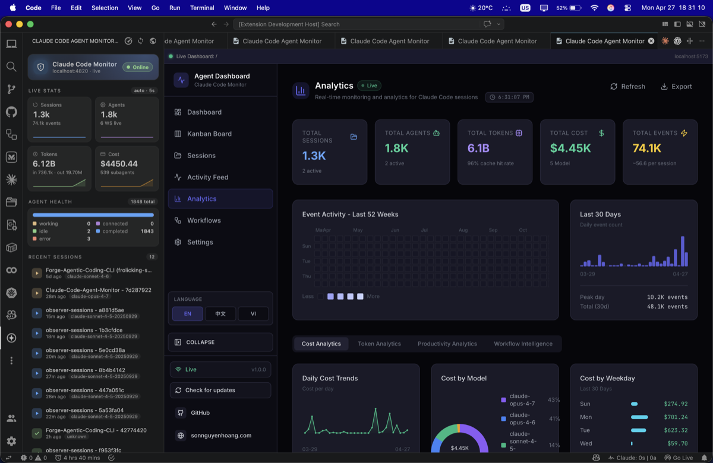</a>
</p>

### 🚀 主な機能 (Key Features)
- **ライブサイドバー**: リアルタイムのエージェントヘルス（作業中、待機中、完了など）を表示する専用のアクティビティバービュー。
- **使用状況分析**: サイドバー内で総トークン数、ライブの USD コスト、およびイベント数を直接追跡します。
- **ステータスバー統合**: ボトムバーにある、アクティブなセッションとエージェントを表示する一目でわかるパルスモニター。
- **ディープナビゲーション**: 特定のダッシュボードビュー（かんばん、分析、設定）または最近のセッションへのワンクリックアクセス。
- **統合タブ**: ネイティブの VS Code Webview タブとしてフル監視ダッシュボードを開きます。

### 📦 インストールとセットアップ (Installation & Setup)
1. [vscode-extension](./vscode-extension) ディレクトリを開きます。
2. Marketplace から拡張機能をインストールするか、`vsce package` を使用して自分でパッケージ化します。
3. ローカルのダッシュボードサーバーが実行中であることを確認します (`npm run dev`)。
4. 開始するには、VS Code アクティビティバーの **レーダーアイコン** をクリックします。

開発者向けの詳細な構成については、[.vscode](./.vscode) および [vscode-extension](./vscode-extension) ディレクトリを参照してください。

> [!TIP]
> VS Code Marketplace の拡張機能: [Claude Code Agent Monitor](https://marketplace.visualstudio.com/items?itemName=hoangsonw.claude-code-agent-monitor)

---

## デスクトップアプリ (macOS & Windows)

オプションの Electron 35 デスクトップアプリは、同じダッシュボードを `desktop/` ワークスペースから macOS の `.dmg`、Windows の NSIS インストーラー、またはポータブル `.exe` としてパッケージ化します。

<p align="center">
  <a href="images/macos.png"></a>
  <br>
  <em>🍎🪟 <strong>デスクトップアプリ (Desktop App)</strong> — メニューバー / 通知領域（トレイ）アイコン、ログイン時の自動起動、および単一インスタンスロックを備えたネイティブシェル。実際の OS ウィンドウ内に同じダッシュボードが表示されます（画像は macOS のもの）。</em>
</p>

<p align="center">
  <a href="images/windows_app.png">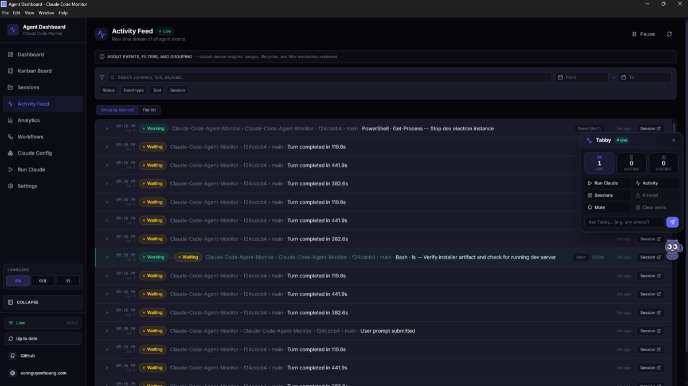</a>
  <br>
  <em>🪟 ネイティブ Windows アプリと同じダッシュボード — 通知領域（トレイ）アイコン、ネイティブのウィンドウメニュー、およびログイン時の自動起動。</em>
</p>

`localhost:4820` で提供される同じ UI に、ネイティブのウィンドウ、トレイ、メニュー、ログイン、シャットダウンの動作を追加します。

### 仕組み (How it works)

ターミナルからダッシュボードを実行する場合とは異なり、デスクトップアプリは `npm start` も、開いているシェルも、サーバーの 2 つ目のコピーも必要としません。Electron の **メインプロセス** は Express サーバーを **インプロセス** でホストします — これは **子プロセスも IPC も使用せず** に、同じ Node ランタイム内で `server/index.js` を直接 `require()` します — そして、Chromium の `BrowserWindow` をビルド済みの React クライアントに向けます。

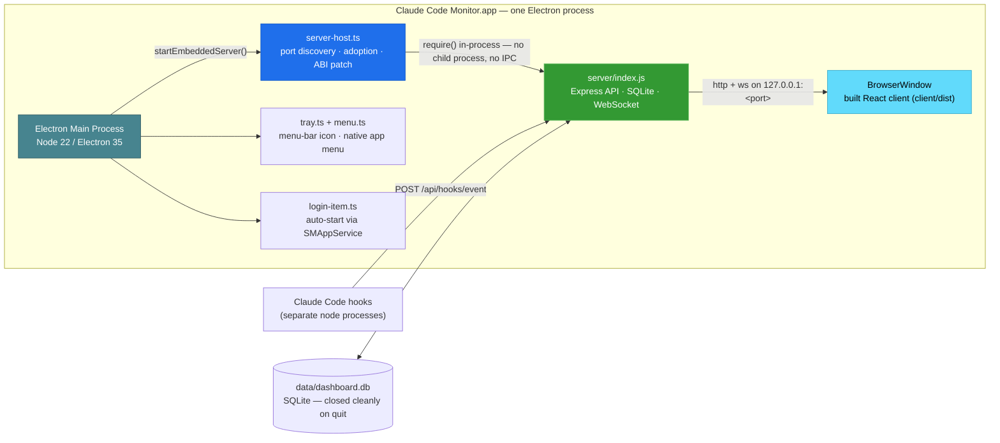

起動時にアプリは以下を行います:

1. 空いているポートを選択します — 優先的に **4820**、フォールバックとして **4821–4829**、それらがすべて使用中の場合はランダムなハイポートを選択します。
2. 正常なダッシュボードサーバーがすでに `4820` で `/api/health` に応答している場合（例えば、ターミナルで `npm start` を実行した場合）、二重にバインドする代わりに **そのサーバーを採用 (adopt)** します — ポートの衝突や SQLite の競合は発生しません。採用されたサーバーは、アプリを終了した後も実行を継続します。
3. そうでない場合は、埋め込みサーバーを起動し、**最初に所有したサーバーの起動時**に、Claude Code フックを自動インストールし、バックグラウンドサービス（アップデートスケジューラー、`cc-watcher`、孤立した実行の調整）を開始します。したがって、DMG のみのユーザーは、**手動でのセットアップなし**（チェックアウトも `npm run install-hooks` も不要）でイベントを流すことができます。
4. **(macOS)** **ログインシェルの `PATH`** を復元するため、**Run Claude** 機能が `claude` CLI を見つけてスポーンできるようにします — Finder/Dock から起動されたアプリは通常 launchd の最小限の `PATH` しか継承しないため、`~/.local/bin`、`/opt/homebrew/bin`、バージョンマネージャーの bin 内の CLI などを見逃してしまいます。（Windows では、プロセスはすでにユーザーの `PATH` を継承しています。）
5. ダッシュボードウィンドウを開きます — ただし、アプリがログイン時に起動された場合（macOS ではログインアイテム、Windows ではタグ付けされた `HKCU\…\Run` エントリ経由）を除き、その場合はトレイのみで待機します。
6. 終了時に、埋め込みサーバーを正常にシャットダウンし、**SQLite をクリーンに閉じます**（WAL チェックポイント）。

### 機能 (Features)

- **トレイとウィンドウ:** 左クリックでウィンドウを切り替えます。右クリックのメニューには **Open Dashboard**、**Open in Browser**、**Restart Server**、**Show Logs**、**Open at Login**、**Quit** があります。macOS ではテンプレート色の（色味を付けた）トレイグリフを使用し、Windows とウィンドウ/タスクバーにはカラーのアプリアイコンを使用します（パッケージ化されていない開発実行も含みます）。
- **ネイティブメニュー:** 標準のアプリケーションメニューと `⌘` / `Ctrl` ショートカット。非表示中も **File → Open Dashboard** (`⌘1`) が使えるのは macOS のみで、Windows/Linux ではトレイから確実に再表示できます。
- **ログインとライフサイクル:** macOS のログイン項目は `SMAppService` で登録し、Windows はユーザーごとの `HKCU\Software\Microsoft\Windows\CurrentVersion\Run` エントリに書き込みます。ウィンドウを閉じると非表示になるだけでトレイとサーバーは動き続け、2 回目の起動は既存の単一インスタンスにフォーカスします。
- **永続的なデータ:** SQLite と VAPID キーはバンドルの外の `~/Library/Application Support/Claude Code Monitor/data/` または `%APPDATA%\Claude Code Monitor\data\` に保存されます。再インストール、アップデート、および NSIS のデフォルトのアンインストールでも、インポートした履歴は保持されます。
- **CLI とログ:** macOS はログインシェルの `PATH` を復元するため、Finder/Dock から起動しても `claude` を実行できます。Windows は継承されたユーザー `PATH` を使用します。**Show Logs** は `~/Library/Logs/Claude Code Monitor/desktop.log` または `%APPDATA%\Claude Code Monitor\logs\desktop.log` を開きます。

### 取得方法 (Get it)

**オプション A — ビルド済みのインストーラーをダウンロードする（推奨）:** **[Releases → latest](https://github.com/hoangsonww/Claude-Code-Agent-Monitor/releases/latest)** から取得できます（公開されており、GitHub へのサインインは不要）。CI は `master` 上の `package.json` のバージョンがインクリメントされるたびに新しい `vX.Y.Z` リリースを自動公開するため、このリンクは常に現在のビルドを提供します:

| プラットフォーム | アセット | メモ |
| --- | --- | --- |
| macOS (Apple Silicon) | `ClaudeCodeMonitor-<ver>-arm64.dmg` | `/Applications` にドラッグ |
| macOS (Intel) | `ClaudeCodeMonitor-<ver>-x64.dmg` | `/Applications` にドラッグ |
| Windows (インストーラー) | `ClaudeCodeMonitor-Setup-<ver>-x64.exe` | ユーザーごとのインストール、管理者権限不要 |
| Windows (ポータブル) | `ClaudeCodeMonitor-<ver>-x64-portable.exe` | インストールせずに実行 |

コミットごとの最新ビルドは、CI アーティファクトとしても存在します（サインインが必要、14 日間保持されます）: `🍎 macOS Desktop (DMG)` ジョブからの `ClaudeCodeMonitor-dmg` および `🪟 Windows Desktop (EXE)` ジョブからの `ClaudeCodeMonitor-win` — 次のリリースタグの前に `master` をテストするのに便利です。

**オプション B — 自分でビルドする:** リポジトリのルートから実行します:

```bash
npm run setup                # ルート + クライアントの依存関係をインストールし、クライアントをビルドし、フックをインストールします
npm run build                # React クライアントをビルドします (client/dist)
npm run desktop:install      # Electron + electron-builder を desktop/ にインストールします (ネイティブ依存関係の事前確認を行い、失敗時にはセットアップのヘルプを表示します)
npm run desktop:dmg:arm64    # macOS:   高速な単一アーキテクチャの DMG → desktop/release/ClaudeCodeMonitor-<ver>-arm64.dmg
npm run desktop:win          # Windows: NSIS インストーラー → desktop/release/ClaudeCodeMonitor-Setup-<ver>-x64.exe
```

> [!NOTE]
> **DMG は macOS でビルドされ、Windows `.exe` は Windows でビルドされます** — electron-builder はホスト OS 向けにパッケージ化します。macOS の `npm run desktop:dmg` ビルドは、アプリを**2回**（各アーキテクチャごとに1回ずつ）パッケージ化し、アーキテクチャごとの **両方** の DMG (`arm64` + `x64`) を出力します — これがリリースビルドであり、それらを 1 つのユニバーサルバイナリに統合することはしません。自分用の Mac では、単一アーキテクチャの `desktop:dmg:arm64` または `desktop:dmg:x64` を使用してください。Windows では、`npm run desktop:install` によってビルド済みの Electron 用バイナリとして `better-sqlite3` が取得されるため、一般的なケースでは Visual Studio C++ ツールチェーンは不要です。ビルドが失敗した場合（ビルド済みのバイナリがない、または C++ ツールチェーンがない場合）、`desktop:install` は壊れたインストールを残すのではなく、OS ごとの正確な修正方法とツールチェーンなしの代替案を出力し、はっきりと失敗を報告します。

### インストール方法 (Install it)

**macOS:**

1. `.dmg` をダブルクリックしてマウントします。
2. **Claude Code Monitor.app** を `/Applications` フォルダーにドラッグします。
3. DMG はデフォルトで**アドホック署名 (ad-hoc signed)** されているため、macOS の Gatekeeper が初回起動時に警告を表示します（*"Apple could not verify…"*）。隔離属性 (quarantine attribute) をクリアします:

   ```bash
   xattr -cr "/Applications/Claude Code Monitor.app"
   ```

   または、**システム設定 → プライバシーとセキュリティ**を開き、**このまま開く (Open Anyway)** をクリックします。

4. アプリを起動します。トレイアイコンが表示され、ダッシュボードウィンドウが開きます。

**Windows:**

`ClaudeCodeMonitor-Setup-<ver>-x64.exe` を実行すると、管理者権限不要で `%LOCALAPPDATA%\Programs\Claude Code Monitor` にユーザーごとにインストールされ、インストール先も選択できます。インストールせずに使うには `*-portable.exe` を使用します。デフォルトのビルドは未署名のため、初回起動時に SmartScreen が表示される場合があります。その場合は **詳細情報 (More info) → 実行 (Run anyway)** を選択してください。スタートメニューまたはデスクトップのショートカットから起動すると、ダッシュボードとトレイアイコンが開きます。

<p align="center">
  <a href="images/setup_win_wizard.png"></a>
  <br>
  <em>🪟 <strong>インストールオプション</strong> · ユーザーごと、または全ユーザー向けのインストールを選択します</em>
</p>

<p align="center">
  <a href="images/setup_win_wizard2.png">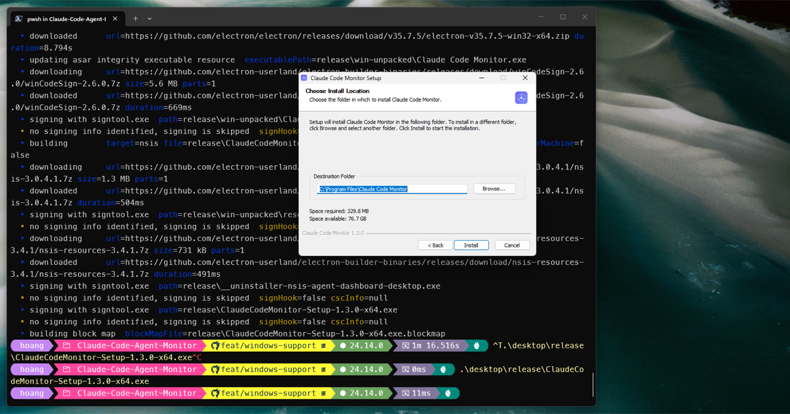</a>
  <br>
  <em>🪟 <strong>インストール場所</strong> · インストール先フォルダーを確認または変更します</em>
</p>

<p align="center">
  <a href="images/setup_win_wizard3.png"></a>
  <br>
  <em>🪟 <strong>Windows セットアップの完了</strong> · インストーラーを終了して Claude Code Monitor を起動します</em>
</p>

### ビルドコマンド (Build commands)

すべてのコマンドは**リポジトリのルート**から実行します:

| コマンド | 行うこと |
| --------------------------- | ---------------------------------------------------------------------------- |
| `npm run desktop:install`   | Electron と electron-builder を `desktop/` にインストールします。Electron の ABI に合わせて `better-sqlite3` をリビルドします。ネイティブの `better-sqlite3` ビルドを事前確認し、失敗時には実行可能なセットアップのヘルプ（ツールチェーンなしの代替案を含む）を出力します |
| `npm run desktop:build`     | デスクトップの TypeScript ソースを `desktop/out/` にコンパイルします |
| `npm run desktop:dev`       | ローカルイテレーション用に Electron アプリをビルドして起動します |
| `npm run desktop:test`      | スモークテストを実行します（Electron をスポーンし、`/api/health` をプローブし、シャットダウンします） |
| `npm run desktop:dmg`       | **macOS:** **両方**の DMG (arm64 + x64) をビルドします — リリース用としては正しいですが、**遅い**です (各アーキテクチャをパッケージ化します) |
| `npm run desktop:dmg:arm64` | **macOS:** Apple Silicon 専用の DMG をビルドします — **高速** (約1分)、自分用の Mac にお勧めです |
| `npm run desktop:dmg:x64`   | **macOS:** Intel 専用の DMG をビルドします — **高速** (約1分) |
| `npm run desktop:dmg:universal` | **macOS:** マージされた 1 つの **ユニバーサル** DMG (arm64 + x86_64) をビルドします — オプションであり、**最も遅く**、リリースで提供されるものではありません |
| `npm run desktop:win`       | **Windows:** NSIS インストーラー `.exe` (x64) をビルドします |
| `npm run desktop:win:portable` | **Windows:** インストール不要のポータブル `.exe` (x64) をビルドします |

得られる macOS DMG は **約 80 MB**（インストールされるとディスク上で ≈ 250 MB）で、Windows インストーラーも同程度です — 標準的な Electron バンドルのオーバーヘッドです。

### 署名と公証 (Signing & notarization)

macOS はデフォルトでアドホック署名を使用し、`CSC_IDENTITY_AUTO_DISCOVERY=false` を設定するため、ローカルの証明書が誤って選択されることはありません。Developer ID 署名には `CSC_LINK` と `CSC_KEY_PASSWORD` を使用し、公証には `APPLE_ID`、`APPLE_TEAM_ID`、`APPLE_APP_SPECIFIC_PASSWORD` を追加します。Windows はデフォルトで未署名で、同じ `CSC_LINK` とパスワード変数で Authenticode 署名を有効にできます。認証情報が存在する場合、CI はどちらの経路も有効化し、コードの変更は不要です。

### 実装ノート (Implementation notes)

- **ネイティブ ABI:** `desktop/` は Electron 向けにビルドした `better-sqlite3` を保持し、`server/db.js` をそれにリダイレクトします。ルートのコピーはシステム Node およびサーバーテストと互換のままです。アーキテクチャ固有の DMG ビルドの後は、デスクトップの `prebuild` がローカルの ABI を自動的に修復し、バイナリが存在しない場合はセットアップのヘルプとともに早期に失敗します。
- **サーバーの同等性:** エクスポートされた `startBackgroundServices()` により、埋め込みサーバーは `node server/index.js` と同じアップデートスケジューラー、設定ウォッチャー、孤立した実行の調整を備えます。スタンドアロンのパスおよび他のワークスペースの動作は変わりません。
- **CI とリリース:** パスでフィルタリングされた macOS と Windows のジョブがスモークテストを行い、単一アーキテクチャの DMG 2 つに加えて NSIS と portable の EXE をアップロードします。`master` へのバージョンアップ時には、すべてのアセットが `vX.Y.Z` に添付されます。`desktop/assets/icon.ico` は `npm run build:win-icon` で再生成できます。

インストールと日常的な使い方については [`DESKTOP.md`](./DESKTOP.md)、プロセス、ライフサイクル、ポート、ビルドについては [`desktop/README.md`](./desktop/README.md) を参照してください。

---

## データストレージ (Data Storage)

- **エンジン:** `better-sqlite3` を経由した SQLite 3（オプション）または Node.js 組み込みの `node:sqlite`
- **場所:** `data/dashboard.db`
- **ジャーナルモード:** WAL (書き込み中の並行読み取り)
- **リセット:** すべてのデータを消去するには `data/dashboard.db` を削除します

### エンティティリレーションシップ (ER) 図

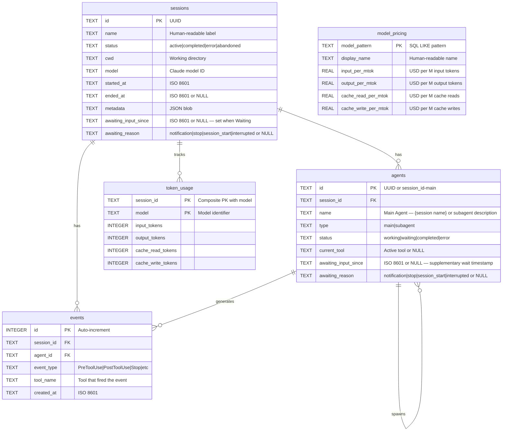

---

## プラグインマーケットプレイス (Plugin Marketplace)

CCAM は、1 つの共有ソースツリーから **14 のプラグイン** を提供します。Claude Code は `.claude-plugin/marketplace.json` を読み取ります。Codex は `.agents/plugins/marketplace.json` に加えて、各プラグインの `.codex-plugin/plugin.json` を読み取ります。バンドルには、**66 のプラグインスキル、18 の Claude サブエージェント、34 の Claude コマンド、3 つの CLI ヘルパー、3 つのフック構成、および 2 つの MCP 対応プラグイン** が含まれています。

```bash
# Claude Code
claude plugin marketplace add hoangsonww/Claude-Code-Agent-Monitor
claude plugin install ccam-platform@claude-code-agent-monitor-plugins

# Codex
codex plugin marketplace add hoangsonww/Claude-Code-Agent-Monitor
codex plugin add ccam-platform@claude-code-agent-monitor-plugins

# オープンエージェントスキル / skills.sh 互換の CLI
npx skills add hoangsonww/Claude-Code-Agent-Monitor --list

# 現在のプロジェクトに Claude Code と Codex の 1 つのスキルをインストール
npx skills add hoangsonww/Claude-Code-Agent-Monitor \
  --skill mcp-server \
  --agent claude-code \
  --agent codex \
  --yes

# プロジェクトスコープのスキルの確認、更新、および削除
npx skills list --json
npx skills update --project --yes
npx skills remove mcp-server --yes

# --global を追加してユーザースコープにインストールし、そのスコープを明示的に管理します
npx skills add hoangsonww/Claude-Code-Agent-Monitor \
  --skill mcp-server \
  --agent claude-code \
  --agent codex \
  --global \
  --yes
npx skills list --global --json
npx skills update --global --yes
npx skills remove --global mcp-server --yes
```

`skills` CLI は、66 のプラグインスキルとリポジトリメンテナンススキルを含む、**合計 77 のリポジトリスキル**を検出します。プロジェクトのインストールでは、`.agents/skills/` に加えてエージェント固有のリンクが使用されます。グローバルな Claude Code スキルはデフォルトで `~/.claude/skills/` になりますが、設定されている場合は `$CLAUDE_CONFIG_DIR/skills/` になります。グローバルな Codex スキルはデフォルトで `~/.codex/skills/` になりますが、設定されている場合は `$CODEX_HOME/skills/` になります。マルチエージェントのインストールは、共有ストアを介してファイルを重複排除し、それらの宛先をリンクする場合があります。すべてのプラグインスキルには、正規の `name`/`description` フロントマターと `agents/openai.yaml` メタデータが含まれています。インストールするために `vercel-labs/skills` へのアップストリームの PR は不要です。パブリックな GitHub リポジトリがソースであり、skills.sh の可視性はパブリケーションと実際のインストールテレメトリに従います。

新しいフォーカスパックは、既存の分析、生産性、品質、セッション、ワークフロー、設定、およびダッシュボードプラグインを補完します:

- `ccam-runner`: 監視された Claude Code/Codex の起動、フォローアップ、停止、再開、および実行履歴
- `ccam-integrations`: アラートルール、Webhook、プッシュ通知、および SSH リモートコレクション
- `ccam-platform`: Claude/Codex 設定エクスプローラー、プロバイダーを認識するインポート、バックアップの復元、フックのセットアップ、更新、および MCP 操作
- `ccam-reports`: ステークホルダー向けのエグゼクティブ、コスト、信頼性、およびワークフローレポート
以下のコマンドでディストリビューションメタデータを検証および再生成します:

```bash
npm run extensions:sync
npm run extensions:validate
```

完全なカタログ、インストールコマンド、skills.sh の動作、パブリック送信の境界、およびクリーンインストールチェックについては、[docs/PLUGINS.md](docs/PLUGINS.md) を参照してください。

---

## Statusline

Claude Code 用のスタンドアロン CLI ステータスラインユーティリティです。モデル名、ユーザー、作業ディレクトリ、git ブランチ、コンテキストウィンドウの使用状況バー、方向ごとのトークン数、セッションコストを、ANSI エスケープシーケンスで色分けして表示します。

```
nguyens6@host ~/agent-dashboard/client | Sonnet 4.6 | main | ████████░░ 79% | 3↑ 2↓ 156586c | $0.4231
```

| セグメント     | 色                | 例                                                        |
| ----------- | -------------------- | -------------------------------------------------------------- |
| モデル       | シアン (Cyan)                 | `Sonnet 4.6`                                                   |
| ユーザー        | 緑 (Green)                | `nguyens6`                                                     |
| CWD         | 黄 (Yellow)               | `~/agent-dashboard`                                            |
| Git ブランチ  | マゼンタ (Magenta)              | `main`                                                         |
| コンテキストバー | 緑 / 黄 / 赤 | `████████░░ 79%`                                               |
| トークン      | 緑 / シアン / ディム (Dim)   | `3↑ 2↓ 156586c` (緑 `↑` は入力、シアン `↓` は出力、ディム `c` はキャッシュ)    |
| コスト (USD)  | 緑 / 黄 / 赤 | `$0.4231` (セッション合計 — API およびサブスクリプションプランで表示)|

コストの色分けのしきい値: $5 未満は緑、$5–$20 は黄、$20 以上は赤。

インストール手順については [`statusline/README.md`](statusline/README.md) を参照してください。

<p align="center">
  <a href="images/statusline.png"></a>
</p>

---

## サーバーアーキテクチャ (Server Architecture)

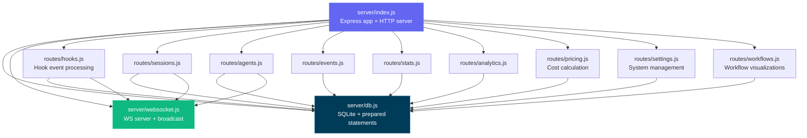

---

## クライアントルーティング (Client Routing)

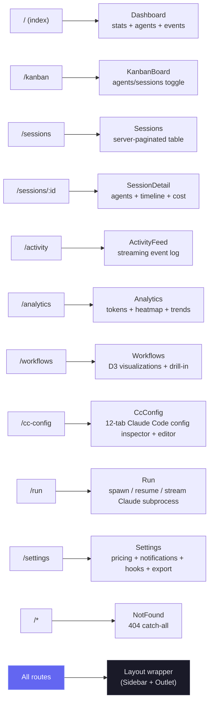

---

## フックハンドラーフロー (Hook Handler Flow)

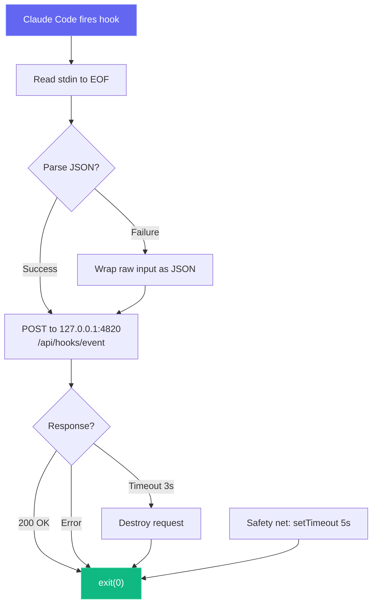

---

## デプロイメントモード (Deployment Modes)

開発モードと本番環境デプロイメントモードの両方を、異なるプロセスアーキテクチャでサポートしています:

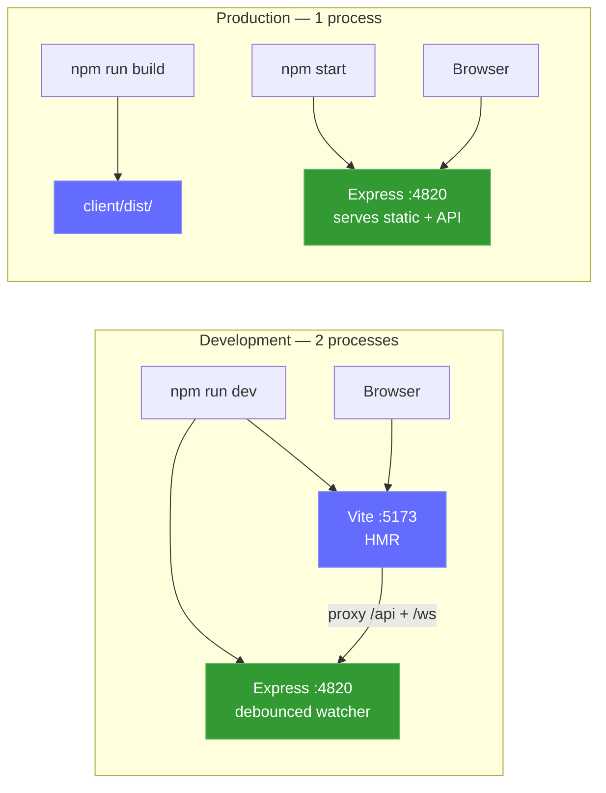

オプションのローカル MCP サイドカー (stdio, HTTP+SSE, および REPL トランスポートをサポート):

```mermaid
graph LR
    subgraph "MCP Transport Options"
        M_STDIO["MCP Server (stdio)<br/>npm run mcp:start"]
        M_HTTP["MCP Server (HTTP)<br/>npm run mcp:start:http<br/>:8819"]
        M_REPL["MCP Server (REPL)<br/>npm run mcp:start:repl"]
    end

    H["MCP Host"] -->|"stdin/stdout"| M_STDIO
    RC["Remote Client"] -->|"POST /mcp · GET /sse"| M_HTTP
    OP["Operator"] -->|"interactive CLI"| M_REPL

    M_STDIO --> D["Dashboard Server<br/>:4820"]
    M_HTTP --> D
    M_REPL --> D

    style M_STDIO fill:#0f766e,stroke:#14b8a6,color:#fff
    style M_HTTP fill:#0f766e,stroke:#14b8a6,color:#fff
    style M_REPL fill:#0f766e,stroke:#14b8a6,color:#fff
```

オプションの **デスクトップアプリ (macOS & Windows)** — Express サーバーをインプロセスでホストする単一の Electron プロセス (ターミナルも子プロセスも不要):

```mermaid
flowchart LR
    subgraph desktop["Desktop App (macOS & Windows) — 1 Electron process"]
        E_MAIN["Electron Main Process<br/>(Node 22 / Electron 35)"]
        E_HOST["server-host.ts<br/>require() server/index.js"]
        E_SRV["Embedded Express :4820<br/>API · SQLite · WebSocket"]
        E_WIN["BrowserWindow<br/>built React client"]
        E_TRAY["Menu-bar (tray) icon<br/>+ native app menu"]
        E_MAIN --> E_HOST
        E_HOST -->|"in-process require()"| E_SRV
        E_MAIN --> E_TRAY
        E_SRV -->|"http + ws on 127.0.0.1"| E_WIN
    end

    E_HOOKS["Claude Code hooks"] -->|"POST /api/hooks/event"| E_SRV

    style E_MAIN fill:#47848F,stroke:#2f5a62,color:#fff
    style E_SRV fill:#339933,stroke:#5cb85c,color:#fff
    style E_WIN fill:#61DAFB,stroke:#3aa9c9,color:#000
```

### クラウドデプロイメント (Cloud Deployment)

`deployments/` スタックは、EKS、GKE、AKS、OKE、および自己管理クラスターを含む、準拠する任意の Kubernetes サービスを対象としています。CCAM は SQLite を使用するため、サポートされているすべてのマニフェストは、Recreate ロールアウトにより**永続ボリュームごとに 1 つのアクティブなダッシュボードライター**を強制します。HPA、アクティブ-アクティブレプリカ、ブルーグリーン、およびカナリアデプロイメントは、SQLite が永続化バックエンドである間は意図的にサポートされません。

```mermaid
flowchart LR
  CI["CI: test · validate · scan · attest · sign"] --> HELM["Helm / Kustomize / Terraform"]
  HELM --> APP["CCAM dashboard<br/>exactly 1 replica"]
  APP --> PVC[("Retained ReadWriteOnce PVC")]
  EDGE["Ingress or Gateway API<br/>TLS + WebSocket"] --> APP
  PROM["Prometheus Operator"] -->|"Bearer /api/metrics"| APP
  MCP["Authenticated MCP sidecar"] --> APP
```

- **Helm:** スキーマによって強制された 1 つのライター、ダイジェストサポート、保持された PVC、Ingress または Gateway API、External-Secret 互換のトークンマウント、NetworkPolicy、オプションの MCP と ServiceMonitor。
- **Kustomize:** 制限付き PSS ベースに加えて、dev/staging/production オーバーレイ、オプションの MCP、監視、Gateway API、および CSI スナップショットコンポーネント。
- **Terraform:** 検証済みの Helm チャートを既存の Kubernetes クラスターにデプロイします。クラウドのネットワーキング、クラスター ID、CSI、TLS、およびシークレットの同期は、引き続きプロバイダーが所有します。
- **オペレーション:** SHA-256 を使用した一貫性のある SQLite オンラインバックアップ、ゼロスケールによる検証済みのリストア、バックアップ優先のデプロイ/ロールバック/ティアダウン、および認証されたヘルスチェック。
- **CI サプライチェーン:** アプリおよび MCP イメージはスキャンされ、SBOM および SLSA の来歴とともに amd64/arm64 向けに公開され、Cosign を使用してキーレス署名されます。

```bash
npm run deploy:validate
REGISTRY="ghcr.io/$(gh repo view --json owner -q .owner.login)"
IMAGE_TAG="$(git rev-parse --short HEAD)"

helm upgrade --install agent-monitor deployments/helm/agent-monitor \
  --namespace agent-monitor-production --create-namespace \
  --values deployments/helm/agent-monitor/values-production.yaml \
  --set image.registry= \
  --set image.repository=${REGISTRY}/claude-code-agent-monitor \
  --set image.tag=${IMAGE_TAG} \
  --atomic --wait --timeout 10m
```

> [!NOTE]
> 完全な本番環境のセットアップ、シークレット、Docker/Podman スタック、Gateway API、Terraform、バックアップ、リストア、およびロールバックについては、[DEPLOYMENT.md](DEPLOYMENT.md) および [deployments/README.md](deployments/README.md) に文書化されています。

---

## プロジェクト構造 (Project Structure)

```
agent-dashboard/
|-- CLAUDE.md                   # Claude Code プロジェクトのメモリと作業に関する合意
|-- AGENTS.md                   # Codex プロジェクトの指示
|-- package.json                # ルートスクリプト (ダッシュボード + MCP ヘルパー) + サーバーの依存関係
|-- .claude/
|   +-- rules/                  # パススコープの Claude ルール
|   +-- skills/                 # Claude の再利用可能なプロジェクトスキル
|   +-- agents/                 # Claude カスタムサブエージェント
|-- .claude-plugin/
|   +-- marketplace.json        # Claude Code マーケットプレイス マニフェスト (14 プラグイン)
|-- .agents/plugins/
|   +-- marketplace.json        # Codex マーケットプレイス マニフェスト (同じ 14 プラグイン)
|-- plugins/
|   |-- ccam-analytics/         # 分析: セッションレポート、コスト内訳、使用状況の傾向、生産性スコア
|   |   |-- .claude-plugin/plugin.json
|   |   |-- skills/ (4)         # session-report, cost-breakdown, usage-trends, productivity-score
|   |   |-- agents/             # analytics-advisor (Sonnet モデル)
|   |   |-- hooks/hooks.json    # Stop + SubagentStop イベントロギング
|   |   +-- bin/ccam-stats      # ターミナルダッシュボード CLI
|   |-- ccam-productivity/      # 生産性: スタンドアップ、レポート、スプリント、ワークフローオプティマイザー
|   |-- ccam-devtools/          # DevTools: デバッグ、診断、エクスポート、ヘルスチェック
|   |   +-- bin/                # ccam-doctor + ccam-export CLI
|   |-- ccam-insights/          # インサイト: パターン、異常、最適化、比較
|   |-- ccam-cost-guard/        # コストガードレール: 予算、支出予測、コストアラート、モデルの節約
|   |-- ccam-sessions/          # セッションフォレンジック: 検索、タイムライン、トランスクリプトの再生、cwd ロールアップ、クリーンアップ
|   |-- ccam-workflows/         # ワークフローオーケストレーション: DAG マップ、委任監査、同時実行、フリートの実行
|   |-- ccam-quality/           # 信頼性 & SLO: エラースキャン、API エラーレポート、フック障害の監査、SLO チェック
|   |-- ccam-config/            # 設定 & メモリのガバナンス: 設定監査、メモリレビュー、スキル/MCP/フックのインベントリ
|   +-- ccam-dashboard/         # ダッシュボードコネクター: ステータス、クイックスタッツ、MCP 統合
|       +-- .mcp.json           # MCP サーバー設定
|-- server/
|   |-- index.js                 # Express アプリ、HTTP サーバー、静的ファイル提供
|   |-- db.js                    # SQLite スキーマ、マイグレーション、プリペアドステートメント
|   |-- websocket.js             # ハートビート付きの WebSocket サーバー
|   +-- routes/
|       |-- hooks.js             # フックイベント処理 (トランザクション)
|       |-- sessions.js          # セッション CRUD
|       |-- agents.js            # エージェント CRUD
|       |-- events.js            # イベントリスティング
|       |-- stats.js             # 集計統計
|       |-- analytics.js         # トークン、ツール、およびトレンド分析
|       |-- workflows.js         # ワークフローの集計データとセッションごとのドリルイン
|       |-- pricing.js           # モデルの価格設定 CRUD とコスト計算
|       +-- settings.js          # システム情報、データ管理、エクスポート、クリーンアップ
|   +-- lib/
|       +-- transcript-cache.js  # V8 の最大文字列長 (~512 MiB) を超えるファイルでも Node をアボートさせることなくパースするための、チャンク同期バイトストリームリーダー (4 MiB チャンク、行ごとの UTF-8 デコード) を備えた JSONL トランスクリプトキャッシュ。トークン、コンパクション、API エラー、ターンの期間、思考ブロック、および使用量の追加情報 (service_tier, speed, inference_geo) を抽出します
|   +-- compat-sqlite.js         # node:sqlite 互換性ラッパー (better-sqlite3 のフォールバック)
|-- client/
|   |-- package.json             # クライアントの依存関係
|   |-- index.html               # HTML エントリーポイント
|   |-- vite.config.ts           # Vite + プロキシ設定
|   |-- tailwind.config.js       # カスタムダークテーマ
|   |-- tsconfig.json            # Strict TypeScript
|   +-- src/
|       |-- main.tsx             # React エントリー
|       |-- App.tsx              # ルーター + WebSocket プロバイダー
|       |-- index.css            # Tailwind + カスタムユーティリティ
|       |-- lib/
|       |   |-- types.ts         # 共有 TypeScript インターフェース
|       |   |-- api.ts           # 型付きの fetch クライアント
|       |   |-- format.ts        # 日付/時刻のフォーマットユーティリティ
|       |   +-- eventBus.ts      # WebSocket 配信用の Pub/sub
|       |-- hooks/
|       |   |-- useWebSocket.ts      # 自動再接続 WebSocket フック
|       |   +-- useNotifications.ts  # WebSocket イベントからのブラウザ通知トリガー
|       |-- components/
|       |   |-- Layout.tsx       # サイドバーとアウトレットを含むシェル
|       |   |-- Sidebar.tsx      # ナビゲーション + 接続インジケーター
|       |   |-- AgentCard.tsx    # ステータス付きのエージェント情報カード
|       |   |-- StatCard.tsx     # メトリクスカード
|       |   |-- StatusBadge.tsx  # 色分けされたステータスピル
|       |   |-- EmptyState.tsx   # 空のリストのプレースホルダー
|       |   +-- workflows/       # D3.js ワークフロー可視化コンポーネント
|       |       |-- OrchestrationDAG.tsx            # エージェント生成パターンの水平 DAG
|       |       |-- ToolExecutionFlow.tsx           # ツール間遷移の d3-sankey ダイアグラム
|       |       |-- AgentCollaborationNetwork.tsx   # 力学モデルによるエージェントパイプライングラフ
|       |       |-- SubagentEffectiveness.tsx       # SVG サクセスリング付きのスコアカードグリッド
|       |       |-- WorkflowPatterns.tsx            # 自動検出されたオーケストレーションシーケンス
|       |       |-- ModelDelegationFlow.tsx         # エージェント階層を通じたモデルのルーティング
|       |       |-- ErrorPropagationMap.tsx         # 階層の深さによるエラークラスタリング
|       |       |-- ConcurrencyTimeline.tsx         # スイムレーンによる並列エージェント実行
|       |       |-- SessionComplexityScatter.tsx    # D3 バブルチャート (期間 vs エージェント数 vs トークン数)
|       |       |-- CompactionImpact.tsx            # トークン圧縮イベントとリカバリ
|       |       |-- WorkflowStats.tsx               # ワークフローの集計統計
|       |       +-- SessionDrillIn.tsx              # セッションごとのエージェントツリー、ツールタイムライン、イベント
|       +-- pages/
|           |-- Dashboard.tsx      # 概要ページ
|           |-- KanbanBoard.tsx    # エージェント/セッションのトグル、ステータスカラム
|           |-- Sessions.tsx       # サーバー側でページネーションされたセッションテーブル
|           |-- SessionDetail.tsx  # 単一セッションのディープダイブ
|           |-- ActivityFeed.tsx   # リアルタイムのイベントストリーム
|           |-- Analytics.tsx      # トークン使用量、ヒートマップ、トレンド
|           |-- Workflows.tsx      # D3.js ワークフローの可視化とセッションのドリルイン
|           |-- Settings.tsx       # モデル価格、通知、フック、エクスポート、クリーンアップ
|           +-- NotFound.tsx       # 404 キャッチオールページ
|-- scripts/
|   |-- hook-handler.js          # 軽量な stdin-to-HTTP フォワーダー
|   |-- install-hooks.js         # ~/.claude/settings.json を自動設定
|   |-- import-history.js        # ~/.claude/ からセッションをインポート。高度な JSONL 抽出（API エラー、ターン期間、エントリポイント、パーミッションモード、思考ブロック、使用量の追加情報、ツールエラー、サブエージェントの JSONL ファイル）を伴う。再インポートは完全にインクリメンタル：イベントタイプごとの高水準点（セッションごとの `MAX(created_at) GROUP BY event_type`）が事前に計算され、`ts > cutoff[type]` を満たす JSONL エントリのみが挿入されます。これにより、トランスクリプトが複数日にまたがって増大する長期実行セッションでも、再実行のたびに Stop / PostToolUse / TurnDuration / ToolError イベントを引き続き受信します。また、JSONL が保存された値を過ぎて進行した場合は `sessions.ended_at` をロールフォワードし、実行ごとにメッセージ数のメタデータを更新します
|   +-- seed.js                  # サンプルデータジェネレーター
|-- mcp/
|   |-- package.json             # MCP パッケージスクリプト + 依存関係
|   |-- README.md                # MCP のセットアップ、ホスト設定、ツールカタログ、安全モデル
|   |-- src/
|   |   |-- index.ts             # MCP ランタイムエントリポイント (トランスポートルーター)
|   |   |-- server.ts            # MCP サーバーアセンブリ
|   |   |-- clients/             # リトライ/バックオフ付きダッシュボード API クライアント
|   |   |-- config/              # 環境/CLI 設定のパース
|   |   |-- core/                # ロガー、ツールレジストリ、結果ヘルパー
|   |   |-- policy/              # ミューテーション/破壊的ガード
|   |   |-- tools/               # 103 個のツールを登録する 16 個のドメインモジュール
|   |   |-- transports/          # HTTP+SSE サーバー、REPL、ツールコレクター
|   |   |-- ui/                  # ANSI バナー、カラー、フォーマッター、テーブル
|   |   +-- types/               # 共有 MCP 型定義
|   +-- build/                   # ビルドされた MCP ランタイム出力
|-- desktop/
|   |-- package.json             # Electron + electron-builder の依存関係とスクリプト
|   |-- electron-builder.yml     # DMG パッケージング設定。署名/公証のフック
|   |-- tsconfig.json            # Strict TypeScript (src/ -> out/)
|   |-- README.md                # デスクトップアプリアーキテクチャのリファレンス (コントリビューター向けドキュメント)
|   |-- assets/                  # icon.svg + 生成された icon.icns + トレイ用 PNG
|   |-- src/
|   |   |-- main.ts              # Electron メインプロセスのエントリ — ライフサイクル、配線
|   |   |-- server-host.ts       # インプロセスでの Express ブート、ポート検出、採用、DB クローズ
|   |   |-- window.ts            # BrowserWindow + 永続化されたウィンドウのジオメトリ
|   |   |-- tray.ts              # メニューバー (トレイ) アイコン + コンテキストメニュー
|   |   |-- menu.ts              # ネイティブアプリケーションメニュー (File ▸ Open Dashboard は macOS のみ)
|   |   |-- login-item.ts        # macOS のログイン項目 (Login Items) 自動起動トグル (SMAppService)
|   |   |-- logger.ts            # ファイルロガー -> ~/Library/Logs/Claude Code Monitor/desktop.log
|   |   |-- constants.ts         # アプリ名、ポート、タイムアウト、ウィンドウサイズ
|   |   +-- preload.ts           # 意図的に空 (レンダラー特権をゼロにするため)
|   |-- scripts/
|   |   |-- install.js           # desktop:install 用のネイティブ依存関係の事前確認。失敗時にはセットアップのヘルプを表示し、非ゼロで終了
|   |   |-- preflight.js         # 共有の better-sqlite3 バイナリチェック + 実行可能な OS ごとのセットアップヘルプ (ツールチェーンなしの代替案を含む)
|   |   |-- prebuild.js          # tsc の前にルート + クライアントがビルドされていることを確認。ネイティブバイナリがない場合はセットアップヘルプを表示して即座に失敗
|   |   |-- build-icons.sh       # qlmanage/sips/iconutil による SVG -> PNG/ICNS 変換
|   |   +-- notarize.js          # electron-builder の afterSign フック (オプトインの公証)
|   +-- tests/
|       +-- smoke.test.mjs       # Electron のスポーン + /api/health のプローブ
|-- deployments/
|   |-- README.md                # 本番デプロイメントリファレンス
|   |-- nginx/                   # ルートレスの Nginx エッジおよびオプトインのフック/MCP ポリシー
|   |-- secrets/                 # 無視される Compose トークン/パスワードファイル
|   |-- terraform/               # 既存の Kubernetes クラスターへの Helm デプロイメント
|   |-- kubernetes/              # 1 つのライターを持つ Kustomize ベース + 環境のオーバーレイ
|   |   |-- base/                # 制限付き PSS、Recreate デプロイメント、PVC、Service、Ingress
|   |   |-- overlays/            # Dev、staging、production ネームスペースとリソース
|   |   +-- components/          # MCP、ServiceMonitor、Gateway API、VolumeSnapshot
|   |-- helm/agent-monitor/      # スキーマによって強制された Helm チャートと環境変数値
|   +-- scripts/                 # 検証、デプロイ、バックアップ、リストア、ロールバック、ヘルス、ティアダウン
|-- .codex/
|   |-- config.toml              # Codex ランタイム設定
|   |-- README.md                # エージェントとスキル向けの Codex セットアップガイド
|   |-- rules/                   # Codex 実行ポリシーのルール
|   |-- agents/                  # Codex カスタムエージェントテンプレート
|   +-- skills/                  # Codex プロジェクトスキル
|-- statusline/
|   |-- README.md                # Statusline インストールおよび使用ガイド
|   |-- statusline.py            # ステータスラインを描画する Python スクリプト
|   +-- statusline-command.sh    # Claude Code の statusLine 設定用のシェルラッパー
+-- data/
    +-- dashboard.db             # SQLite データベース (gitignored)
```

---

## トラブルシューティング (Troubleshooting)

| 問題                           | 解決策                                                                                                                                                         |
| --------------------------------- | ---------------------------------------------------------------------------------------------------------------------------------------------------------------- |
| `better-sqlite3` のインストールに失敗する | これは致命的ではありません — サーバーは自動的に Node.js 組み込みの `node:sqlite` にフォールバックします (Node 22+)。古い Node バージョンの場合は、Python 3 と C++ ビルドツールをインストールしてから、`npm rebuild better-sqlite3` を実行してください |
| フックが発火しない                  | `npm run install-hooks` を実行し、Claude Code を再起動します。フックが `~/.claude/settings.json` に存在することを確認してください                                                             |
| ダッシュボードにデータが表示されない           | Claude Code セッションを開始する前に、サーバーが実行中である (`npm run dev`) ことを確認してください。`http://localhost:4820/api/health` をチェックしてください                                     |
| WebSocket が切断される            | クライアントは 2 秒ごとに自動再接続します。ポート 4820 がファイアウォールによってブロックされていないことを確認してください                                                                    |
| 再起動後にデータが古いままになる          | データベースは再起動を超えて永続化されます。新しいデモデータを作成するには `npm run seed` を実行するか、データをリセットするには `data/dashboard.db` を削除してください                                            |
| MCP ツールが接続に失敗する         | ダッシュボード API が `MCP_DASHBOARD_BASE_URL` 上で起動していることを確認し、MCP を再ビルド/起動してください (`npm run mcp:build`、`npm run mcp:start`)                                         |

---

## 貢献 (Contributing)

コントリビューションを歓迎します。完全なガイドについては [`.github/CONTRIBUTING.md`](.github/CONTRIBUTING.md) を参照してください。

すべてのコントリビューターは、[Contributor License Agreement](https://github.com/hoangsonww/Claude-Code-Agent-Monitor/blob/master/CLA.md) (CLA) に署名する必要があります。これは、プルリクエストごとに `🖋️ CLA Assistant` GitHub Action によって自動的に強制されます。最初に PR を開いたときに、ボットが `I have read the CLA Document and I hereby sign the CLA` とコメントして署名するように求めてきます。あなたが署名するまで、PR の **CLA Assistant** ステータスチェックは赤のままになり、一度署名すれば、今後のすべてのコントリビューションに適用されます。

---

## ライセンス (License)

MIT. 詳細については [LICENSE](LICENSE) を参照してください。

